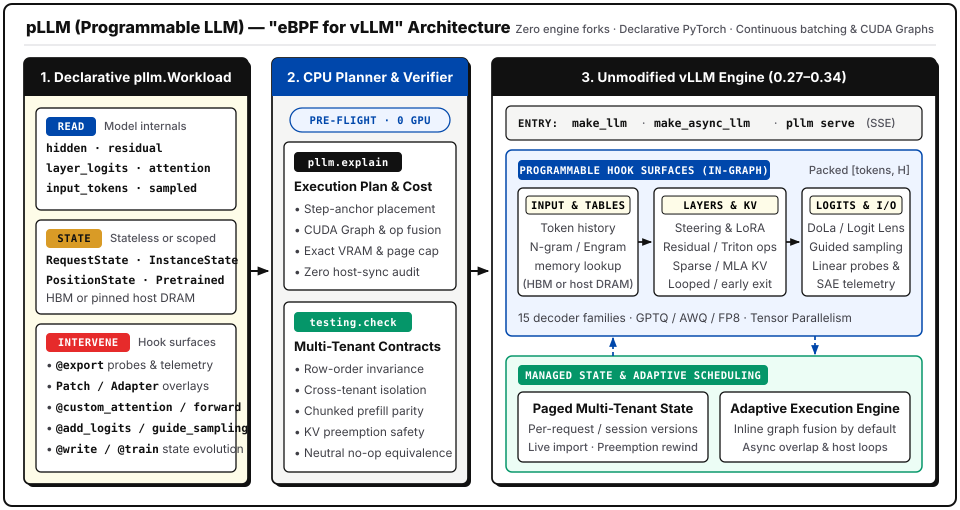

# pLLM: Programmable LLM

[](https://github.com/LinesHogan/pLLM/releases/tag/v0.5.1)
[](LICENSE)
[](pyproject.toml)
[](doc/reference/support-matrix.md)

> **[Project & Documentation Site](https://lineshogan.github.io/pllm/)** · **[Documentation (EN)](doc_en/README.md)** · **[Engineering Blog (EN/ZH)](blog/README.md)** · **[Agent Skill](doc/agent/SKILL.md)** · **[Migration Guide](doc/agent/migration.md)** · **[中文文档](README.zh.md)**

**pLLM** (**Programmable LLM**) is a declarative programmability layer for running stateful and adaptive inference-time algorithms inside unmodified [vLLM](https://github.com/vllm-project/vllm) with continuous batching and CUDA graphs.

Prototyping an inference-time algorithm—activation steering, linear probes, per-request dynamic LoRA, or decode-time online training—takes a few dozen lines of PyTorch on a single sequence (`batch_size = 1`). Moving that same logic into production vLLM collides with packed continuous batching, frozen CUDA graphs (where Python hooks do not execute during replay), per-request paged state management, KV preemption rollback, and multi-stream memory hazards.

pLLM acts like an eBPF layer for vLLM: instead of maintaining a private fork of `GPUModelRunner` or the scheduler, you subclass `pllm.Workload` to declare **which internal representations to read, what per-request or engine-wide state to own, and where outputs or parameter updates take effect**, writing standard PyTorch tensor math. Before initializing CUDA or loading weights, pLLM statically verifies multi-tenant isolation and scheduling contracts on CPU, then compiles your forward interventions, custom KV/layer schedules, paged state transitions, and optional online training steps directly into vLLM's execution pipeline.



---

## Core Capabilities

| Inference-Time Capability | Why Raw PyTorch Hooks or vLLM Forks Break | Declarative Primitive in pLLM |
| --- | --- | --- |
| **Inspect hidden states & per-layer logits** (probes, SAEs, Logit Lens, DoLa) | Concurrent requests interleave across dynamic token rows; Python hooks never fire during CUDA graph replay | `pllm.hidden(layer)`, `pllm.residual(layer)`, `pllm.layer_logits(...)`, `@pllm.export`, `@pllm.add_logits` |
| **Apply per-request or session overlays & dynamic layer routing** (CAA, ReFT, hypernetwork LoRA, live layer switching) | Manual slot allocation, eviction, quantized overlays, and runtime layer changes leak VRAM or force CUDA graph recapture | `pllm.RequestState` + `pllm.model.ActivationPatch` / `pllm.model.Adapter` / `pllm.model.LayerRoute` |
| **Train fast weights online during decode** (ESamp, In-Place TTT, TLM, TTRL) | Synchronous autograd stalls decoding; uncoordinated streams tear in-place parameters and break KV preemption | `@pllm.train` / `@pllm.train_in_forward` (CUDA-graph captured; fused inline or overlapped when independent) |
| **Customize forward schedules, attention & KV layouts** (early exit, looped depth, sliding/sink KV, lookup tables) | Ad-hoc layer loops and KV reads violate append-only block-table invariants | `@pllm.custom_forward`, `@pllm.custom_attention`, `@pllm.custom_residual`, `pllm.input_tokens` |

---

## Installation & Compatibility

pLLM requires **Python 3.11+**, a Rust toolchain when building from source, and **vLLM 0.27 through 0.34** (`torch>=2.13,<2.16`, `triton>=3.7,<4`). pLLM registers no global vLLM plugins and leaves upstream vLLM untouched.

- **Create a fresh virtual environment with [`uv`](https://docs.astral.sh/uv/) (recommended):**
  ```bash
  uv venv --python 3.12 .venv && source .venv/bin/activate
  uv pip install -e ".[vllm032,test]"   # alternatives: ".[vllm034,test]", ".[vllm027,test]", ".[vllm,test]"
  ```
- **Install into an existing vLLM 0.27–0.34 environment:**
  ```bash
  uv pip install -e . --no-deps   # or `uv pip install -e .` (also works with `python -m pip install -e .`)
  ```
- **CPU-only workload authoring & contract verification (`pllm.explain`, `pllm.testing.check`):**
  ```bash
  uv pip install -e ".[test]"
  ```

**Model & Hardware Matrix:** Supports 15 decoder families—`Qwen2 / Qwen2.5`, `Llama`, `Mistral`, `Phi-3`, `GLM-4`, `Gemma 2 / 3`, `Mixtral`, `Qwen2-MoE`, `Qwen3 / Qwen3-MoE`, `Qwen3.5` (including MoE), `DeepSeek V2 / V3` (including compressed latent MLA `@pllm.custom_attention` and sublayer residuals), and `gpt-oss`—alongside GPTQ / AWQ / FP8 quantized checkpoints and single-node tensor parallelism (`tensor_parallel_size > 1` requires `vllm >= 0.32.0`). `vLLM 0.27.1` and `0.32.0` serve as full GPU regression baselines (`0.33`–`0.34` pull PyTorch `2.14+cu130` and require a CUDA 13 driver). See the [Support Matrix](doc/reference/support-matrix.md) for exact per-feature coverage.

---

## Quickstart

### 1. Stateless Layer Contrast & CPU Pre-Flight Verification

Every `pllm.Workload` can be planned and contract-checked on CPU—verifying row permutation invariance, multi-tenant isolation, chunked prefill equivalence, and preemption rollback—without loading model weights or touching a GPU:

```python
import torch

import pllm
from pllm import testing


class LayerContrast(pllm.Workload):
    @pllm.add_logits
    def contrast(self, logits: torch.Tensor = pllm.layer_logits((12, -1))) -> torch.Tensor:
        return 0.5 * (logits[:, 1] - logits[:, 0])


config = pllm.ModelConfig("Qwen/Qwen2.5-0.5B-Instruct", max_num_seqs=16)
print(testing.check(LayerContrast(), config))
```

### 2. Decode-Time Per-Request Online Training (ESamp)

In Exploratory Sampling (ESamp), each concurrent request owns an independent rank-4 MLP trained online via `AdamW` at every decode step to predict final-layer hidden representations from shallow layer-0 representations, while sampling suppresses tokens already predictable from shallow features:

```python
from dataclasses import dataclass
from torch import nn


@dataclass(frozen=True)
class ESampLite(pllm.Workload):
    beta: float = 0.5
    distiller = pllm.RequestState(
        init=pllm.FromModule(
            lambda m: nn.Sequential(nn.Linear(m.hidden_size, 4), nn.Linear(4, m.hidden_size))
        ),
        optimizer=pllm.AdamW(1e-3),
    )

    @pllm.train(state="distiller")
    def loss(
        self,
        shallow: torch.Tensor = pllm.hidden(0),
        deep: torch.Tensor = pllm.hidden(-1),
        f: nn.Module = pllm.module("distiller"),
    ) -> torch.Tensor:
        return (f(shallow) - deep).square().mean(-1)

    @pllm.guide_sampling(beta=pllm.cfg("beta"))
    def predict(
        self,
        shallow: torch.Tensor = pllm.hidden(0),
        f: nn.Module = pllm.module("distiller"),
    ) -> torch.Tensor:
        return f(shallow)


esamp_cfg = pllm.ModelConfig("Qwen/Qwen2.5-0.5B-Instruct", max_num_seqs=128)
print(pllm.explain(ESampLite(), esamp_cfg))
print(testing.check(ESampLite(), esamp_cfg))
```

Once CPU contract verification passes, run the workload directly on the GPU engine:

```python
# check-docs: skip: requires GPU engine
from vllm import SamplingParams

with pllm.make_llm(esamp_cfg, workload=ESampLite()) as llm:
    outputs = llm.generate(["Explain gradient descent:"] * 8, SamplingParams(n=16, max_tokens=256))
```

**Measured Throughput Overhead:**
- **ESamp on Qwen2.5-7B-Instruct** (single RTX 4090, 8 prompts × 16 samples, 256 tokens each): reaches **97.4%** of native vLLM throughput when training per-request distillers online without guidance, and **96.3%** with both online training and survivor-filtered sampling guidance enabled ([measurements.toml](doc/reference/measurements.toml), reproducible in [Tutorial 03](doc/tutorials/03_decode_training.ipynb)).
- **Activation Steering & Async CPU Hidden Capture on Qwen2.5-7B-Instruct** (RTX 4090, layer-14 `ActivationPatch` steering + `@pllm.export` streaming every decode token asynchronously to CPU `torch.Tensor` with 0 dropped rows): for single-request streaming, running steering and full **3584-dim** residual export together achieves a pure decode **TPOT of 16.48 ms** vs. **16.50 ms** on native vLLM (**60.6 token/s**, **100%**); across **128 concurrent sequences** (8 × 16, transferring 896 KiB/step for full residuals), async export alone (64-dim SAE / full 3584-dim residual) retains **100% / 99.5%** of native throughput (TPOT **21.90 / 22.06 ms** vs. native **21.97 ms**), and combining steering with full-residual CPU export retains **98.0%** (**5,604** vs. **5,719 token/s**, TPOT **22.17 ms**, adding just **0.20 ms**).
- **4B In-Place TTT** ([Example 08](doc_en/examples/08_inplace_ttt.ipynb), vLLM 0.32.0, CUDA graphs enabled, 256 greedy tokens at 4096 / 16384 prompt tokens): ~25 lines of tensor math automatically compile into per-request paged fast weights, FP32 delta retention, chunked-prefill tail buffering, CUDA-graph conditional chunk updates, and zero-copy paged streaming reads—running at **73.02 / 47.97 token/s** for a single request vs. **54.79 / 34.89 token/s** for the official `bs=1`-only Hugging Face implementation, and scaling to **171.56 token/s** across 4 concurrent requests (3.13× official single-request throughput).

---

## Online Serving & Runtime Entry Points

A single `pllm.Workload` runs unchanged across batch processing, embedded async Python services, and OpenAI-compatible HTTP endpoints (see the [Online Serving Guide](doc/howto/online-serving.md)):

- **OpenAI-Compatible HTTP Server (`pllm serve`):** supports continuous request admission, SSE token streaming, client-disconnect cancellation, and lock-free paged state reclamation:
  ```bash
  pllm serve \
    --model Qwen/Qwen2.5-0.5B-Instruct \
    --workload pllm.workloads:DoLaWorkload \
    --port 8000 \
    --gpu-memory-utilization 0.85
  ```
  When a workload declares `pllm.RequestState(..., key_fields=("route",))`, clients persist and isolate state across multi-turn conversations via `vllm_xargs`:
  ```python
  # check-docs: skip: connects to a running pllm serve endpoint
  from openai import OpenAI

  client = OpenAI(base_url="http://127.0.0.1:8000/v1", api_key="unused")
  stream = client.chat.completions.create(
      model="Qwen/Qwen2.5-0.5B-Instruct",
      messages=[{"role": "user", "content": "Explain KV caching in two sentences."}],
      stream=True,
      extra_body={"vllm_xargs": {"pllm_route": "session-42"}},
  )
  ```
- **Embedded Async & Synchronous Python Handles (`pllm.make_async_llm`, `pllm.make_llm`):** share a unified runtime control plane. `ModelConfig(..., multiprocessing="auto")` isolates `EngineCore` in a dedicated worker subprocess for async/HTTP serving while running in-process for batch scripts, supporting `stream()`, `generate()`, `abort()`, `diagnostics()`, live `import_state()`, `train_batch()` (`CausalTrainBatch`, `WeightedRowBatch`), cross-process `feed()`, and `generate_feedback()`.

---

## Supported Algorithm Families & Built-in Workloads

| Algorithm Pattern | Representative Methods | Tutorials & Examples |
| --- | --- | --- |
| **Inspect or intervene at forward sites** | Activation steering (CAA / ActAdd), linear probes & SAEs, ReFT / LoReFT, Logit Lens & DoLa, residual rewrites (LAuReL, hyper-connections, value residual) | [00](doc/tutorials/00_quickstart.ipynb), [01](doc/tutorials/01_observe_probe.ipynb), [06](doc/examples/06_reading_inside.ipynb), [07](doc/examples/07_custom_residual.ipynb) |
| **Replace attention reads or static KV layouts** | Attention monitoring, Quest top-K sparse reads, sliding window, local/global alternation, prompt-sink + window, cross-layer KV sharing | [10](doc/examples/10_custom_attention.ipynb) |
| **Query large external lookup tables** | N-gram priors, Engram-style hashed memory in GPU HBM or pinned host DRAM over PCIe | [11](doc/examples/11_lookup_memory.ipynb) |
| **Evolve per-request or instance state across tokens** | Hypernetwork Text-to-LoRA, decode-time distillation (ESamp), Test-Time Learning (TLM), chunked fast-weight memory (TTT / Titans / In-Place TTT) | [02](doc/tutorials/02_request_adapters.ipynb), [03](doc/tutorials/03_decode_training.ipynb), [07](doc/examples/07_custom_residual.ipynb), [08](doc/examples/08_inplace_ttt.ipynb) |
| **Control layer loops & adaptive token depth** | Looped latent reasoning (Ouro / Huginn), continuous thought (Coconut), token-wise early exit | [04](doc/tutorials/04_custom_forward.ipynb), [12](doc/examples/12_adaptive_depth.ipynb) |
| **Integrate custom GPU kernels** | Custom Triton / CUDA ops registered via `torch.library.custom_op` | [09](doc/examples/09_custom_kernels.ipynb) |
| **Closed-loop rollouts, scoring & updates** | Test-Time Reinforcement Learning (TTRL), GRPO / majority-vote host feedback loops | [05](doc/tutorials/05_host_feedback.ipynb) |

**Built-in Reference Workloads (`pllm.workloads`):** `ESampWorkload`, `DoLaWorkload`, `ReFTWorkload`, `OverRIDEWorkload`, `OutputLoRAWorkload`, `InPlaceTTTWorkload`, `PrefillAdaptersWorkload`, `RecirculationWorkload`, `StepLoopWorkload`, `RewardHeadWorkload`, `TLMWorkload`, `FTTTWorkload`, and `DummyWorkload`—all compiled through the exact same public API as user-authored workloads.

**Explicit Scope Boundaries:** Pretraining new architectures from scratch and attention-score-driven mid-sequence physical KV block eviction (e.g., H2O, SnapKV) conflict with vLLM's append-only block tables and are outside pLLM's scope; see [rules.md](doc/agent/rules.md) and [design-tradeoffs.md](doc/explain/design-tradeoffs.md).

---

## Coding Agent Integration (`pllm skill`)

`pllm` packages complete authoring rules, generated API signatures, an error-resolution catalog, and a Hugging Face / PEFT migration checklist for coding agents (Claude Code, Codex, Cursor). Inside your project repository:

```bash
pllm skill --install claude   # installs .claude/skills/pllm/*.md
pllm skill --install codex    # installs .agents/skills/pllm/*.md
pllm skill --install cursor   # installs .cursor/rules/pllm/*.md
# Or stream directly to stdout: pllm skill --print && pllm skill --print migration
```

Recommended prompt for porting existing research code or authoring new workloads:

> Read the installed `pllm` skill (`SKILL.md` and `migration.md`, consulting `reference.md` and `pitfalls.md` as needed). Audit any Hugging Face hooks, `LogitsProcessor`, PEFT adapters, or custom PyTorch inference loops in this repository against `migration.md`, flag anything outside pLLM's supported scope, implement an importable `pllm.Workload`, verify `pllm.explain(...)` and `pllm.testing.check(...)` on CPU first, and wire it into `pllm.make_llm`, `pllm.make_async_llm`, or `pllm serve`.

---

## Documentation & Engineering Blog

- **Project & Documentation Portal:** [lineshogan.github.io/pllm](https://lineshogan.github.io/pllm/)
- **English Agent & API Reference:** [SKILL.md](doc/agent/SKILL.md) · [migration.md](doc/agent/migration.md) · [reference.md](doc/agent/reference.md) · [examples.md](doc/agent/examples.md) · [rules.md](doc/agent/rules.md) · [pitfalls.md](doc/agent/pitfalls.md) · [llms.txt](llms.txt)
- **Guides, How-Tos & Reference Manuals (EN & 中文):** [English Docs Index](doc_en/README.md) · [Chinese Docs Index](doc/README.md) · [Capability Map](doc_en/guides/capability-map.md) · [Online Serving](doc_en/howto/online-serving.md) · [Production Deployment](doc_en/howto/production.md) · [API Reference](doc_en/reference/api.md)
- **Engineering Essays & Systems Deep Dives (EN & ZH):** [blog/README.md](blog/README.md) & [LayerRoute Debugging Postmortems](blog/personal/README.md) (also published on [LinesHogan's Blog](https://lineshogan.github.io/blog/)) — fifteen bilingual articles organized into architecture & postmortems, engine-internals deep dives, and compiler / Triton / IEEE 754 / multi-version state debugging notes.

---

## Citation

If you find pLLM useful in your research or systems work, please cite our ICML 2026 paper on Exploratory Sampling (ESamp):

```bibtex
@InProceedings{pmlr-v306-zeng26m,
  title = 	 {Large Language Models Explore by Latent Distilling},
  author =       {Zeng, Yuanhao and Lu, Ao and Li, Lufei and Zhang, Zheng and Li, Yexin and Ren, Kan},
  booktitle = 	 {Proceedings of the 43rd International Conference on Machine Learning},
  pages = 	 {153483--153507},
  year = 	 {2026},
  editor = 	 {Zhang, Tong and Dudik, Miroslav and Jaggi, Martin and Agarwal, Alekh and Li, Sharon and Schuurmans, Dale and Zhu, Jerry and Berkenkamp, Felix and Dong, Hanze and Bietti, Alberto},
  volume = 	 {306},
  series = 	 {Proceedings of Machine Learning Research},
  month = 	 {06--11 Jul},
  publisher =    {PMLR},
  pdf = 	 {https://raw.githubusercontent.com/mlresearch/v306/main/assets/zeng26m/zeng26m.pdf},
  url = 	 {https://proceedings.mlr.press/v306/zeng26m.html}
}
```

## License

pLLM is released under the [Apache License 2.0](LICENSE).
