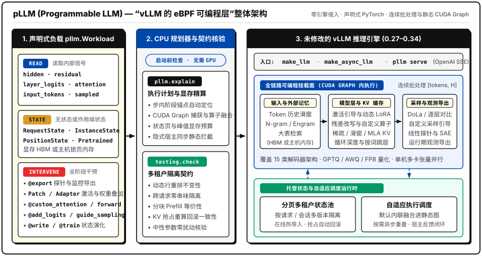

# pLLM: Programmable LLM（可编程大语言模型推理层）

[](https://github.com/LinesHogan/pLLM/releases/tag/v0.5.0)
[](LICENSE)
[](pyproject.toml)
[](doc/reference/support-matrix.md)

> **[English README](README.md)** · **[项目主页与文档站](https://lineshogan.github.io/pllm/)** · **[文档首页](doc/README.md)** · **[技术随笔与机制拆解 (中/英)](blog/README.md)** · **[在线服务指南](doc/howto/online-serving.md)** · **[Agent 迁移指南](doc/agent/migration.md)**

**pLLM**（**Programmable LLM**，可编程大语言模型推理层）是一个直接运行在未修改的 [vLLM](https://github.com/vllm-project/vllm) 之上的声明式可编程层，用于在连续批处理与静态 CUDA graph 下高效执行有状态、自适应的推理期算法。

在单序列 PyTorch 脚本里验证一个推理期算法（激活引导、探针监控、每请求动态 LoRA、decode 期在线训练），通常只需几十行代码；但一旦进入生产级 vLLM，连续批处理会把并发请求拼进同一张动态重排的二维张量，CUDA graph 重放会绕开运行期 Python hook，每请求分页状态的分配、抢占回滚与多流同步也都必须重新处理。

pLLM 与 vLLM 的关系类似 eBPF 之于 Linux 内核：无需 fork 或改动 vLLM 源码，只需继承 `pllm.Workload` 声明**读取模型的哪个内部表示、持有何种请求级或实例级状态、计算与参数更新作用于何处**，并编写标准 PyTorch 张量数学。pLLM 在接触 GPU 前先于 CPU 上完成形状追踪与多租户隔离契约检查，再将前向干预、自定义层/KV 调度、分页多版本状态与按需的在线训练直接编译进连续批处理与静态 CUDA graph。



---

## 核心能力一览

| 推理期需求 | 直接改 PyTorch hook 或维护 vLLM 分支的阻碍 | 在 pLLM 中的声明式原语 |
| --- | --- | --- |
| **读取隐藏状态或逐层 logits**（探针、SAE、Logit Lens、DoLa） | 多请求交错排布，CUDA graph 重放时不触发 Python hook | `pllm.hidden(layer)`、`pllm.residual(layer)`、`pllm.layer_logits(...)`、`@pllm.export`、`@pllm.add_logits` |
| **按请求或会话叠加激活 / 权重**（CAA、ReFT、超网络动态 LoRA） | 手工管理槽位分配、回收与量化投影叠加极易泄漏显存或跨租户串味 | `pllm.RequestState` + `pllm.model.ActivationPatch` / `pllm.model.Adapter` |
| **解码过程中在线训练快权重**（ESamp、In-Place TTT、测试时学习、TTRL） | 同步反向传播阻塞解码流，多流并发又会导致原地权重读写撕裂 | `@pllm.train` / `@pllm.train_in_forward`（捕获进静态 CUDA graph，按依赖内联融合或异步重叠） |
| **改写 forward 循环、注意力读法或 KV 布局**（早退跳层、循环深度、滑窗/Sink、大表记忆） | 手改层调度与块表极易破坏只追加分页 KV 的底层内存不变量 | `@pllm.custom_forward`、`@pllm.custom_attention`、`@pllm.custom_residual`、`pllm.input_tokens` |

---

## 安装与版本兼容（vLLM 0.27 – 0.34）

需要 **Python 3.11+**、Rust 工具链（从源码构建时），支持 **vLLM 0.27 至 0.34**（`torch>=2.13,<2.16`、`triton>=3.7,<4`）。pLLM 不注册全局 vLLM 插件，不改动上游 vLLM 代码。

- **使用 [`uv`](https://docs.astral.sh/uv/) 从零创建虚拟环境（推荐）**：
  ```bash
  uv venv --python 3.12 .venv && source .venv/bin/activate
  uv pip install -e ".[vllm032,test]"   # 亦可选 ".[vllm034,test]"、".[vllm027,test]" 或 ".[vllm,test]"
  ```
- **装入已有的 vLLM 0.27–0.34 环境**：
  ```bash
  uv pip install -e . --no-deps   # 若需补齐纯 Python 依赖可执行 uv pip install -e .（亦兼容 python -m pip）
  ```
- **仅在 CPU 上编写与检查负载**：
  ```bash
  uv pip install -e ".[test]"   # 无需 GPU 即可运行 pllm.explain 与 pllm.testing.check
  ```

**模型与硬件支持范围**：准入覆盖 15 类解码器架构——`Qwen2 / Qwen2.5`、`Llama`、`Mistral`、`Phi-3`、`GLM-4`、`Gemma 2 / 3`、`Mixtral`、`Qwen2-MoE`、`Qwen3 / Qwen3-MoE`、`Qwen3.5`（含混合 MoE）、`DeepSeek V2 / V3`（含 MLA 压缩潜空间 `@pllm.custom_attention` 与子层残差）与 `gpt-oss`，支持 GPTQ / AWQ / FP8 量化底座与单节点张量并行（`tensor_parallel_size > 1` 需 `vllm >= 0.32.0`）。其中 `0.27.1` 与 `0.32.0` 为仓库完整 GPU 回归基线；`0.33`–`0.34` 依赖的 PyTorch `2.14+cu130` 需要支持 CUDA 13 的 NVIDIA 驱动。各模型与特性的精确边界见 [支持矩阵](doc/reference/support-matrix.md)。

---

## 快速上手

### 1. 最小无状态负载与 CPU 契约检查

任何 `pllm.Workload` 都可以先在无 GPU 环境下完成静态执行规划与多请求隔离、分块、抢占重算契约检查（以对比第 12 层与末层 logits 的简化 DoLa 为例）：

```python
import torch

import pllm
from pllm import testing


class LayerContrast(pllm.Workload):
    @pllm.add_logits
    def contrast(self, logits: torch.Tensor = pllm.layer_logits((12, -1))) -> torch.Tensor:
        return 0.5 * (logits[:, 1] - logits[:, 0])


config = pllm.ModelConfig("Qwen/Qwen2.5-0.5B-Instruct", max_num_seqs=16)
print(testing.check(LayerContrast(), config))
```

### 2. 解码期每请求在线训练与采样引导（ESamp）

在探索性采样（ESamp）中，每个并发请求各自维护一份秩为 4 的双层小网络与 `AdamW` 动量，每步用第 0 层 hidden 在线拟合末层 hidden，并在采样时压低浅层特征即可预测的平庸候选词：

```python
from dataclasses import dataclass
from torch import nn


@dataclass(frozen=True)
class ESampLite(pllm.Workload):
    beta: float = 0.5
    distiller = pllm.RequestState(
        init=pllm.FromModule(
            lambda m: nn.Sequential(nn.Linear(m.hidden_size, 4), nn.Linear(4, m.hidden_size))
        ),
        optimizer=pllm.AdamW(1e-3),
    )

    @pllm.train(state="distiller")
    def loss(
        self,
        shallow: torch.Tensor = pllm.hidden(0),
        deep: torch.Tensor = pllm.hidden(-1),
        f: nn.Module = pllm.module("distiller"),
    ) -> torch.Tensor:
        return (f(shallow) - deep).square().mean(-1)

    @pllm.guide_sampling(beta=pllm.cfg("beta"))
    def predict(
        self,
        shallow: torch.Tensor = pllm.hidden(0),
        f: nn.Module = pllm.module("distiller"),
    ) -> torch.Tensor:
        return f(shallow)


esamp_cfg = pllm.ModelConfig("Qwen/Qwen2.5-0.5B-Instruct", max_num_seqs=128)
print(pllm.explain(ESampLite(), esamp_cfg))
print(testing.check(ESampLite(), esamp_cfg))
```

通过 CPU 检查后，即可直接装入 GPU 引擎并发运行：

```python
# check-docs: skip: requires GPU engine
from vllm import SamplingParams

with pllm.make_llm(esamp_cfg, workload=ESampLite()) as llm:
    outputs = llm.generate(["Explain gradient descent:"] * 8, SamplingParams(n=16, max_tokens=256))
```

**实测吞吐开销**：
- **Qwen2.5-7B-Instruct 上的 ESamp**（单张 RTX 4090，8 条 prompt × 16 个样本，各生成 256 token）：仅开启每请求在线训练时，吞吐达原生 vLLM 的 **97.4%**；同时开启在线训练与采样引导时，达原生 vLLM 的 **96.3%**（详见 [实测记录](doc/reference/measurements.toml) 与 [教程 03](doc/tutorials/03_decode_training.ipynb)）。
- **4B In-Place TTT 社区检查点**（[示例 08](doc/examples/08_inplace_ttt.ipynb)，vLLM 0.32.0，CUDA graph 开启，贪心生成 256 token）：仅用约 25 行数学公式声明更新规则，pLLM 自动编译出多请求分页隔离、FP32 残差增量、跨步攒块、CUDA graph 条件块更新与非边界步零拷贝流式读取——单请求、prompt 4096 / 16384 token 时达 **73.02 / 47.97 token/s**，官方硬编码 `bs=1` 的 Hugging Face 实现为 **54.79 / 34.89 token/s**；4 请求并发时 pLLM 合计达 **171.56 token/s**（官方单请求吞吐的 3.13 倍）。

---

## 在线服务与统一运行时入口

同一个 `pllm.Workload` 可直接接入离线批处理、异步 Python 服务与 OpenAI 兼容 HTTP 服务（详见 [在线服务指南](doc/howto/online-serving.md)）：

- **OpenAI 兼容 HTTP 服务（`pllm serve`）**：支持连续请求准入、流式 SSE、客户端断连取消与无锁分页状态回收：
  ```bash
  pllm serve \
    --model Qwen/Qwen2.5-0.5B-Instruct \
    --workload pllm.workloads:DoLaWorkload \
    --port 8000 \
    --gpu-memory-utilization 0.85
  ```
  当负载的 `pllm.RequestState` 声明 `key_fields=("route",)` 时，客户端可通过 `vllm_xargs` 传入会话标识，在多轮对话间持久复用并隔离各自的状态：
  ```python
  # check-docs: skip: connects to a running pllm serve endpoint
  from openai import OpenAI

  client = OpenAI(base_url="http://127.0.0.1:8000/v1", api_key="unused")
  stream = client.chat.completions.create(
      model="Qwen/Qwen2.5-0.5B-Instruct",
      messages=[{"role": "user", "content": "用两句话解释 KV cache。"}],
      stream=True,
      extra_body={"vllm_xargs": {"pllm_route": "session-42"}},
  )
  ```
- **异步与同步 Python 句柄（`pllm.make_async_llm`、`pllm.make_llm`）**：共享统一控制面。默认 `ModelConfig(multiprocessing="auto")` 为在线服务自动启用独立 `EngineCore` 子进程隔离，支持 `stream()`、`generate()`、`abort()`、`diagnostics()`、并发期间热更新 `import_state()`、宿主批训练 `train_batch()`（含 `CausalTrainBatch`）、跨进程 `feed()` 与 `generate_feedback()`。

---

## 支持算法族与内置参考负载

| 算法需求模式 | 代表方法 | 教程与示例 |
| --- | --- | --- |
| **在 forward 站点读取或叠加计算** | 激活引导（CAA / ActAdd）、探针与 SAE 监控、ReFT / LoReFT、Logit Lens 与 DoLa、残差连接改写（LAuReL、超连接、value residual） | [00](doc/tutorials/00_quickstart.ipynb)、[01](doc/tutorials/01_observe_probe.ipynb)、[06](doc/examples/06_reading_inside.ipynb)、[07](doc/examples/07_custom_residual.ipynb) |
| **替换注意力读法或静态 KV 布局** | 注意力监控、Quest 式 top-K 稀疏读、滑动窗口、局部/全局交替、Prompt Sink + 窗口、跨层共享 KV | [10](doc/examples/10_custom_attention.ipynb) |
| **按 token 历史查大型外部记忆表** | n-gram 先验、Engram 式哈希查表记忆（支持显存 HBM 或主机锁页内存零拷贝） | [11](doc/examples/11_lookup_memory.ipynb) |
| **维护随 token 演化的请求 / 实例状态** | 超网络生成 LoRA（Text-to-LoRA）、解码期在线蒸馏（ESamp）、测试时学习（TLM）、分块快权重记忆（TTT / Titans / In-Place TTT） | [02](doc/tutorials/02_request_adapters.ipynb)、[03](doc/tutorials/03_decode_training.ipynb)、[07](doc/examples/07_custom_residual.ipynb)、[08](doc/examples/08_inplace_ttt.ipynb) |
| **编排层循环与按 token 自适应深度** | 循环深度 / 潜在推理（Ouro、Huginn）、连续思维（Coconut）、按 token 早退跳层 | [04](doc/tutorials/04_custom_forward.ipynb)、[12](doc/examples/12_adaptive_depth.ipynb) |
| **接入自定义底层算子** | 通过 `torch.library.custom_op` 将 Triton / CUDA kernel 纳入静态图与契约检查 | [09](doc/examples/09_custom_kernels.ipynb) |
| **控制生成—打分—更新闭环** | 测试时强化学习（TTRL）、GRPO 与多数投票奖励头宿主循环 | [05](doc/tutorials/05_host_feedback.ipynb) |

**内置参考负载（`pllm.workloads`）**：包含 `ESampWorkload`、`DoLaWorkload`、`ReFTWorkload`、`OverRIDEWorkload`、`OutputLoRAWorkload`、`InPlaceTTTWorkload`、`PrefillAdaptersWorkload`、`RecirculationWorkload`、`StepLoopWorkload`、`RewardHeadWorkload`、`TLMWorkload`、`FTTTWorkload` 与 `DummyWorkload`，与用户编写负载走完全一致的编译与执行路径。

**明确边界**：从头预训练新模型架构、按运行期注意力分数在序列中途动态释放物理 KV 块（如 H2O、SnapKV）与 vLLM 只追加块表模型冲突，不在支持范围内（详见 [能力地图](doc/guides/capability-map.md) 与 [设计取舍](doc/explain/design-tradeoffs.md)）。

---

## Coding Agent 集成（`pllm skill`）

包内自带面向编码智能体（Claude Code、Codex、Cursor 等）的编写规范、生成式 API 签名、报错修复表与旧代码迁移清单：

```bash
pllm skill --install claude   # 写入 .claude/skills/pllm/*.md
pllm skill --install codex    # 写入 .agents/skills/pllm/*.md
pllm skill --install cursor   # 写入 .cursor/rules/pllm/*.md
# 或直接输出至标准输出：pllm skill --print && pllm skill --print migration
```

推荐交给编码智能体的工作流提示词：

> 阅读已安装的 `pllm` skill（先读 `SKILL.md` 与 `migration.md`，按需查 `reference.md` 和 `pitfalls.md`）。若当前仓库已有 Hugging Face hook、`LogitsProcessor`、PEFT 或自定义推理循环，先对照 `migration.md` 做准入审计，明确哪些部分可直接声明、哪些属于不支持边界；再编写可导入的 `pllm.Workload`，在 CPU 上通过 `pllm.explain(...)` 与 `pllm.testing.check(...)` 后，接入 `pllm.make_llm`、`pllm.make_async_llm` 或 `pllm serve`。

---

## 文档与技术博客

- **项目主页与在线文档站**：[lineshogan.github.io/pllm](https://lineshogan.github.io/pllm/)
- **完整中文文档**：[文档首页](doc/README.md) · [00 快速上手](doc/tutorials/00_quickstart.ipynb) · [在线服务指南](doc/howto/online-serving.md) · [上生产指南](doc/howto/production.md) · [API 参考](doc/reference/api.md)
- **英文 Agent 与参考规范**：[SKILL.md](doc/agent/SKILL.md) · [migration.md](doc/agent/migration.md) · [reference.md](doc/agent/reference.md) · [llms.txt](llms.txt)
- **独立技术随笔与机制拆解（中英双语）**：[随笔目录](blog/README.md)（同步发布于 [个人博客](https://lineshogan.github.io/blog/)），收录十篇围绕推理期算法演进、40 行最长路调度、带宽与 SM 配额、IEEE 754 保序位变换、编译图快权重训练、静态图指针寻址、显存无锁 MVCC/RCU、GQA/MLA 注意力布局、`attn_metadata` 解包与多租户核验的深度文章。

---

## 引用（Citation）

如果 pLLM 对你的研究或系统工作有所帮助，欢迎引用我们发表于 ICML 2026 的探索性采样（ESamp）论文：

```bibtex
@InProceedings{pmlr-v306-zeng26m,
  title = 	 {Large Language Models Explore by Latent Distilling},
  author =       {Zeng, Yuanhao and Lu, Ao and Li, Lufei and Zhang, Zheng and Li, Yexin and Ren, Kan},
  booktitle = 	 {Proceedings of the 43rd International Conference on Machine Learning},
  pages = 	 {153483--153507},
  year = 	 {2026},
  editor = 	 {Zhang, Tong and Dudik, Miroslav and Jaggi, Martin and Agarwal, Alekh and Li, Sharon and Schuurmans, Dale and Zhu, Jerry and Berkenkamp, Felix and Dong, Hanze and Bietti, Alberto},
  volume = 	 {306},
  series = 	 {Proceedings of Machine Learning Research},
  month = 	 {06--11 Jul},
  publisher =    {PMLR},
  pdf = 	 {https://raw.githubusercontent.com/mlresearch/v306/main/assets/zeng26m/zeng26m.pdf},
  url = 	 {https://proceedings.mlr.press/v306/zeng26m.html}
}
```

## 许可证（License）

本项目基于 [Apache License 2.0](LICENSE) 开源发布。
