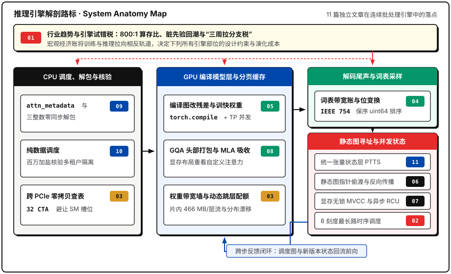

# 技术随笔与机制拆解 / Engineering Essays & Deep Dives

十一篇面向推理系统社区的平权独立文章（中英双语），不设上下级阅读门槛，也不预设读者了解本仓库。其中三篇聚焦行业趋势、系统复盘与状态层抽象，八篇为单点技术深潜——从反常现象出发，用示意图还原问题建模、算法推导与通用排障思路（另有四篇围绕动态切层开发过程的排障手记整理在 [blog/personal/](personal/README.md)）。

Eleven peer-independent articles (in Chinese and English) written for the inference-systems community, assuming zero prior familiarity with this repository. Three pieces examine macro economics, engineering postmortems, and unified state architecture; eight are focused deep-dives reconstructing problem modeling, derivations, and reusable debugging habits with diagrams (plus four debugging notes from the dynamic layer-routing build in [blog/personal/](personal/README.md)).

## 推理引擎解剖路标 / System Anatomy Map

每篇独立文章对应现代连续批处理推理引擎上的一个具体部位：

## 中文目录 (`blog/zh/`)

### 观点思辨、架构抽象与工程复盘
1. **[`[观点思辨]` 《〈苦涩的教训〉还有后半句：当商业推理退回“脏先验”，真正卡脖子的是引擎试错税》](zh/01-after-the-bitter-lesson.md)**  
   *单晶体管造价企稳与 800:1 算存比把训练与推理拉向相反的经济轨道，促成多元语法查表、跨层索引复用与在线快权重回潮；当编码智能体让局部先验变成可规模化搜索时，无状态引擎征收的“三周拉分支税”成了新瓶颈。*
2. **[`[工程复盘]` 《复盘一次过度设计：删掉 45 万行多面体编译器，换成 40 行最长路》](zh/02-forty-lines-over-polyhedral-ir.md)**  
   *复盘引进 45.7 万行 ISL 多面体库却只用来算 `lag >= 1` 的弯路；展示如何将跨步时间线折叠为 8 刻度一致依赖图，以及如何用剖析器定位双卡 All-Reduce 优先级抢占与可分页内存假异步。*
11. **[`[架构抽象 · 状态底座]` 《PagedAttention 之后：用统一的张量状态层（PTTS）承接推理期算法》](zh/11-ptts-beyond-paged-attention.md)**  
    *对比 PagedAttention 专管的一维序列块表与非 KV 推理期算法的多样状态需求；拆解 PTTS 如何用整字段固定基地址槽池、整数槽号版本根与因果读写划分统一瞬态探针、多租户引导/LoRA、在线学习、分块快权重零拷贝沿用与运行时免重录动态切层。*

### 硬核机制拆解与排障方法
3. **[`[极客拆解 · 带宽与配额]` 《为什么 32 个线程块跑赢 9,600 个，跳过 23% 的词却省不下 1 毫秒？连续批处理的带宽配额分析》](zh/03-bandwidth-and-sm-quotas.md)**  
   *建立“外部慢速 PCIe vs 片内 466 MB/层权重流”的双瓶颈模型：推导非抢占式 SM 槽位为何会被 9,600 个查表块塞满饿死矩阵乘，以及部分动态跳层为何省不下时间且暗藏概率分布漂移。*
4. **[`[极客拆解 · 尾声与位运算]` 《解码尾声的带宽账，与 5 行 IEEE 754 保序位变换》](zh/04-sampler-tail-and-bit-hack.md)**  
   *从 `top-p` 过滤后平均仅剩 4.83 个幸存词出发降维词表计算；对照 IEEE 754 位图推导单条 `uint64` 整数比较实现“浮点降序 + 同分下标升序”，并提炼“锁种子逐词对账”与“盯批次最大耗时行”两把排障尺子。*
5. **[`[极客拆解 · 编译图与快权重]` 《从 `assert bs == 1` 到编译态多卡并发：在 `torch.compile` 图里改残差与训快权重》](zh/05-compiler-and-host-jujitsu.md)**  
   *一条完整链路打通图内干预与在线快权重训练：借 `fused_add_rms_norm` 接缝与 `data_ptr()` 进图、10 行 `make_fx` 剪掉 61,440 个多余内核、`grad → vmap(chunk_size=1) → compile` 配 `float32` 增量破解 99.99% 精度吞没、以及双假图对比自动证明 `TP > 1` 零通信更新。*
6. **[`[极客拆解 · 静态图寻址]` 《图是死的，表是活的：怎么在冻结的 CUDA Graph 里偷渡动态指针？》](zh/06-cuda-graph-pointer-smuggling.md)**  
   *借用无绑定描述符表（Bindless Descriptor Table）与空位吸收槽建模静态图动态寻址，展示如何把外部搬家张量的裸指针当成 `int64` 填表并在 Triton 内还原，以及从“流事件记录器”视角预判预热污染、跨流 GC 与纯函数编译器克隆冲突。*
7. **[`[极客拆解 · 显存并发状态]` 《当上百个在线请求各自边跑边改权重：在 GPU 显存里手搓无锁 MVCC 与异步 RCU》](zh/07-gpu-mvcc-and-rcu.md)**  
   *深入落地显存多版本状态的五道硬关卡：融合“写时重定向”省掉 `AdamW` 预拷贝并砍掉 30% 动量显存、用无锁代次账本抓出 ABA 悬空槽、靠两级非阻塞 `wait_event` 与 `abort()` 栅栏实现零冗余页回收、跨进程 `CUDA IPC` 远端凭证隔离、以及五行集合交集划定抢占回滚边界。*
8. **[`[极客拆解 · 跨代际注意力]` 《少读 98% 的历史反而慢 5 倍，换上 DeepSeek 又罢工：从显存布局重看自定义注意力》](zh/08-attention-from-gqa-to-mla.md)**  
   *示范如何用一页纸 Roofline 除法锁定 7:1 GQA 头部打包失效（附 `FullAttentionSpec` 吞并 `RSWASpec` 子类的继承排查），再顺着维度复杂度用矩阵乘法结合律推导出零解压的 DeepSeek MLA 潜空间流式注意力。*
9. **[`[极客拆解 · 批次解包与元数据]` 《连续批处理的行坐标还原：探针实测 vLLM `attn_metadata` 与图内无同步反解》](zh/09-anatomy-of-attn-metadata.md)**  
   *示范如何用 5 步最小混批探针与单请求 MSE 对账测清 `attn_metadata` 的真实语义；从 CSR 行偏移出发推导图内零同步 `searchsorted` 坐标还原、边界夹紧抽页与 `slot_mapping = -1` 读写控制，并划分与上游三整数路由的职责边界。*
10. **[`[极客拆解 · 多租户核验]` 《`h - h.mean(dim=0)` 一行错都不报，却会让多租户推理串味：把连续批处理调度变成可测数据》](zh/10-schedule-as-data-verification.md)**  
   *用零字节 `meta` 追踪拦截隐式同步，将连续批处理压缩为静态整数三元组（Schedule-as-Data）；配合分块/抢占不变性、百万加盐蜕变测试与单行 `return None` 抢占注入，两秒内在笔记本 CPU 上抓出跨租户泄密。*

### 工程与排障笔记 (`blog/personal/`)
- **[工程与排障笔记目录](personal/README.md)**
  1. **[`[编译与自定义算子]` 《自定义算子接入 `torch.compile` 后写入失效：从一次排障看 PyTorch AOT 函数化》](personal/01-aot-functionalization-and-custom-ops.md)**
  2. **[`[静态图与早退内核]` 《不重录 CUDA Graph 实现动态切层：条件子图、掩码求值与早退 Triton 内核的比较》](personal/02-early-exit-triton-vs-conditional-cudagraph.md)**
  3. **[`[浮点算术与张量并行]` 《融合 Triton 内核与 PyTorch 原生算子的两次舍入差异：FP16 吸收效应与弱类型标量》](personal/03-fp16-bf16-rounding-traps-in-fused-kernels.md)**
  4. **[`[多版本状态与连续批处理]` 《连续批处理下的状态生命周期排障：准入快照时机、抢占重算边界与导出维度对齐》](personal/04-mvcc-pins-preemption-and-batch-dedup.md)**

---

## English Articles (`blog/en/`)

### Positions, Architecture & Engineering Postmortems
1. **[`[Position]` The Second Half of the Bitter Lesson: Why Commercial Inference Is Returning to Dirty Priors, and Why Engine Forks Break the Economics of Search](en/01-after-the-bitter-lesson.md)**
2. **[`[Postmortem]` Deleting 450,000 Lines of Polyhedral C for 40 Lines of Longest-Path: An Over-Engineering Postmortem](en/02-forty-lines-over-polyhedral-ir.md)**
11. **[`[Architecture · State Layer]` Beyond PagedAttention: Unifying Stateful Inference Algorithms on One Tensor State Layer (PTTS)](en/11-ptts-beyond-paged-attention.md)**

### Technical Deep Dives & Diagnostic Methods
3. **[`[Deep Dive · Bandwidth & Quotas]` Why 32 Thread Blocks Beat 9,600—and Skipping 23% of Tokens Saves Zero Time: Bandwidth and SM Quotas in Continuous Batching](en/03-bandwidth-and-sm-quotas.md)**
4. **[`[Deep Dive · Bit Tricks & Tail Bandwidth]` Bandwidth Accounting at the Decode Tail—and a 5-Line IEEE 754 Order-Preserving Bit Trick](en/04-sampler-tail-and-bit-hack.md)**
5. **[`[Deep Dive · Compiled Fast Weights]` From `assert bs == 1` to Multi-GPU Compiled Serving: Editing Residuals and Training Fast Weights Inside `torch.compile`](en/05-compiler-and-host-jujitsu.md)**
6. **[`[Deep Dive · Frozen Graphs]` Dead Graphs, Live Tables: Smuggling Dynamic Pointers and Autograd Inside Frozen CUDA Graphs](en/06-cuda-graph-pointer-smuggling.md)**
7. **[`[Deep Dive · GPU MVCC & RCU]` When a Hundred Live Requests Mutate Weights Concurrently: Building Lock-Free MVCC and Async RCU in GPU Memory](en/07-gpu-mvcc-and-rcu.md)**
8. **[`[Deep Dive · Attention Layouts]` Why Reading 98% Less History Ran 5x Slower—and Broke on DeepSeek: Rethinking Custom Attention from Memory Layouts](en/08-attention-from-gqa-to-mla.md)**
9. **[`[Deep Dive · Unpacking Jagged Batches]` Reconstructing Token Coordinates in Flattened Batches: Probing vLLM's `attn_metadata` and Sync-Free On-GPU Parsing](en/09-anatomy-of-attn-metadata.md)**
10. **[`[Deep Dive · Multi-Tenant Verification]` `h - h.mean(dim=0)` Throws Zero Errors While Leaking Prompts Across Tenants: Turning Batch Schedules into Testable Data](en/10-schedule-as-data-verification.md)**

### Engineering & Debugging Notes (`blog/personal/en/`)
- **[Engineering & Debugging Notes Index](personal/README.md)**
  1. **[`[Compiler & Custom Ops]` Why Custom Op Writes Disappear Under `torch.compile`: Debugging PyTorch AOT Functionalization](personal/en/01-aot-functionalization-and-custom-ops.md)**
  2. **[`[CUDA Graphs & Triton]` Dynamic Layer Switching Without Recapturing CUDA Graphs: Conditional Subgraphs, Masked Evaluation, and Early-Exit Triton Kernels](personal/en/02-early-exit-triton-vs-conditional-cudagraph.md)**
  3. **[`[IEEE 754 & Tensor Parallelism]` Two Rounding Divergences Between Fused Triton Kernels and Eager PyTorch: FP16 Absorption and Weak-Scalar Promotion](personal/en/03-fp16-bf16-rounding-traps-in-fused-kernels.md)**
  4. **[`[MVCC & Continuous Batching]` Debugging State Lifecycles Under Continuous Batching: Admission Pins, Preemption Boundaries, and Export Dimensions](personal/en/04-mvcc-pins-preemption-and-batch-dedup.md)**
