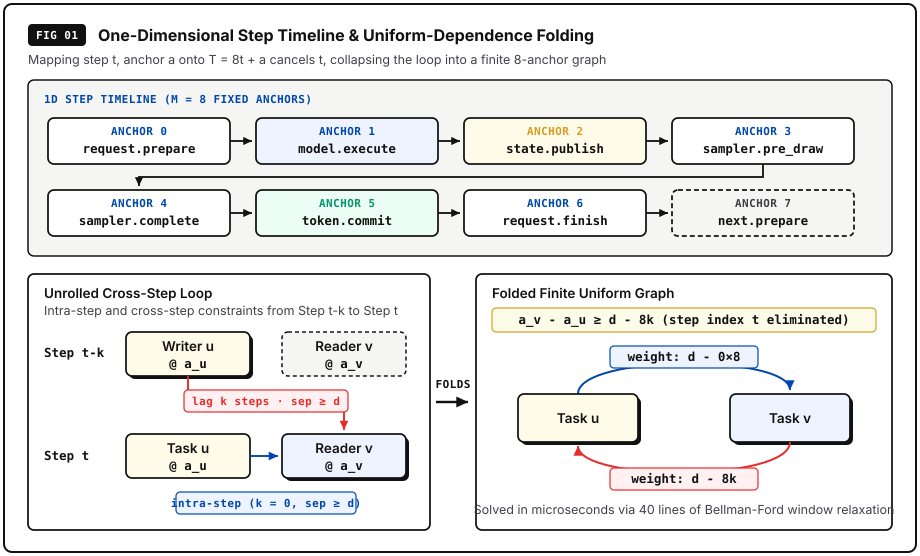
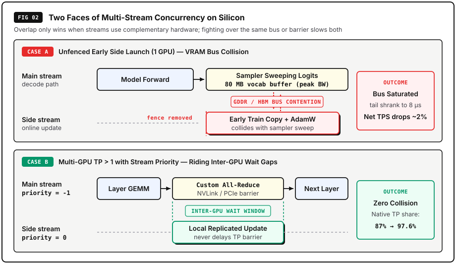

# Deleting 450,000 Lines of Polyhedral C for 40 Lines of Longest-Path: An Over-Engineering Postmortem

> **TL;DR**: Systems programmers have an occupational habit of judging technical depth by the weight of their dependencies. To schedule host prefetches, logit steering, and side-stream optimizer updates inside each LLM decode step, we once vendored 457,770 lines of polyhedral compiler C code (ISL)—only to find during a production audit that its main job was checking whether `lag >= 1`. Here is how recognizing the one-dimensional geometry of step scheduling replaced the entire middle-end with 40 lines of uniform-dependence relaxation, and how profiler traces exposed the real multi-stream bottlenecks in bus contention, TP barriers, and pageable memory.

Systems engineers have a soft spot for compiler machinery. Hand us an iterative loop with cross-step state dependencies and two CUDA streams to coordinate, and our minds drift straight toward polyhedral models and integer linear programming—as if solving a scheduling problem without first designing an intermediate representation (IR) were cutting corners.

No strawman is needed here; we built that monument ourselves.

The engineering problem on the table was concrete. When attaching stateful inference algorithms to a continuous-batching engine—prefetching lookup rows across PCIe at step start, steering vocabulary logits before sampling, and running backward passes plus `AdamW` on a side stream after token commit—the runtime must answer three questions automatically: **when inside the step may each task run, does it occupy the main stream or the side stream, and how many steps later do its state updates become visible?**

Seeing "loop iterations" and "loop-carried dependencies," we reached for the bedrock of polyhedral compilation, the **Integer Set Library (ISL, the solver behind LLVM Polly)**: 1,530 files and 457,770 lines of C code alongside big-integer arithmetic, wrapped inside a custom Rust Region IR with affine dependence analysis and tile search.

In hindsight, the psychology matched a small-town machine shop taking out a loan for an aerospace five-axis CNC mill. Day to day, the shop cuts flat flanges and angle iron that never touch the extra axes, yet parking the giant machine in the middle of the floor reassures the owners and impresses visiting peers.

---

Eventually we audited every measurable speedup on our production path to see how much throughput those 457,000 lines of C were earning. The ledger came back with dry comedy.

First, on chunkwise recurrent workloads such as In-Place TTT and GatedDelta, rewriting sequential $S_t = \mathcal{L}_t(S_{t-1}) + B_t$ loops into $\mathcal{O}(\log L)$ Hillis-Steele parallel prefix scans delivered genuine three-to-six-fold wins, cutting single-head $64 \times 64$ transitions from `1.44 ms` to `0.22 ms`. Inspecting the code responsible for that rewrite, however, turned up a lightweight `make_fx` algebraic matcher that strips state-independent subgraphs and checks whether the carry update falls into one of four associative linear actions (**scalar multiply, diagonal mask, left matmul, right matmul**). **Lines of ISL called: zero.** It merely wore the Region IR wrapper on the outside.

Second, cross-step visibility analysis—checking whether side-stream optimizer writes could overlap the next step's forward pass—did invoke ISL. It formatted the integer lag into a polyhedral set string and asked the C integer linear solver whether `0 <= b < t` held. Put plainly, we were waking up 457,000 lines of solver machinery to check whether an integer `lag` was at least `1`.

Meanwhile, the paths that genuinely exercised polyhedral grid expansion hit combinatorial explosion as soon as concurrency grew past toy sizes: `146 ms` for 1 sequence, `293 ms` for 2, and `ISL quota exceeded` at 4—whereas executing the matrix update directly inside the forward pass took **`19.6 ms`** total.

---

Why did a proven loop-compiler model misfire inside an LLM serving engine? Sketching the geometry makes the mismatch obvious.

Polyhedral tools shine on dense, multi-dimensional loop nests like image stencils or blocked GEMMs. In a modern PyTorch serving stack, intra-task operator fusion is already handled far better by `torch.compile` (Inductor) than by custom middle-ends. What remains for the outer step runtime is not a high-dimensional lattice, but **a one-dimensional timeline of $M = 8$ ordered step anchors**:



Each task's declared inputs and effects give it an initial valid window $[a_u^{\min}, a_u^{\max})$. Every dependency—whether intra-step ($k = 0$) or reading a state version written $k \ge 1$ steps ago with minimum separation $d$—maps step $t$, anchor $a$ onto global tick $T = 8t + a$, canceling $t$ from both sides:

$$(8t + a_v) - (8(t - k) + a_u) \ge d \quad \Longleftrightarrow \quad a_v - a_u \ge d - 8k$$

Karp, Miller, and Winograd showed in 1967 that **uniform-dependence** loops fold directly into a small finite graph with edge weights $d - 8k$. Solving placement windows across a dozen tasks reduces to 40 lines of standard Bellman-Ford longest-path relaxation:

```rust
fn propagate(bounds: &[(u32, u32)], edges: &[(usize, usize, i64)]) -> Result<Vec<(u32, u32)>, String> {
    let mut lo: Vec<_> = bounds.iter().map(|b| i64::from(b.0)).collect();
    let mut hi: Vec<_> = bounds.iter().map(|b| i64::from(b.1) - 1).collect();
    for pass in 0..=bounds.len() {
        let mut changed = false;
        for &(u, v, weight) in edges {
            if lo[u] + weight > lo[v] { lo[v] = lo[u] + weight; changed = true; }
            if hi[v] - weight < hi[u] { hi[u] = hi[v] - weight; changed = true; }
        }
        if lo.iter().zip(&hi).any(|(a, b)| a > b) {
            return Err("a task reads a value that exists only after its phase ends".into());
        }
        if !changed {
            return Ok(lo.iter().zip(&hi).map(|(&a, &b)| (a as u32, b as u32 + 1)).collect());
        }
        if pass == bounds.len() {
            return Err("placement constraints contain a contradictory cycle".into());
        }
    }
    unreachable!()
}
```

Unlike generic integer linear solvers that fail with an opaque `empty set`, both error exits map straight to actionable fixes: `lo > hi` means a method was declared in a phase before its input exists, while failing to converge after $|V|$ passes identifies a positive dependency cycle needing a larger `publish_lag`. Deleting all 457,770 lines of C dropped planning time back to microseconds.

---

Once the compiler monument was gone and we opened Nsight Systems instead, we learned the harder physical lesson: **drawing two parallel CUDA stream arrows on a whiteboard is free, but on silicon, multi-stream overlap only wins when the two streams consume complementary hardware resources.**

Whenever overlapping a side stream fails to deliver expected speedups, checking three physical contention points—**VRAM bus saturation, multi-GPU collective barriers, and host memory pageability**—usually catches the culprit:



1. **Check memory-bus saturation before launching early**: On a 0.5B run, ~70 µs of side-stream training poked past the forward pass. Removing the pre-sampler fence shrank the visible tail to 8 µs on the timeline—yet end-to-end throughput *dropped* by nearly two points. At that exact instant, the main-stream sampler was sweeping an 80 MB logits table at peak memory bandwidth; unleashing side-stream kernels into a saturated memory bus simply slowed both streams down.
2. **Check cross-GPU barriers under Tensor Parallelism**: Side-stream training that ran smoothly on one GPU sagged to **87%** of native throughput across multi-GPU TP (where small request states are replicated per rank to avoid extra collectives). Under TP, every layer ends with a tight Custom All-Reduce barrier; whenever a side-stream backward kernel delayed *one* GPU's arrival at the collective by tens of microseconds, every other GPU stalled waiting for the straggler. Giving the main TP stream high priority (`torch.cuda.Stream(priority=-1)`), keeping the side stream at `0`, and staggering publication eliminated collective overlap stalls and lifted TP throughput to **97.6%**.
3. **Check host pageability when `non_blocking=True` blocks**: In a healthy decode loop, ~700 µs of CPU routing preparation hides behind a multi-millisecond GPU forward pass; a single blocking host sync drains the queue and exposes all 700 µs (removing our last stray sync jumped early 0.5B graph throughput from 11k to 19k tok/s). Even without `.item()`, calling `.to("cuda", non_blocking=True)` on an ordinary CPU tensor *still* blocks—because OS pageable memory can swap out, forcing the CUDA driver to fall back to a synchronous copy instead of background DMA. Genuine 6 µs async uploads require pre-allocated `pin_memory()` ring buffers recycled via non-blocking `event.query()` checks.

---

That combination—40 lines of uniform-dependence relaxation, `make_fx` associative prefix-scan matching, TP stream priorities, and pinned staging rings—now forms the entire scheduling core of **[pLLM](https://github.com/LinesHogan/pLLM)** (`pllm`).

Replacing 450,000 lines of C with 40 lines of Rust is no reason to boast when we hauled the five-axis mill onto the shop floor ourselves. Systems culture often rewards grand middle-ends over checking stream priorities, even though hardware only grades the final bus timeline. Keeping boundaries modest—`torch.compile` fuses inside a task, 40 lines place tasks across eight anchors, and profilers arbitrate physical contention—cuts maintenance weight by orders of magnitude. Should a genuinely non-uniform multidimensional recurrence ever show up that 40 lines cannot schedule, heavier machinery is always an import away.
