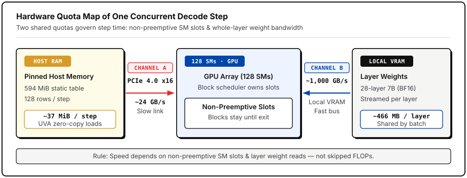
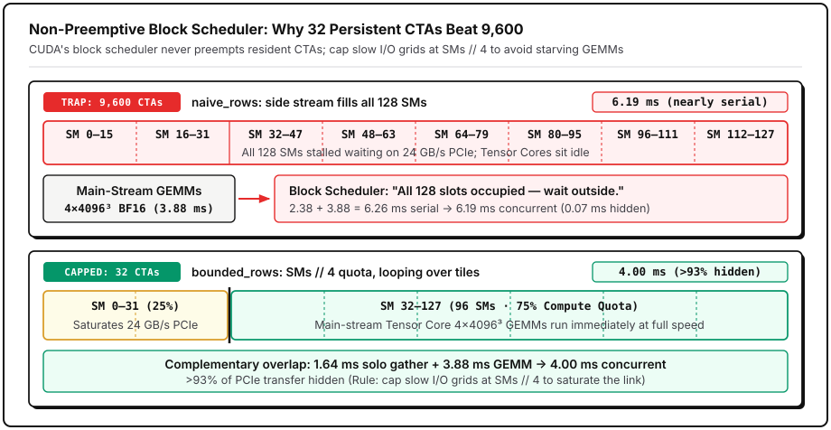
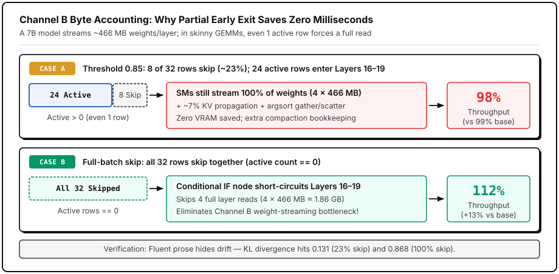

# Why 32 Thread Blocks Beat 9,600—and Skipping 23% of Tokens Saves Zero Time: Bandwidth and SM Quotas in Continuous Batching

> **TL;DR**: Two habits learned from single-request scripts—"launch thousands of thread blocks to hide memory latency" and "let easy tokens exit early to save proportional runtime"—both backfire inside a continuous-batching engine. Modeling a decode step through its shared hardware quotas connects both surprises: across a slow PCIe link, 9,600 non-preemptive gather blocks occupy every SM residency slot and starve main-stream Tensor Cores, whereas capping the grid at 32 persistent blocks hides over 93% of the transfer; inside the chip, streaming 466 MB of weights per layer pins short-context decode against VRAM bandwidth, so partial early exit saves zero weight reads while quietly drifting token distributions behind fluent-looking prose.

Profiling single-request research scripts builds two reliable reflexes: when memory latency is high, launch a massive grid of thread blocks (CTAs) so warp switching hides the wait; when easy tokens like periods or `the` settle their representation by layer 16, branch around the next few layers (early exit) to pocket proportional speedups.

Move both optimizations into a continuous-batching server handling a hundred concurrent sequences, and the timers invert: prefetching rows from a host lookup table with **9,600 thread blocks** degrades two-stream concurrency into serial execution, whereas shrinking the grid to **32 blocks** hides over 93% of the transfer; letting **23% of decode tokens skip four layers** nudges throughput slightly *down* instead of up.

Although one surprise happens over PCIe and the other inside Transformer blocks, both follow one modeling rule: **on a shared batching line, speed is governed not by how much arithmetic an individual row skips, but by who consumes the chip's non-preemptive SM slots and whole-layer weight bandwidth.**

Sketching the hardware quotas of a single concurrent decode step puts both bottlenecks on one map:



Tracing Channel A and Channel B in turn derives both reversals from elementary arithmetic.

---

Start with Channel A: **why does launching fewer thread blocks make a cross-PCIe prefetch finish faster alongside the model forward pass?**

External memory layers such as N-gram priors or Engram carry static tables hundreds of megabytes wide (~**594 MiB** for a vocabulary-width BF16 table). Pinning that table in host RAM preserves GPU KV capacity: because the lookup depends only on previously sampled token IDs rather than current hidden states, launching a side-stream gather at step start to pull 128 rows (~**37 MiB**, or ~`1.6 ms` at `24 GB/s`) ought to hide cleanly behind a multi-millisecond forward pass.

The first implementation obstacle is **why hardware DMA copy engines (`cudaMemcpyAsync`) cannot do the job**.

Dedicated copy engines consume zero SMs, which makes them ideal for deterministic weight offloading. Every `cudaMemcpy` variant, however, requires **source host addresses to be passed from the CPU**. Inside an autoregressive loop, the sampled token IDs and hashed row indices live in GPU memory! Copying 128 indices back to the host just to compute DMA offsets introduces a blocking host synchronization that stalls CPU-ahead-of-GPU pipelining and breaks CUDA Graph capture.

With DMA off the table, the zero-sync path is **Unified Virtual Addressing (UVA) zero-copy loads** over pinned host memory: map the pinned buffer into unified address space and let a Triton kernel read row indices on the GPU and issue cross-PCIe loads directly.

Sizing that kernel's launch grid springs the trap. Following textbook practice (`naive_rows`), assigning one CTA per 4 KiB column tile across 128 rows launches `128 × 75 = 9,600` CTAs; in `bounded_rows`, the load instructions stay identical while the grid is capped at **32 persistent CTAs** (`SMs // 4`), looping across tiles:

```python
@triton.jit
def bounded_rows(src, rows, out, count: int, width: tl.constexpr, block: tl.constexpr):
    tiles = tl.cdiv(width, block)
    # Pin grid at SMs // 4; persistent blocks saturate PCIe while leaving 3/4 of SMs for GEMMs
    for tile in tl.range(tl.program_id(0), count * tiles, tl.num_programs(0)):
        row, col = tile // tiles, tile % tiles * block + tl.arange(0, block)
        idx = tl.load(rows + row).to(tl.int64)
        tl.store(out + row * width + col, tl.load(src + idx * width + col, col < width, 0), col < width)
```

Timed alongside four `4096³` BF16 matmuls on the main stream (`3.88 ms` solo):
- **`naive_rows` (9,600 CTAs)**: `2.38 ms` solo gather, **`6.19 ms` concurrent**—practically serial (`6.26 ms`), saving just `0.07 ms`;
- **`bounded_rows` (32 CTAs)**: `1.64 ms` solo gather, **`4.00 ms` concurrent**—hiding over **93%** of the PCIe transfer behind the forward pass!

Distinguishing the GPU's two schedulers explains why 300x more blocks ruined concurrency. Inside one SM, warp schedulers switch warps every cycle—provided another kernel already holds a residency slot on that SM. Above them, **CUDA's global block scheduler is non-preemptive**:



That gives a general rule for any multi-stream server: **when a background kernel is bottlenecked on slow external I/O, maximizing SM occupancy is self-sabotage.** Launching just enough persistent CTAs to saturate the external link leaves the remaining SMs free so complementary resources actually overlap. It also states the exact boundary where host placement stops hiding: once $\text{bytes\_per\_step} / 24\text{ GB/s} > T_{\text{forward}}$ (on tiny 3 ms models or massive batches, or if the lookup accidentally depends on `hidden` states and cannot launch at step start), PCIe latency surfaces directly on the critical path.

---

Now turn to Channel B inside the chip: **why does letting 23% of decode tokens skip four layers save zero milliseconds?**

Suppose after layer 15 on a 28-layer 7B model (32 concurrent decode sequences), tokens whose hidden direction has stabilized skip layers 16–19. Using CUDA Graph conditional `IF` nodes and power-of-two compaction buckets (`argsort` gathers active rows into a tighter batch while skipped rows pay ~7% of a layer's FLOPs to register valid K/V entries so later tokens never read uninitialized cache holes), the entire branch runs with zero host syncs.

Benchmarking three thresholds tells a stark story:
- Never skip: **99%** of native CUDA Graph throughput;
- Threshold `0.85` (**~23% of decode tokens skip layers 16–19**): **98%** of native;
- Always skip (**100% of the batch skips together**): **112%** of native!

Why did compacting nearly a quarter of the rows away lose a percent, while skipping 100% jumped to 112%?

Count the bytes on Channel B. Across 28 layers, a BF16 7B model averages ~**466 MB of weights per layer**. In skinny decode GEMMs (dozens of rows), runtime is dominated by streaming those 466 MB from VRAM into registers rather than Tensor Core math:



On a shared weight-streaming conveyor belt, one active row keeps the entire station running. Partial per-token skipping only starts saving wall-clock time in two regimes: when **batch concurrency grows large enough to enter compute-bound GEMMs**, or when **context lengths reach tens of thousands of tokens** so per-row KV cache scans outweigh the 466 MB layer weights.

Testing early exit also highlights a verification discipline worth keeping whenever you approximate model forward passes: **fluent prose tells you almost nothing about whether output distributions stayed intact.**

Running layer skipping on a standard 7B checkpoint that was never trained with layer dropout produces grammatical, confident English paragraphs even when 100% of tokens skip layers 16–19. Measure teacher-forced next-token probability distributions against the unmodified model across identical prefixes, however, and the silent drift jumps out:
- At ~23% token skip, mean KL divergence already reaches **`0.131`**;
- At 100% skip, mean KL divergence climbs to **`0.868`** (total variation `0.25`).

---

Both quota mechanisms—automatic `SMs // 4` persistent UVA gathers with upfront PCIe byte accounting in `pllm.explain`, and conditional-graph compaction paired with `pllm.testing.check_distribution`—ship inside **[pLLM](https://github.com/LinesHogan/pLLM)** (`pllm`). Before porting a solo-script optimization onto a batching server, sketch the resource quotas first: trimming surplus FLOPs while hogging SM slots or streaming the exact same weights rarely pays back its own bookkeeping.
