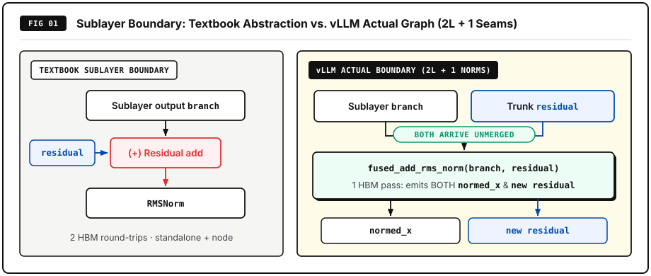
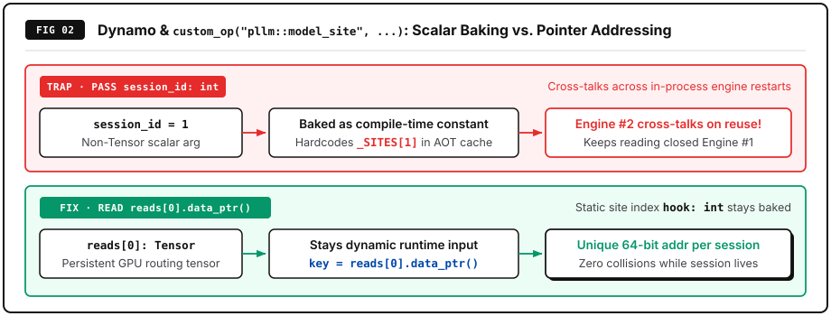
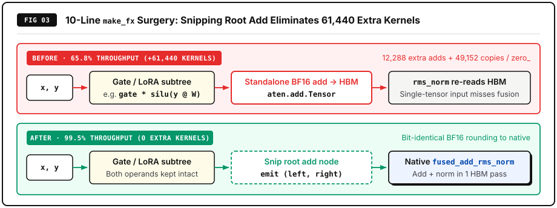
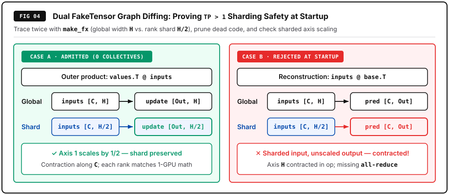

# From `assert bs == 1` to Multi-GPU Compiled Serving: Editing Residuals and Training Fast Weights Inside `torch.compile`

> **TL;DR**: Open-source repositories for test-time training (such as In-Place TTT) and activation steering routinely open with `assert len(input_ids) == 1`—because dropping single-request research hooks into a `torch.compile` + CUDA Graph + Tensor Parallel (`TP > 1`) serving engine triggers a chain reaction of fused-op mismatches, Dynamo constant baking, cross-batch rounding drift, and `bfloat16` precision swamping. Following that single journey end to end without forking vLLM or writing C++ kernels takes four connected moves: riding `fused_add_rms_norm` boundaries with `reads[0].data_ptr()` session addressing, snipping 61,440 ghost kernels via 10 lines of `make_fx`, nesting `grad → vmap(chunk_size=1) → compile` over `float32` deltas to rescue 99.998% of swallowed updates, and diffing two fake-tensor graphs to prove zero-collective `TP > 1` updates at startup.

Open almost any research release for inference-time adaptation—whether In-Place Test-Time Training (TTT), which treats selected MLP `down_proj` matrices as online fast weights updated every token chunk, or per-request activation steering—and you will likely find this line near the top of `generate`:

```python
assert len(input_ids) == 1, "only support bs=1 for inference"
```

Authors don't write that assertion out of laziness. Moving single-stream research code into a production vLLM engine with `torch.compile` and CUDA Graphs enabled hits four obstacles in sequence: the textbook residual `+` node has vanished from the graph; integer session IDs get baked into AOT caches and cross-talk across instances; even a no-op `return x + y` hook spawns tens of thousands of extra kernels; and batching fast-weight updates runs headfirst into `bfloat16` swamping (>99.99% of gradient updates rounded to zero) and silent multi-GPU (`TP > 1`) sharding bugs.

Walking one algorithm through all four stages without forking the engine or writing custom C++ kernels comes down to a single principle: **map out the exact fusion seams and algebraic invariants of the compiler and host modules first, then reshape your code to match them.**

---

Stage 1: **Find the missing `+` node, and cross `@torch.library.custom_op` without Dynamo constant baking.**

Textbooks write Transformer sublayers as `x = x + sublayer(norm(x))`. Print vLLM's actual execution graph, however, and no standalone residual `+` exists anywhere. To save a full-hidden-width HBM round-trip at every sublayer, vLLM fuses the end-of-sublayer addition into the *next* sublayer's `fused_add_rms_norm` C++ kernel across all `2L + 1` norms:



What looks like a locked door is actually the cleanest seam in the model: precisely because the preceding sublayer deferred its addition, **both `branch` and `residual` arrive unmerged right at the norm's front door**. Unhooked layers keep their untouched native norms at zero overhead.

How do you invoke session-owned logic at that boundary without breaking `torch.compile`? On a 32-way `0.5B` benchmark, breaking the graph to run per-request Python callbacks outside CUDA Graphs manages only `4,258 tok/s` versus `12,174 tok/s` in-graph—losing two-thirds of throughput. The standard bridge into Dynamo is an opaque `@torch.library.custom_op`, whose schema accepts only `Tensor`s and primitive scalars (`int`, `float`), never Python session objects.

Passing `session_id: int` into a global `_SESSIONS[session_id]` dict works on Engine #1—and silently corrupts activations as soon as the same process closes Engine #1 and starts Engine #2 on the same architecture. Why? Dynamo bakes every non-`Tensor` scalar argument as a **compile-time constant** inside AOT-cached code, so Engine #2 hits the cache and keeps reading `_SESSIONS[1]`!



Aligning with Dynamo's rule solves it cleanly: every engine session already owns a persistent GPU routing tensor `reads[0]` whose 64-bit physical address `reads[0].data_ptr()` cannot be reused while the session is alive. Keying `_SITES` by `reads[0].data_ptr()` routes sessions dynamically, while the static topological site index `hook: int` *should* be baked in as a constant. *(Checking repeated in-process lifecycles caught a companion VRAM leak: vLLM appends closures to `torch._dynamo.convert_frame._bytecode_hooks` and never cleans them up, pinning compiled models in HBM across teardown; snapshot-diffing `_bytecode_hooks` and `CleanupManager` on `close()` reclaims tens of gigabytes cleanly.)*

---

Stage 2: **Measure zero-math baseline noise first—why did `return x + y` spawn 61,440 extra kernels?**

Before writing fancy interventions inside a compiled hook, establish a baseline: **attach a mathematical no-op `def identity(x, y): return x + y` and count every launched GPU kernel.**

Across an 8,192-token `Qwen2.5-0.5B` run, that one-line identity dropped throughput to **65.8%** of native vLLM, inflating total kernel launches from `104,837` to `166,277`—**61,440 extra kernels**:
- `37,119` `memcpy` and `12,240` `direct_copy` launches staging tensors into and out of port buffers;
- `12,288` polite `zero_` fills on output ports overwritten microseconds later;
- `12,288` standalone `bfloat16` `add` kernels—because returning a single summed tensor forced a separate HBM add before `rms_norm` could read it back.

Eliminating staging copies and zero-fills is straightforward, but how do you hand that addition back to `fused_add_rms_norm`? Do *not* blindly rewrite arbitrary hook outputs `out` as `(out - x, x)`: testing unconditional splitting shifted intermediate `bfloat16` rounding and degraded worst-case sequence logprob error (against an `float32` reference) from `0.243` to `0.394`.

Getting zero extra kernels *and* bit-identical rounding takes ten lines of `make_fx` surgery on zero-memory FakeTensors at bind time—inspecting whether the **root node** of the expression tree is `aten.add.Tensor`:

```python
body = make_fx(trace, tracing_mode="fake", _allow_non_fake_inputs=True)(samples, arguments)
output = next(node for node in body.graph.nodes if node.op == "output")
(tail,) = output.args[0]
if isinstance(tail, fx.Node) and tail.target == torch.ops.aten.add.Tensor and not tail.kwargs:
    left, right = tail.args  # Once shapes/dtypes match, snip the terminal add and emit (left, right)!
    set_tuple_output(body, output, (left, right))
    body.graph.erase_node(tail)
    body.recompile()
```



The boundary of this trick follows directly from the hardcoded C++ kernel entry: whenever the **outermost root node** is `+`—no matter how much gating, low-rank projection, or nonlinearity lives inside its left and right subtrees (such as `x + gate * silu(y @ W)`, covering the vast majority of residual edits)—the terminal add vanishes, extra kernels drop to **0**, and throughput returns to **99.5%** (pure `x + y` identities even uninstall the hook outright). Only when the root itself is non-additive (e.g., `tanh(x + y)`) does an isolated `torch.compile` pass fuse the user's math and output-port write into one Inductor kernel, paying a single HBM pass instead of 61,440 eager launches.

---

Stage 3: **Step inside linear projections—breaking `assert bs == 1` and the 99.998% `bfloat16` swamping trap.**

Moving from residual boundaries into linear weights—like In-Place TTT updating per-request `[2560, 9728]` `down_proj` fast weights every `chunk = 1024` tokens mid-forward—requires vectorizing per-request differentiation across concurrent requests without numerical drift:

```python
eager = torch.func.grad(loss)
# 1. Broadcast frozen trunk weights via None; 2. Lock GEMM shape with chunk_size=1!
eager = torch.vmap(eager, in_dims=(0, 0, None, 0), chunk_size=1)
compiled = torch.compile(eager, fullgraph=True, dynamic=False, options={"triton.cudagraphs": False})
```

Two details do the heavy lifting here:
1. **Exact composition order (`grad` → `vmap` → `compile`)**: differentiate scalar masked loss per request first, map across requests while broadcasting the giant frozen base matrix zero-copy (`None`), then compile the joint forward/backward graph once.
2. **Why pass a seemingly self-defeating `chunk_size=1` to `vmap`?** Whenever user loss math evaluates `x @ base.T` against the shared frozen weight, unchunked `vmap` folds $B$ requests into a `[B * C, H]` GEMM. Changing the matrix $M$ dimension causes cuBLAS heuristics to pick a different tile kernel, altering internal `bfloat16` reduction order so a request's gradient drifts depending on batch size! Setting `chunk_size=1` keeps every frozen-base GEMM at `[C, H]` while still compiling all chunks inside one `torch.compile` graph.

Once batched TTT ran end to end on `Qwen3-4B`, parity checks uncovered an eye-opening numerical trap in the reference approach: **cloning `bfloat16` base weights and adding updates in place ($W \leftarrow \text{BF16}(W + \Delta W)$) threw away over 99% of every update!**

That is classic floating-point **swamping**. `bfloat16` carries only **7 mantissa bits** (~`0.78%` relative step size). Under the paper's `1e-5` Frobenius-norm update clip, we measured Layer 0's actual `down_proj` matrix (**24,903,680** parameters): adding a `1e-5`-norm update in `bfloat16` changed **only 472 elements out of 24.9 million**—wiping out **99.998%** of the entries to zero and leaving just **0.97%** of the intended update norm!

Decoupling the read-only `bfloat16` base weight $W$ from a zero-initialized **`float32` per-request `delta`** (`inputs @ delta.to(inputs.dtype).T`) preserves every gradient bit in 23-bit mantissas while outrunning the `bs=1`-only HF baseline (`59.6` vs `54.8 tok/s` at 4k solo, +21% at 16k, and **`111.4 tok/s`** at 4-way concurrency).

---

Stage 4: **Scale fast weights to multi-GPU Tensor Parallelism (`TP > 1`) with zero extra collectives—and prove sharding safety via two fake graphs.**

Under `TP = 2`, `down_proj` (`RowParallelLinear`) shards both input features and weights column-wise `[Out, H/2]` before calling an upstream `all-reduce`. Forward reads ride that collective for free: hooking `quant_method.apply` *before* vLLM's `all-reduce` accumulates each rank's local shard correction in `float32`, adding zero extra communication and rounding to `bfloat16` only once at the exit.

In-forward updates (`@pllm.train_in_forward`) are where silent corruption lurks. When each GPU sees only `[C, H/2]`, can each rank run the author's update function independently?
- **Outer-product updates (`values.T @ inputs` in TTT)**: contract along the chunk-token axis `C`, leaving the sharded `H/2` axis untouched—local shard updates match single-GPU math bit for bit;
- **Inner-product reconstructions (`pred = inputs @ base.T` or `inputs.square().sum(-1)`)**: contract across the sharded `H` axis—without an unspoken cross-GPU `all-reduce`, each GPU computes half the sum and silently corrupts weights!

Rather than building a massive distributed sharding analyzer across a thousand ATen ops, trace the update function twice on FakeTensors and play "spot the difference":



After dead-code elimination, aligning live nodes between the two graphs proves sharding conservation in under a hundred lines: if any operator consumes a sharded operand (`axis is not None`) yet produces identically shaped outputs in both graphs (`axis is None`), the sharded dimension vanished inside a contraction—so startup fails fast with a clear diagnostic.

---

This four-stage pipeline powers `@pllm.custom_residual` and `@pllm.train_in_forward` in **[pLLM](https://github.com/LinesHogan/pLLM)** (`pllm`), running unmodified across upstream vLLM `0.27`–`0.32`.

Two explicit trade-offs come with the design: first, enabling residual rewrites captures model CUDA Graphs over source operators rather than whole-model Inductor fusion to avoid nested-FX conflicts and guarantee bitwise neutral parity (sustaining **97%** of native throughput on 7B even with all 28 layers hooked—a fixed ~3% ticket); second, full-rank fast weights carry real HBM weight (`714 MiB` per `float32` state root on 4B TTT, with Prefix Caching disabled whenever internal layers vary per request). Mapping compiler seams and floating-point step sizes up front turns a multi-week engine fork into surgical hooks.
