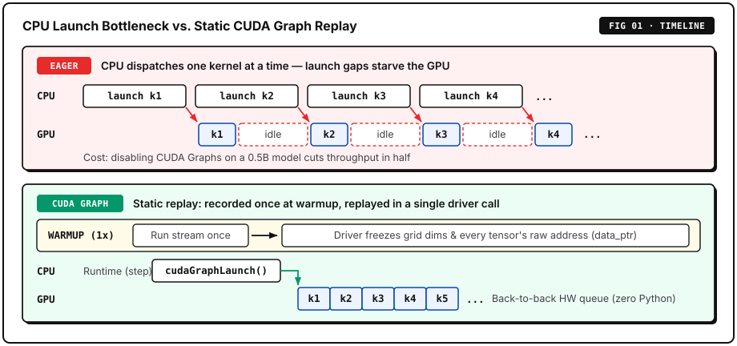
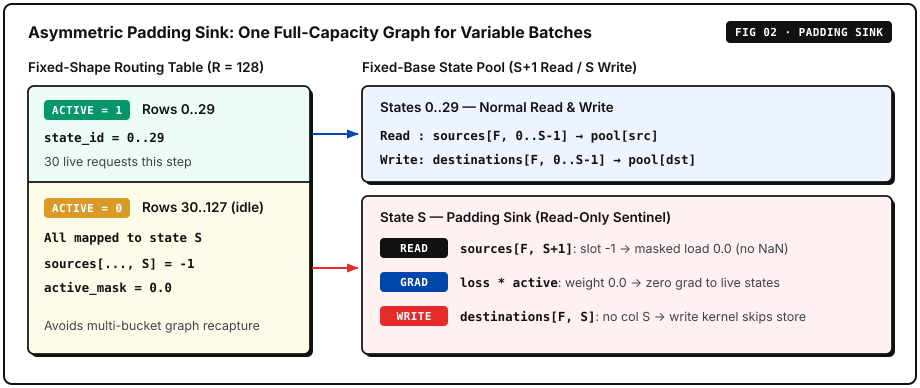
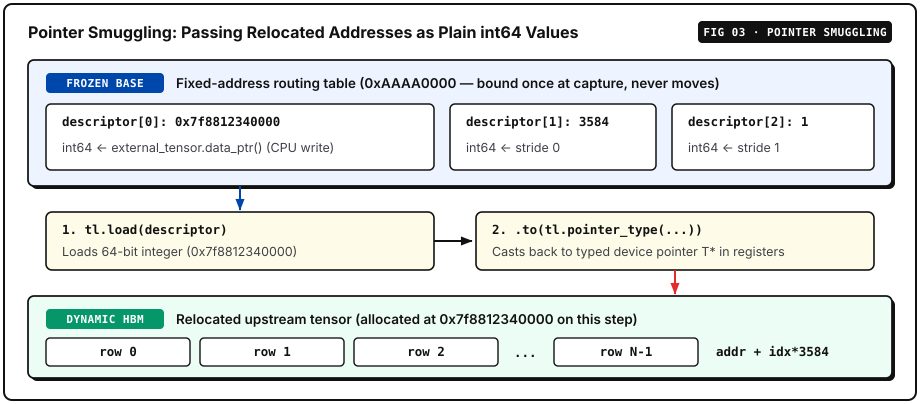

# Dead Graphs, Live Tables: Smuggling Dynamic Pointers and Autograd Inside Frozen CUDA Graphs

> **TL;DR**: Production serving engines capture decode steps into static CUDA Graphs to eliminate Python/driver launch overhead, freezing every kernel's tensor shapes and raw device addresses at warmup. Running online backward passes and `AdamW` inside a single never-recaptured graph—while active request counts, batch row seats, and even upstream input buffer addresses change every step—comes down to borrowing **Bindless Descriptor Tables** from modern graphics APIs: reduce all runtime dynamism (including 64-bit raw pointers to relocated external tensors) to integers inside a fixed-address `int64` routing table. We close by viewing CUDA Graph capture as a literal stream-and-allocator event recorder, turning warmup corruption, cross-stream GC crashes, and `@torch.compile` clone regressions into predictable consequences of one mental model.

After getting an online learning loop working in a single-request script—say, computing a token-level loss from hidden states, running `autograd` backward, and stepping per-request `AdamW` weights on every decode token—moving it into a concurrent serving engine hits an immediate wall. That first wall isn't on the GPU; it is on the CPU.

During autoregressive decode, each request processes 1 token per step. A tiny GPU kernel finishes in a few microseconds, whereas launching it from Python walks through the interpreter, the PyTorch dispatcher, and the CUDA driver. Add backward gradients and optimizer updates, and a single step fires fifty to sixty small kernels:



To erase that launch tax, online training has to live inside a static CUDA Graph just like the trunk model.

Put both sets of constraints side by side, however, and they collide head-on: CUDA Graphs require **constant tensor shapes, constant base device pointers, and zero GPU-to-CPU synchronization**; continuous batching changes active request counts every step, shuffles which request sits in which batch row, and periodically frees and reallocates upstream input tensors (like sampler outputs) at brand-new HBM addresses.

---

How do you model that contradiction?

Whenever an instruction stream must stay static while the objects it touches move around, look at OS virtual memory page tables or **Bindless Descriptor Tables** in Vulkan and DirectX 12: compiled shader code never changes, because it binds a single fixed-address integer table; before each frame, the CPU writes the active resource slots and buffer addresses into that table, and the GPU dereferences them indirectly.

Carry that exact pattern into PyTorch and Triton, and the entire architecture reduces to six words: **dead graphs, live tables.**

At engine startup, we allocate two buffers whose base addresses never move for the lifetime of the server: a physical state pool `pool[capacity, *field_shape]` holding parameter and optimizer pages, and a ~20 KB fixed-address `int64` routing table `TableLayout` (populated by the CPU in pinned memory each step and copied asynchronously in ~6 microseconds).

Three layers of runtime dynamism dissolve into that table one by one.

**Layer 1: Row seats shuffle every step—solve with slot indirection.**  
Request A sits at batch row 0 on step $t$, while Request C sits at row 0 on step $t+1$. Graph kernels never bind per-request tensors; they bind only the pool base pointer and the routing table, reading `src` and `dst` slot indices from the table's `rows` segment before indexing `pool[src]` and `pool[dst]`. Reseating requests just changes integers in the table.

**Layer 2: Active requests fall below capacity—use an asymmetric Padding Sink instead of multi-bucket graphs.**  
Suppose capacity is $R = 128$ rows and $S = 128$ states, yet an off-peak step arrives with only 30 live requests. Recording dozens of `(rows, states)` bucket graphs—as stateless forward passes do—would multiply private backward-activation memory pools across buckets and starve the KV cache.

Capturing **one single full-capacity graph** takes an asymmetric column split in the routing table: size the read table `sources` to `S + 1` columns (`0..S`), size the write table `destinations` to only `S` columns (`0..S-1`), and dedicate column `S` as a sentinel **Padding Sink**:



Whether 1 request or 128 requests show up, the frozen graph runs the exact same dense tensor shapes without generating `NaN`s or stray HBM stores. (By the same token, when a workload updates only requests satisfying a dynamic data-dependent condition, the CPU never calls `.tolist()` to check the mask—it pre-allocates fresh destination slots for every live request, and an in-graph kernel copies old slots forward whenever a row's runtime predicate evaluates false.)

---

**Layer 3: How does a frozen graph read an upstream tensor whose HBM address changes every few steps?**

We own the state pool, so its base pointer stays put. We do *not* own external tensors handed over by the host engine (such as feedback tensors freshly allocated by the sampler)—whenever upstream resizes a batch, the caching allocator frees the old block and hands back a new address. Binding that external `Tensor` directly as a kernel argument bakes a dangling pointer into the CUDA Graph.

At first glance that looks impossible: how do you read a tensor without passing it into the graph?

Step beneath PyTorch's `Tensor` wrapper to the hardware truth: **under 64-bit unified virtual addressing on modern GPUs, a device pointer is physically just an ordinary 64-bit integer.**

CUDA Graphs forbid changing a kernel's entry argument pointers; they never forbid changing `int64` values stored inside a fixed-address buffer. So we never pass the external tensor into the graph at all—before replay, the CPU calls `external_tensor.data_ptr()` and writes its raw 64-bit address plus `(stride0, stride1)` as three plain `int64` integers into the `descriptor` segment of the fixed routing table:



Inside Triton, reconstructing the typed device pointer and gathering rows takes ten lines:

```python
@triton.jit
def _gather_rows(descriptor, rows, output, width: tl.constexpr):
    row = tl.program_id(0) // tl.cdiv(width, 256)
    col = (tl.program_id(0) % tl.cdiv(width, 256)) * 256 + tl.arange(0, 256)
    # Capture binds only the constant `descriptor` address; runtime casts the loaded int64 back to T*
    address = tl.load(descriptor).to(tl.pointer_type(output.dtype.element_ty))
    stride0 = tl.load(descriptor + 1)
    stride1 = tl.load(descriptor + 2)
    index = tl.load(rows + row)
    value = tl.load(address + index * stride0 + col * stride1, col < width, 0)
    tl.store(output + row * width + col, value, col < width)
```

One `.to(tl.pointer_type(...))` cast cleanly decouples the lifetime of the frozen CUDA Graph from the allocation lifetime of upstream tensors.

---

Once you build stateful CUDA Graphs yourself, how do you anticipate subtle crashes and slowdowns instead of playing whack-a-mole?

Most postmortems list CUDA Graph pitfalls as disconnected trivia. In practice, nearly all of them follow directly from one mental model: **a CUDA Graph recorder does not understand your Python math—it literally records every memory store and every allocator event that touches the capturing CUDA Stream during the capture window, and its in-place world clashes directly with pure-functional compilers.**

Walk forward from that single principle, and three classic failure modes become obvious ahead of time:

1. **Because warmup and capture execute real instructions, in-place writers will corrupt live state unless masked.**  
   Before `torch.cuda.graph` capture, standard practice runs 3 warmup iterations on a private stream so cuBLAS and Triton finish lazy workspace allocations. If your graph ends with an in-place `AdamW` kernel over the state pool, 3 warmup runs will overwrite live parameters three times with uninitialized scratch gradients! Following the model makes the safeguard immediate: call `destinations.fill_(-1)` before warmup + capture so all four passes become strictly read-only against the pool, then populate real destination slots on replay.
2. **Because allocator events are recorded too, any cross-stream free aborts capture.**  
   When `operation not permitted when stream is capturing` fires intermittently in production, engineers usually hunt for stray `.item()` calls while overlooking Python's cyclic garbage collector (`gc`): allocating wrapper objects mid-capture can trip a GC threshold, finalizing a dead tensor last used steps ago on *another* CUDA Stream. Its C++ destructor notifies the caching allocator across streams and kills capture on the spot—so always bracket capture windows with `gc.disable()`. (Similarly, if you use device-side conditional `IF` nodes inside a graph, PyTorch's C++ internals increment the graph memory pool refcount twice across conditional scope entry/exit while `CUDAGraph.reset()` decrements it once; watching pool refcounts exposes the exact scope release needed to prevent pool leaks.)
3. **When an in-place state pool meets `@torch.compile`, verify total wall time in a profiler—never just kernel counts.**  
   Wrapping a captured training step in `@torch.compile` looks like an easy win to fuse fifty small ops. When we measured it, side-stream kernel launches dropped from 59 to 25—yet step duration *regressed* from **~180 µs to nearly 260 µs**! Opening the trace showed why: AOTAutograd's Functionalization pass requires pure side-effect-free ops, so seeing an in-place slice mutation on the persistent pool caused it to inject a ~40 µs `clone_paged_adamw_slice` kernel to copy the pool slice out and back. Once CUDA Graphs have already removed CPU launch overhead, layering pure-functional compilation on top of in-place state pools trades away precious HBM bandwidth.

---

This single-descriptor-table capture architecture drives every per-request online training and state-mutation graph in **[pLLM](https://github.com/LinesHogan/pLLM)** (`pllm`); at 128-way concurrency on a 7B model, replaying a full forward, backward, and paged `AdamW` step takes ~600 microseconds.

Nothing in systems engineering is free, and buying "one graph, zero recaptures" carries two explicit costs: at low concurrency, Padding Sink rows still ride along through full-capacity GEMMs; and because live rows and sink rows share the batch tensor, user loss functions must stay strictly independent along `dim=0`—any cross-row mean or batch norm mixes sink zeros into live request gradients.
