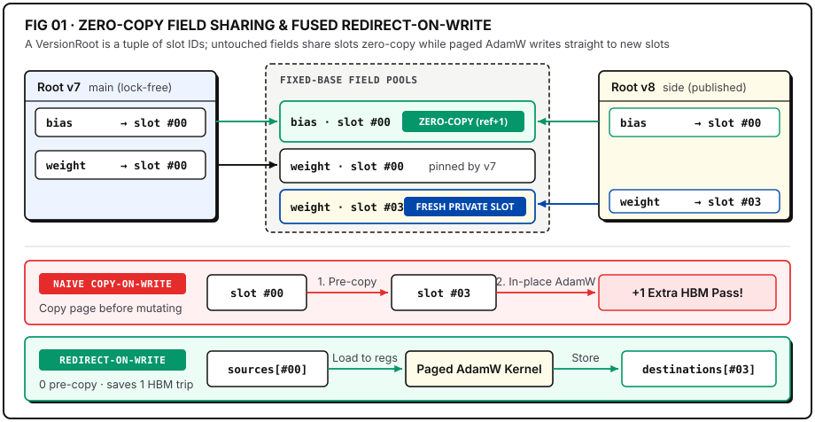
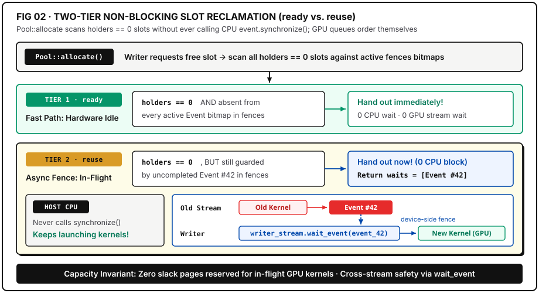

# When a Hundred Live Requests Mutate Weights Concurrently: Building Lock-Free MVCC and Async RCU in GPU Memory

> **TL;DR**: Carrying `param.add_()` in-place weight updates from a single-stream script into a concurrent serving engine triggers four simultaneous failures: frozen CUDA Graph pointers, two-stream torn reads, mid-sentence SSE hot-reload drift, and corrupted KV preemption replays. Bringing database **MVCC** and kernel **RCU** onto the GPU restores time as immutable versions over fixed-base field pools. We unpack the five hardest systems problems underneath: turning Copy-on-Write into zero-copy **Redirect-on-Write** for `AdamW` while cutting 30% of momentum VRAM, catching ABA stale-slot bugs in a lock-free Rust generation ledger, non-blocking two-tier `stream.wait_event` reclamation and `abort()` fences, why cross-process `CUDA IPC` borrowing cannot trust local events, and the 5-line `applied & rewritten` set intersection governing preemption rollback.

In a single-request research script, mutating online state barely registers as a design problem: keep a Python dict `states[req_id]`, call `param.add_(delta)` in place after each step, and `del` it when generation finishes.

Drop that exact pattern into a loaded production serving engine, and four seemingly unrelated failures detonate one after another:
1. **Frozen graph pointers**: CUDA Graphs lock raw tensor addresses at warmup, so dynamically allocated per-request dict tensors cannot enter captured decode loops;
2. **Two-stream torn reads**: Hiding backward + `AdamW` latency behind the next token's forward pass requires running training on a side CUDA Stream concurrently with the main forward Stream—mutating one slot in place makes the main stream read half-written weights mid-kernel, while adding a mutex serializes both streams;
3. **Mid-sentence SSE hot-reload drift**: Client A is halfway through a streamed sentence when an operator calls `import_state` to update a shared steering vector in place, abruptly changing Client A's persona on token 15;
4. **Corrupted KV preemption replays**: Under KV memory pressure, the scheduler evicts a request at step 50 and later replays its prompt + emitted tokens from position 0—in-place updates destroyed step 0's initial weights long ago, so replaying token 0 under step-50 weights computes contradictory K/V history.

Patching those four symptoms one by one—static slots for graphs, ping-pong buffers for two streams, blocking queues for imports, backup clones for preemption—produces a brittle tangle of conflicting state machines.

Strip away the surface details, and all four failures are fighting over one question: **at any instant on the timeline, which exact snapshot of state should a given reader see?** In-place mutation makes that question unsolvable because it erases time—flattening past, present, and half-written future onto one physical address.

Databases (PostgreSQL **MVCC**) and OS kernels (Linux **RCU**) solved this decades ago: **make state immutable; writers claim fresh slots from a pool and atomically swing a version root, while old slots wait out a Grace Period before reuse.**

Translating textbook MVCC/RCU onto **frozen-base CUDA Graphs, asynchronous multi-stream GPU queues, and cross-process shared HBM**, however, is where the real engineering begins. Here are the five hardest problems inside our Paged Tensor Transition System (PTTS).

---

Problem 1: **What is the right page granularity—and how do you eliminate both the "Copy" in Copy-on-Write and `AdamW` momentum bloat?**

Hearing "paging," engineers instinctively think of PagedAttention's 16-token blocks, or multi-LoRA servers (S-LoRA / Punica) packing heterogeneous-rank *read-only* adapters. Live mutable state obeys different physics: KV caches append one token at a time (needing small blocks against internal fragmentation), whereas online updates read and write **entire parameter tensors at once**. Slicing a `[4, 3584]` matrix into sub-pages adds page-table indirection while saving zero bytes of copy bandwidth.

So each field owns one contiguous fixed-base tensor `pool[capacity, *field_shape]` allocated once at startup. One "page" is one whole-field `slot_id` along axis 0, and a `VersionRoot` is just a small tuple of integer slot IDs.

Whole-field slots unlock two immediate wins. First is **zero-copy untouched sharing plus Redirect-on-Write**:



Standard COW copies the old page before mutating (`fill_versions`). For full-tensor writers like `AdamW`, our paged optimizer kernel reads `sources[0]` into registers, computes the step, and writes straight out to `destinations[3]`—**skipping the pre-copy HBM round-trip altogether** (only partial-row writers opt into `copy_fields`).

Second, ask **who actually reads historical versions?** An `AdamW`-backed parameter has four fields (`weight`, `step`, `exp_avg`, `exp_avg_sq`). Forward inference only ever reads `weight`, and preemption rollback only resets to `v0`'s `weight`—no external reader ever inspects *historical* `AdamW` momentum, which is chained strictly at `lag = 0` by the writer itself! Attaching a per-field `pinned: Vec<bool>` mask in the ledger restricts historical pins to model parameters, capping all three optimizer fields at a flat **2 pages** per lineage (1 read + 1 write) regardless of lag window and cutting state-pool VRAM by **~30%**.

---

Problem 2: **How do you run sub-200 µs lock-free bookkeeping while catching silent ABA stale-slot bugs?**

Tracking hundreds of page refcounts through Python objects and locks would bottleneck small-model decode steps on the CPU. Instead, we split **control plane from data plane**: Python holds only heavyweight GPU handles (pool `Tensor`s and `torch.cuda.Event`s), while all numeric ownership lives inside a single-threaded, lock-free Rust ledger (`slot_ledger.rs` and `page_ledger.rs`, marked `#[pyclass(unsendable)]` and releasing Python's GIL via `py.allow_threads`).

Inside `slot_ledger.rs`, each physical pool is just three flat integer/bit vectors:

```rust
pub(crate) struct Pool {
    pub width: usize,
    pub capacities: Vec<usize>,
    offsets: Vec<usize>,
    holders: Vec<i64>,            // Logical refcount per slot (pins + latest root + active write)
    generations: Vec<i64>,        // ABA fuse: increments every time `holders` drops to 0
    fences: Vec<(i64, Vec<bool>)> // Hardware grace periods: (uncompleted Event ID, guarded slot bitmap)
}
```

Why keep `generations`? Custom memory pools are notorious for silent **ABA / use-after-free aliasing**: suppose buggy caller code retains a stale handle `PageSlot(slot=3, gen=12)` after release; slot 3 hits `holders == 0`, gets reallocated to Tenant B, and receives Tenant B's private weights. Without generation tags, dereferencing `slot=3` succeeds silently and leaks Tenant B's state! Incrementing `generations[index] += 1` whenever `holders` hits zero and asserting `holders >= 1 && generations == gen` on every view turns silent corruption into an immediate crash.

Paired with lazy receipt collection (skipping event polling until `PageCapacity` actually runs low), 128-way bookkeeping takes **`~181 µs`** for `prepare_transition`, **`~82 µs`** for `publish`, and **`~58 µs`** for `release`.

---

Problem 3: **On an asynchronous GPU, `holders == 0` never means hardware is idle—how do you recycle slots without stalling the CPU?**

In a CPU database, `holders == 0` means memory is immediately reusable. On an asynchronous GPU, dropping the last logical reference on the host only means the CPU *finished queuing commands*—kernels reading or writing that slot may still be executing in a CUDA Stream!

Calling `event.synchronize()` on the CPU before reusing a slot would stall the host launch pipeline. Look at how `Pool::allocate` avoids CPU stalls completely via **two-tier non-blocking allocation (`ready` vs. `reuse`)**:



This two-tier handoff yields a remarkable capacity property: **our memory budget reserves zero extra slack pages for in-flight GPU kernels!** Once logical ownership ends, slots are immediately reallocatable behind GPU-side `wait_event` ordering.

Following that same async hardware law explains two subtleties that bite almost every first-time implementation:
- **Why `abort(token)` looks nearly identical to `publish(token)`**: Even when a write transaction aborts mid-step (due to an error or false runtime predicate), `abort(token)` *must* record a `cuda.Event` on `token.stream` and register it in `fences`, differing from `publish` only in setting `aborted = True` so the root stays unpublished. Microseconds before the host decided to abort, kernels may already have launched onto `token.stream`; returning the aborted slot unfenced lets the next tenant collide with still-running aborted writes! (Likewise, every newly bound stream calls `tensor.record_stream(stream)` on backing pools so async engine teardown never lets PyTorch's caching allocator premature-free HBM.)
- **Why cross-process `CUDA IPC` readers cannot rely on local `cuda.Event`s**: When an external ingestion process exports pinned pages zero-copy over `CudaIpcStorage` to an inference worker, local stream completion tells you nothing about when the remote OS process finishes reading! `release_pin` therefore parks a `PageRelease` in `pending_releases` until *both* the local Event and every remote stream-synchronized pipe `ACK` arrive—and if a peer crashes or disconnects without ACKing, the arena permanently quarantines those pages and fail-stops rather than risking overwriting live IPC-mapped HBM.

---

Problem 4: **Exact deadlock-free page arithmetic under `publish_lag = 1`.**

Online loss computation cannot start on the side stream until step $n$ commits its sampled token (`token.commit`), right as the main stream crosses into step $n+1$'s forward pass. Demanding `publish_lag = 0` stalls step $n+1$ behind step $n$'s backward pass.

Allowing a one-step lag (`publish_lag = 1`) decouples both streams lock-free: step $n+1$ forward reads `v_{n-1}` (`(boundary, 1)`), step $n+2$ reads `v_n`, while the side-stream trainer chains `(latest, 0)` (`v_{n-1} -> v_n`) without dropping a single gradient step.

How many pages guarantee zero deadlocks at peak concurrency? One exact formula with zero fudge factors:

$$\text{Per-request parameter pages} = (1 + H + W) \times N_{\text{max\_seqs}}$$

Every term maps to one physical role: **`1`** for the current step's pinned forward read; **`H`** for lagged retention (`publish_lag`—noting neatly that the newest slot inside `H` *is* the latest published root, needing no extra `+1`, and retiring requests share lag quota seamlessly with newly admitted ones); and **`W`** (`0` or `1`) for the private write slot in flight. For live-updatable shared `InstanceState` pinned at admission, accounting for the worst case where every active SSE request holds a distinct historical `import_state` snapshot yields `1 + H + 1 + N_{\text{max\_seqs}}`.

---

Problem 5: **When KV preemption evicts a request, when is `keep` safe and when is `reset` mandatory?**

In `preemption.py`, five lines of set algebra draw the exact causal boundary:

```python
applied = {b.resource for b in (*spec.overlay_bindings, *spec.activation_bindings)}
custom = any(not rewrite.patch for rewrite in sites)
return "reset" if (applied & _rewritten(graph)) or custom or probe.custom_attention or adaptive else "keep"
```

- **Never alters trunk K/V (e.g., side-stream distillation steering only the sampler) → `keep`**: replaying the first 50 tokens produces identical trunk K/V, so 50 steps of learned weights stay intact (with `frontier` filtering replayed tokens out of training);
- **Mutated during inference AND applied inside trunk layers (`applied & _rewritten(graph)` non-empty) → `reset`**: token 10's K/V depended on `v10`, so eviction rewinds to admission-pinned `v0`;
- **The sharp edge outside the intersection**: an in-model `Adapter` (`in applied`) imported before admission and never rewritten mid-request (`not in _rewritten`) still gets **`keep`**—avoiding pointless rollbacks!

---

This Rust-ledger + CUDA-event MVCC engine backs every stateful workload in **[pLLM](https://github.com/LinesHogan/pLLM)** (`pllm`), paired with automatic `float32` promotion on optimizer-updated fields and recurrences (across a 32k-token, chunk-64 recurrence test, `float32` relative error stays at $3.7 \times 10^{-4}$ versus $1.4 \times 10^{-1}$ in `bfloat16`—nearly three orders of magnitude cleaner).

On `Qwen2.5-7B` at 128-way concurrency, rank-4 per-request online training (`publish_lag=1`: 384 parameter pages, 256 optimizer pages) takes **`110 MiB`** total and sustains **97.4%** of stateless throughput. Whole-field fixed-ceiling pools carry clear trade-offs on giant states, however: 6-layer full-rank `[2560, 9728]` fast weights on 4B consume **`5.6 GiB`** across 4 requests, mutating two rows copies the whole field, and outrunning slow-client snapshot drain raises non-blocking `WindowBackpressure`. Paying upfront for versioned slots buys a guarantee no lock can match: asynchronous streams interleaving at microsecond granularity without corrupting a single bit.
