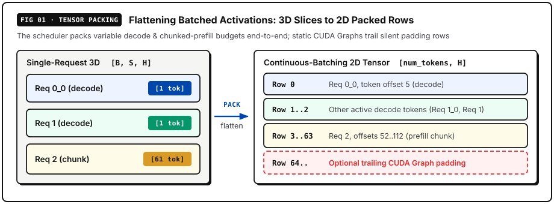
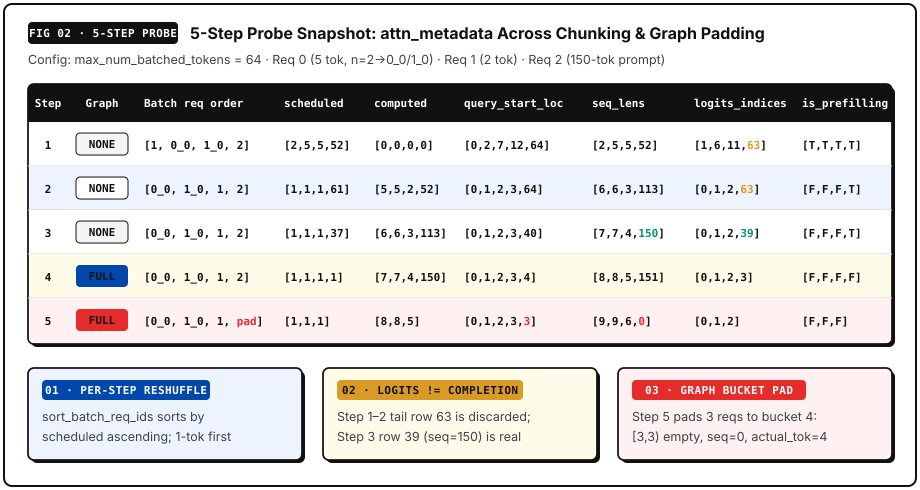
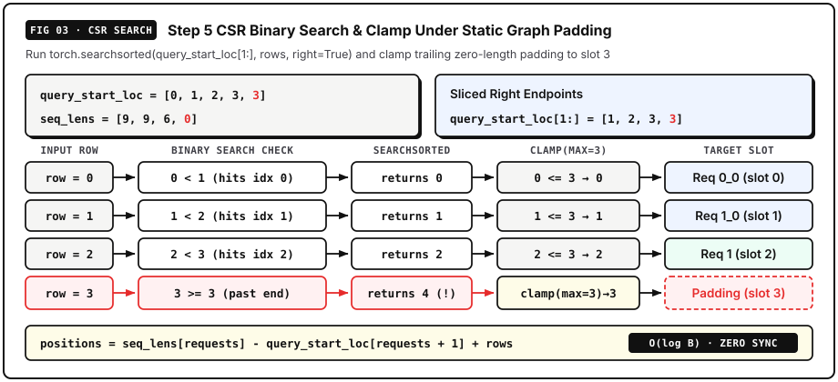
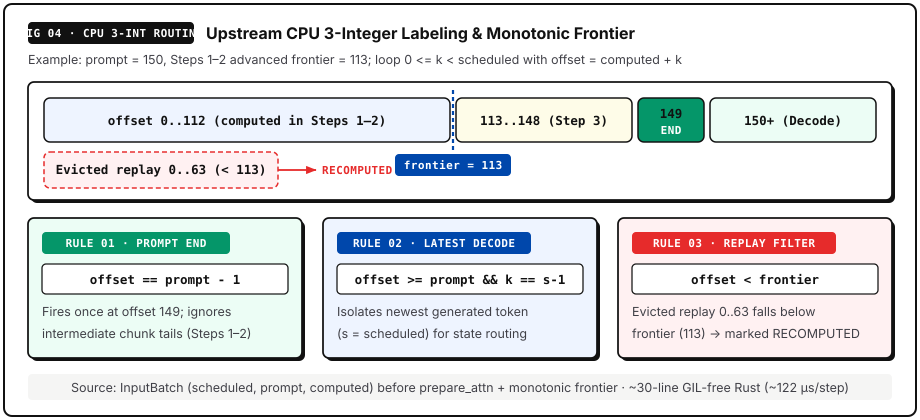

# Reconstructing Token Coordinates in Flattened Batches: Probing vLLM's `attn_metadata` and Sync-Free On-GPU Parsing

> **TL;DR**: Continuous batching and chunked prefill pack variable-length request slices end to end into a 2D `[num_tokens, hidden]` tensor—trailed by silent padding rows under static CUDA Graphs. Recovering which request owns row `r` and at what logical sequence position by reading static source code easily runs afoul of undocumented cross-backend differences. We show how a 15-line runtime probe and a `bs=1` MSE parity check map out `attn_metadata` in 5 steps; derive sync-free **on-GPU** coordinate reconstruction from Compressed Sparse Row (CSR) offsets, safe paged gathers, and metadata write switches; and draw the architectural boundary between in-layer GPU metadata parsing and upstream three-integer CPU routing.

In a single-request research script, activations arrive as a 3D `[batch_size, seq_len, hidden_size]` tensor where request index and token position correspond directly to the first two axes.

Inside a production vLLM engine running continuous batching and chunked prefill, the scheduler assigns each active request a variable token budget per step and concatenates them end to end into a 2D `[num_tokens, hidden_size]` tensor; under static CUDA Graphs, extra padding rows may also trail at the end to match a captured bucket width:



Any custom operator that depends on sequence structure—sparse or windowed attention, adaptive layer skipping, or per-request stateful adaptation—must first establish an exact mapping from **flat row index `r`** to **`(request_index, logical_offset, lifecycle_phase)`**.

Inside `forward`, linear projections and normalizations operate row-independently; the sole struct carrying batch layout into the model is **`attn_metadata`**. Because `attn_metadata` evolves across engine releases and attention backends with minimal documentation, guessing field invariants from static source code is error-prone.

---

Rather than reading twenty thousand lines of backend code and guessing, a reliable diagnostic workflow is **designing a minimal input schedule that forces every state transition in a handful of steps, logging runtime fields with a tiny wrapper, and verifying row extraction against a `bs=1` MSE reference**.

Setting `max_num_batched_tokens = 64` to force chunked prefill with CUDA Graphs enabled and submitting three small requests—a 5-token prompt with parallel sampling `n = 2` (splitting into `0_0` and `1_0`), a 2-token prompt (`1`), and a 150-token prompt (`2`)—exercises prefill chunking, multi-sample fan-out, decode transitions, and `FULL` CUDA Graph padding within **5 steps** (`tools/probe_attention_metadata.py`):



Every quirk in that table makes immediate sense once you model what `attn_metadata` actually is: **it is not a high-level request-lifecycle ledger—it is a low-level kernel launch packet shaped around GPU grid partitioning and static graph buckets.** Three structural consequences follow directly:

- **Batch order reshuffles every step, and phase counters follow kernel dispatch rules rather than prompt lifecycle**: Between Steps 1 and 2, `sort_batch_req_ids` sorts requests ascending by `scheduled` length so 1-token queries sit contiguously at the front ahead of multi-token chunks. Downstream, `FlashInferMetadata` counts *any* 1-token query as `num_decodes` (including a 1-token final prefill chunk, even while `is_prefilling` remains `True`), whereas `FlashAttentionMetadata` leaves `num_decode_reqs` and `num_prefill_tokens` at `0`; `seq_lens` always equals post-step valid cache length `computed + scheduled`.
- **Under `FULL` CUDA Graphs, `num_actual_tokens` reports the padded bucket width**: On Step 5, only 3 real requests (3 tokens) remain, padded to a 4-row graph bucket. `query_start_loc` appends a zero-length interval (`[0, 1, 2, 3, 3]`), `seq_lens` appends `0`, and `slot_mapping` writes `-1`—while `attn_metadata.num_actual_tokens` equals **`4`**, the padded tensor height.
- **`logits_indices` marks `lm_head` projection slots, not prompt completion**: On Steps 1 and 2, Request `2`'s unfinished chunk tail (row `63`) still appears in `logits_indices`, runs through `lm_head`, and is discarded afterward; only row `39` on Step 3 (`seq_lens == 150`) produces a real initial sample. (Re-running the probe under `TP = 2` also confirms that every tensor-parallel rank receives byte-identical `InputBatch` and `attn_metadata` fields, halving only local KV head counts.)

To verify any row-extraction logic end to end, run prompts one by one at `batch_size = 1` (greedy) to record unambiguous Layer-0 decode states, then run the mixed batch concurrently and check per-step MSE against those single-request references—any off-by-one shift at a chunk or padding boundary surfaces immediately.

---

With the layout clear, consider the in-graph problem: **when custom code runs inside a model layer (`@pllm.custom_attention` or compiled layer slices) where `.cpu()` and `.tolist()` are forbidden by `torch.compile` and CUDA Graphs, how do you reconstruct coordinates and steer cache behavior purely on the GPU?**

**1. Model `query_start_loc` as a CSR row-pointer array and invert it via parallel binary search.**

`query_start_loc` (`[0, 1, 2, 3, 64]`) is identical to the `row_ptr` array in **Compressed Sparse Row (CSR)** matrices (`cuSPARSE` / graph frameworks): Request $i$ owns the half-open row interval `[query_start_loc[i], query_start_loc[i+1])`.

Evaluating `torch.searchsorted(query_start_loc[1:], rows, right=True)` finds the first right endpoint strictly greater than `row` in $O(\log B)$ parallel work per thread—and clamping to `len(seq_lens) - 1` handles Step 5's trailing zero-length graph-padding interval `[0, 1, 2, 3, 3]` cleanly:



Once `requests` is known, subtracting the request's batch end offset from its post-step `seq_lens` recovers every row's exact logical sequence position `positions` (`pllm/execution/attention.py`):

```python
rows = torch.arange(query_count, device=pages.device)
# 1. Invert CSR offsets in O(log B) parallel registers; clamp absorbs trailing 0-length graph padding
requests = torch.searchsorted(query_start_loc[1:], rows, right=True).clamp(max=len(seq_lens) - 1)
# 2. Recover exact logical sequence offset from post-step seq_lens without host synchronization
positions = seq_lens[requests] - query_start_loc[requests + 1] + rows
```

Checking Request `2` on Step 2 (`Rows 3..63`, `seq_lens=113`, `query_start_loc[4]=64`) gives `113 - 64 + 3 = 52` at Row 3 and `113 - 64 + 63 = 112` at Row 63. (On DeepSeek V2/V3 MLA, `MLACommonMetadata` splits `decode` and `prefill` sub-structs; rebuilding unified `seq_lens` on GPU adds `prefill.chunked_context.context_lens` onto `prefill.query_start_loc.diff()` whenever prior chunks exist.)

**2. Clamp before gathering from `block_table`, then mask loaded values.**

Indexing `block_table[requests, chosen // 16]` for custom sparse `topk` reads inside a static graph encounters `-1` entries on unselected lanes and padding rows. Clamping coordinates into `[0, max_slots - 1]` prior to indexing and zero-masking afterward prevents out-of-bounds device faults without branching:

```python
valid = (chosen >= 0) & (chosen <= positions[:, None])
safe = torch.where(valid, chosen.clamp(0, block_table.shape[1] * 16 - 1), 0).long()
blocks = torch.where(valid, block_table[requests[:, None], safe // 16], 0).long()
keys = key_cache[blocks, safe % 16].masked_fill(~valid[..., None, None], 0.0)
```

**3. Steer upstream C++ cache and attention kernels via metadata boundary values.**

Respecting the exact sentinel conventions of upstream kernels avoids writing custom CUDA for control flow:
- **Selective cache-write suppression (`slot_mapping = -1`)**: vLLM's cache-write kernel ignores negative slot IDs. When an adaptive-depth policy (CALM) skips Layer 16 on a subset of rows, those skipped rows still need fresh K/V written for later tokens while already-computed active rows must not be overwritten—masking active rows' `slot_mapping` to `-1` and temporarily binding a 5-line `do_kv_cache_update` wrapper onto `self_attn.attn.forward` reuses native `QKV + QK-norm + RoPE` across 15 model families. (When compacting active rows into power-of-two graph buckets, also set inactive lanes' `seq_lens` to `1` rather than `0` so FlashAttention never divides `0 / 0` into `NaN`.)
- **Write-free attention "peek" (`seqused_k = seq_lens - 1`)**: Passing `(metadata.seq_lens - 1).clamp_min(0)` reads strictly prior cached KV, while `merge_attn_states` folds in the uncached current token's diagonal score—evaluating exploratory attention without modifying a byte of physical cache.

---

Finally, step back to the system boundary: **should cross-layer features parse `attn_metadata` on the GPU too?**

No. Because `attn_metadata` carries neither original prompt lengths nor eviction history, it structurally cannot distinguish an unfinished prefill chunk in `logits_indices` from true prompt completion, nor fresh prefill from a KV-preemption replay.

Whenever a workload needs **Layer-0 hidden capture, side-stream state prefetching, per-request state routing, or preemption replay filtering**, stepping one call upstream on the CPU to `GPUModelRunner.prepare_attn`—before `InputBatch` is lowered into `attn_metadata`—exposes three plain CPU integers (`scheduled`, `prompt`, `computed`). Paired with one monotonic per-request high-water mark `frontier`, a 30-line GIL-free Rust loop (`~122 µs`) resolves every lifecycle label deterministically:



In **[pLLM](https://github.com/LinesHogan/pLLM)** (`pllm`), both layers work in tandem: **cross-layer state routing and lifecycle checks stay upstream on three CPU integers, while in-layer custom attention stays on-GPU with `searchsorted` and metadata masks** (guarded at entry by `num_draft_tokens == 0`, since multi-token speculative decoding breaks the one-sample-slot-per-request invariant). Matching each problem to the layer that actually owns its invariant keeps both paths simple.
