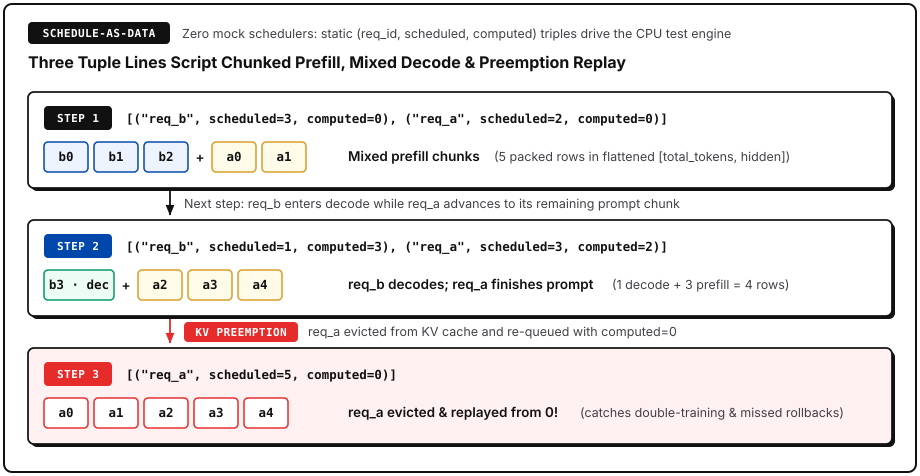
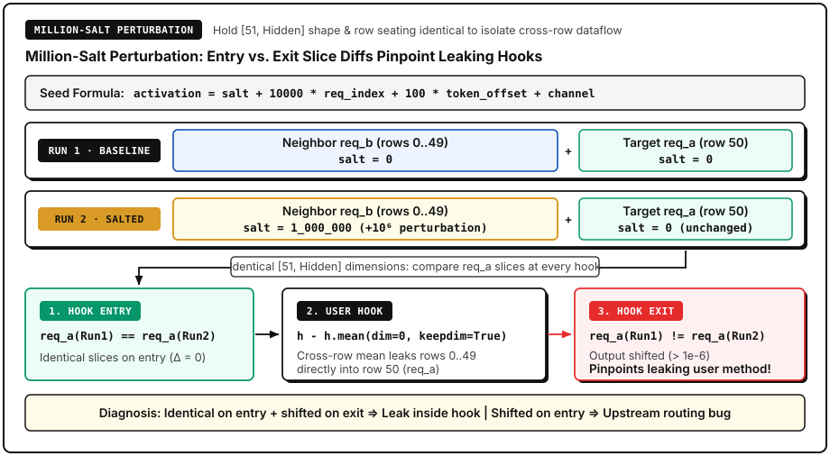

# `h - h.mean(dim=0)` Throws Zero Errors While Leaking Prompts Across Tenants: Turning Batch Schedules into Testable Data

> **TL;DR**: Ask a coding agent to center hidden states inside an inference hook, and `h - h.mean(dim=0, keepdim=True)` will sail past strict type checks, single-request unit tests, and CUDA Graph capture—before silently mixing Tenant A's confidential prompt into Tenant B's decode token under continuous batching. When drafting custom inference logic takes minutes, multi-tenant verification becomes the real bottleneck. We show how zero-byte `meta` tracing catches hidden host syncs, and how turning batch schedules into static integer triples (`Schedule-as-Data`) paired with "million-salt" metamorphic testing and 1-line preemption injection catches cross-tenant leaks, chunking drift, and rollback bugs on a laptop CPU in under two seconds.

Ask a colleague or a coding agent to write a quick activation-centering hook at Layer 8 of a Transformer, and nine times out of ten you will get this one-liner:

```python
centered = h - h.mean(dim=0, keepdim=True)
```

Run strict Pyright over it: zero errors. Run a single-prompt functional test: clean output. Warm up and capture CUDA Graphs on a GPU serving engine: passes without a warning.

The failure waits quietly until multi-tenant traffic hits production. Inside a continuous-batching engine, `h` is a flattened 2D `[total_tokens, hidden]` array packing every active request's tokens end to end: rows `0..49` hold 50 tokens of Tenant A's confidential contract prompt, while row `50` holds 1 decode token for Tenant B's chat session. Evaluating `h.mean(dim=0)` averages straight across row boundaries, injecting Tenant A's private prompt directly into Tenant B's hidden state with zero exceptions raised.

---

In an era where coding agents can draft custom inference plugins in minutes, **authoring code is no longer the bottleneck—verifying that custom code is safe to load into a multi-tenant GPU server is.** Reserving a multi-GPU node and loading tens of gigabytes of weights for every two-line edit kills iteration speed.

How do you compress multi-tenant safety verification down to two seconds on a laptop CPU?

Mimicking the Linux kernel's eBPF verifier with pure static AST bans falls apart across PyTorch's thousand-operator surface—valid per-row GEMMs and illegal cross-row reductions look syntactically identical without shape semantics, drowning authors in false positives.

A far sharper first filter is zero-byte **`device="meta"` symbolic tracing**: execute the workload against shape-only meta tensors without allocating a byte of HBM. Alongside catching shape and dtype bugs immediately, `meta` tracing catches hidden GPU-to-CPU synchronizations with zero false positives—any stray `if (h > 0).any():`, `x.item()`, or `assert not torch.isnan(h).any()` evaluates a data-dependent boolean on a symbolic node and immediately trips PyTorch's `GuardOnDataDependentSymNode` error before touching a GPU.

---

`meta` tracing alone cannot catch `h.mean(dim=0, keepdim=True)`, because its output shape, dtype, and device match valid per-row code down to the last dimension. Testing intricate multi-tenant interleavings without a GPU or multi-gigabyte checkpoints hinges on one modeling move: **turn continuous-batching schedules themselves into plain static data (`Schedule-as-Data`).**

Because the production Rust `RowLabeler` and state executor consume plain `(request_id, scheduled, computed)` integer triples, offline verification needs zero mock schedulers—three lines of Python tuples script an interleaved chunked-prefill, decode, and mid-flight preemption scenario against a tiny synthetic CPU Transformer:



Without hand-written golden outputs for arbitrary user math, how does that miniature engine know whether outputs are right or leaking?

Borrow **Metamorphic Testing** (invariant checking under equivalence transformations from compiler fuzzing and security non-interference proofs) to enforce three domain-agnostic laws:

1. **Chunk Invariance**: Processing `req_a`'s prompt in one shot versus splitting it into `2 + 3` token chunks must produce identical outputs and final state (catching dropped chunk tails or miscounted offsets).
2. **Preemption Invariance**: Evicting `req_a` mid-generation (`computed` reset to `0` on Step 3) and replaying history must match an uninterrupted run (catching double-trained replay tokens under `keep` or missed state rollbacks under `reset`).
3. **Non-Interference & Million-Salt Perturbation**: As long as target `req_a`'s own tokens and history stay fixed, changing co-scheduled neighbor `req_b` must never alter `req_a`'s output by a single ulp!

Why add a **Million-Salt Perturbation** on top of solo-vs.-batched comparisons? Suppose buggy code hides behind `if h.shape[0] > 4:`, or you want to pinpoint *which exact method* leaked. Holding the flattened batch shape `[51, Hidden]` and row seating identical across two runs isolates cross-row dataflow surgically:



With batch dimensions unchanged, even a `1e-6` shift in `req_a` proves cross-tenant coupling mathematically, while entry-vs.-exit slice diffs separate user `dim=0` bugs from framework routing bugs immediately. All suites finish in under two seconds on CPU.

---

When a workload clears CPU verification and runs end-to-end GPU smoke checks (`check_on_gpu`), two diagnostic lessons save hours of debugging:

- **Never assume PyTorch's `torch.cuda.set_sync_debug_mode("error")` catches every host stall.** That flag catches `.item()` and `.cpu()` transfers reliably—yet while hunting throughput jitter, we found it is **completely blind to explicit `event.synchronize()` and `stream.synchronize()` calls**, staying silent while the host thread blocks flat-footed on the GPU! Pair PyTorch's debug mode with explicit sync-primitive call audits.
- **Test live KV preemption deterministically by injecting one `return None` into `allocate_slots`, never by gambling on OOM stress tests.** Tuning memory utilization to provoke organic KV eviction is slow and flaky. Wrapping `kv_cache_manager.allocate_slots` in five lines to return `None` *once* right after a request's fourth decode token exercises upstream vLLM's exact production eviction, block-free, and prefill-recompute path deterministically on every run.

---

Zero-byte `meta` tracing, schedule-as-data tuples, million-salt metamorphic checks, and deterministic GPU preemption injection ship together in **[pLLM](https://github.com/LinesHogan/pLLM)** (`pllm`) as `pllm.explain()`, `pllm.testing.check()`, and `check_on_gpu()`—a mandatory two-second CPU gate every coding-agent draft clears before touching a GPU.

One honest disclaimer on what this verifier *cannot* do: think of it as a cold steel **go/no-go gauge** on a machine-shop floor. In two seconds, it guarantees your custom part won't seize the engine, stall the CUDA stream, or leak Neighbor A's prompt into Neighbor B's chat—while having zero opinion on whether your shiny new math makes the model smarter or just helps it hallucinate faster. For that half of the job, you still need an eval suite.
