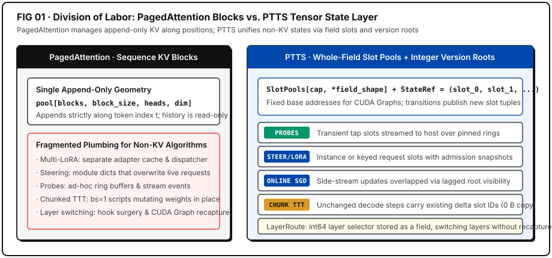
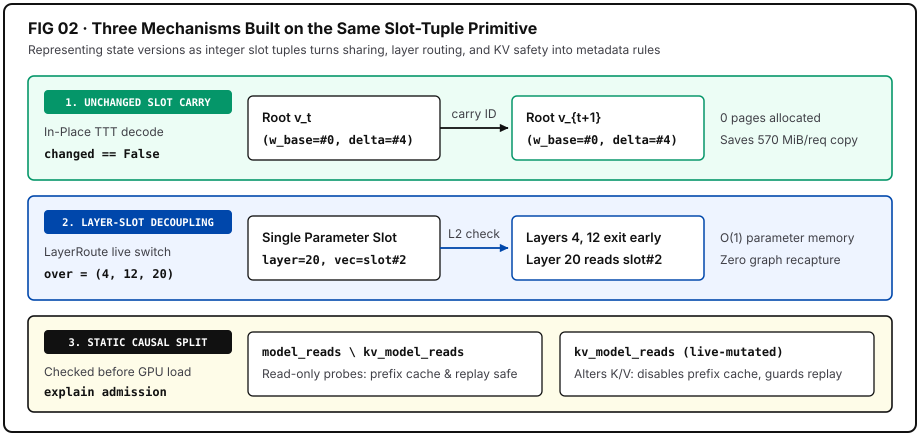

# Beyond PagedAttention: Unifying Stateful Inference Algorithms on One Tensor State Layer (PTTS)

> **TL;DR**: PagedAttention turned append-only KV caches into clean block tables, but it models only one state geometry: fixed per-token slices growing along the sequence axis. Supporting activation probes, multi-tenant LoRA, live activation steering, side-stream online learning, chunk-recurrent fast weights (In-Place TTT), and runtime layer switching through separate feature-specific managers leads to conflicting pointer, synchronization, and preemption rules. We describe the Paged Tensor Transition System (PTTS)—built on fixed-base whole-field slot pools, integer slot-tuple version roots, and explicit refresh and causal KV classification—showing how one substrate serves all of these algorithms inside captured CUDA Graphs while complementing PagedAttention.

PagedAttention solved a foundational memory problem in LLM serving: replacing per-request contiguous KV allocations with fixed-size physical blocks indexed through a block table. Whenever an algorithm's state follows that single law—append `[kv_heads, head_dim]` at token index $t$ while keeping positions $0..t-1$ immutable—sequence block tables are hard to beat.

Modern inference workloads and research prototypes, however, routinely carry non-KV state across steps and streams:

- Interpretability and safety pipelines extract intermediate hidden states or sparse autoencoder (SAE) features and stream them asynchronously to host memory;
- Multi-tenant customization attaches per-request low-rank adapters or hot-swaps shared steering vectors on a live server;
- Test-time adaptation updates small per-request predictors after each sampled token on a side stream (such as online self-distillation ESamp), or updates large fast-weight matrices every 512–1,024 tokens inside the forward pass (In-Place TTT);
- Interactive probing and adaptive interventions switch observation or steering sites from layer 8 to layer 20 without pausing to recapture CUDA Graphs.

Implementing each capability as an isolated feature quickly fragments the engine: one subsystem manages LoRA slots, another stores steering vectors in module attributes, a third maintains custom pinned ring buffers for probes, fast-weight prototypes fall back to `bs=1` in-place mutation, and layer changes tear down hooks and re-record graphs. Each piece works in isolation, yet combining two of them in one continuous batch—or evicting a request under KV memory pressure—exposes contradictory assumptions about pointer stability, stream ordering, and replayability.

---

Look across those algorithms side by side, and their math differs far more than their systems requirements. What every one of them actually asks from the serving runtime comes down to three primitives: **device storage whose base address stays constant across CUDA Graph replays, a lightweight indirection mapping logical ownership to physical slots, and explicit rules governing which version a reader sees.**

That observation shaped our **Paged Tensor Transition System (PTTS)**. Rather than replacing PagedAttention's sequence blocks, PTTS manages tensor state whose per-field shape is fixed and whose values evolve across versions or flow transiently across streams:



PTTS factors non-KV state along three orthogonal axes:

1. **Whole-field fixed-base pools (`SlotPools`)**: Each declared field allocates one contiguous tensor `pool[capacity, *field_shape]` at engine startup. Unlike KV caches that grow one token at a time, adapter factors, steering vectors, tapped rows, and scalar selectors are read and written as whole fields; whole-field slots avoid sub-tensor block fragmentation while keeping base pointers fixed for the lifetime of captured CUDA Graphs.
2. **Integer slot-tuple roots (`StateRef`) and ownership scopes**: A state version copies zero tensor bytes on its own—it is simply a tuple of integer slot indices `(slot_0, slot_1, ...)`. Combined with explicit scopes—engine-wide `InstanceState`, `RequestState` keyed by `request_id` / `prompt_index` / `route`, and token-aligned `PositionState`—the host stages compact integer descriptor tables before each step with zero device-to-host synchronization.
3. **Explicit transitions and two refresh modes (`refresh`)**: State mutates only through declared transitions (`StateImport` / `Feed`, on-GPU `@pllm.write`, stepwise `@pllm.train`, or in-forward `@pllm.train_in_forward`), each publishing a new `StateRef`. Readers declare either `refresh="admission"` (pinning the version active when the request entered, isolating in-flight streams from concurrent updates) or `refresh="step"` (reading the latest published root each step for live control).

---

Representing state versions as integer slot tuples unlocks several practical payoffs when algorithms meet continuous batching and CUDA Graphs:



**First, zero-copy slot carry for chunk-recurrent fast weights (In-Place TTT).**

In `Qwen3-4B` In-Place TTT, six adapted `W_down` fast-weight matrices occupy roughly `570 MiB` per concurrent request in `float32`. Copying `570 MiB` on every decode step would saturate memory bandwidth, even though TTT updates weights only at chunk boundaries (e.g., every 1,024 tokens) and leaves `changed == False` on the 1,023 decode steps in between.

Under PTTS, immutable pretrained weights `w_base` (borrowed zero-copy from the checkpoint) and mutable increments `w_delta` live in separate fields. Whenever an in-forward step reports `changed == False`, the published next-step root carries forward the existing `w_delta` slot index—allocating zero pages and copying zero bytes—while a paged matrix-vector kernel streams directly from `SlotPools` instead of gathering a `1.1 GiB` dense temporary buffer. On a single RTX 4090, 4-way concurrent `float32` serving reaches `171.6 tok/s`, more than $3\times$ the throughput ceiling of a `bs=1` reference loop (`54.8 tok/s`).

**Second, transient activation probes share the same slot substrate.**

Streaming intermediate hidden states to the CPU (`HiddenTaps` + `@pllm.export`) does not require a separate callback buffer layer. During the main forward pass, tap kernels copy selected rows into transient `SlotPools` slots without breaking `torch.compile` fusion; a side-stream task then transfers those slots through a pinned host ring buffer concurrently with the next forward pass. On `Qwen2.5-7B` at 128 concurrent sequences, exporting full 3,584-dim residuals to CPU every step runs at `22.06 ms` decode TPOT versus `21.97 ms` on unmodified vLLM.

**Third, runtime dynamic layer switching (`LayerRoute`) and static causal KV analysis.**

Switching a probe, steering vector, or LoRA from layer 8 to layer 20 on a running server—or routing different requests in the same batch to different layers—requires no special graph-patching machinery once the target layer index is stored as a `0-d int64` field (`ctrl.layer`) in PTTS. A single steering vector or adapter occupies one parameter slot; lightweight Triton kernels at candidate layers `over` check the L2-cached `int64` selector, return early on inactive layers, and read or accumulate from the parameter slot only on the active layer. Publishing a new version via `import_state` or `@pllm.write` switches layers on the next forward step with zero CUDA Graph recapture:

```python
class DynamicSteering(pllm.Workload):
    ctrl = pllm.InstanceState(
        {"layer": pllm.Field((), torch.int64), "vector": pllm.Field(lambda width, _: (width,))},
        init=pllm.Imported(),
    )
    route = pllm.model.LayerRoute("ctrl", over=(4, 12, 20))
    steer = route.patch(operator="add", decode=True)

    @pllm.export(name="probe", max_rows=8, max_cols=16)
    def capture(self, r: torch.Tensor = route.residual()) -> torch.Tensor:
        return r[:, :16].float()
```

Because every read and transition flows through one static declaration graph, the planner also separates **`model_reads`** (states read during forward, governing slot retention) from **`kv_model_reads`** (states whose values alter trunk K/V entries). Removing `steer` from the workload above leaves `kv_model_reads` empty, so the engine automatically permits prefix caching and seamless preemption replay; keeping a live-mutated `steer` or `adapter` puts the state in `kv_model_reads`, disabling prefix caching at build time and failing closed if KV preemption would otherwise replay old tokens under newer weights.

---

PTTS serves as the unified state substrate in **[pLLM](https://github.com/LinesHogan/pLLM)** (`pllm`); readers interested in the underlying lock-free Rust refcount ledger, generation tags, and non-blocking event reclamation can find those mechanics in Essay 07 of this collection.

Its boundaries are straightforward: variable-length token histories still belong in PagedAttention blocks (whole-field slots would pad shorter sequences to a fixed ceiling), outer-loop speculative tree verification and KV rollback belong in the token scheduler rather than per-step state transitions, and whole-field pools reserve a deterministic slot budget up front (inspected on CPU via `pllm.explain`). Trading an explicit startup memory reservation buys constant graph pointers and one composable state model across diverse inference-time algorithms.
