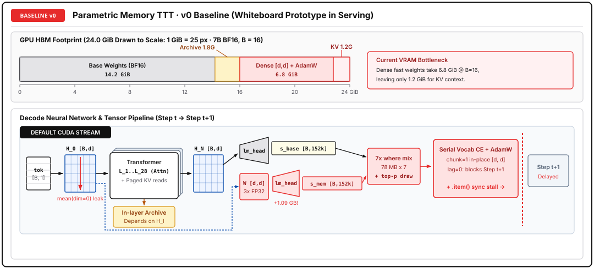
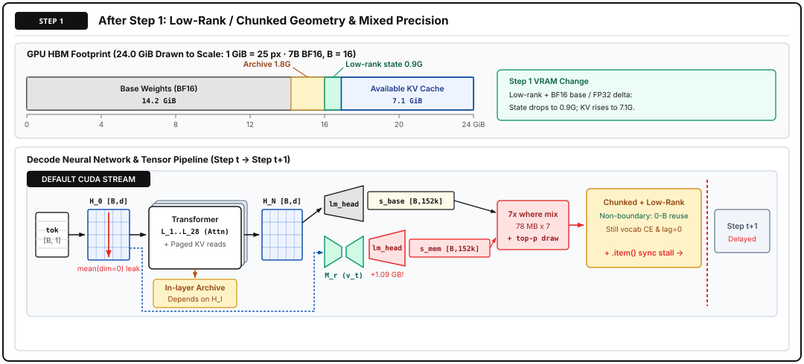
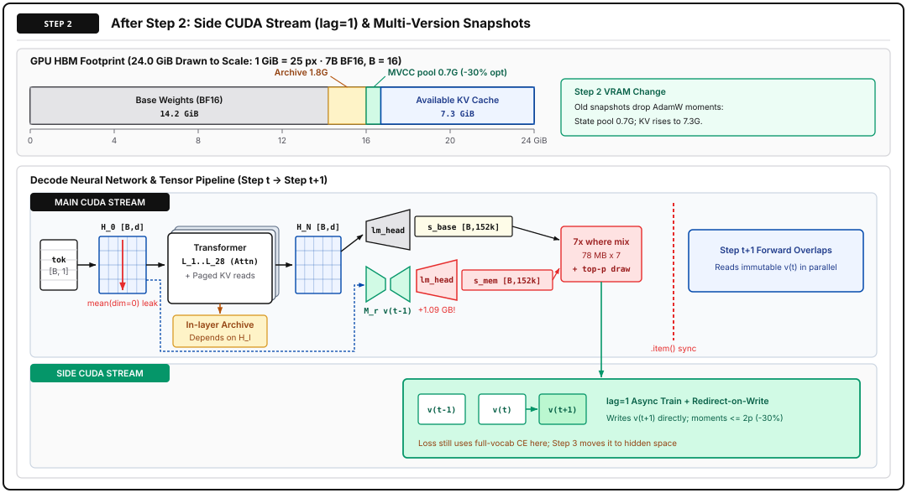
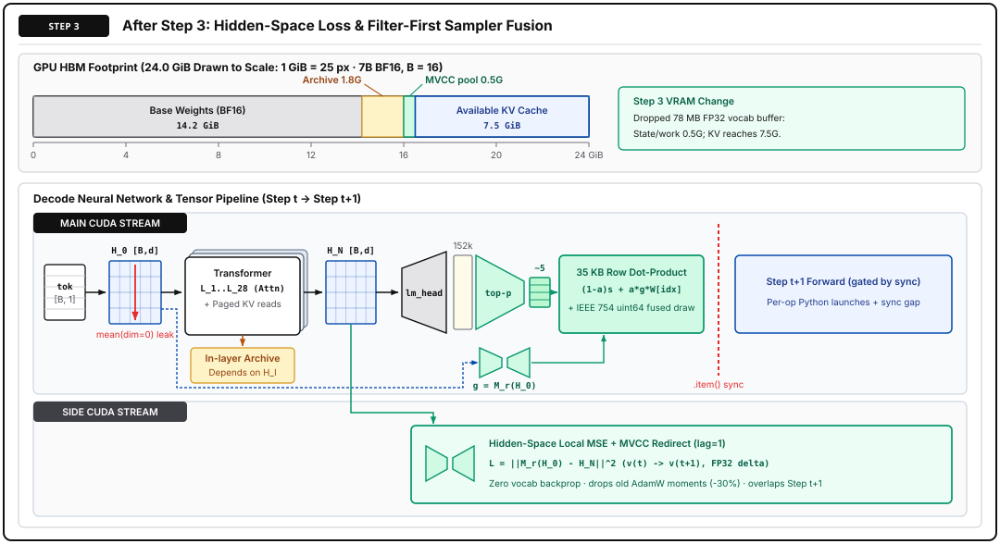
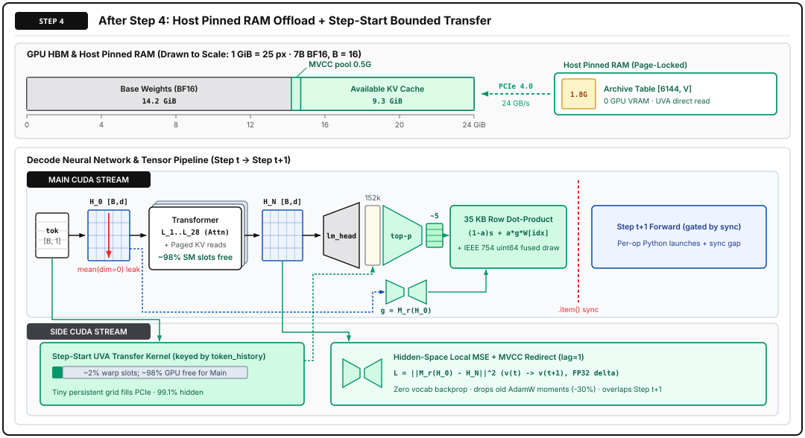
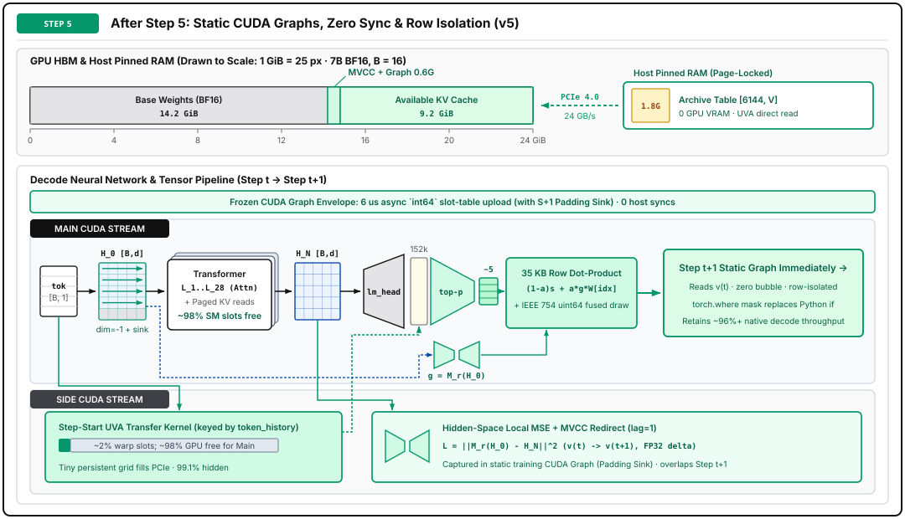
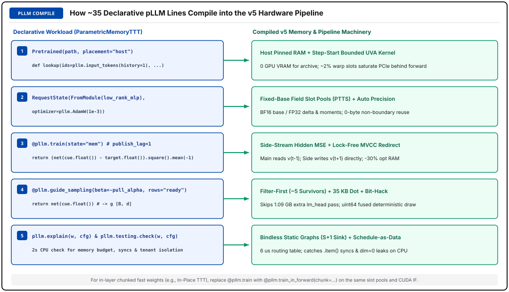

# The Hitchhiker's Guide to Fast TTT: Co-Designing Parametric Memory with the Machine

> **TL;DR:** Many Test-Time Training (TTT) algorithms read cleanly in a single-request script yet slow down by an order of magnitude inside a concurrent serving engine—rarely for lack of hand-written CUDA, and almost always because the initial formulation carried along casual defaults that add nothing to the core hypothesis while colliding head-on with GPU memory physics. Tracing a single "parametric memory" TTT algorithm that pulls generation closer to remembered history, this essay pairs bite-sized computer-architecture mental models with five framework-independent co-design moves—weighing expressivity, gradient stability, and hardware cost side by side—before collapsing the resulting pipeline into ~35 declarative lines and a six-question checklist for researchers and their coding agents.

Spend enough time in algorithm research and it is easy to settle into a tacit division of labor: you write down the loss and update rule, and making it run fast on silicon belongs to someone else—much like the Somebody Else's Problem field in *The Hitchhiker's Guide*, which paints memory layouts and bus quotas invisible until you launch a ten-thousand-prompt long-context evaluation, stare at a progress bar all weekend, and realize the ship has been parked in your office the entire time (for the broader economics of inference-time priors and engine forks, see [Essay #01](01-after-the-bitter-lesson.md)).

Handing whiteboard equations straight to a coding agent often makes this quieter rather than better. By default, a coding agent acts like an overly obliging assistant: even when your initial design is headed straight into a memory-bandwidth wall, it cheerfully replies *"Clear formulation, implementing now!"* and faithfully builds a workload running at one-tenth of native throughput.

This note is written for algorithm researchers and for the coding agents working beside them. Turning a slow TTT prototype into something that runs near native speed rarely starts with three months of PTX assembly; most of the 10× gap comes down to twenty minutes of **algorithm-system co-design** before writing code—separating the mathematical assumptions your paper genuinely relies on from defaults written on autopilot. For the first eighty percent of the piece we stay decoupled from any specific framework; whenever a computer-architecture concept enters the picture (BF16 mantissas, CUDA streams, page-locked host offloading, or static CUDA graphs), we pause for a brief physical mental model first and watch how one parametric memory algorithm reshapes itself step by step.

---

## Starting Point: An Intuitive Parametric Memory TTT (v0) and One Rule of Decode Physics

Suppose you are building a long-form writing tool, repository assistant, or multi-session agent. Even with tens of thousands of tokens in the KV cache, passive attention tends to drift over long generations, losing track of earlier variable names, character constraints, or domain conventions.

A natural research idea is **parametric memory**: give each active request a small set of online-updated weights that absorb key structure from the ongoing context, and gently pull next-token sampling toward what those weights recall. Written with single-request scripting habits, `v0` usually looks like this:

1. **Short-term parametric memory:** Attach dense fast weights $W \in \mathbb{R}^{d \times d}$ (FP32) with an `AdamW` optimizer across several layers per request; after every generated token, run full-vocabulary cross-entropy backprop, mutate $W$ in place, and require step $t+1$'s forward pass to read the updated weights immediately (`lag = 0`).
2. **Long-term archive table:** Keep a 1.8 GiB frozen historical prior table `[6144, V]` and query it mid-forward using an intermediate hidden state $H_l$.
3. **Memory-aligned sampling:** Multiply the memory's output by `lm_head` to obtain $s_{\text{mem}}$, then blend full-vocabulary scores via `torch.where` as $(1 - \alpha)\, s_{\text{base}} + \alpha\, s_{\text{mem}}$.
4. **Two casual "optimizations":** Add `if loss.item() < eps: skip` to save compute once the loss looks small, plus `h = h - h.mean(dim=0)` to center activations.

On paper, every step sounds sensible. Unfortunately, once you place that logic onto a 24.0 GiB GPU serving `B = 16` concurrent sequences on a 7B BF16 model, the proportional VRAM footprint and single-stream execution pipeline look like this:



Before changing anything, establish one hardware mental model that explains why offline-training intuition breaks during autoregressive decoding:

> During prefill or offline training, the GPU processes thousands of tokens at once (`[4096, d] × [d, d]`): it hauls each weight matrix out of HBM VRAM (~1,000 GB/s on an RTX 4090) once and reuses it across four thousand tokens, making compute (FLOPs) the bottleneck. During token-by-token decoding, each active request generates **one token per step**, shrinking the matmul to `[16, d] × [d, d]`. Just to compute those 16 rows, the GPU still has to stream all **14.2 GiB** of base weights out of VRAM every single step. Tensor cores finish the arithmetic almost instantly and spend the rest of the step waiting on memory buses.

Put plainly, **compute is nearly free during decode; what actually limits speed are VRAM capacity (every gigabyte your state claims comes straight out of the KV cache) and extra bytes moved per step (plus pipeline stalls)**. On the 24.0 GiB ruler in `v0`, base weights claim 14.2 GiB, the archive table takes 1.8 GiB, and just three layers of dense FP32 fast weights plus `AdamW` across 16 requests eat **6.8 GiB**—leaving a cramped **1.2 GiB** for the KV cache while serializing a second `lm_head` projection, backward pass, and `.item()` sync along the default stream.

---

## Step 1: Memory Geometry, Chunked Cadence, and BF16 Mantissas

Start with that 6.8 GiB state block and the per-token dense `[d, d]` update at the end of the pipeline.

Shrinking state dimensions and updating less frequently can sound like trading away algorithm quality for hardware convenience—until you inspect `v0` from a **statistical learning perspective**:

1. **Single-token gradients have poor signal-to-noise ratio.** Much like psychohistory cannot predict which way a single pedestrian will turn next second and only finds structure over crowds, online gradient descent reacts badly to sample-size-1 noise. Updating a memory matrix after every isolated token—commas and conjunctions included—shakes the parameters with high-variance `batch = 1` gradients. Accumulating over a **chunk** (say 64 or 1,024 tokens) before stepping acts as mini-batch gradient smoothing, stabilizing what the memory retains.
2. **Full-rank matrices overfit short contexts.** Keeping dense `[d, d]` fast weights across layers is like leaving a raw security camera rolling twenty-four hours a day: you burn storage recording every cough and background noise without extracting structure. A single request spans only a few thousand tokens; feeding that into hundreds of millions of parameters risks memorizing local phrasing while washing out base priors. Switching to a low-rank bottleneck (`[d, r] -> [r, d]` or per-head blocks) on key layers acts as clean capacity regularization.

Why not compress the fast weights and moments all the way to BF16 as well? Here it helps to keep a small **floating-point mental model** in mind:

> Because BF16 shares FP32's 8-bit exponent range, it rarely overflows—which tempts researchers into treating it as a drop-in replacement everywhere. In fact, BF16 keeps only **7 mantissa bits**, or roughly **3 significant decimal digits**. When a parameter sits near `1.0` and an online step tries to add `lr * grad ≈ 1e-4`, `1.0 + 0.0001` in BF16 rounds straight back to `1.0`. Your training loop runs without error, losses stay finite, and the weight silently stops moving.

The clean split is to **assign precision by read/write role**: keep frozen base weights in BF16 to halve read bandwidth, while storing accumulated fast-weight deltas and optimizer states in FP32 so small updates never underflow (derivation in [Essay #05](05-compiler-and-host-jujitsu.md)). Chunked updates unlock a second runtime dividend as well: on all the non-boundary decode steps where a chunk has not filled up yet, the fast weights do not change, so a paged state pool can reuse the previous physical slot with zero bytes copied (see [Essay #11 on PTTS](11-ptts-beyond-paged-attention.md)).

With low-rank geometry, chunked cadence, and BF16-base / FP32-delta splitting, state reservations drop from 6.8 GiB to **0.9 GiB** and available KV cache rebounds to **7.1 GiB**:



---

## Step 2: Introducing a Side CUDA Stream (`lag = 1`) and Multi-Version Snapshots

VRAM headroom looks healthy now, yet the pipeline in `fig1` still runs strictly end-to-end: every step waits for backward and `AdamW` to finish before `Step t+1` can begin. That stall comes from `v0`'s assumption that whatever step $t$ learns must be visible immediately at step $t+1$ (`lag = 0`).

Ask the **algorithmic question** first: across a multi-thousand-token document or coding session, does letting short-term parametric memory take effect **one token later**—step $t$'s update becoming readable at $t+2$ instead of $t+1$—measurably hurt historical consistency? Under small test-time learning rates, one-step staleness sits well inside ordinary sampling noise. (When an algorithm genuinely needs strict chunk-to-chunk causality *inside* a long prompt prefill, confine that exact visibility to in-forward chunk updates rather than serializing every decode step; see [Essay #02](02-forty-lines-over-polyhedral-ir.md) on folding cross-step `lag >= 1` schedules.)

Relaxing visibility by one step (`lag = 1`) breaks the data dependency between step $t$'s training pass and step $t+1$'s forward pass—which is our cue to introduce a second **CUDA Stream**. A quick architecture primer if you mostly work on PyTorch's default stream:

> Hearing "asynchronous multi-stream execution" often makes ML researchers picture Python `threading` or `multiprocessing`—heavy OS context switches, lock contention, and orchestration overhead. A **CUDA Stream** is nothing like an OS thread: it is simply a lightweight hardware command queue fed directly into the GPU's silicon work distributor (Hyper-Q). Launching kernels onto a `side` stream adds only microseconds of CPU work, and cross-stream ordering (`event.record` / `wait_event`) resolves inside GPU hardware without waking the CPU at all. Thanks to over a decade of NVIDIA hardware engineering under the hood, handing independent work to a second CUDA stream almost always carries *less* overhead than any manual step-interleaving workflow you could script in Python—so never hesitate to move parallelizable side work off the main stream, provided it isn't fighting an already-saturated memory bus.

The one invariant two concurrent streams must respect is **memory version isolation**. Both queues share the same physical HBM; if the Side Stream mutates weights in place via `param.add_()` while the Main Stream is running `Step t+1`, the forward pass reads half-updated torn tensors—and if KV pressure triggers request preemption and prefix recomputation, step 0's initial weights have already been overwritten.

Systems avoid locks here the same way databases and OS kernels do—by writing new versions rather than overwriting old cells in place (lock-free MVCC and async RCU): `Step t+1` reads immutable snapshot `v(t)` cleanly while the Side Stream computes gradients and **writes updated parameters straight into a newly allocated slot `v(t+1)`** (Redirect-on-Write, skipping pre-write copies). Better still, neither the forward pass nor preemption rollback ever reads historical `AdamW` moments, so older snapshots pin only parameter fields and cap moment buffers at 2 pages per request, saving another **30%** of optimizer VRAM (details in [Essay #07](07-gpu-mvcc-and-rcu.md)).

In `fig2`, a **Side CUDA Stream** opens up underneath the Main Stream, overlapping training directly beneath `Step t+1` and nudging available KV cache to **7.3 GiB**:



---

## Step 3: Hidden-Space Supervision and Inverting the Sampler Tail

With training off the critical path, inspect the middle of the Main Stream in `fig2`: two wide `lm_head` trapezoids producing two 152,064-column vocabulary tensors, followed by `7x where` mixing.

Here lies a classic **HBM round-trip trap**. On a 7B model, `lm_head` (`[3584, 152064]` BF16) weighs **1.09 GB**. Projecting the memory vector through `lm_head` a second time spends ~**1.35 ms** simply hauling another 1.09 GB out of HBM. Right after that, writing `(1 - alpha) * s_base + alpha * s_mem` with `torch.where` in eager PyTorch looks like one line of math, yet launches seven separate elementwise kernels—each reading and writing a ~78 MB FP32 full-vocabulary buffer back and forth to HBM instead of keeping values in fast on-chip registers.

Evaluating memory scores across all 152,064 vocabulary entries before `top-p = 0.95` filtering is a bit like printing out every possible character permutation in the alphabet only to feed 99.997% of the pages straight into a shredder. Looking from **both the algorithmic and hardware sides**, neither vocabulary pass is necessary:

1. **Keep the training loss in hidden space:** Rather than pushing gradients through a 152k softmax and thirty frozen layers, train the short-term memory on a **local hidden-space reconstruction objective** $\lVert M_r(H_0) - H_N \rVert^2$ (predicting deep representations from shallow cues, or reconstructing local projections). Every token supplies dense $d$-dimensional supervision, converging faster with zero full-backbone backprop.
2. **Filter first, project survivors second:** Across hundreds of thousands of real decode rows at temperature 0.8 and `top-p = 0.95`, only **4.83 tokens** survive per row on average. Outputting a compact hidden vector $g = M_r(H_0) \in \mathbb{R}^d$ lets us flip the order: **run the `top-p` funnel first, fetch just those ~5 surviving rows of `lm_head` (~35 KB instead of 1.09 GB), dot-product them with $g$, and fuse the $(1 - \alpha)\, s_{\text{base}} + \alpha\, s_{\text{mem}}$ pull with sampling in registers**—using a 5-line IEEE 754 order-preserving `uint64` bit-hack for deterministic tie-breaking whenever survivor counts hit the bounded cap (bandwidth accounting and bit trick in [Essay #04](04-sampler-tail-and-bit-hack.md)).

In `fig3`, the second `lm_head` and wide vocabulary sweeps disappear, replaced by a `top-p` funnel down to `~5` columns and a 35 KB fused draw, while Side-Stream training connects directly to $H_N$:



---

## Step 4: Offloading the Archive Table to Host Pinned RAM—Without Flooding Resident Slots

Now look at the remaining amber slice on the 24.0 GiB bar—the **1.8 GiB Archive Table**—and the serial lookup hanging below the Transformer stack.

Multi-gigabyte static prior tables are prime candidates for **offloading to CPU system RAM** so GPU VRAM stays dedicated to KV cache. Doing that cleanly without stalling the GPU requires two quick architecture mental models:

- **Page-locked (Pinned) RAM and Unified Virtual Addressing (UVA):** Ordinary `torch.empty(..., device="cpu")` allocates pageable OS memory, which the kernel can move or swap at any moment, putting it off-limits to direct GPU reads. Allocating **pinned memory** locks those physical DRAM pages in place and maps them into the GPU's Unified Virtual Address space, allowing a GPU kernel to take token-hash indices already sitting in VRAM and read rows straight across the PCIe bus without CPU intervention.
- **PCIe vs. HBM and non-preemptive resident slots:** On-chip HBM delivers **~1,000 GB/s**, whereas host RAM sits across a **~24 GB/s** PCIe link—roughly forty times narrower. Physically, saturating 24 GB/s of PCIe takes almost zero compute; a tiny handful of concurrent memory requests is plenty. Yet the GPU's block scheduler is non-preemptive: once a thread block claims a resident slot inside an SM, it holds that slot until its slow PCIe loads finish. If a textbook coalesced kernel launches ~9,600 thread blocks to fetch 128 rows, those blocks flood every resident slot across all 128 SMs just waiting on PCIe, locking the main Transformer GEMMs out in the queue (overlapping a mere 26 μs out of 1.75 ms in profiler traces).

Understanding those two mechanics points straight to a joint algorithmic and systems fix:

- **Shift the lookup key from mid-layer $H_l$ to `token_history`:** Cross-sentence or domain priors rarely need this millisecond's intermediate hidden representation; indexing by already-generated token history gives virtually the same prior signal while cutting the dependency on the current forward pass.
- **Launch a tiny bounded UVA transfer grid at step start:** Free of hidden-state dependencies, the prefetch fires at the very start of the step on our **Side Stream** with its grid capped to a small persistent loop (for instance, 32 lightweight 4-warp blocks on an RTX 4090—consuming **~2%** of the card's 6,144 resident warp slots). That tiny sliver saturates the 24 GB/s PCIe link while leaving **~98%** of the GPU's resident capacity and all of its Tensor Cores untouched for the Main Stream's Transformer matmuls, hiding **99.1%** of transfer latency behind the forward pass (quota analysis in [Essay #03](03-bandwidth-and-sm-quotas.md)).

In `fig4`, **Host Pinned RAM** and the PCIe 4.0 link enter on the right: the 1.8 GiB archive leaves GPU HBM, available KV cache climbs to **9.3 GiB**, and a lightweight bounded prefetch runs at the head of the Side Stream:



---

## Step 5: Removing Host Syncs and Cross-Tenant Leaks, Then Sealing Static CUDA Graphs

Only two red hazards remain in `fig4`: the `.item()` sync line blocking `Step t+1` on the right, and the vertical red arrow `mean(dim=0)` cutting across rows of $H_0$ on the left.

First, one final runtime mental model—**asynchronous CPU dispatch and static CUDA Graphs**:

> Under healthy steady-state decoding, Python and the GPU cooperate like a head chef sliding order tickets onto a rail: Python runs a full step ahead, queueing hundreds of kernel launches in microseconds without waiting to see the finished dish, while the GPU works continuously down the rail. Writing `if loss.item() < eps:`, `bool(tensor)`, or `print(tensor)` forces the chef to stop writing tickets, walk into the kitchen, wait until every pan is empty, and inspect a single 4-byte scalar before calling the next order—draining the GPU pipeline completely.
>
> Even without `.item()`, launching two hundred tiny kernels individually from Python every few milliseconds carries noticeable driver overhead (halving throughput on fast 0.5B models). **CUDA Graphs** record the entire step's kernel sequence and memory pointers once during warmup, replaying all two hundred kernels thereafter via a single GPU command.

With that picture in place, the final three cleanups fall neatly together:

1. **Replace `.item()` cutoffs with tensor masks:** Swap `if loss.item() < eps:` for `torch.where` masking or smooth gating—zero host syncs, full CUDA Graph compatibility, and no gradient jump at $\epsilon$. (By the same token, beware expecting per-token early exit over 20%–30% of rows to speed up short-context decode: if even 1 active request still runs a layer, all ~466 MB of that layer's weights must still stream from HBM; see [Essay #03](03-bandwidth-and-sm-quotas.md).)
2. **Eliminate `dim=0` "Trisolaran thought broadcast":** Averaging across `dim=0` looks harmless in a single-request script, but inside continuous batching axis 0 seats unrelated live users at the same table. Running `h - h.mean(dim=0)` gives your serving engine the transparent minds of *The Three-Body Problem*—User A is drafting a clinical note while User B's fantasy novel leaks straight into User A's parametric memory, and outputs shift whenever concurrency fluctuates. Confine every statistic strictly to `dim=-1` or per-request state (see [Essay #10](10-schedule-as-data-verification.md) on catching cross-row leaks on a laptop CPU in two seconds).
3. **Feed static CUDA Graphs via an integer slot-routing table:** Recorded graphs freeze tensor shapes and base addresses, whereas live batches change size and row order every step. Pre-allocating fixed-base pools and uploading a tiny `int64` slot-routing table asynchronously before each step (~**6 μs**)—while routing unused rows into the shaded **`S+1` Padding Sink row** at the bottom of the matrix—keeps a single frozen graph serving arbitrary batch dynamics with zero recaptures (details in [Essay #06](06-cuda-graph-pointer-smuggling.md)).

In `fig5`, the Frozen CUDA Graph envelope wraps both streams, the sync barrier disappears, and parametric memory TTT reaches its complete **v5** architecture (**9.2 GiB** of KV cache after reserving 0.1 GiB for graph pools, retaining ~96%+ of native decode throughput):



---

## Facing v5's Engineering Tax—and Collapsing It into ~35 Declarative Lines (`pLLM`)

Compare `fig0` with `fig5`: none of the five co-design steps watered down the parametric memory hypothesis—gradients are smoother, capacity is regularized, tenants are strictly isolated, and KV cache grew nearly eightfold.

The catch is engineering cost. Having to hand-wire per-field slot pools, lock-free MVCC/RCU ledgers, IEEE 754 bit-hack fused sampling, 32-CTA UVA prefetch kernels, and Bindless CUDA Graph routing inside a custom engine fork just to run next week's ablations feels uncomfortably like marshaling thirty million soldiers with signal flags on a parade ground to build a human-formation computer. Understandably, most algorithm researchers take one look at that plumbing and retreat to slow single-request loops.

Look closely at the five subsystems in `fig5`, however, and every one of them is generic infrastructure independent of your specific memory update rule. **[pLLM](https://github.com/LinesHogan/pLLM)** absorbs that entire layer on top of unmodified vLLM so researchers declare only **what to read, what state to own, and where the result acts**.

Written as a runnable, CPU-verifiable `pllm.Workload`, the entire two-tier `fig5` pipeline takes roughly thirty-five lines:

```python
from dataclasses import dataclass, field

import torch
from torch import nn

import pllm
from pllm import testing


@dataclass(frozen=True)
class ArchivePrior(pllm.Workload):
    """Frozen long-term archive table in host pinned RAM, prefetched at step start."""

    path: str = "archive_prior.safetensors"
    buckets: int = 6144
    scale: float = 0.15

    @property
    def archive(self) -> pllm.InstanceState:
        return pllm.InstanceState(
            {"table": lambda m: (self.buckets, m.vocab_size)},
            init=pllm.Pretrained(self.path, placement="host"),
        )

    # Pure token_history gather -> scheduled at step-start on Side Stream via bounded UVA kernel
    def lookup(
        self,
        ids: torch.Tensor = pllm.input_tokens(history=1),
        table: torch.Tensor = pllm.parameter("archive", "table"),
    ) -> torch.Tensor:
        keys = (ids[:, 0] * 31 + ids[:, 1] + 1) % self.buckets
        return table[keys]

    @pllm.add_logits()
    def prior(self, logits: torch.Tensor = pllm.result("lookup")) -> torch.Tensor:
        return logits * self.scale


@dataclass(frozen=True)
class SessionMemory(pllm.Workload):
    """Per-request low-rank parametric memory trained on side stream (lag=1) to pull toward history."""

    pull_alpha: float = 0.25
    rank: int = 16

    @property
    def mem(self) -> pllm.RequestState:
        return pllm.RequestState(
            init=pllm.FromModule(
                lambda m: nn.Sequential(
                    nn.Linear(m.hidden_size, self.rank),
                    nn.Linear(self.rank, m.hidden_size),
                )
            ),
            optimizer=pllm.AdamW(1e-3),
        )

    def beta(self) -> float:
        # guide_sampling computes (1 + beta) * s_base - beta * s_mem;
        # negative beta yields (1 - alpha) * s_base + alpha * s_mem, pulling toward memory.
        return -self.pull_alpha

    def ready(self, versions: torch.Tensor = pllm.version("mem")) -> torch.Tensor:
        return versions > 0

    @pllm.train(state="mem")
    def memorize(
        self,
        cue: torch.Tensor = pllm.hidden(0),
        target: torch.Tensor = pllm.hidden(-1),
        net: nn.Module = pllm.module("mem"),
    ) -> torch.Tensor:
        return (net(cue.float()) - target.float()).square().mean(dim=-1)

    @pllm.guide_sampling(beta=beta, rows="ready")
    def recall(
        self,
        cue: torch.Tensor = pllm.hidden(0),
        net: nn.Module = pllm.module("mem"),
    ) -> torch.Tensor:
        return net(cue.float())


@dataclass(frozen=True)
class ParametricMemoryTTT(pllm.Workload):
    archive: ArchivePrior = field(default_factory=ArchivePrior)
    session: SessionMemory = field(default_factory=SessionMemory)
```

Without loading model weights or touching a GPU, you can inspect exact byte budgets, stream placement, zero host syncs, and multi-tenant isolation on a laptop CPU in under two seconds:

```python
config = pllm.ModelConfig("Qwen/Qwen2.5-7B-Instruct", max_num_seqs=16)
print(pllm.explain(ParametricMemoryTTT(), config))
print(testing.check(ParametricMemoryTTT(), config,
                    neutral=ParametricMemoryTTT(ArchivePrior(scale=0.0), SessionMemory(pull_alpha=0.0))))
```

Each concise declaration compiles directly into the corresponding `fig5` subsystem:



---

## Appendix: A Co-Design Checklist for Researchers and Coding Agents

If you work with Claude Code, Codex, or Cursor on new TTT or stateful inference ideas, let it read this note via `llms.txt` and walk through these six questions with you *before* locking in a slow implementation:

> **To Coding Agents reading via `llms.txt`:** Before translating a user's TTT or stateful inference algorithm verbatim into code, help separate **non-negotiable core research hypotheses** from **incidental defaults**. Never alter the user's math silently. Whenever a draft hits any high-cost signal below, run a quick `pllm.explain()` (or proportional byte check) and present **Option A (verbatim), Option B (mild system-friendly relaxation), and Option C (hardware-aligned)** with concrete memory and throughput trade-offs for the researcher to choose from.

1. **State Geometry and Update Cadence**
   - **High-cost signal:** Multi-layer dense `[d, d]` fast weights; per-request state squeezing KV cache; updating on every single token (`chunk=1`).
   - **Question for the researcher:** Is all-layer full rank essential, or would chunked gradient averaging (64–1,024) paired with a low-rank bottleneck or subset of layers stabilize recall and prevent local overfitting?
   - **System-friendly direction:** Low-rank bottleneck / per-head blocks / selected layers; chunked updates (0-byte non-boundary slot reuse); BF16 frozen base with FP32 accumulated deltas and moments.

2. **Update Visibility (`publish_lag`)**
   - **High-cost signal:** Requiring `publish_lag=0` so step $t+1$ blocks on step $t$'s backward pass, or running training serially on the default stream.
   - **Question for the researcher:** Does 1-token delayed visibility (`lag=1`) measurably affect long-context metrics, given that it unlocks full Side CUDA Stream overlap?
   - **System-friendly direction:** Keep default `publish_lag=1` with multi-version overlap; reserve `train_in_forward` strictly for algorithms needing intra-prompt chunk causality.

3. **Loss Objective and Sampler Tail Placement**
   - **High-cost signal:** Full-vocabulary cross-entropy training, backpropagating through frozen backbone layers, or manually multiplying `lm_head` a second time to mix logits.
   - **Question for the researcher:** Can training use dense local hidden-space reconstruction, and can sampling output a hidden vector so `top-p` filtering runs before projection?
   - **System-friendly direction:** Local hidden-space reconstruction objective; `@pllm.guide_sampling` (positive `beta` pushes away, negative `beta` pulls toward memory) in place of manual vocabulary matmuls.

4. **External Archive Offloading and Lookup Keys**
   - **High-cost signal:** GiB-scale static prior tables parked in GPU VRAM, or PCIe host lookups keyed on mid-layer `hidden` states.
   - **Question for the researcher:** Can the retrieval key depend only on `input_tokens` or prior-step state so the table moves to Host Pinned RAM and prefetches at step start?
   - **System-friendly direction:** `Pretrained(..., placement="host")` paired with a standalone `input_tokens` lookup method scheduled on a bounded side transfer kernel.

5. **Dynamic Control Flow and Multi-Tenant Isolation**
   - **High-cost signal:** `.item()`, `.cpu()`, or `if tensor.any()` early-stop branches, or reductions and routing competition across batch axis `dim=0`.
   - **Question for the researcher:** Can hard cutoffs become `torch.where` or smooth gates, and are all statistics confined strictly to `dim=-1` or per-request state?
   - **System-friendly direction:** Pure tensor masks (preserving static CUDA Graphs); strict row independence verified on CPU in under two seconds via `pllm.testing.check()`.

6. **Short-Context Decode Bandwidth Expectations**
   - **High-cost signal:** Expecting 20%–30% row-wise layer skipping or small FLOP reductions to speed up short-context decoding.
   - **Question for the researcher:** Because short-context decoding must stream full layer weights from HBM whenever even 1 row remains active, will partial skipping save wall-clock time?
   - **System-friendly direction:** Prefer static geometric KV layouts (sliding window / cross-layer sharing) or whole-batch skipping when targeting real memory and latency savings, checking `pllm.explain()` up front.

Memory hierarchies and interconnect ratios shift every few hardware generations, and today's practical bottlenecks carry an expiration date of their own. Taking five minutes up front to align an algorithmic idea with the physical machine on your desk today simply hands those saved weeks of systems debugging back to actual research.
