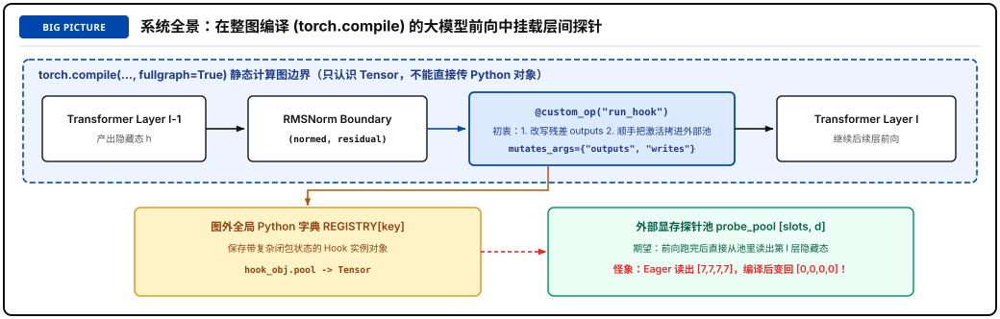
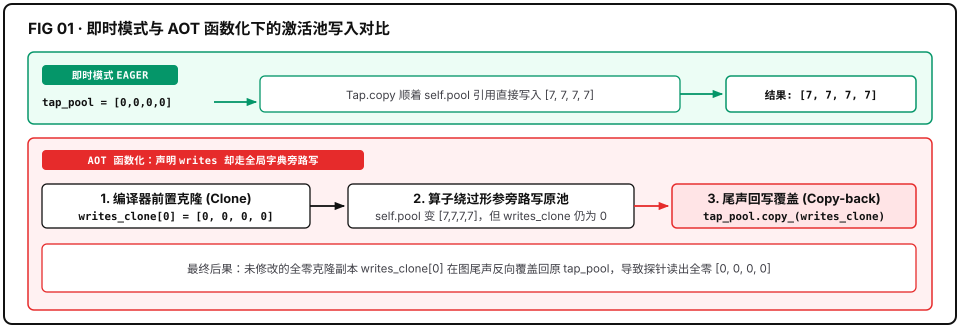
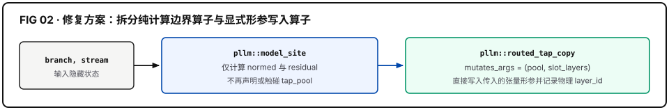

# 自定义算子接入 `torch.compile` 后写入失效：从一次排障看 PyTorch AOT 函数化

> **TL;DR**：想在不打断 `torch.compile(fullgraph=True)` 整图编译的前提下把大模型中间层的隐藏态拷进外部显存池，最顺手的写法是注册一个 `torch.library.custom_op`，把显存池声明进 `mutates_args` 里，再从全局 Python 字典取出钩子对象执行拷贝。然而这段在即时（Eager）模式下完全正常的代码，一开编译就会在毫无报错的情况下把刚写进去的 `[7, 7, 7, 7]` 抹回全零。原因在于 PyTorch 编译器的 AOT 函数化阶段会在算子前后包一层“克隆复印件 → 执行算子 → 拿复印件盖回原件”的转换；算子绕过形参直接修改原张量，最终被编译器手里未动过的空白复印件反向覆盖。将探针拷贝拆为直接读写张量形参的独立算子后，数据流与编译器契约恢复一致，也顺带修掉了提前跳层退出时层号标签误标的问题。

做大模型可解释性分析、激活引导（Steering）或者在线记忆训练时，我们经常需要干一件很朴素的事：在 Transformer 跑到第 $l$ 层和第 $l+1$ 层交界的 `RMSNorm` 边界时，顺手把这一层的隐藏状态（Hidden States）拷进一块预先分配好的外部显存池 `probe_pool` 里，顺便允许用户在边界上对残差做一点自定义修改。

如果只跑单卡实验脚本，直接挂一个 PyTorch 的 `register_forward_hook` 就能收工。但在生产级推理引擎里，模型前向通常要用 `torch.compile(..., fullgraph=True)` 整图编译成一张没有 Python 断图（Graph Break）的静态计算图。整个场景在系统里的位置长这样：



这里横着一道所有写过 `torch.compile` 扩展的人都会撞上的约束：**整图编译的自定义算子（Custom Op）签名里只认 `Tensor` 和基本标量，不能直接把一个带复杂闭包和内部状态的 Python 钩子对象塞进算子参数里。**

---

既然算子参数里传不了 Python 对象，工程师第一反应都会想到一个经典的“旁路查表”写法：我们在图外维护一个全局字典 `REGISTRY`，把 Python 钩子实例存进去；注册一个自定义算子 `run_hook`，算子内部按整数 `hook_id` 从字典里取回实例并调用它的 `.run()` 方法。

同时，为了做个守规矩的好公民——告诉编译器“我的算子不仅会改写层间输出 `outputs`，还会原地修改外部的探针池 `probe_pool`”，防止编译器把算子当成无副作用的死代码删掉或乱序重排——我们特意把 `probe_pool` 塞进 `writes` 列表传给算子，并在装饰器上老老实实写明了 `mutates_args={"outputs", "writes"}`。

把无关的业务逻辑剥掉，当时写出来的代码骨架就是下面这二十来行（你可以直接拷进本地 Python 运行复现）：

```python
import torch
from torch import Tensor

REGISTRY: dict[int, "LayerHook"] = {}

class LayerHook:
    def __init__(self, probe_pool: Tensor):
        self.pool = probe_pool  # 持有外部显存探针池的引用

    def run(self, x: Tensor, out: Tensor) -> None:
        h = x + 7.0
        out.copy_(h)          # 1. 把修改后的激活写进层间输出形参 out
        self.pool.copy_(h)    # 2. 顺手把同一份激活拷进外部探针池

@torch.library.custom_op("demo::run_hook", mutates_args={"outputs", "writes"})
def run_hook(
    inputs: list[Tensor], outputs: list[Tensor], writes: list[Tensor], hook_id: int
) -> None:
    # 按 ID 从全局字典取回 Python 对象执行
    REGISTRY[hook_id].run(inputs[0], outputs[0])

@run_hook.register_fake
def _(inputs, outputs, writes, hook_id):
    return None
```

写这段代码时的初衷很清晰：`out` 接住改写后的激活继续往下游层传，`self.pool` 把激活存下来供外部读取，而 `writes=[probe_pool]` 则负责向编译器报备“这块内存我动过了”。

在即时执行（Eager 模式）和原生 CUDA Graph 录制下，这段代码跑得天衣无缝：传入全零的 `x = torch.zeros(4)`，跑完之后看一眼模型继续往下传的 `out`，里面是 `[7., 7., 7., 7.]`；再看一眼外部的 `probe_pool`，里面也是 `[7., 7., 7., 7.]`。

然而很遗憾，当我们给外层前向套上 `torch.compile(fn, backend="aot_eager", fullgraph=True)` 再跑完全相同的输入时，怪事发生了：

```python
probe_pool = torch.zeros(4)
REGISTRY[0] = LayerHook(probe_pool)

def forward_step(x: Tensor) -> Tensor:
    out = torch.empty_like(x)
    torch.ops.demo.run_hook([x], [out], [probe_pool], 0)
    return out

# Eager 模式：out 为 [7, 7, 7, 7]，probe_pool 也为 [7, 7, 7, 7]
# 编译模式：
compiled_step = torch.compile(forward_step, backend="aot_eager", fullgraph=True)
res = compiled_step(torch.zeros(4))
print(res)         # tensor([7., 7., 7., 7.])  <- 层间输出完全正常！
print(probe_pool)  # tensor([0., 0., 0., 0.])  <- 探针池居然还是全零！
```

全程没有任何报错，也没有触发断图回退，`run()` 函数体明明真真切切执行过了（不然 `res` 不可能变成 `7`），甚至如果你在 `self.pool.copy_(h)` 下一行加一句 `print(self.pool)`，打印出来的也是 `[7., 7., 7., 7.]`。可一旦编译后的函数返回，外面的 `probe_pool` 就像被人施了失忆咒一样，瞬间变回了 `[0., 0., 0., 0.]`。

---

要看懂写进去的数据是在哪一微秒被人抹掉的，得先补一块底层拼图：**`torch.compile` 背后到底是怎么处理“原地修改张量”的？**

我们平时手写 PyTorch 代码，习惯用 `out.copy_()`、`x.add_()` 这类带下划线的原地（In-place）算子，因为能省显存分配。但后端图编译器（比如 Inductor）在做算子融合、指令重排和死代码消除时，最怕的就是“两段代码偷偷改同一块内存”——只要存在隐式的内存别名和原地副作用，编译器就不敢随便挪动任何一条指令的顺序。

因此，现代图编译器都会先做一步叫作 **Functionalization（函数化）** 的变换，把整张图改写成**单静态赋值（SSA，Single Static Assignment）**形式：图里的每一个张量一旦生成就不可变，所有计算都必须变成“吃进旧张量、吐出新张量”的纯函数。

对于 PyTorch 自带的原生算子，编译器清楚 `x.add_(1)` 等价于 `x_new = x + 1`；但遇到我们用 `@torch.library.custom_op` 注册的黑盒自定义算子时，编译器看不见算子内部的 Python/C++/Triton 实现，只知道你在装饰器上写了 `mutates_args={"outputs", "writes"}`。

为了把这个黑盒强行变成纯函数，PyTorch 的 AOTAutograd 引擎会自动用一层叫 `auto_functionalized` 的包装器把你的算子裹起来，在幕后悄悄干三件事：

1. **前置克隆复印件（Clone）**：进你的算子之前，编译器先把 `outputs` 和 `writes` 里的每一个张量都 `.clone()` 出一个临时副本（比如 `writes_clone = [w.clone() for w in writes]`），然后**把这份复印件作为形参递进你的算子里**；
2. **执行算子（Execute）**：运行你的 `run_hook` 函数体。编译器默认你会老老实实把修改写在这批克隆形参上，执行完后把修改后的克隆副本作为纯函数节点的返回值往后传；
3. **尾声盖回原件（Epilogue Copy-back）**：整张图跑完、需要把更新后的状态同步回外部持有的原始张量时，编译器自动补上一条 `probe_pool.copy_(writes_clone[0])`，拿复印件的内容把原件覆盖一遍。

把这套幕后流程摆到台面上，刚才的灵异现象一句话就能讲通——**编译器递给你一张空白复印件让你在上面填数，你却伸手打开抽屉把数直接填在了原件上；等你交卷离开，编译器顺手把那张一字未改的空白复印件盖回了原件上。**



对照上面的时间线再看一眼那两行 `copy_`：

- `out.copy_(h)` 之所以活了下来，是因为 `out` 取自算子的形参 `outputs[0]`——它改的正是编译器递进来的克隆件 `outputs_clone[0]`，尾声回写时自然把 `[7, 7, 7, 7]` 同步回了外部；
- `self.pool.copy_(h)` 之所以白干了，是因为它根本没碰形参 `writes[0]`，而是顺着全局字典 `REGISTRY` 里的对象属性，绕过编译器直接改了外面的原池 `probe_pool`。在编译器眼里，递进去的 `writes_clone[0]` 进去是 `[0, 0, 0, 0]`、出来还是 `[0, 0, 0, 0]`，说明算子执行后的“新值”就是全零，最后一步 `probe_pool.copy_(writes_clone[0])` 便尽职尽责地把你刚写的 `7` 冲成了 `0`。

也许你会问：那我干脆别在 `mutates_args` 里声明 `"writes"` 不就行了？也不行。一旦不声明，编译器就会认定 `probe_pool` 跟这个算子毫无数据依赖——只要同一张编译图里后半段有人去读 `probe_pool`，编译器随时可能把读取指令重排到写入之前，酿成更隐蔽的乱序读取。

---

看穿了这层窗户纸，修起来就不需要去折腾全局字典，而是顺着编译器的脾气，把“带闭包状态的残差改写”和“纯粹搬运数据的探针拷贝”拆成两步。

仔细想一下：`run_hook` 之所以非要走全局字典查 Python 对象，是因为用户的残差改写逻辑可能挂着任意复杂的外部状态；而探针拷贝只做一件单纯的事——拿到当前层的隐藏态张量，按行索引拷进显存池 `probe_pool` 里，压根不需要访问任何 Python 对象。

于是我们把探针拷贝从 `LayerHook.run()` 里拎出来，单独写成一个纯张量形参的算子，紧跟在边界钩子后面调用：



```python
@torch.library.custom_op("demo::probe_copy", mutates_args={"probe_pool", "layer_tags"})
def probe_copy(
    hidden: Tensor,
    src_rows: Tensor,
    dst_slots: Tensor,
    probe_pool: Tensor,
    layer_tags: Tensor,
    layer_id: int,
) -> None:
    # 直接对传入的形参张量做原地写入，不再绕路查任何全局对象！
    valid = (src_rows >= 0) & (dst_slots >= 0)
    probe_pool[dst_slots[valid]] = hidden[src_rows[valid]]
    layer_tags[dst_slots[valid]] = layer_id
```

这么一拆，`probe_pool` 作为直接形参传进 `probe_copy`，算子内部也直接往形参 `probe_pool` 上写数据。AOT 函数化克隆形参 → 算子修改克隆副本 → 尾声拷回原池，三步严丝合缝，Eager 与 `torch.compile` 终于给出了一模一样的 `[7., 7., 7., 7.]`。

---

有意思的是，这次拆分还顺手消灭了另一个潜伏的元数据 bug：**导出的“层号标签”到底该在前向开始前填，还是在真正跑过那一层的瞬间填？**

在做动态层分析时，探针池里的每一行除了存激活向量，旁边还配了一个 `int64` 的标签槽 `layer_tags[slot]`，告诉下游“这一行激活是从第几层采出来的”（没采到记为 `-1`）。

最初图省事，我们在整步前向还没开始前的 CPU/GPU 准备阶段，一看路由配置写着“本步目标采第 2 层”，就提前把 `2` 填进了 `layer_tags[slot]`。如果模型老老实实从第 0 层一路跑到最后一层，这没有任何毛病。但如果用户同时写了**提前退出（Early-Exit）或自适应跳层**逻辑，比如某一步算完第 0 层觉得置信度够了，直接 `return` 退出前向，压根没走到第 2 层：

- **旧写法（准备期预填标签）**：第 2 层的探针根本没机会运行，池子里的激活还是上次清零留下的 `[0, 0, ..., 0]`，可旁边的标签却赫然标着 `layer = 2`——下游分析代码兴冲冲拿走一行全零，还以为第 2 层神经元集体死机了；
- **新写法（内核拷贝时同步落盘）**：准备阶段统一把 `layer_tags` 重置为 `-1`；只有当模型前向真正流经第 `layer_id` 层、且 Triton 拷贝内核把隐藏态写进 `probe_pool` 的同一刻，才由第 0 号线程块顺手把 `layer_id` 写进 `layer_tags`：

```python
@triton.jit
def _routed_probe_copy_kernel(
    hidden_ptr, src_rows_ptr, dst_slots_ptr, row_layers_ptr,
    pool_ptr, layer_tags_ptr, hidden_stride, pool_stride,
    width, layer_id, BLOCK: tl.constexpr,
):
    row = tl.program_id(0)
    dst = tl.load(dst_slots_ptr + row)
    target_layer = tl.load(row_layers_ptr + row)
    if (dst < 0) | (target_layer != layer_id):
        return
    src = tl.load(src_rows_ptr + row)
    if src < 0:
        return
    if tl.program_id(1) == 0:
        # 只有真正执行到这一层并发生激活拷贝时，才写下层号标签
        tl.store(layer_tags_ptr + dst.to(tl.int64), tl.full((), layer_id, dtype=tl.int64))
    cols = tl.program_id(1) * BLOCK + tl.arange(0, BLOCK)
    mask = cols < width
    vals = tl.load(hidden_ptr + src.to(tl.int64) * hidden_stride + cols, mask=mask, other=0.0)
    tl.store(pool_ptr + dst.to(tl.int64) * pool_stride + cols, vals, mask=mask)
```

如果某一步提前退出跳过了第 2 层，第 2 层的内核压根不会跑，池子保持全零，标签也诚实地保持 `-1`，数据和它的“出生证明”在物理时间上彻底绑定在了一起。

---

回头复盘，为什么这个“写了等于白写”的 bug 能躲过我们第一轮端到端 GPU 集成测试？

原因很典型：第一轮测试为了省时间，把“自定义残差改写”“在线适配器”和“激活探针”全挂在同一个测试任务里一起跑。恰好引擎检测到存在复杂的动态残差回调时，会自动切到 `backend="eager"` 配合原生 CUDA Graph 录制，绕开了 Inductor 的 AOT 函数化；直到后来单独测一个“只挂探针、不挂其他组件”的轻量任务时，引擎走回默认的 `torch.compile(backend="inductor")` 主路径，全零的探针池才终于露出了马脚。

这也给我们留下了一条便宜又管用的自检习惯：**只要你写了带 `mutates_args` 的 `@torch.library.custom_op`，不管它将来跑不跑 GPU，都在纯 CPU 单测里固定套一行 `torch.compile(fn, backend="aot_eager", fullgraph=True)` 跑一遍非零输入，断言外部缓冲区真的变了。** `aot_eager` 不需要显卡，也不需要等 Inductor 慢吞吞编译 C++/Triton 代码，几十毫秒就能把 AOTAutograd 的“克隆—执行—回写”完整走一遍，任何绕过形参偷改内存的旁路引用都会当场现形。

上述机制对应开源推理框架 **[pLLM](https://github.com/LinesHogan/pLLM)** 中动态切层（`LayerRoute`）的底层实现。客观地说，把 `probe_copy` 拆成边界外的独立算子并非零代价：候选集合里的每一层都会在静态 CUDA Graph 中多留一个轻量内核节点；未命中层虽然只需在片上缓存读两个整数就会立刻退出，但内核发射本身的微秒级开销仍会随候选层数量线性累加，因此在实际工程中更适合按需列出要切换的候选层，而不是偷懒挂满整个模型。
