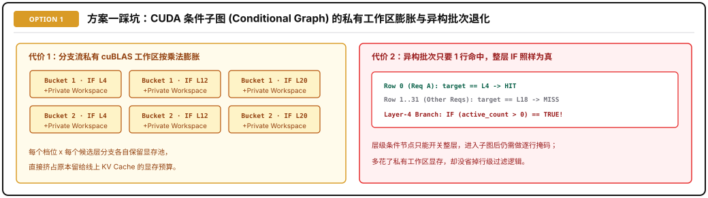
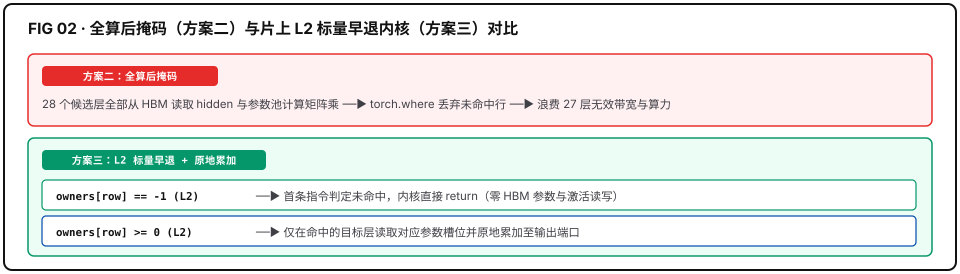

# 不重录 CUDA Graph 实现动态切层：条件子图、掩码求值与早退 Triton 内核的比较

> **TL;DR**：在线推理服务完成 CUDA Graph 捕获后，如果希望动态切换激活干预、探针或 LoRA 的目标层，重新捕获整套分档位静态图会带来数秒停顿；而在所有候选层做全量计算再 `torch.where` 掩码，又会让未命中层额外消耗显存带宽。对比 CUDA 条件子图的私有工作区显存开销后，我们采用了基于片上 L2 标量判定的早退 Triton 内核，并复用层间归一化输出端口原地累加，使未命中候选层跳过权重池与激活池的 HBM 读写。文末记录了 `rank > 256` 回退分支里 `bool(mask.any())` 导致图捕获失败的排查过程。

在做模型内部表征分析或在线激活引导（Steering）时，经常会遇到这样的场景：模型已经加载并完成了各个批次档位的 CUDA Graph 预热捕获，此时希望把读取残差或注入干预向量的位置从第 8 层调整到第 20 层，或者在同一个连续批处理步中让请求 A 走第 4 层 LoRA、请求 B 走第 18 层 LoRA、请求 C 传 `-1` 保持原模型输出。

如果把层号作为静态图结构的一部分，每次换层都需要卸载旧钩子、重新走一遍编译并重录 `[1, 2, 4, 8, ..., 256]` 等全部批次档位的 CUDA Graph，一次切换通常耗时数秒到十余秒，不适合交互式实验或在线服务。

要避免重录图，自然需要在构建期把候选层集合 `over=(4, 12, 20, ...)` 的钩子预先放进图里，运行时通过状态池里的一个 `0-d int64` 标量控制当前哪一层生效。随之而来的工程问题是：当候选层较多时（例如在 28 层模型上做逐层扫描，`over=tuple(range(28))`），每一步只有 1 层真正生效，其余 27 个未命中层的运行开销该如何控制。

---

围绕“在已捕获的静态图里跳过未命中层计算”，我们比较了三种实现方案。

**第一种方案是使用 CUDA 12.4+ 的设备端条件图节点（Conditional CUDA Graph / `device_branch`）。**  
思路是在每个候选层放置一个硬件级 `IF (active_count > 0)` 条件节点，仅当本步存在命中该层的请求时才执行分支子图内的矩阵乘。

实际验证下来，它的主要限制在于显存占用：每个条件子图分支在捕获其内部算子（如 cuBLAS 批量矩阵乘）时，会在各自的分支流内存池上独立申请私有工作区（Workspace）。



此外，在异构连续批处理中，只要批次里有 1 个请求命中第 $l$ 层，整层的 `IF` 条件就为真，子图内部仍然需要做行级过滤。用层级条件分支既多占了留给 KV Cache 的显存，也省不掉异构批次的行掩码处理。

**第二种方案是全算后掩码（`torch.where(mask, h + delta, h)`）。**  
做法最直接：每个候选层照常按槽位收集参数并执行矩阵乘算出 `delta`，最后用 `torch.where` 将未命中行的增量置零。这种方式不引入额外工作区，也兼容 CUDA Graph，但未命中的 27 层仍然会把参数和隐藏状态从高带宽显存（HBM）完整读入计算一遍。排查这部分开销时，我们还注意到原有的静态适配器路径里有一句无条件的 `captured[:len(hidden)].copy_(hidden)`——原本只用于在线求导保留前向输入，纯推理模式下省去这步拷贝也能减少每层的写带宽。

**第三种方案是基于片上 L2 标量检查的线程块早退（CTA Early-Exit）Triton 内核，配合已有输出端口原地累加。**  
每步前向开始前，引擎在设备端生成一张几百字节的 `int64` 归属表 `owners[rows]`（未命中行记为 `-1`），这张小表在前向期间常驻片上 L2 缓存。自定义 Triton 内核按 `(row, col_block)` 划分网格，每个线程块启动后的第一条指令先从 L2 读取 `owner = tl.load(owners_ptr + row)`，若小于 `0` 则直接 `return`：



这里还有一个容易忽略的细节：如果把激活补丁算子设计成返回新张量的函数 `out = masked_patch_add(hidden, table, pool)`，即使未命中行跳过了参数池读取，为了保证返回的 `out` 中包含原有的 `hidden`，仍需把整行 `hidden` 从 HBM 读出再写入 `out`，相当于每个未命中层多做一次全宽拷贝。

结合层间 `RMSNorm` 边界的上下文看，外层在调用边界钩子时已经备好了 `(residual, normed)` 两个输出端口，并已将分支输出拷入 `normed`。因此把补丁算子改为对 `normed` 原地累加的 `masked_patch_add_into(normed, table, pool)`，未命中行就可以不触碰 `normed` 所在的 HBM 地址：

```python
@triton.jit
def _masked_patch_add_into_kernel(
    target_ptr, table_ptr, pool_ptr,
    table_stride, target_stride, pool_stride, width, BLOCK: tl.constexpr,
):
    row = tl.program_id(0)
    # 先读 L2 中的掩码标志；未命中时直接返回，不读写 target_ptr 与 pool_ptr
    if tl.load(table_ptr + row) == 0:
        return
    cols = tl.program_id(1) * BLOCK + tl.arange(0, BLOCK)
    col_mask = cols < width
    slot = tl.load(table_ptr + table_stride + row)
    dst_ptrs = target_ptr + row.to(tl.int64) * target_stride + cols
    h = tl.load(dst_ptrs, mask=col_mask, other=0.0)
    delta = tl.load(pool_ptr + slot.to(tl.int64) * pool_stride + cols, mask=col_mask, other=0.0)
    tl.store(dst_ptrs, h + delta.to(target_ptr.dtype.element_ty), mask=col_mask)
```

低秩 LoRA 适配器也采用了同样的思路：预留一块 `[max_rows, rank]` 的 `float32` 中间缓冲 `routed_mid`，分两阶段执行早退内核并在第二阶段直接累加到 `output[:, offset:offset+width]`。当外层运行在 `@pllm.custom_forward` 的子批次重排（`call_rows != None`）模式下时，只需对 `owners` 做一次 `index_select(0, call_rows)` 即可复用同一套内核。

---

在审查上述内核的外围分派逻辑时，我们发现了一处藏在低频参数分支里的图捕获问题。

由于两阶段低秩内核设定了 `rank <= 256` 的快路径上限，当 `rank > 256`、输入为 `float64` 或末维步长非连续时，代码会回退到常规 PyTorch 算子组合。为了在回退路径下少做无用计算，初版代码直接沿用了 CPU 分支的短路判断：

```python
if target.dtype == torch.float64 or rank > 256 or target.stride(-1) != 1:
    mask = table[0, :rows].bool()
    if bool(mask.any()):  # rank <= 256 时不会走到这里；一旦 rank = 260，图捕获会报错
        ...
```

平时常规测试使用的都是 `rank = 4` 或 `8`，GPU 执行一直走上面的 Triton 快路径，这段回退分支只在 CPU 测试里跑过；而在 CPU 上调 `bool(mask.any())` 是完全正常的。一旦用户在 GPU 上声明了 `rank = 260` 并开启 CUDA Graph，预热捕获走到 `bool(mask.any())` 时，PyTorch 需要同步流把布尔规约结果拷回主机转成 Python `bool`，CUDA 驱动就会报 `cudaErrorStreamCaptureUnsupported`。

修复方式是将 CPU 短路与 CUDA 兜底明确分开：CUDA 路径即使退回慢速实现，也只使用设备端的 `torch.where`，不把张量转换成 Python 标量；同时在 GPU 测试集里补一条 `rank = 260` 的图捕获用例覆盖该分支：

```python
if not target.is_cuda or target.dtype == torch.float64 or rank > 256 or target.stride(-1) != 1:
    mask = table[0, :rows].bool()
    if not target.is_cuda and not bool(mask.any()):
        # 仅在 CPU 路径使用 Python bool 短路
        return
    # CUDA 回退路径保持纯设备端掩码更新，避免流同步打断 CUDA Graph 捕获
    ...
    target.copy_(torch.where(mask[:, None], target + delta, target))
    return
```

---

在单张 RTX 4090 上以 `Qwen2.5-7B-Instruct`（`bfloat16`，开启 CUDA Graph）测试这组实现的实际开销：

- 在 4 个候选层（`over=(4, 12, 20, 26)`）挂载动态激活引导与异步残差导出，并在轮次间调用 `import_state` 实时切层：128 并发（`batch=8, n=16`）下解码 TPOT 为 `24.6 ms`，静态单层版本为 `24.4 ms`，无钩子的原版 vLLM 为 `23.2 ms`，动态门控相比静态单层增加约 `0.2 ms`；
- 将低秩 LoRA 挂在全部 28 层（`over=tuple(range(28))`，共 56 个 `q_proj` / `v_proj` 投影钩子，每步激活 1 层）时，整套分档位 CUDA Graph 共占用 `0.30 GiB` 显存，128 并发下 TPOT 为 `24.8 ms`（静态单层 LoRA 为 `24.0 ms`，27 个未命中层合计增加约 `0.8 ms`）。

相关代码已合入 **[pLLM](https://github.com/LinesHogan/pLLM)** 的 `pllm.model.LayerRoute`。在使用上仍需注意它的边界成本：早退内核省去了未命中层的 HBM 读写与矩阵乘，但每个候选层仍保留一次轻量内核发射（单层十余微秒量级），且层间补丁所在的归一化边界需传递残差与分支端口，`per_head`、`rank > 256` 及末维非连续补丁输入则会回退至掩码求值。因此 API 上将 `LayerRoute(..., over=(...))` 设为独立入口，要求显式列出实际需要切换的候选层，而不是默认挂满全模型。
