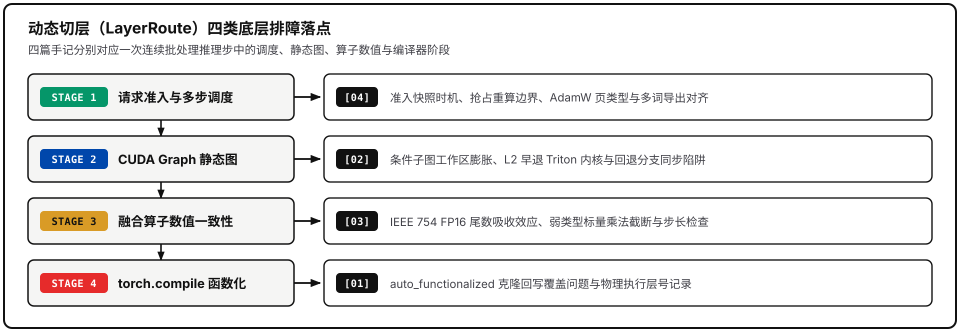

# 工程与排障笔记 / Engineering & Debugging Notes

这里持续记录开发与维护过程中的一线工程与疑难排障笔记（中英双语）——涵盖编译器变换、GPU 内核实现、浮点数值行为与并发运行时边界等真实问题。每篇笔记聚焦一个独立机制：先还原故障现象，再拆解背后的底层原理，最后总结可复用的验证与排障方法。

Ongoing bilingual engineering and debugging notes from building and maintaining inference systems—covering compiler passes, GPU kernels, floating-point numerics, and concurrent runtime edge cases. Each standalone note reconstructs a concrete failure mode, explains the underlying mechanism, and distills reusable diagnostic techniques.

## 近期笔记落点示意 / Recent Notes Map

**中文视图**

**English View**

---

## 中文目录 (`blog/personal/`)

1. **[`[编译与自定义算子]` 《自定义算子接入 `torch.compile` 后写入失效：从一次排障看 PyTorch AOT 函数化》](01-aot-functionalization-and-custom-ops.md)**  
   *即时执行时写入激活池的 `[7, 7, 7, 7]`，在开启 `aot_eager` 编译后读出来仍是全零。从图编译器的单静态赋值（SSA）要求出发，梳理 `auto_functionalized` 的“克隆—执行—回写”过程，定位全局字典旁路写入与 `mutates_args` 声明不一致导致的覆盖问题，并顺带修正自适应跳层下的层号记录时机。*

2. **[`[静态图与早退内核]` 《不重录 CUDA Graph 实现动态切层：条件子图、掩码求值与早退 Triton 内核的比较》](02-early-exit-triton-vs-conditional-cudagraph.md)**  
   *在多个候选层预埋动态钩子时，对比 CUDA 条件子图的工作区显存占用、朴素 `torch.where` 的无效访存带宽，以及基于片上 L2 标量判定的早退 Triton 内核与归一化端口原地累加方案；同时记录 `rank > 256` 回退路径中一行 `bool(mask.any())` 引发图捕获报错的原因。*

3. **[`[浮点算术与张量并行]` 《融合 Triton 内核与 PyTorch 原生算子的两次舍入差异：FP16 吸收效应与弱类型标量》](03-fp16-bf16-rounding-traps-in-fused-kernels.md)**  
   *正态随机测试通过的融合内核，在 `FP16 [2048, 0]` 输入下算出 `1` 而原生 PyTorch 算出 `0`，在多卡张量并行 `down_proj` 的 `FP32` 部分和路径上又因缩放因子 `0.123` 出现尾数偏差。结合 IEEE 754 尾数间距与 PyTorch 弱类型标量规则还原两处差异，并讨论如何构造最小数值与步长测试用例。*

4. **[`[多版本状态与连续批处理]` 《连续批处理下的状态生命周期排障：准入快照时机、抢占重算边界与导出维度对齐》](04-mvcc-pins-preemption-and-batch-dedup.md)**  
   *单步测试通过后，在多请求连续批处理场景下遇到首步准入快照读到旧版本、KV 抢占恢复后用新层重算旧词、混合类型状态挂优化器导致浮点初值截断为零、以及 `tokens="all"` 导出形状不匹配四个问题。结合分页张量状态系统（PTTS）梳理状态版本与调度时间线的对齐规则。*

## English Notes (`blog/personal/en/`)

1. **[`[Compiler & Custom Ops]` Why Custom Op Writes Disappear Under `torch.compile`: Debugging PyTorch AOT Functionalization](en/01-aot-functionalization-and-custom-ops.md)**
2. **[`[CUDA Graphs & Triton]` Dynamic Layer Switching Without Recapturing CUDA Graphs: Conditional Subgraphs, Masked Evaluation, and Early-Exit Triton Kernels](en/02-early-exit-triton-vs-conditional-cudagraph.md)**
3. **[`[IEEE 754 & Tensor Parallelism]` Two Rounding Divergences Between Fused Triton Kernels and Eager PyTorch: FP16 Absorption and Weak-Scalar Promotion](en/03-fp16-bf16-rounding-traps-in-fused-kernels.md)**
4. **[`[MVCC & Continuous Batching]` Debugging State Lifecycles Under Continuous Batching: Admission Pins, Preemption Boundaries, and Export Dimensions](en/04-mvcc-pins-preemption-and-batch-dedup.md)**
