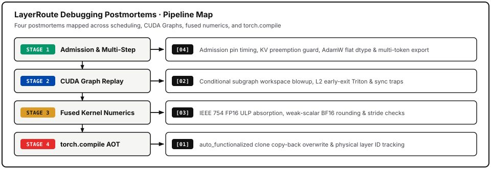

# 工程与排障笔记 / Engineering & Debugging Notes

这里持续记录推理系统开发与维护过程中的一线工程与疑难排障笔记（中英双语），不预设读者了解任何特定框架内部命名。每篇笔记按统一脉络展开：**先用全景图交代要解决的真实问题与底层运行机制，再贴出出事的初版最小代码与反常症状，最后定位根因并提炼可复用的防坑测试方法。**

Ongoing bilingual engineering and debugging notes from building and operating LLM inference systems—written assuming zero familiarity with framework-internal names. Every standalone note follows the same arc: **establish the system big picture and underlying runtime mental model first, show the minimal broken code and its symptom, trace the root cause visually, and distill reusable test probes.**

## 四篇笔记在推理引擎中的层次落点 / Where Each Note Sits in the Stack

**中文视图**

**English View**

---

## 中文目录 (`blog/personal/`)

1. **[`[编译与自定义算子]` 《自定义算子接入 `torch.compile` 后写入失效：从一次排障看 PyTorch AOT 函数化》](01-aot-functionalization-and-custom-ops.md)**  
   *想在不打断 `torch.compile` 整图编译的前提下把中间层激活拷进外部显存池，即时模式下写入正常的 `[7, 7, 7, 7]` 开启编译后不报错却变回全零。从图编译器的单静态赋值（SSA）要求讲起，拆解 `auto_functionalized` 的“克隆复印件—执行算子—盖回原件”三步曲，定位旁路字典修改被空白克隆覆盖的原因。*

2. **[`[静态图与早退内核]` 《不重录 CUDA Graph 实现动态切层：条件子图、掩码求值与早退 Triton 内核的比较》](02-early-exit-triton-vs-conditional-cudagraph.md)**  
   *推理服务完成分档 CUDA Graph 预热捕获后，如何在不卡顿十余秒重录整套静态图的前提下实时切换激活干预或 LoRA 目标层？对比条件子图的工作区显存膨胀、`torch.where` 的无效 HBM 带宽消耗与片上 L2 标量早退 + 原地累加方案，并复盘 `rank > 256` 兜底分支里一行 `bool(mask.any())` 打碎图捕获的原因。*

3. **[`[浮点算术与张量并行]` 《融合 Triton 内核与 PyTorch 原生算子的两次舍入差异：FP16 吸收效应与弱类型标量》](03-fp16-bf16-rounding-traps-in-fused-kernels.md)**  
   *从自回归贪婪解码下 1 ULP 误差滚雪球讲起，还原两次 `torch.randn` 随机单测未能发现的数值分叉：`float16` 在 `2048` 处因 `ULP = 2.0` 把 `+ 1` 吞成 `0`，以及多卡张量并行 `float32` 部分和遇上 Python 原生 `float` 弱类型标量导致的缩放尾数偏差。*

4. **[`[多版本状态与连续批处理]` 《连续批处理下的状态生命周期排障：准入快照时机、抢占重算边界与导出维度对齐》](04-mvcc-pins-preemption-and-batch-dedup.md)**  
   *先画出有状态连续批处理引擎一步的四阶段流水线全景，再逐一还原单步测试全绿、并发调度下才暴露的四个边界故障：进场快照早于随批导入锁住旧版本、在线换层后发生 KV 抢占重算篡改历史上下文、融合 `AdamW` 扁平页继承首字段 `int64` 把 `0.5` 截断为零、以及预填充多词展开与按请求去重混用引发形状崩溃。*

## English Notes (`blog/personal/en/`)

1. **[`[Compiler & Custom Ops]` Why Custom Op Writes Disappear Under `torch.compile`: Debugging PyTorch AOT Functionalization](en/01-aot-functionalization-and-custom-ops.md)**  
   *Copying hidden states out of a `torch.compile(fullgraph=True)` model via a side-table custom op works in Eager mode, yet silently returns `[0, 0, 0, 0]` when compiled. Unpacks AOTAutograd's clone-execute-copyback wrapper to show why bypassing formal tensor parameters wipes your writes.*

2. **[`[CUDA Graphs & Triton]` Dynamic Layer Switching Without Recapturing CUDA Graphs: Conditional Subgraphs, Masked Evaluation, and Early-Exit Triton Kernels](en/02-early-exit-triton-vs-conditional-cudagraph.md)**  
   *How to switch active steering or LoRA layers live without freezing traffic for 10 seconds to recapture bucketed CUDA Graphs—comparing conditional graph workspace bloat, `torch.where` HBM traffic, and L2 early-exit Triton kernels, plus a `bool(mask.any())` stream-capture crash in a `rank > 256` fallback.*

3. **[`[IEEE 754 & Tensor Parallelism]` Two Rounding Divergences Between Fused Triton Kernels and Eager PyTorch: FP16 Absorption and Weak-Scalar Promotion](en/03-fp16-bf16-rounding-traps-in-fused-kernels.md)**  
   *Why 1-ULP rounding differences snowball under greedy decoding, and how two minimal inputs (`[2048, 0]` in `float16` and `27.0 * 0.123` on `TP > 1` `float32` partial sums) exposed IEEE 754 ULP absorption and PyTorch's weakly-typed Python `float` promotion.*

4. **[`[MVCC & Continuous Batching]` Debugging State Lifecycles Under Continuous Batching: Admission Pins, Preemption Boundaries, and Export Dimensions](en/04-mvcc-pins-preemption-and-batch-dedup.md)**  
   *Maps one step inside a stateful continuous-batching engine across four stages, then walks through four cross-step bugs: early admission snapshots, KV preemption recomputing old tokens with new weights, `int64`-led `AdamW` pages truncating floats to `0`, and ragged prefill export crashes.*
