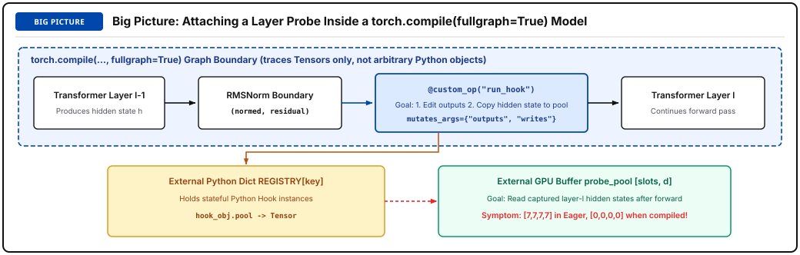
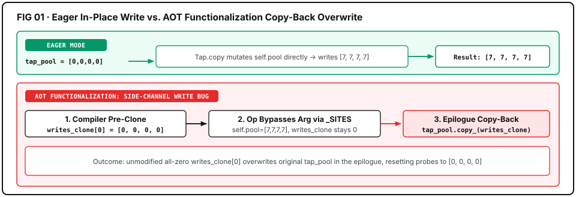
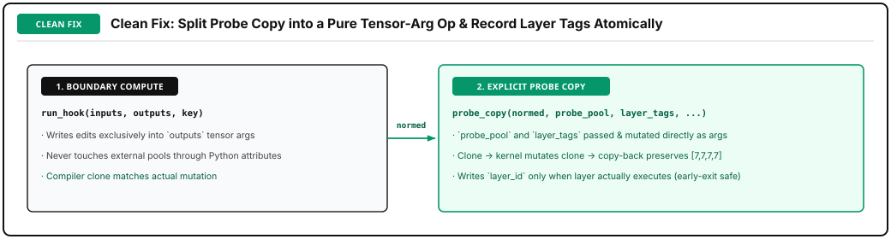

# Why Custom Op Writes Disappear Under `torch.compile`: Debugging PyTorch AOT Functionalization

> **TL;DR**: When you want to copy intermediate hidden states out of a `torch.compile(fullgraph=True)` Transformer without introducing graph breaks, the natural pattern is to register a `@torch.library.custom_op`, declare the destination buffer in `mutates_args`, and look up a stateful Python hook object in a global dictionary to perform the copy. In Eager mode, this works as expected; under compilation, `[7, 7, 7, 7]` written inside the op silently turns back into `[0, 0, 0, 0]` with zero errors. The culprit is PyTorch's AOT Functionalization pass, which wraps black-box mutating ops in a "clone inputs -> run op -> copy clones back" sandwich: mutating the original buffer through a Python object attribute leaves the compiler's clone untouched, so the epilogue overwrites your data with zeros. Splitting the probe copy into a pure tensor-argument op restores the compiler contract and also fixes stale layer-tag metadata under early-exit forward passes.

When building mechanistic interpretability probes, activation steering, or online memory modules inside an LLM serving engine, you routinely need to do something simple at the `RMSNorm` boundary between layer $l-1$ and layer $l$: copy that layer's hidden states into a pre-allocated GPU buffer `probe_pool`, while optionally letting user code tweak the residual stream along the way.

In a single-request research script, a plain `register_forward_hook` does the job in five lines. Inside a production serving engine, however, the Transformer forward pass is typically compiled end-to-end with `torch.compile(..., fullgraph=True)` so the entire model runs without Python graph breaks. Here is where our hook sits inside the overall pipeline:



Right at that dashed boundary sits a constraint familiar to anyone extending `torch.compile`: **a custom operator signature only accepts `Tensor`s and primitive scalars—you cannot pass an arbitrary stateful Python hook instance into a compiled graph node.**

---

Since a custom op cannot accept a Python object directly, almost every engineer reaches for the same side-table pattern: keep stateful Python hook instances in a module-level dictionary `REGISTRY`, pass an integer `hook_id` into `@torch.library.custom_op`, and let the op look up `REGISTRY[hook_id]` and call `.run()`.

At the same time, we wanted to play by the compiler's rules. To prevent dead-code elimination or instruction reordering from dropping our side-effecting op, we passed `probe_pool` inside a `writes` tensor list and explicitly declared `mutates_args={"outputs", "writes"}` on the decorator.

Stripped down to a self-contained script you can run locally on CPU, the broken code looked like this:

```python
import torch
from torch import Tensor

REGISTRY: dict[int, "LayerHook"] = {}

class LayerHook:
    def __init__(self, probe_pool: Tensor):
        self.pool = probe_pool  # Holds a reference to the external probe buffer

    def run(self, x: Tensor, out: Tensor) -> None:
        h = x + 7.0
        out.copy_(h)          # 1. Write edited activations into the `out` parameter
        self.pool.copy_(h)    # 2. Copy the same activations into the external probe pool

@torch.library.custom_op("demo::run_hook", mutates_args={"outputs", "writes"})
def run_hook(
    inputs: list[Tensor], outputs: list[Tensor], writes: list[Tensor], hook_id: int
) -> None:
    # Retrieve the stateful Python object by ID and run it
    REGISTRY[hook_id].run(inputs[0], outputs[0])

@run_hook.register_fake
def _(inputs, outputs, writes, hook_id):
    return None
```

The intent behind every line is straightforward: `out` carries the modified hidden state to the next Transformer layer, `self.pool` records a copy for external inspection, and `writes=[probe_pool]` informs PyTorch that `probe_pool` is mutated by this node.

In Eager mode—and under raw CUDA Graph capture—everything works cleanly: feed in `torch.zeros(4)`, and both `out` and `probe_pool` come out as `[7., 7., 7., 7.]`.

Unfortunately, the moment we wrapped the exact same function in `torch.compile(..., backend="aot_eager", fullgraph=True)`, something strange happened:

```python
probe_pool = torch.zeros(4)
REGISTRY[0] = LayerHook(probe_pool)

def forward_step(x: Tensor) -> Tensor:
    out = torch.empty_like(x)
    torch.ops.demo.run_hook([x], [out], [probe_pool], 0)
    return out

# Eager mode: both `res` and `probe_pool` read [7., 7., 7., 7.]
# Compiled mode:
compiled_step = torch.compile(forward_step, backend="aot_eager", fullgraph=True)
res = compiled_step(torch.zeros(4))
print(res)         # tensor([7., 7., 7., 7.])  <- Downstream output is fine!
print(probe_pool)  # tensor([0., 0., 0., 0.])  <- Probe pool is all zeros!
```

No exception was raised, no graph break occurred, and `LayerHook.run()` definitely executed—otherwise `res` could not be `[7., 7., 7., 7.]`. Even stranger, if you put `print(self.pool)` right after `self.pool.copy_(h)` inside `run()`, it prints `[7., 7., 7., 7.]`! Yet the microsecond `compiled_step` returns to the caller, `probe_pool` is back to `[0., 0., 0., 0.]`.

---

To see who erased those sevens on the way out, we need a clear mental model of how `torch.compile` handles in-place tensor mutations under the hood.

In handwritten PyTorch, in-place ops like `out.copy_()` and `x.add_()` are everywhere because they avoid allocating fresh GPU buffers. Graph compilers like Inductor, however, hate in-place memory side effects: to fuse kernels, reorder instructions, or eliminate dead code safely, the compiler wants the graph in **Single Static Assignment (SSA)** form, where every edge is an immutable value and operators are pure functions with no hidden aliasing.

Transforming an eager program with in-place mutations into a pure SSA graph is the job of **Functionalization** inside AOTAutograd. For built-in ATen ops, PyTorch already knows the out-of-place equivalent (`x.add_(1)` becomes `x_new = x + 1`). When it encounters a black-box `@torch.library.custom_op` marked with `mutates_args={"outputs", "writes"}`, it cannot rewrite your Python body, so it wraps the call in an automatic helper called `auto_functionalized` that performs three steps:

1. **Clone before call**: Before invoking `run_hook`, the compiler clones every tensor listed in `outputs` and `writes` (`writes_clone = [w.clone() for w in writes]`) and passes those **clones**—not the original buffers—into your function parameters;
2. **Execute op**: Your custom op runs. The compiler assumes all mutations happen on those passed-in clone parameters, and threads the resulting clones forward as pure SSA outputs;
3. **Epilogue copy-back**: At the end of the compiled graph, to synchronize any mutated external buffers with their updated SSA values, the compiler emits `probe_pool.copy_(writes_clone[0])`.

Put those three steps on a timeline and the mystery evaporates: **the compiler handed your op a blank photocopy expecting you to write on it, you reached into a desk drawer and wrote on the original sheet instead, and when you finished, the compiler dutifully copied its untouched blank photocopy right back over your original.**



Look again at the two `.copy_()` lines in `LayerHook.run()`:

- `out.copy_(h)` survived because `out` came from the `outputs[0]` parameter—it wrote `[7, 7, 7, 7]` onto `outputs_clone[0]`, which the epilogue copied out;
- `self.pool.copy_(h)` vanished because `run()` ignored the `writes` parameter entirely and mutated `self.pool` via the global `REGISTRY` dict. From the compiler's point of view, `writes_clone[0]` went in as `[0, 0, 0, 0]` and came out as `[0, 0, 0, 0]`, so the "new value" of `probe_pool` after the op was zero—and `probe_pool.copy_(writes_clone[0])` wiped our write clean.

What if we simply remove `"writes"` from `mutates_args`? That breaks the contract in the other direction: the compiler then treats `probe_pool` as completely independent of `run_hook`, and is free to reorder any subsequent in-graph read of `probe_pool` *ahead* of the hook.

---

Once the mechanism is clear, the fix does not require fighting `REGISTRY` at all—we simply separate stateful residual editing from pure tensor-to-tensor probe copying.

`run_hook` only needed the Python side-table because user-defined residual edits can close over arbitrary Python state. Copying hidden states into a probe pool, by contrast, needs no Python objects whatsoever: it takes the boundary activation tensor, a row-mapping vector, and the destination `probe_pool`, and copies selected rows across.

Pulling the probe copy out of `LayerHook.run()` into its own pure tensor-argument custom op right after the hook restores complete alignment with AOT Functionalization:



```python
@torch.library.custom_op("demo::probe_copy", mutates_args={"probe_pool", "layer_tags"})
def probe_copy(
    hidden: Tensor,
    src_rows: Tensor,
    dst_slots: Tensor,
    probe_pool: Tensor,
    layer_tags: Tensor,
    layer_id: int,
) -> None:
    # Mutate the passed-in tensor arguments directly—no global Python side-tables!
    valid = (src_rows >= 0) & (dst_slots >= 0)
    probe_pool[dst_slots[valid]] = hidden[src_rows[valid]]
    layer_tags[dst_slots[valid]] = layer_id
```

Now `probe_pool` enters `probe_copy` as a formal tensor parameter and is mutated through that exact parameter: AOT Functionalization clones it, the kernel populates the clone, and the epilogue copies `[7., 7., 7., 7.]` back into `probe_pool`.

---

Splitting `probe_copy` into a standalone kernel also fixed a subtle metadata bug around **when layer tags should be recorded**.

When dynamically routing probes across layers, each row in `probe_pool` is paired with an `int64` entry `layer_tags[slot]` recording which layer produced that activation (`-1` if disabled).

Our initial implementation pre-filled `layer_tags[slot] = 2` during the pre-forward setup step whenever the routing state targeted layer `2`. For a standard full-depth forward pass, that shortcut looks harmless. Suppose, however, that a user combines dynamic probing with a **custom early-exit forward pass** that stops after layer `0` on confident tokens and never executes layer `2`:

- **Pre-filling tags during setup**: Layer `2`'s hook never runs, so `probe_pool[slot]` stays `[0, 0, ..., 0]`, yet `layer_tags[slot]` already claims `2`—handing downstream analysis an all-zero vector falsely labeled as a real layer-2 activation;
- **Writing tags inside the copy kernel**: Setup resets `layer_tags` to `-1`, and `layer_id` is written by column-block `0` inside the Triton kernel at the exact moment layer `layer_id` executes and copies its activations:

```python
@triton.jit
def _routed_probe_copy_kernel(
    hidden_ptr, src_rows_ptr, dst_slots_ptr, row_layers_ptr,
    pool_ptr, layer_tags_ptr, hidden_stride, pool_stride,
    width, layer_id, BLOCK: tl.constexpr,
):
    row = tl.program_id(0)
    dst = tl.load(dst_slots_ptr + row)
    target_layer = tl.load(row_layers_ptr + row)
    if (dst < 0) | (target_layer != layer_id):
        return
    src = tl.load(src_rows_ptr + row)
    if src < 0:
        return
    if tl.program_id(1) == 0:
        # Record `layer_id` only when this layer actually executes and copies data
        tl.store(layer_tags_ptr + dst.to(tl.int64), tl.full((), layer_id, dtype=tl.int64))
    cols = tl.program_id(1) * BLOCK + tl.arange(0, BLOCK)
    mask = cols < width
    vals = tl.load(hidden_ptr + src.to(tl.int64) * hidden_stride + cols, mask=mask, other=0.0)
    tl.store(pool_ptr + dst.to(tl.int64) * pool_stride + cols, vals, mask=mask)
```

If an early-exit step stops at layer `0`, layer `2`'s kernel never fires, the buffer stays zero, and its tag honestly remains `-1`.

---

Why did our first round of end-to-end GPU tests miss a bug that zeroes out the entire probe buffer?

Because our kitchen-sink integration test bundled custom residual callbacks, adapters, and probes into a single workload—and whenever arbitrary Python residual callbacks were present, the engine fell back to `backend="eager"` with raw CUDA Graph capture, bypassing Inductor's AOT Functionalization pass completely. Only when we tested a lightweight probe-only workload did the engine take the default `backend="inductor"` path and expose the wiped buffer.

That leaves a fast, practical habit for anyone authoring PyTorch custom ops: **whenever you write a `@torch.library.custom_op` with `mutates_args`, wrap it in `torch.compile(fn, backend="aot_eager", fullgraph=True)` inside a plain CPU unit test and assert that your external buffer actually changes on non-zero inputs.** `aot_eager` needs no GPU and no C++ codegen; in tens of milliseconds it exercises the full clone-execute-copyback contract and catches any side-channel mutation immediately.

This design powers dynamic layer probing (`LayerRoute`) in the open-source **[pLLM](https://github.com/LinesHogan/pLLM)** engine. As an engineering trade-off, placing `probe_copy` outside the hook as a standalone graph node means every candidate layer in `over` retains a tiny kernel launch inside the static CUDA Graph; inactive layers return after reading two cached `int64` scalars without touching HBM, so listing the actual candidate layers you plan to switch across remains cleaner than attaching hooks to every layer blindly.
