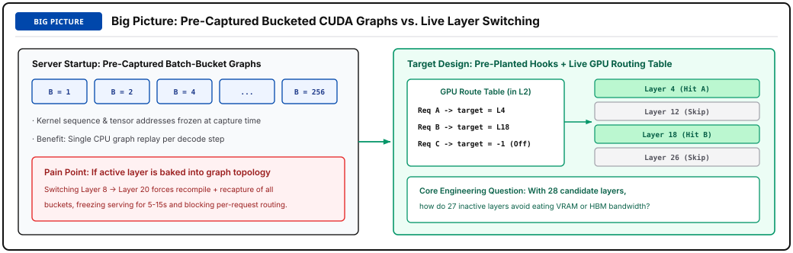
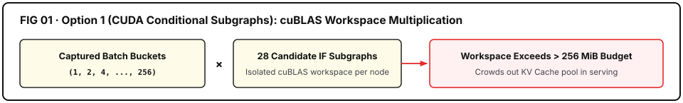
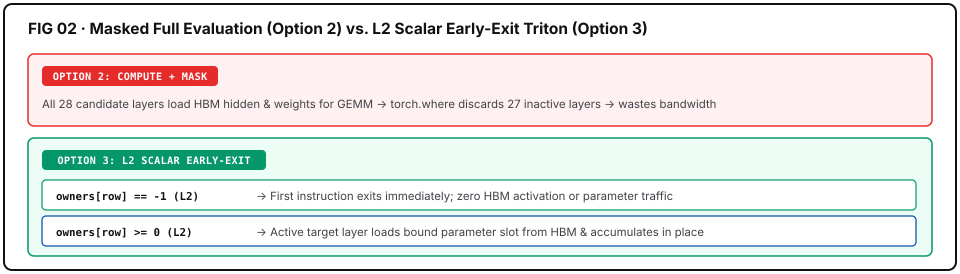

# Dynamic Layer Switching Without Recapturing CUDA Graphs: Conditional Subgraphs, Masked Evaluation, and Early-Exit Triton Kernels

> **TL;DR**: Production LLM serving engines pre-capture static CUDA Graphs across batch-size buckets at startup to eliminate CPU kernel-launch overhead. Once those graphs are frozen, switching an activation steering vector, probe, or LoRA adapter from layer 8 to layer 20 by recompiling and recapturing every bucket stalls live traffic for 5–15 seconds. Starting from how static graph capture works, this note compares three ways to switch candidate layers live without recapturing: CUDA conditional subgraphs multiply stream-private cuBLAS workspaces across buckets and layers; evaluating every layer then masking with `torch.where` wastes HBM memory bandwidth on inactive layers; and an on-chip L2 scalar early-exit Triton kernel paired with in-place port accumulation drops inactive-layer HBM traffic to zero. Finally, we trace a fallback bug where `bool(mask.any())` on `rank > 256` crashed CUDA Graph capture via an unintended host synchronization.

When serving LLMs interactively or running mechanistic interpretability sweeps, a natural request comes up all the time: the 7B or 70B model is already warmed up and serving traffic, and now you want to move a steering vector or residual probe from layer 8 to layer 20—or, inside a single continuous-batching step, route Request A through a layer-4 LoRA, Request B through a layer-18 LoRA, and Request C through `-1` (the unmodified base model).

In an eager single-request script, that is a one-line `if layer_idx == target_layer:`. Inside a production inference engine running **CUDA Graphs**, that one-line `if` collides head-on with how static graphs achieve low latency.

Let's start with a quick mental model of why serving engines rely on bucketed CUDA Graphs in the first place:



During autoregressive decode, each step processes only one new token per request. A GPU finishes an individual matrix projection in tens of microseconds—often faster than the Python interpreter on the CPU can dispatch the next kernel. Left in eager mode, the GPU spends much of decode sitting idle between kernel launches.

To remove CPU launch gaps, engines like vLLM and SGLang pre-capture static **CUDA Graphs** at startup for a fixed ladder of batch sizes (`B = 1, 2, 4, 8, ..., 256`). At runtime, the CPU issues a single `graph.replay()` and the GPU hardware replays the entire sequence of kernels back-to-back.

The catch is rigidity: **every kernel node and memory pointer inside a captured CUDA Graph is frozen at capture time—there is no Python interpreter in the loop to evaluate `if` branches on live values.** If "layer 8 is active" is baked into the graph topology, switching to layer 20 means tearing down the old hooks, re-running `torch.compile`, and recapturing every batch bucket from scratch, freezing the server for 5 to 15 seconds and ruling out per-request layer routing within a shared batch.

---

To switch layers with zero graph recapture, we have to **pre-plant lightweight hook ops at a set of candidate layers during graph construction** (say `over = (4, 12, 18, 26)`, or even all 28 layers of a 7B model) and drive which layer actually fires at runtime via a small `int64` routing table in GPU memory.

That shifts the engineering problem onto hardware efficiency: suppose a researcher attaches hooks across all 28 layers for a layer-by-layer sweep, activating just 1 layer at a time. **How do we keep the other 27 inactive layers from bloating VRAM or burning memory bandwidth on every token?**

We evaluated three designs against that constraint.

---

### Option 1: Hardware Conditional CUDA Graph Nodes (`CUDA 12.4+`)

The textbook answer on recent GPUs is a device-side conditional graph node (`torch.cond` / `cudaGraphConditionalHandle`): place a hardware `IF (active_count > 0)` gate in front of each candidate layer so the GPU only enters the subgraph when at least one request targets that layer.

On paper, that sounds ideal. In a multi-bucket serving engine, however, two practical costs show up immediately:



First is **stream-private cuBLAS workspace bloat**. When capturing a conditional body subgraph, CUDA records its internal ops on a dedicated branch capture stream. Whenever that body invokes cuBLAS GEMMs, cuBLAS allocates a stream-private workspace buffer that is not shared with the main stream's memory pool. Multiply that private workspace by a dozen batch-size buckets and twenty-plus candidate layers, and idle conditional branches quietly eat hundreds of megabytes—or gigabytes—of VRAM that would otherwise hold online KV Cache.

Second is **mixed-request continuous batching**. A layer-wide `IF (active_count > 0)` gate is all-or-nothing: as soon as Request 0 targets layer 4 while Requests 1..31 target layer 18, layer 4's condition evaluates to `True` and the entire subgraph runs anyway. Inside that subgraph, you still need row-level masking to keep Requests 1..31 untouched—paying extra workspace VRAM without even eliminating per-row filtering.

---

### Option 2: Compute Everything, Then Mask with `torch.where`

If conditional subgraphs cost too much VRAM, the simplest graph-safe alternative is to compute the intervention unconditionally at every candidate layer and mask out inactive rows at the end:

```python
def naive_routed_patch(h: Tensor, weight_pool: Tensor, slots: Tensor, active_mask: Tensor) -> Tensor:
    # Every candidate layer gathers weights and computes `delta` unconditionally
    delta = compute_intervention(h, weight_pool[slots])
    # Keep `h + delta` for matching rows and original `h` for inactive rows
    return torch.where(active_mask[:, None], h + delta, h)
```

This adds zero workspace memory and captures cleanly into any CUDA Graph, but it violates the cardinal rule of LLM decode: **never waste High-Bandwidth Memory (HBM) traffic.**

Because decode batches have small row counts, arithmetic units sit mostly underutilized while latency is bottlenecked on streaming bytes to and from off-chip HBM. In the snippet above, all 27 inactive layers still stream their adapter/patch weights and the full hidden state `h` out of HBM, compute `delta`, and throw 27 out of 28 results away inside `torch.where`. (While auditing this HBM traffic, we also spotted an unconditional `captured[:len(h)].copy_(h)` left over in the static adapter path for online backprop; skipping that copy on inference-only workloads saved another full-width HBM write per layer.)

---

### Option 3: On-Chip L2 Scalar Early-Exit Triton Kernels + In-Place Port Accumulation

Can we keep a flat, workspace-free CUDA Graph while driving inactive-layer HBM reads and writes all the way down to **zero bytes**?

Here a quick GPU memory-hierarchy mental model helps: **off-chip HBM bandwidth is scarce, whereas reading a few hundred bytes from on-chip L2 Cache is practically free.** An RTX 4090 carries 72 MB of on-chip L2 Cache. Before each forward step, we materialize a tiny `int64` routing table `table` (a few hundred bytes mapping each batch row to its active slot, or `0` if inactive). Because that table is tiny and touched by every candidate layer, it stays hot in on-chip L2 throughout the forward pass.

We then launch a custom Triton kernel tiled across `(row, col_block)` whose very first instruction loads that single cached flag for its row—and **immediately executes `return` if the row is inactive**, before issuing a single HBM load of weights or activations!

One subtle API detail still stands between early-exit and true zero-HBM skipping:

- If the op returns a **fresh output tensor** `out = routed_patch(h, table, pool)`, even an early-exiting thread block has a problem: downstream layers will read `out`, so somebody still has to copy `h -> out` for inactive rows—burning a full-width HBM read and write on every skipped layer!
- If instead we mutate the `RMSNorm` boundary's existing `normed` output buffer **in place** via `routed_patch_into(normed, table, pool)`, active rows add their delta into `normed` while **inactive rows do nothing and `return` immediately**, leaving the valid activations already sitting in `normed` untouched:



The resulting Triton kernel is barely fifteen lines long:

```python
@triton.jit
def _masked_patch_add_into_kernel(
    target_ptr, table_ptr, pool_ptr,
    table_stride, target_stride, pool_stride, width, BLOCK: tl.constexpr,
):
    row = tl.program_id(0)
    # First instruction checks the 8-byte flag in on-chip L2; exits with 0 HBM traffic on miss!
    if tl.load(table_ptr + row) == 0:
        return
    cols = tl.program_id(1) * BLOCK + tl.arange(0, BLOCK)
    col_mask = cols < width
    slot = tl.load(table_ptr + table_stride + row)
    dst_ptrs = target_ptr + row.to(tl.int64) * target_stride + cols
    h = tl.load(dst_ptrs, mask=col_mask, other=0.0)
    delta = tl.load(pool_ptr + slot.to(tl.int64) * pool_stride + cols, mask=col_mask, other=0.0)
    tl.store(dst_ptrs, h + delta.to(target_ptr.dtype.element_ty), mask=col_mask)
```

We applied the same two-stage L2 early-exit pattern to dynamically routed LoRA adapters: a shared `[max_rows, rank]` buffer holds intermediate projections, both stages exit on L2 miss at line 1, and stage 2 accumulates directly into `output[:, offset:offset+width]`. Even when Request A hits layer 4, Request B hits layer 18, and Request C is off in the same batch, each thread block exits independently for its row.

---

### Debugging Detour: The `bool(mask.any())` Time Bomb Hiding in the `rank > 256` Fallback

While reviewing the dispatch wrapper around our two-stage LoRA kernel, we caught a classic CUDA Graph capture bug hiding inside a cold fallback branch.

To keep intermediate vectors inside registers, our Triton fast path handles `rank <= 256`. Whenever inputs arrive on CPU, use `float64`, have non-contiguous last-dim strides, or specify an unusually large `rank > 256`, the wrapper falls back to plain PyTorch ops.

To save work when no rows matched in that fallback branch, the initial implementation reused a Python short-circuit check:

```python
# Initial broken fallback branch:
if (not target.is_cuda) or target.dtype == torch.float64 or rank > 256 or target.stride(-1) != 1:
    mask = table[0, :rows].bool()
    if bool(mask.any()):  # <--- Never reached on GPU when rank=8; crashes capture when rank=260!
        delta = slow_pytorch_lora(hidden, mask, weights)
        target.add_(delta)
    return
```

Why did every standard test suite stay green? Because GPU tests all used `rank = 8` or `16`—taking the Triton fast path above—while the fallback branch was only ever exercised by CPU unit tests, where `bool(mask.any())` is completely legal!

The moment a user declares `rank = 260` on GPU with CUDA Graphs enabled, server warmup enters stream capture, hits `if bool(mask.any()):`, and crashes immediately with:

```text
RuntimeError: CUDA error: operation not permitted when stream is capturing
(cudaErrorStreamCaptureUnsupported)
```

Intuitively, **CUDA Graph capture is like recording a macro offline before any real batch runs—yet `bool(mask.any())` demands that the GPU halt recording, synchronize with the host over PCIe, and hand Python a runtime `True/False` scalar right now so Python can decide whether to record the body of the `if` block.** CUDA stream capture forbids any device-to-host synchronization by design.

Separating the CPU short-circuit from the GPU fallback—and adding an explicit `rank = 260` CUDA Graph capture test—closed the hole cleanly:

```python
if (not target.is_cuda) or target.dtype == torch.float64 or rank > 256 or target.stride(-1) != 1:
    mask = table[0, :rows].bool()
    if not target.is_cuda and not bool(mask.any()):
        # Python bool short-circuit is safe on CPU only
        return
    # On CUDA, stay 100% device-side with torch.where so stream capture never syncs
    delta = slow_pytorch_lora(hidden, weights)
    target.copy_(torch.where(mask[:, None], target + delta, target))
    return
```

---

How much does L2 early-exit cost end-to-end on real hardware? Benchmarking `Qwen2.5-7B-Instruct` (`bfloat16`, full bucketed CUDA Graphs, 128 concurrent decode sequences) on a single RTX 4090:

- **4 candidate layers** (`over=(4, 12, 20, 26)`) with live steering + async residual export switched between turns: decode TPOT is `24.6 ms` vs. `24.4 ms` for a static single-layer hook (`23.2 ms` unhooked baseline)—live zero-recapture layer switching adds roughly **`0.2 ms`**;
- **All 28 layers hooked** (`over=tuple(range(28))`, 56 `q_proj`/`v_proj` LoRA sites, 1 active layer per step): the entire bucketed CUDA Graph pool takes `0.30 GiB` of VRAM, and 27 inactive layers add **`~0.8 ms`** total (`24.8 ms` vs. `24.0 ms` static single-layer LoRA).

This mechanism ships as `LayerRoute` in **[pLLM](https://github.com/LinesHogan/pLLM)**. Its remaining boundary cost is kernel launch overhead inside the graph: early-exit eliminates HBM traffic on inactive layers, but each candidate site still records a ~10-microsecond kernel node in the static graph, so declaring only the candidate layers you actually intend to switch across remains good practice.
