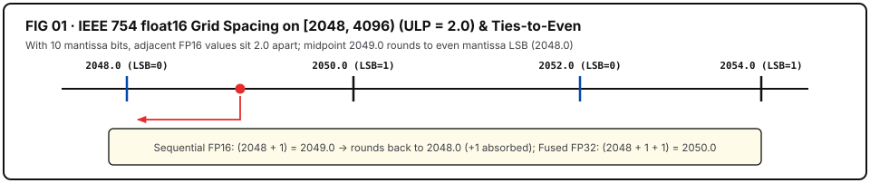
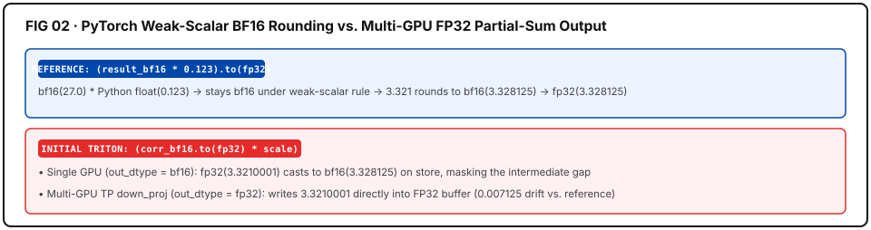

# Two Rounding Traps in Fused Triton Kernels: FP16 Absorption and Weakly Typed Scalars

> **TL;DR**: Fusing a chain of eager PyTorch ops into one Triton kernel can change outputs on boundary inputs even when the algebra is identical—the culprit is whether intermediate values stay in `float32` registers or round back to half precision along the way. This note documents two numerical divergences caught while validating dynamic layer-routing kernels: an `FP16` absorption case at `[2048, 0]` where a fused affine kernel produced `1` while eager PyTorch produced `0`, and a multi-GPU tensor-parallel `down_proj` case where PyTorch's weak-scalar type promotion rounded a `bfloat16` product before casting to an `FP32` partial-sum buffer. We close with two lightweight test probes—tiny exact-boundary tensors and stride-sentinel columns—that catch rounding and indexing drift far earlier than `torch.randn`.

The standard playbook for writing a fused GPU kernel is straightforward: move the reference multiply-add sequence into Triton, accumulate intermediates in `tl.float32`, cast back to the target half-precision dtype on the final store, and validate with `assert_close` over a handful of `torch.randn` tensors.

While building early-exit kernels for low-rank affine activation intervention (LoReFT, $$\Delta h = R(Wh + b - R^\top h)$$) and tensor-parallel LoRA, our standard Gaussian random tests all passed cleanly. Only when we began edge-case parity checks against the static reference path did two tiny two-element inputs expose rounding divergences between the two implementations.

The first input ran in `float16`: hidden state $$h = [2048, 0]$$, projection $$W = [1, 1]$$, orthonormal basis $$R^\top = [1, 1]$$, and bias $$b = 1$$. Over the reals, $$Wh = 2048$$ and $$R^\top h = 2048$$, so the inner term $$2048 + 1 - 2048 = 1$$; adding that update back to $$h$$ leaves index 1 equal to `1`. Our first Triton kernel returned `[2049, 1]`, whereas the eager PyTorch implementation `(h @ W.T + b - h @ R) @ R.T` returned `0` at index 1.

The second input showed up on the multi-GPU tensor-parallel (`TP > 1`) `down_proj` path: a `bfloat16` projection delta of `27.0`, a scaling factor `scale = 0.123`, and a `float32` output buffer holding partial sums awaiting cross-rank reduction. The eager PyTorch path accumulated `3.328125`; our initial Triton kernel wrote `3.3210001`.

---

Start with the first divergence: why does `2048 + 1 - 2048` evaluate to `0` in step-by-step `float16` PyTorch?

IEEE 754 `float16` allocates 1 sign bit, 5 exponent bits, and 10 explicit mantissa bits (plus 1 implicit leading `1`). On the interval $$[2048, 4096)$$—that is, $$[2^{11}, 2^{12})$$—the exponent is fixed at $$2^{11}$$, and those 10 mantissa bits divide a span of length $$2048$$ into $$2^{10} = 1024$$ equal steps. The spacing between adjacent representable floats (one ULP, or Unit in the Last Place) is exactly `2.0`:



In the unfused PyTorch reference, `h @ W.T + b - h @ R` runs as four separate ATen kernels, materializing a `float16` tensor after every op:
1. `wh = h @ W.T` yields `float16(2048.0)`;
2. `wh_b = wh + b` computes `float16(2048.0 + 1.0)`. With `ULP = 2.0`, `2049.0` sits halfway between `2048.0` and `2050.0`; under round-to-nearest-even (ties-to-even), `1.0` is absorbed and the result stays `float16(2048.0)`;
3. `hr = h @ R` yields `float16(2048.0)`;
4. `wh_b - hr` evaluates `2048.0 - 2048.0 = 0.0`.

Our first fused Triton kernel kept `acc_w`, `acc_r`, and `b` inside 23-bit-mantissa `tl.float32` registers (where the ULP at `2048` is roughly `0.000244`). In `float32`, `2048.0 + 1.0` equals `2049.0` exactly, and subtracting `2048.0` preserves the `1.0`.

Strictly as a real-number approximation, keeping `float32` intermediates carries smaller rounding error. Inside an inference engine, however, static `ActivationPatch(layers=(10,))` and dynamic `LayerRoute.patch(over=(2, 10, 18))` are the static and dynamic entry points to the same operator. If the two paths round at different points under identical layers and weights, a 1-ULP shift near a greedy (`temperature=0`) tie or a `top-p` boundary can compound across autoregressive steps into a different token sequence, making experimental parity harder to verify.

Matching the static reference inside the fused kernel requires zero extra HBM traffic; you just insert the corresponding dtype casts in registers:

```python
# Match the reference op's per-step half-precision rounding in registers (zero extra HBM traffic):
wh = acc_w.to(elem_ty).to(tl.float32)
wh_b = (wh + b).to(elem_ty).to(tl.float32)
hr = acc_r.to(elem_ty).to(tl.float32)
coeff = (wh_b - hr).to(elem_ty).to(tl.float32)
```

---

Now for the second divergence: why did `27.0 * 0.123` produce `3.328125` on one path and `3.3210001` on the other for multi-GPU `down_proj`?

On a single GPU (`TP = 1`), both the hidden state `hidden` and the linear output buffer `output` live in `bfloat16`. Under multi-GPU tensor parallelism (`TP > 1`), `down_proj` is a `RowParallelLinear` sharded along its input dimension: each rank computes a local partial sum before a cross-rank `All-Reduce`. To avoid repeated half-precision rounding prior to reduction, the hook keeps `output` in `float32`, adds each rank's LoRA delta into that buffer, runs `All-Reduce`, and casts back to `bfloat16` afterward.

When execution reaches LoRA accumulation, the unscaled projection `result` (`27.0`) is `bfloat16`, `self.scale` (`0.123`) is a native Python `float`, and the destination `output` is `float32`. The static reference computes:

```python
output[:, offset : offset + width].add_((result * self.scale).to(output.dtype))
```

The trap sits in the return dtype of `result * self.scale`. Under PyTorch's type promotion rules, native Python `float` and `int` scalars are weakly typed: multiplying a Python `float` by a floating-point `Tensor` (including `float16` and `bfloat16`) preserves the tensor's lower-precision dtype instead of promoting the product to `float32`:



The real product `3.321` falls in $$[2.0, 4.0)$$, where `bfloat16` has 7 mantissa bits (`ULP = 0.015625`) and adjacent representable values `3.3125` and `3.328125`, so `result * self.scale` rounds to `3.328125` before `.to(output.dtype)` ever runs. In single-GPU tests, the final store targeted `bfloat16` anyway, so the epilogue cast quietly performed the same truncation and hid the missing intermediate rounding. Only when we switched to the multi-GPU `float32` partial-sum buffer did `3.3210001` land straight in `output`. Adding an explicit cast back to `hidden_ptr.dtype` before converting to the output buffer dtype aligned single-GPU and multi-GPU behavior:

```python
corr = acc.to(hidden_ptr.dtype.element_ty)
# Match PyTorch's (bf16_tensor * python_float) same-dtype rounding before casting to the output buffer dtype:
scaled = (corr.to(tl.float32) * scale).to(hidden_ptr.dtype.element_ty)
delta = scaled.to(out_ptr.dtype.element_ty)
```

During the same pass, we also wired up the output column stride `out_stride1`. The original store offset `row * out_stride0 + out_offset + cols` silently assumed a contiguous last dimension (`out_stride1 == 1`). Passing `out_stride1` explicitly and computing `row * out_stride0 + (out_offset + cols) * out_stride1` lets the kernel write cleanly into strided column slices such as `output[:, ::2]`.

---

Two concrete unit-testing habits come straight out of these two sessions.

First, alongside standard `torch.randn` fuzzing, add two or three tiny hand-crafted boundary cases—a vector straddling a half-precision ULP absorption threshold like `[2048.0, 0.0] + 1.0`, and a non-dyadic scale factor like `0.123` writing into a `float32` accumulator—and check them against the reference with `rtol=0, atol=0`. Each case holds only a few elements, yet surfaces intermediate rounding drift far earlier than large zero-mean Gaussian tensors.

Second, when verifying writes into sliced views, pre-fill the untouched neighboring columns with a recognizable sentinel (for example, set `out[:, 1::2] = -99.0` and pass `out[:, ::2]` into the kernel), then assert both the computed target columns and that every untouched column still holds `-99.0`. Stride bugs show up immediately. One extra note when comparing greedy-decode outputs on a real model: run both paths at the exact same batch size so they hit the same CUDA Graph bucket and cuBLAS GEMM tiling; otherwise tiling-reduction differences in the base linear layers will muddy the comparison.

Both kernels are verified on real GPUs in **[pLLM](https://github.com/LinesHogan/pLLM)**. One caveat worth stating plainly: inserting half-precision truncation inside registers is done here to maintain strict parity with an existing unfused reference operator in the same framework. If you have no legacy reference to match and simply want lower rounding noise, keeping `float32` intermediates from start to finish is an entirely sound design choice—what matters is knowing the exact semantics of every cast.
