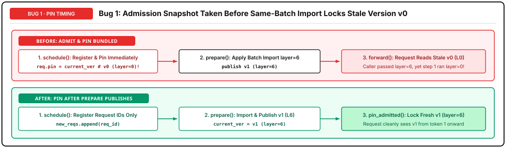
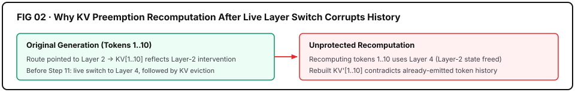
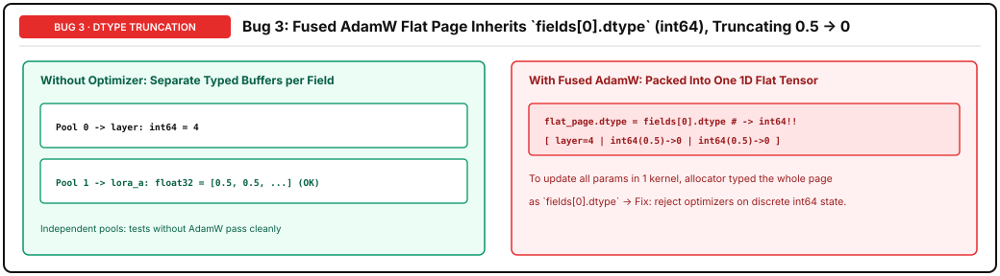
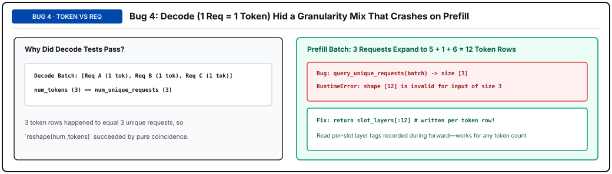

# Debugging State Lifecycles Under Continuous Batching: Admission Pins, Preemption Boundaries, and Export Dimensions

> **TL;DR**: Once a continuous-batching inference engine adds mutable runtime state—dynamic layer routing, per-request fast weights, or online parameter imports—bugs tend to surface along cross-step and cross-request lifecycle seams instead of inside individual kernels. Drawing on four debugging sessions from building dynamic layer routing, this note lays out four rules for pairing a Paged Tensor State System (PTTS) with a continuous-batching scheduler: record admission pins only after the step's pre-forward publications settle; separate read-only observation state from KV-mutating state when gating prefix caching and preemption; keep discrete `int64` control fields out of flat floating-point optimizer pages; and record exported layer tags alongside physical tap slots instead of re-querying deduplicated request indices after the fact.

In a stateless inference engine, as long as the KV-cache block table maps correctly, a request produces the same activations whether it runs solo, rides inside a mixed chunked-prefill-plus-decode batch, or gets evicted under memory pressure and recomputed later.

Introduce mutable runtime state—updating an observed or intervened layer online via `import_state`, or letting each request carry private state that mutates mid-flight—and timing and shape bugs that never appear in isolated single-step tests emerge quickly inside a multi-request scheduling loop.

While implementing dynamic layer routing, we ran into four concrete failures:

1. **Admission pins captured the pre-import version**: A workload declared `refresh="admission"` (pinning the global layer active when the request enters) and called `generate(..., batch=StateImport(layer=6))` to import layer 6 with the batch. On step 1, a step-refreshed probe saw the newly published version `v1` (layer 6), whereas the admission-pinned patch still read the initial version `v0` (layer 0).
2. **Preemption recomputed old prefixes with the new layer**: The server started with global steering on layer 2, and request A generated 10 tokens. An online update switched steering to layer 4 right before KV-cache memory pressure preempted request A and freed its blocks. When request A resumed, the engine recomputed KV history for the first 10 tokens using layer 4.
3. **Attaching an optimizer truncated float initializers to zero**: Placing a routing field `layer: int64` alongside low-rank factors `a, b: float32` in the same state, filling them with `0.5`, and attaching `optimizer=AdamW(lr=1e-3)` caused `a` and `b` to read back as all `0`s immediately after initialization.
4. **Multi-token prefill export failed with a shape mismatch under `tokens="all"`**: Single-token decode exports worked cleanly, yet running `tokens="all"` on a prefill batch of 3 requests totaling 12 tokens threw `RuntimeError: shape '[12]' is invalid for input of size 3`.

All four traced back to how state versioning meets the continuous-batching scheduler timeline.

---

Inside pLLM, mutable state lives in the Paged Tensor State System (PTTS): each field maps to a fixed-base-address GPU slot pool; every update allocates a fresh slot and publishes an immutable, monotonically increasing version reference (`StateRef`); readers hold a lock-free lease (`PagePin`) and return it asynchronously via a CUDA Event once kernels finish. Walking through one step's timeline exposes all four bugs and their fixes.

**First: when admission pins get recorded.**

Why did an admission-pinned reader see `v0` on the very step that carried `StateImport(layer=6)`? The original step-entry call order gives the answer immediately:

In our initial implementation, registering a new request's lineage and pinning its snapshot of global `InstanceState` were bundled inside a single `admit()` call during step 1 (`driver.schedule()`). Whenever no batch-attached import existed, the version number never changed during `request.prepare`, so the ordering stayed invisible. Once a call passed `StateImport` or ran a pre-forward write task, however, the new version `v1` was only published later inside `driver.begin()` once the `request.prepare` anchor completed—leaving `refresh="step"` readers on `v1` (layer 6) during `model.execute` while `refresh="admission"` readers still held the stale `inference_pin[req]` captured at `v0` (layer 0).

Splitting those two actions fixes the race: `schedule()` creates the request lineage alone (`pin_instances=False`), and `begin()` calls `pin_admitted()` for newly admitted requests only after all `request.prepare` imports and state publications have settled.

Follow that boundary one layer further. Suppose a user declares `refresh="admission"` on a per-request `RequestState`, yet also attaches a per-step `@pllm.write` task mutating that state—or keys it without `request_id` (such as `key_fields=("sample_index",)`, where a later online request can overwrite the same keyed slot). Because PTTS maintains per-request admission pins only for globally shared `InstanceState` and does not keep multi-version history for `RequestState`, the running request would read the updated value mid-generation and silently drift from `refresh="admission"` semantics. We now catch those combinations at compile-time validation with a clear error steering callers toward `refresh="step"` or a key schema containing `request_id`.

---

**Second: separating read-only observation from KV-mutating state for prefix caching and preemption.**

The second bug is about causal consistency in an autoregressive KV cache.

Under its default `refresh="step"` mode, dynamic layer routing follows forward-only KV semantics: tokens 1 through 10 are generated under layer 2 and their keys/values sit in physical blocks; once `import_state` switches routing to layer 4 before token 11, historical KV blocks for tokens 1–10 remain untouched while token 11 onward runs under layer 4. That avoids pinning historical parameter snapshots per in-flight request and keeps state-page overhead constant.

Trouble starts if memory pressure triggers preemption mid-generation. The scheduler evicts request A's KV blocks for tokens 1–10 and later feeds `"prompt + 10 generated tokens"` back through forward to rebuild the cache:

Because the engine never recorded which layer each historical token used, recomputation replays all 10 historical tokens through the current layer 4—building a `KV'[1..10]` that contradicts the premises under which those tokens were sampled. Any workload combining mutable shared state with model-layer intervention therefore belongs under `preemption="reset"`: if preemption occurs and the state cannot be replayed from its initial value, the engine raises a runtime error instead of silently serving inconsistent context, advising the caller to raise KV memory headroom or lower max concurrency. (The same applies to online imports targeting shared keys such as `key_fields=("sample_index",)`.)

The converse matters just as much. If a `LayerRoute` only reads hidden states or intermediate logits—for instance, attaching `route.residual()` with `@pllm.export`, with no `patch` or `adapter` modifying model computation—then the trunk's KV cache matches the unmodified base model regardless of which layer is tapped. Our initial implementation put every routed state into one `model_reads` set, needlessly blocking prefix caching on pure observation workloads. Splitting the backend attachment contract into two sets fixed that over-restriction: `model_reads` governs state-page pin lifetimes, while `kv_model_reads` specifically marks states that affect trunk K/V values. Pure observation routes enter only `model_reads`, staying fully compatible with prefix caching and lossless preemption recomputation.

---

**Third and fourth: the optimizer's flat-page assumption, and request-deduplicated vs. token-expanded indexing.**

The final two bugs came from memory-layout conventions in parameter pools and a granularity mismatch in export indices.

In the third bug, placing `layer: Field((), int64)` ahead of `a, b: Field(..., float32)` with `AdamW` turned float initializers into zeros because `declare_parameters` builds pools differently for optimized and unoptimized states. Plain unoptimized states allocate an independent pool per field, so mixed dtypes never interfere. States with `AdamW`, by contrast, pack every field into one flat 1D `parameters` tensor (allocating matching `exp_avg` and `exp_avg_sq` buffers) so a single fused `paged_adamw` kernel can update all trainable weights in one pass—and they take `fields[0].dtype` as the dtype of that entire merged page:

Because `layer` sat at index 0, the whole merged page was allocated as `int64`; calling `f["a_0"].fill_(0.5)` during initialization wrote into an `int64` view and truncated `0.5` toward zero. A discrete `int64` layer index is neither differentiable nor suited to `AdamW` momentum updates anyway. Rejecting optimizers on `LayerRoute` control states at declaration validation—and prompting users to declare discrete control state separately from trainable weight state—eliminates that truncation trap before any pool is allocated.

The fourth bug—`shape '[12]' is invalid for input of size 3` during `tokens="all"` prefill export—came from mixing request-level deduplication with token-level expansion. On a decode step, each request occupies 1 token, so request count equals token row count. On a prefill step, 3 requests can expand into `5 + 1 + 6 = 12` token rows. Our first export post-processor called `_core.select_states` to look up state slots, which returns 3 deduplicated request-state indices that cannot be reshaped to 12 rows:

Since the forward tap pool already allocates per-token physical slots `dst_slots[0..11]`, recording each row's active layer ID into a companion `_slot_layers[dst_slots]` array during the forward copy removes post-hoc pool lookups entirely. Export simply reads `tap.layers[tap.slots[row]]` per packed row index, keeping row counts and sampled layer IDs aligned across single-token decode, multi-token chunked prefill, and automatic chunked exports above 32 KiB.

---

Looking back across all four bugs, one engineering habit paid off well beyond its cost: bringing in an independent cross-review model. An author's own tests naturally follow the intended happy path—validating a single step, habitually listing weight fields before metadata, or checking an import only on the immediately following step. Here, we had a separate review model (`gpt-6.2-astra`) work read-only against the contract boundaries and write minimal CPU probes: declaring `InstanceState` and `RequestState` side by side to check first-step admission versions, placing an `int64` field first inside an `AdamW` state to inspect the memory snapshot, and advancing multiple decode steps after an import to verify state retention. A few dozen lines of CPU probes reproduced and pinned down all four issues before merge.

This state-lifecycle and dynamic layer-routing mechanism is now merged into **[pLLM](https://github.com/LinesHogan/pLLM)**. On the system trade-off: fixed-base-address version pages paired with explicit `admission` and `step` refresh modes give PTTS lock-free in-graph reads and a predictable GPU memory ceiling. The corresponding constraint is straightforward: whenever a workload mutates shared state that alters trunk KV values mid-generation, prefix caching has to stay off and the KV cache needs enough headroom to avoid preemption recomputation.
