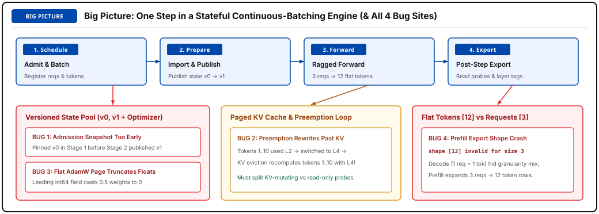

# Debugging State Lifecycles Under Continuous Batching: Admission Pins, Preemption Boundaries, and Export Dimensions

> **TL;DR**: In a stateless LLM serving engine, model weights never change and a request's KV Cache is a pure function of its past tokens, making batching, prefix caching, and preemption recomputation invisible to model semantics. Once you introduce mutable runtime state—such as live layer switching, same-batch parameter imports, or online fast-weight updates—bugs rarely hide inside a single GPU kernel; they cluster at cross-step and cross-request boundaries. Starting from a four-stage walkthrough of how a stateful continuous-batching step executes, this note reconstructs four bugs we hit in multi-request testing: an admission snapshot taken half a stage too early, KV preemption recomputing old tokens with newly switched layer weights, a flat `AdamW` parameter page inheriting `int64` from field 0 and truncating float weights to `0`, and a ragged prefill export crash (`shape '[12]' is invalid for input of size 3`) hidden during decode.

If you have worked inside a standard LLM serving engine like vanilla vLLM, one quiet property makes almost every systems optimization easier: **at the parameter level, the engine is completely stateless.**

No matter how many concurrent requests arrive, the model weights stay frozen. Token 5's hidden states and KV Cache depend solely on tokens 1 through 5 of that request. As a result, whether the scheduler runs a request alone, packs it into a mixed chunked-prefill-plus-decode batch, reuses a prefix cache block, or evicts its KV Cache under memory pressure and recomputes those tokens two seconds later, the resulting numbers are identical.

The moment you make an inference engine **stateful**—letting callers switch an active steering layer from layer 2 to layer 4 mid-flight, pass state updates alongside a new batch of requests, or update per-request fast weights with an optimizer—the scheduler, state pool, and KV Cache cease to be orthogonal.

When we wired dynamic layer routing and mutable states into continuous batching, isolated single-step tests passed right away. Under multi-request concurrent load, four puzzling failures surfaced one after another.

Before looking at any individual bug, let's put **the big picture of a single step inside a stateful continuous-batching engine** on the table:



Under the hood, mutable states (such as an active `layer` index or low-rank weights `lora_a`) live in a **versioned GPU state pool**: instead of overwriting memory in place and stalling running kernels, updates allocate a fresh slot and publish a new immutable version (`v0 -> v1`), while active readers hold lightweight reference pins (`Pin`) until their step finishes.

Every call to `engine.step()` marches through four stages in order:

1. **Stage 1 · Schedule & Admit (`schedule`)**: Pick which new and running requests participate in this step, and decide how many tokens each request feeds into the model;
2. **Stage 2 · Prepare & Publish State (`prepare`)**: Apply any pre-forward state imports or updates attached to this step (for instance, switching the target layer to `6`), publishing version `v1`;
3. **Stage 3 · Ragged Mixed-Batch Forward (`forward`)**: Flatten all tokens across prefill and decode requests into a single 1D ragged token table (e.g., Request A prefilling 5 tokens + Request B decoding 1 token + Request C prefilling 6 tokens = `[12, hidden_dim]`) and run the GPU forward pass. If GPU KV memory fills up, the scheduler triggers **preemption**, freeing a request's KV blocks and recomputing its prompt + generated tokens once memory clears;
4. **Stage 4 · Post-Step Export (`export`)**: Package captured probe activations alongside per-row metadata (such as which layer each row came from) and return them to the caller.

With that four-stage map in mind, each of the four bugs becomes easy to spot.

---

### Bug 1: The Caller Passed `layer = 6` With the Batch—Why Did Step 1 Still Run on Layer 0? (Stage 1 vs. Stage 2 Ordering)

**Motivation & Initial Code**: Suppose the server holds a shared `route_layer` state (initialized at version `v0` with `layer = 0`). Many workloads want **admission pinning (`refresh="admission"`)**: *"whatever layer is active the moment my request enters the engine, lock that version for my entire generation so later switches by other users don't affect me."*

When writing the first version of `step()`, the most natural place to take an admission snapshot seemed to be right inside Stage 1 when `schedule()` admits the request:

```python
# Initial broken step() ordering:
def step(self, incoming_requests, batch_state_updates):
    # Stage 1: Select requests for this step and immediately pin the current global state!
    batch = self.scheduler.schedule(incoming_requests)
    for req in batch.newly_admitted:
        req.pinned_version = self.state_pool.current_version  # <--- Still v0 (layer=0)!

    # Stage 2: Apply state updates submitted alongside this batch, publishing v1
    if batch_state_updates:
        self.state_pool.apply_and_publish(batch_state_updates)  # <--- Publishes v1 (layer=6) here!

    # Stage 3: Run GPU forward
    self.run_forward(batch)
```

**Discovery & Symptom**: Whenever we updated the state in a separate call *before* submitting requests, everything worked. Then we tested **same-batch state import**—submitting new requests alongside `StateUpdate(layer=6)` in a single call. Step-refreshed probes immediately saw `layer = 6` (`v1`), yet every admission-pinned request in that exact batch ran its entire life on stale `layer = 0` (`v0`)!

**Intuition & Fix**: As the timeline below shows, **we pressed the camera shutter half a stage too early**:


At Stage 1, Stage 2's same-batch import had not published `v1` yet, so `newly_admitted` locked `v0`. Splitting "record who was admitted" from "pin the state snapshot"—waiting until Stage 2 finishes publishing all pre-forward updates before pinning—fixed the race cleanly:

```python
def step(self, incoming_requests, batch_state_updates):
    # Stage 1: Record newly admitted request IDs only—do not pin yet
    batch = self.scheduler.schedule(incoming_requests)

    # Stage 2: Publish all same-batch state imports and pre-forward writes -> v1 (layer=6)
    if batch_state_updates:
        self.state_pool.apply_and_publish(batch_state_updates)

    # Fix: Pin admitted requests right after Stage 2 publishes the fresh version v1
    for req in batch.newly_admitted:
        req.pinned_version = self.state_pool.current_version

    self.run_forward(batch)
```

While auditing this boundary, we also added a load-time check rejecting contradictory declarations where a request-private state is marked `refresh="admission"` while also being mutated every step by a write task.

---

### Bug 2: Why Did Context Turn Incoherent Right After a Live Layer Switch Under High Load? (Stage 3 · KV Preemption Recompute)

**How Live Switching Interacts with KV Cache**: Under default per-step refresh (`refresh="step"`), switching a steering hook live follows **forward-only KV semantics**: if Request A generates tokens 1..10 while routed to layer 2, those 10 K/V vectors stay untouched in their physical KV blocks; when you switch to layer 4 at step 11, tokens 11 onward use layer 4 conditioned on the existing KV history. That keeps memory overhead constant without archiving historical weights per request.

**Discovery & Symptom**: At low concurrency, live switching behaved smoothly. Once we cranked concurrency high enough to exhaust the KV Cache pool and trigger **preemption**, coherence broke down silently: Request A generated 10 tokens on layer 2, the user switched the global layer to layer 4, memory pressure evicted Request A's KV blocks, and two seconds later the engine resumed Request A by feeding `prompt + 10 generated tokens` back through the forward pass to rebuild its missing KV Cache:

```python
# Standard stateless preemption recovery (silently corrupts stateful KV!):
def resume_preempted_request(self, req):
    # Concatenate prompt and the 10 already-generated tokens to rebuild evicted KV blocks
    recompute_tokens = req.prompt_tokens + req.generated_tokens
    # Bug: `current_version` is now layer=4, NOT layer=2 that originally produced those 10 tokens!
    self.run_forward(recompute_tokens, active_state=self.state_pool.current_version)
```

**Those first 10 tokens were chosen under layer-2 steering, yet preemption recovery recomputed all 10 of their K/V vectors using layer-4 weights!**


**Intuition & Two-Way Fix**: Without recording a full per-token parameter log, a request whose backbone activations were altered mid-generation **cannot be losslessly recomputed from a single current state**. For KV-mutating hooks (activation patches or LoRA adapters), the engine must disable cross-request Prefix Caching and fail fast if KV eviction forces a cross-version recompute, instructing the operator to raise KV memory headroom or cap max concurrency.

Equally important, **we should not penalize read-only probes!** Often a researcher switches `LayerRoute` live purely to *inspect* residuals or per-layer logits without modifying the model's forward activations at all. When no patch or adapter writes back into the backbone, the model's K/V tensors are 100% identical to the base model regardless of which layer the probe reads. Splitting state tracking into `all_bound_states` (for page pin lifetimes) and `kv_mutating_states` (for hooks that actually alter K/V) lets read-only probes keep full Prefix Caching and lossless preemption recompute.

---

### Bug 3: We Initialized Weights to `0.5`—Why Did Attaching `AdamW` Turn Them All Into `0`? (State Pool · Flat Page Dtype)

**Initial Code & Symptom**: Next, someone defined a single state class holding both the discrete routing index `layer` (`int64`) and trainable low-rank weights `lora_a, lora_b` (`float32`), initialized the weights to `0.5`, and attached `AdamW(lr=1e-3)`:

```python
class RoutedAdapterState:
    layer: Field(shape=(), dtype=torch.int64)           # Field 0: active layer index (int64 = 4)
    lora_a: Field(shape=(8, 4096), dtype=torch.float32) # Field 1: trainable factor (init = 0.5)
    lora_b: Field(shape=(4096, 8), dtype=torch.float32) # Field 2: trainable factor (init = 0.5)
```

Without an optimizer, reading `lora_a` right after initialization returned `0.5`. The instant `optimizer=AdamW(lr=1e-3)` was added—before a single training step even ran—every `0.5` in `lora_a` and `lora_b` came back as **`0`**!

**How the Allocator Ran Underneath**: Inspecting the state pool allocator revealed why field ordering suddenly mattered:

```python
# Initial state-pool allocator (excerpt):
def allocate_state_pool(fields, optimizer):
    if optimizer is None:
        # No optimizer: each field gets its own typed tensor pool—int64 and float32 never mix
        return [torch.zeros((num_slots, *f.shape), dtype=f.dtype, device="cuda") for f in fields]
    else:
        # With AdamW: pack all fields into one flat 1D tensor so a single fused paged_adamw
        # kernel updates everything—typing the entire page using `fields[0].dtype`!
        page_dtype = fields[0].dtype  # <--- fields[0] is `layer: int64`!!
        total_elems = sum(f.numel for f in fields)
        flat_param_page = torch.zeros((num_slots, total_elems), dtype=page_dtype, device="cuda")
        ...
```

![Bug 3: Fused AdamW Flat Page Inherits fields[0].dtype (int64), Truncating 0.5 -> 0](../../assets/personal-04-fig3-en.svg)

To update all trainable parameters and moments (`exp_avg`, `exp_avg_sq`) in one fused kernel launch, the optimizer allocator packed every field into one flat 1D buffer typed as `fields[0].dtype`. Previous tests always listed float weights first; putting `layer: int64` at index 0 turned the entire parameter page into an `int64` tensor, silently truncating `0.5` to `0` on copy!

Since discrete `int64` routing indices are non-differentiable anyway, rejecting gradient optimizers on discrete routing states at declaration time—and keeping discrete control switches separate from trainable float states—eliminated the trap cleanly.

---

### Bug 4: Decode Worked Fine—Why Did Multi-Token Prefill Export Crash With `shape '[12]' is invalid for input of size 3`? (Stage 4 · Token Rows vs. Unique Requests)

**Initial Code & Symptom**: Our fourth bug surfaced in Stage 4 (`export`) when `tokens="all"` was enabled to export hidden states across every prompt token during prefill:

```python
# Initial broken post-step export packaging:
def package_export_event(batch, probe_pool):
    num_tokens = batch.total_tokens  # Total flattened token rows in this step
    activations = probe_pool[:num_tokens]

    # Bug: queried deduplicated per-request state slots (1 entry per request, not per token!)
    req_slots = select_unique_request_slots(batch)     # Length = 3 requests, NOT 12 tokens!
    layers = route_layer_pool[req_slots].reshape(num_tokens)  # <--- Crashes on prefill!
    return ExportEvent(activations=activations, layers=layers)
```

Across dozens of concurrent **decode** tests (3, 8, or 32 requests), this ran without a hitch. The moment we fed a 3-request **prefill** batch whose prompts had `5`, `1`, and `6` tokens (`12` flattened token rows total), PyTorch threw:

```text
RuntimeError: shape '[12]' is invalid for input of size 3
```

**Intuition & Fix**: Look at why decode tests masked the bug completely:


During pure decode, every request contributes exactly `1` token, so `num_tokens == num_unique_requests == 3` and `.reshape(3)` succeeded by sheer coincidence! During prefill (or chunked prefill mixed with decode), 3 requests expand to `5 + 1 + 6 = 12` rows in the flattened token table while `select_unique_request_slots` still returns 3 entries.

Better yet, as we saw in Note 01, our forward probe kernel already writes the executed layer index into `slot_layers[dst_slot]` alongside every token row it copies. Reading `slot_layers[:num_tokens]` directly drops the redundant state-pool lookup and works identically across decode, ragged prefill, and chunked exports:

```python
def package_export_event(batch, probe_pool, slot_layers):
    num_tokens = batch.total_tokens
    # Read per-token-slot layer tags recorded during forward—aligned for both decode and prefill
    return ExportEvent(
        activations=probe_pool[:num_tokens],
        layers=slot_layers[:num_tokens],
    )
```

---

### Takeaway: Why Authors Miss Cross-Boundary Bugs (& How Tiny Adversarial CPU Probes Catch Them)

None of these four bugs involved subtle math; every single one lived at the seam between two subsystems that worked fine in isolation. Why did hundreds of initial unit tests miss them?

Because **the engineer who just built a feature unconsciously writes "happy-path" tests matching their own mental order of operations**: importing before admitting, listing float weights before integer flags, testing export on single-token decode steps, and keeping KV memory comfortably below eviction.

Before merging this subsystem, we ran an experiment that paid off handsomely: we handed a separate reviewer model read-only access to the codebase and asked it to write tiny, 20-line CPU-only adversarial probes specifically targeting *feature intersections*—combining `refresh="admission"` with same-batch imports, placing an `int64` field first under `AdamW`, and running `tokens="all"` on ragged multi-token prefill batches. All four bugs above were reproduced and fixed in seconds on CPU before touching a GPU cluster.

This versioned state lifecycle (PTTS) and dynamic routing layer now ship in **[pLLM](https://github.com/LinesHogan/pLLM)**. Fixed-base versioned pools paired with explicit `admission` / `step` refresh policies keep in-graph reads lock-free inside CUDA Graphs; the fundamental constraint to remember is that whenever an online intervention mutates backbone KV mid-request, cross-request prefix caching must stay off and KV memory should be sized with enough headroom to avoid preemption recompute.
