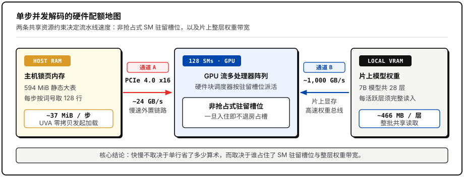
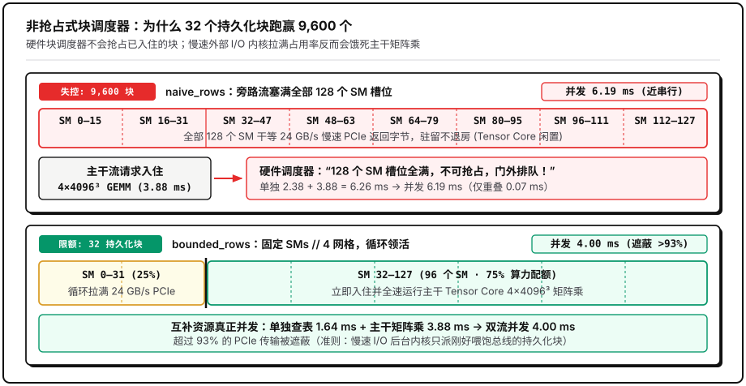
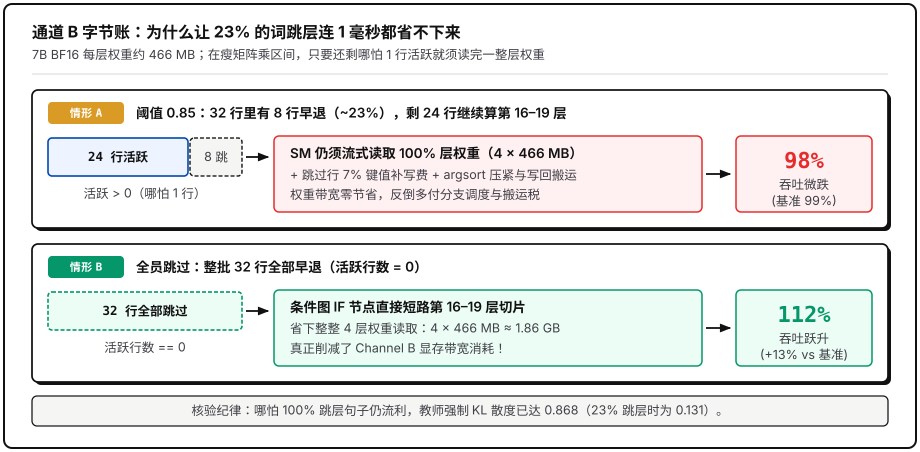

# 为什么 32 个线程块跑赢 9,600 个，跳过 23% 的词却省不下 1 毫秒？连续批处理的带宽配额分析

> **TL;DR**：写单请求实验脚本培养出的两条性能直觉——“访存慢就多开线程块藏延迟”和“让简单词提前退出就能按比例省时间”——搬进连续批处理推理引擎后双双失灵。本文通过一张单步带宽与流处理器（SM）配额模型把两件事串起来：跨慢速 PCIe 零拷贝查表时，9,600 个非抢占式线程块会占满全部 SM 驻留槽位饿死主干矩阵乘，把网格压到 32 个持久化块才能藏住 93% 以上的传输；而在芯片内部，每层 466 MB 的权重读取锁死了短上下文解码节拍，局部跳层省不下权重搬运，还会在文字通顺的表象下暗藏显著的分布漂移。

在单请求研究脚本里调性能，有两条几乎不用过脑子的经验：遇到高延迟访存就把启动网格（grid）开大，靠成千上万个线程块切换来掩盖延迟；遇到像 `the`、句号这类简单词，在第 16 层判断收敛后直接跳过后面几层（Early Exit），跳过四分之一的词自然能省近四分之一的时间。

可把这两套做法原封不动放进跑着上百条并发请求的连续批处理引擎，实测结果正好反过来：跨 PCIe 读一张外部记忆表，发射 **9,600 个线程块**让双流并发退化成了串行，硬砍到 **32 个线程块**反而把传输时间藏掉了九成以上；动态早退让批次里 **23% 的词跳过 4 层**，端到端解码吞吐非但没涨，反而微跌了近两个百分点。

这两桩反常现象看似一桩在芯片外、一桩在模型层内，其实遵循的是同一个系统建模框架：**在共享流水线上，快慢不取决于单个任务少做了多少算术，而取决于谁占住了全局稀缺配额（SM 驻留槽位与整层权重带宽）。**

先把一步并发解码所处的硬件配额地图画出来：



顺着图上的通道 A 和通道 B 各算一笔账，两个反直觉现象就能用初等算术推出来。

---

先看通道 A：**为什么跨 PCIe 预取数据时，派出去干活的线程块越少，整步跑得越快？**

像多元语法先验或 Engram 这类外挂记忆结构，静态查找表动辄几百兆（例如一张词表宽度的双字节表约 **594 MiB**）。为了不挤占宝贵的 GPU KV 缓存，工程上自然想把大表锁在主机内存（Pinned RAM）里：因为查表只依赖上一步已生成的词编号、不依赖当前步的模型隐藏状态，只要在每步开头把 128 行所需数据（约 **37 MiB**，按 `24 GB/s` 算耗时约 `1.6 ms`）放到旁路 CUDA Stream 上跨 PCIe 预取，理论上正好能藏在主干流几毫秒到二十多毫秒的模型前向背后。

动手实现时，第一个问题是：**为什么不能调 GPU 专职的硬件 DMA 拷贝引擎（`cudaMemcpyAsync`）？**

DMA 拷贝引擎不占半个 SM，平时做权重卸载挺好用；但所有的 `cudaMemcpy` 接口都有一条硬前提——**源内存地址必须在 CPU 主机端作为参数传给驱动**。而在自回归解码循环里，上一步刚抽出来的词编号和算出来的哈希行号自始至终躺在 GPU 显存里！如果为了组装 DMA 地址先把 128 个行号拷回 CPU，就会触发阻塞式主机同步，不仅掐断异步发射流水线，也没法录进静态 CUDA Graph。

DMA 指望不上，唯一的无同步路径是**锁页内存上的统一虚拟寻址（UVA）零拷贝读取**：把主机张量锁定在物理内存并映射进统一地址空间，让运行在 SM 上的 Triton 内核直接在显存里读出行号，跨 PCIe 发起加载指令。

问题就出在这个内核的网格大小上。按标准 GPU 教材写法（`naive_rows`），每行切 75 个 4 KiB 列分块以保证合并访存，128 行一共发射 `128 × 75 = 9,600` 个线程块（CTA）；而在对照版本（`bounded_rows`）里，算术指令一行不改，唯独把启动网格上限卡死在 **32 个线程块**（128 个 SM 的四分之一），靠循环跨步领活：

```python
@triton.jit
def bounded_rows(src, rows, out, count: int, width: tl.constexpr, block: tl.constexpr):
    tiles = tl.cdiv(width, block)
    # 网格大小固定为 SMs // 4；少量常驻块循环领活，留出四分之三 SM 给主干前向
    for tile in tl.range(tl.program_id(0), count * tiles, tl.num_programs(0)):
        row, col = tile // tiles, tile % tiles * block + tl.arange(0, block)
        idx = tl.load(rows + row).to(tl.int64)
        tl.store(out + row * width + col, tl.load(src + idx * width + col, col < width, 0), col < width)
```

拿这两段内核跟主干流上的 4 组 `4096³` 矩阵乘（单独耗时 `3.88 ms`）并排实测，对比鲜明：
- **`naive_rows`（9,600 个块）**：单独查表 `2.38 ms`，与矩阵乘双流并发总耗时 **`6.19 ms`**——跟串行相加（`6.26 ms`）几乎没区别，重叠只省下 `0.07 ms`；
- **`bounded_rows`（32 个块）**：单独查表 `1.64 ms`，双流并发总耗时直接降到 **`4.00 ms`**——超过 **93%** 的跨总线传输时间被主干矩阵乘遮住了！

为什么多派三百倍的块反而把并发搞砸了？这里要区分 GPU 的两层调度器：SM 内部的 Warp 调度器确实能单周期切换藏延迟，但前提是别的内核已经拿到了这个 SM 的房间；而芯片顶层的**硬件块调度器是非抢占式的（non-preemptive）**：



看清这张驻留图，诊断准则就有了：**凡是在旁路流上跑受限于慢速外部 I/O 的后台内核，“拉满占用率”恰恰是毒药**。只派刚好能喂饱外部总线带宽的少量持久化块（约 `SMs // 4`），把主力算力单元留给前台任务，两条流索取的资源互补，并发才真正成立。

同时，这个模型也直接给出了主机表方案失效的算术边界：只有当 $\text{单步跨总线字节数} / 24\text{ GB/s} < T_{\text{前向}}$（且查表被拆成只依赖输入词编号、不读模型隐藏状态的独立前置函数）时，传输才藏得住；要是换到单步只有 3 毫秒的 0.5B 小模型或超大并发批次，PCIe 耗时露出水面，就得由作者显式权衡是留显存还是保吞吐了。

---

视线移回芯片内部的通道 B：**为什么让 23% 的解码词跳过 4 层，连 1 毫秒都省不下来？**

假设我们在 7B 模型（共 28 层，32 并发解码）的第 15 层后加一道余弦相似度判断：表示方向已经稳定的简单词，直接跳过第 16–19 层。我们已经用设备端条件图节点和 2 的幂次压紧桶（`argsort` 把仍需计算的活跃行聚拢成紧凑小批次，同时为跳过行补齐约占单层 7% 算力的键值投影以防后续词读出缓存空洞）做到了全程零主机同步。

拉上基准测试台实测三种阈值配置：
- 从不跳层：吞吐为原生图模式的 **99%**；
- 阈值 `0.85`（实测约 **23% 的词跳过第 16–19 层**）：吞吐微跌至 **98%**；
- 阈值极端化（整批 **100% 的词全部跳过**）：吞吐跃升至 **112%**！

明明用压紧桶把活跃行数从 32 行压少了近四分之一，为什么 23% 的词跳层一点没快，非得全员 100% 一起跳才快出 12%？

还是算一眼通道 B 的字节账。7B 模型的双字节权重约 15 GiB，除去首尾词表，**平均每一层 Transformer 的权重矩阵重达约 466 MB**。在每次只算几十行的瘦矩阵乘（Skinny GEMM）里，耗时大头根本不是浮点乘加，而是把这 466 MB 权重从显存流式读进寄存器：



独立工作台上干完活就能关灯下班；但在共享权重带宽的批处理传送带上，只要同批里还有一个慢工位没法跳过这一层，整层权重就得照读不误。

顺着这个带宽模型往下推，不用做实验也能准确预判按行早退在什么条件下才会真正省时间：要么**并发批次大到跨过算力受限（Compute-Bound）拐点**，减少行数能直接削减 Tensor Core 计算耗时；要么**上下文长达数万词**，单行扫描历史 KV 缓存的字节数反超了 466 MB 层权重，被跳过的行省下的注意力访存终于成了大头。

在排查早退收益时，我们还踩出了一条做模型近似优化必须守住的核验纪律：**千万别因为生成的句子肉眼读着通顺，就以为跳层没伤精度。**

拿未经跳层专门训练的普通 7B 模型直接跑上面的早退负载，哪怕把阈值调到 100% 总是跳掉第 16–19 层，模型吐出来的英文长句依然语法工整、像模像样。可一旦换用教师强制（Teacher Forcing）在相同前缀上逐位置比对跳层模型与原模型的下一词完整概率分布：
- 约 23% 词跳层时，平均 KL 散度已漂移到 **`0.131`**；
- 100% 跳层时，平均 KL 散度高达 **`0.868`**（总变差距离 `0.25`），预测分布其实已经面目全非了。

---

这两套配额规律——跨 PCIe 预取自动按 `SMs // 4` 派发持久化网格（并在启动前通过静态分析打印每步跨总线字节账单），以及动态跳层自动接入图内条件压紧桶与教师强制分布校验工具 `check_distribution`——如今都已内置在我们的开源 vLLM 扩展层 **[pLLM](https://github.com/LinesHogan/pLLM)**（`pllm`）里。

下次往批处理引擎里移植单卡优化技巧之前，不妨先画一张两分钟的资源配额草图：如果省掉的是过剩的浮点算力、抢占的却是满载的总线或非抢占槽位，再精巧的局部剪枝也只会替瓶颈添乱。
