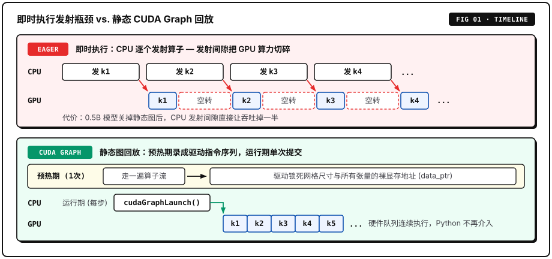
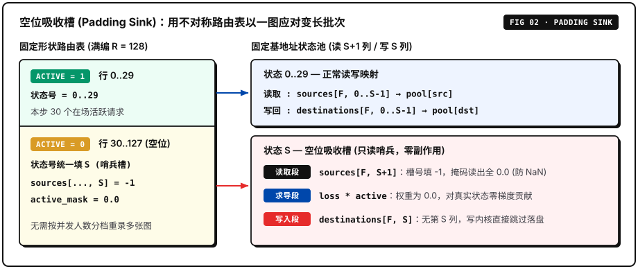
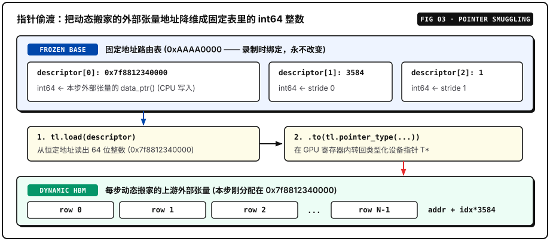

# 图是死的，表是活的：怎么在冻结的 CUDA Graph 里偷渡动态指针？

> **TL;DR**：为了省掉逐个发射小算子的 CPU 开销，生产推理引擎会把解码步录成静态 CUDA Graph，代价是图内算子的张量形状与裸显存地址在预热那一刻就被锁死。想在不重录图、零主机同步的前提下跑通每步人数在变、座位在变、甚至外部输入缓冲区都在搬家的在线反向传播与 `AdamW`，核心建模手段是借用图形学与系统里的**无绑定描述符表（Bindless Descriptor Table）**：把一切运行期变化（包括外部张量的 64 位裸指针）降维成固定地址 `int64` 表里的整数。文末从“录制器真正记录的是什么”这一视角，统一解释预热防污、跨流 GC 与纯函数编译器冲突三类常见故障的排查逻辑。

在单卡脚本里调通一段在线学习算法（比如每生成一个词，就拿首尾层隐藏状态算一次损失、反向求导并用 `AdamW` 更新当前请求专属的轻量权重）之后，搬进并发推理引擎遇到的第一个性能悬崖，通常不在 GPU 上，而在 CPU 上。

逐字解码时，每个请求每步只处理 1 个词。GPU 执行单个小算子只需几微秒，而 CPU 每发射一个算子都要穿过 Python 解释器、PyTorch 分发器和 CUDA 驱动。在线训练加上反向求导和动量更新，一步里零零碎碎有五六十个小算子：



为了消掉这笔发射开销，在线训练步也必须像主干模型那样录进静态 CUDA Graph。

但只要把两边的约束摆在一起，矛盾就出来了：CUDA Graph 要求算子看到的**张量形状恒定、物理基地址恒定、且全程不能有 GPU 到 CPU 的同步等待**；而外面的连续批处理引擎恰恰相反——每一步进场的活跃请求数在变，哪个请求排在批次的第几行在变，甚至上游组件（比如采样器）递过来的输入张量隔几步就会释放旧块、换一个新显存地址。

---

怎么对这个矛盾建模？

遇到“指令流必须静态、操作对象却在动态变化”的约束，不妨想想操作系统虚拟内存页表，或者现代图形 API（Vulkan / DirectX 12）里的**无绑定描述符表（Bindless Descriptor Table）**是怎么干的：着色器代码编译死之后不能改，但它可以绑定一张物理基地址永远不动的整数描述符表；每帧开画前，CPU 把本帧真正要读的纹理槽位和内存地址写进表里，GPU 顺着表做一次间接寻址。

把这个模式原样搬进 PyTorch 和 Triton，整套动态训练图的数据结构就收束成了一句话：**图是死的，表是活的。**

我们在启动时按最大并发上限，一次性分配两样基地址永不改变的显存块：一块是存放各参数字段的物理槽池 `pool[capacity, *field_shape]`，另一块是一张只有二十多 KB 的固定 `int64` 路由表 `TableLayout`（每步由 CPU 在锁页内存里填好数字推上显卡，异步拷贝只需约 6 微秒）。

顺着这张表，三层由浅入深的动态性可以逐一消解。

**第一层：座位每步洗牌，用槽号间接寻址解决。**  
这一步第 0 行是请求 A，下一步变成了请求 C。图里的内核不绑定任何具体请求的张量，只绑定槽池基地址和路由表地址：先去表的 `rows` 段读出当前行对应的源槽号 `src` 与目标写槽号 `dst`，再去 `pool[src]` 读参数、算完写回 `pool[dst]`。外头怎么换座位，变的只是表里的几个整数。

**第二层：在场人数不满上限，用“空位吸收槽（Padding Sink）”替代多档位录图。**  
上限设为 $R = 128$ 行、$S = 128$ 个请求状态，可线上低谷期某一步只来了 30 个请求，剩下 98 行空位怎么处理？如果模仿无状态前向那样按 `(行数, 状态数)` 组合分档录十几张图，每张图私有的反向激活显存池会把宝贵的 KV 缓存空间吃光。

想只录**唯一一张满容量图**，只需在设计路由表的读写列数时做一个不对称切分——源槽表 `sources` 开 `S + 1` 列（`0..S`），而目标写槽表 `destinations` 只开 `S` 列（`0..S-1`），把多出来的第 `S` 列专门留作吸收无效行的哨兵槽：



这样一来，无论本步来 1 个请求还是 128 个请求，静态图执行的永远是同一套规整张量运算，空行既不会算出 `NaN` 污染梯度，也不会触发任何多余的显存写入。（同理，哪怕算法要求按运行时的动态数值条件只更新部分请求，CPU 也不用调 `.tolist()` 同步等结果——直接给在场请求都分配好新槽位，图内内核发现某请求未命中更新条件时，把旧槽位原样拷进新槽位即可。）

---

**第三层：上游每步重新分配地址的外部张量，怎么在死图里读取？**

自己分配的状态池可以保证基地址不变，但宿主引擎传过来的外部张量（比如采样器刚产出的反馈张量）不归我们管——上游隔几步调整批次大小时就会释放旧张量、新分配一块显存。如果把这个外部张量直接作为算子参数录进 CUDA Graph，下一步回放时算子就会冲向已经释放的悬空旧地址。

初看这像个死结：不传张量怎么读数据？传了张量地址又会被锁死。

破局点在于跳出 PyTorch 的 `Tensor` 包装看硬件本质：**在 64 位统一虚拟寻址的 GPU 上，设备指针（Device Pointer）在物理表示上就是一个普通的 64 位整数。**

CUDA Graph 只禁止“作为内核入口参数的张量换地址”，从不禁止“固定地址缓冲区里存的整数换数值”。那我们干脆不把外部张量传进图里——每步回放前，让 CPU 调一次 `external_tensor.data_ptr()` 取出它的 64 位裸地址，连同两个维度的步长（`stride0`, `stride1`），当成三个普通 `int64` 填进固定路由表的 `descriptor` 段：



在 Triton 内核里，只需十行代码就能完成这次“整数还原指针”的间接读取：

```python
@triton.jit
def _gather_rows(descriptor, rows, output, width: tl.constexpr):
    row = tl.program_id(0) // tl.cdiv(width, 256)
    col = (tl.program_id(0) % tl.cdiv(width, 256)) * 256 + tl.arange(0, 256)
    # 录制器只看到恒定的 descriptor 地址；运行期读出的 int64 直接转回类型指针解引用
    address = tl.load(descriptor).to(tl.pointer_type(output.dtype.element_ty))
    stride0 = tl.load(descriptor + 1)
    stride1 = tl.load(descriptor + 2)
    index = tl.load(rows + row)
    value = tl.load(address + index * stride0 + col * stride1, col < width, 0)
    tl.store(output + row * width + col, value, col < width)
```

一行 `.to(tl.pointer_type(...))`，就把静态计算图的生命周期与外部缓冲区的分配生命周期干净拆开了。

---

掌握了上面这套间接寻址模型之后，自己在项目里动手录复杂状态图时，怎样才能不踩进莫名其妙的崩溃和性能倒退里？

不少文章会把录图时的故障列成一串零散的注意事项，其实只要建立一个核心认知，所有问题都能自己提前推出来：**CUDA Graph 录制器看不懂你的 Python 数学意图，它只是忠实地把“录制窗口期间当前 CUDA Stream 上发生的每一次内存写操作和每一次分配器事件”原样录下来；而且它跟追求“纯函数无副作用”的图编译器天生路数不同。**

顺着这个视角往外推，三个最容易栽跟头的现场就全串起来了：

1. **既然预热和录制跑的是真指令，原地写算子就会污染线上状态。**  
   正式调用 `torch.cuda.graph` 之前，惯例要先在私有流上跑 3 遍预热（warmup），让 cuBLAS 和 Triton 完成内部工作区分配。但如果你的图末尾挂着原地写池子的 `AdamW`，直接跑 3 遍预热就会拿未初始化的缓冲把线上真参数连覆盖 3 次。顺着模型想，解法自然就有了：进入预热和录制前先调一句 `destinations.fill_(-1)` 把所有目标写槽屏蔽掉，录完图再填回真实槽号回放，4 遍捕获过程对状态池就成了严格只读操作。
2. **既然分配器事件也会被录进去，任何跨流内存释放都会炸毁录制窗口。**  
   线上偶发“捕获失败（operation not permitted when stream is capturing）”时，新手常去查是不是自己写了 `.item()`，却忽略了后台的 Python 循环垃圾回收器（GC）：录制中途分配包装对象时，GC 可能突然按计数触发，顺手析构掉一个几步前在**另一条 CUDA Stream** 上用过的死张量；C++ 析构函数向缓存分配器发出的跨流释放通知一插进当前捕获流，录图就会立刻作废。因此录制窗口外围必须用 `gc.disable()` 护住。（同理，若在图内使用设备端条件 `IF` 分支节点，PyTorch C++ 底层在条件节点开闭时会把同一个图显存池的引用计数多加两次，而 `CUDAGraph.reset()` 只减一次；排查显存泄漏时盯着图池引用计数看，就能定位到必须手动调一次底层池作用域释放来配平。）
3. **当原地状态池遇上 `torch.compile`，记得用剖析器核对总耗时而非只数内核个数。**  
   把训练步录进静态图后，常有人想到再套一层 `@torch.compile` 把五六十个碎算子融合成大内核。我们实测套上之后，旁路流每步发射的内核数确实从 59 个降到了 25 个，但每步 GPU 总耗时反而从约 **180 微秒恶化到了近 260 微秒**。打开剖析时间线一看，编译器在 `AdamW` 前面凭空塞进了一个耗时近 40 微秒的 `clone_paged_adamw_slice` 内核——因为 AOTAutograd 的函数式化（Functionalization）要求图内算子全是无副作用的纯函数，看到你往固定大池子的切片里原地写数据，它为了自保先把池子切片克隆了一份副本、算完再拷回去。在静态图已经消除了 CPU 发射税的前提下，盲目叠加纯函数编译反而会赔上显存带宽。

---

这套基于单张固定 `int64` 描述符表的捕获机制，目前承担着开源扩展层 **[pLLM](https://github.com/LinesHogan/pLLM)**（`pllm`）里所有逐请求在线训练与状态写入任务的图执行；在 7B 模型、128 并发下，回放包含前向、反向求导与分页 `AdamW` 的整步训练图只需约 600 微秒。

工程上没有白吃的午餐，这套建模换取“单图零重录”的代价有两条：一是低并发时段，空位吸收槽所在的行依然会陪跑满编的矩阵乘；二是由于有效行与空位行同批执行，用户编写的损失函数在行维度（`dim=0`）上必须严格独立——一旦混入跨行求均值等归约操作，空位行的零值就会直接稀释正常请求的梯度。
