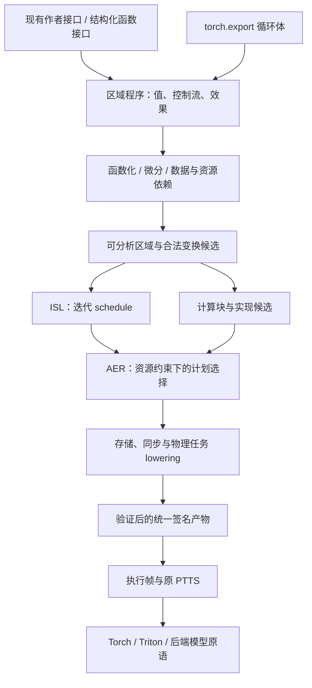

# pLLM 计算模型：先确定语义，再决定执行

本文保留架构设计与分阶段记录；当前实现、验收证据和剩余任务统一见
[功能与进展收口](implementation-status.md)。

状态：架构提案，2026-09-11。本文是后续 ISL、数学变换和执行器改造的前置设计，
不是已经实现的完整能力说明。区域语义内核与参考验证已开始实现，具体签名、
证据与未完成边界见 [区域 IR 规格](region-ir.md)。追加 `SemanticTask.iteration`
的实验接线已移除；现已从区域源程序推导依赖、调用 ISL 并降低成循环指令，
真实张量与原 owner 内的 PTTS 执行已接通；In-Place-TTT 的 chunk 递推已导入
新 scan，条件 replay 的 while 与停止判断也已迁移，并通过原后端端点接回
Qwen2 层段；完整生产作者接口与全局模型执行仍待迁移。

目标是让普通训练、在线更新和条件重放由同一组基本构件组合出来。算法作者
表达数学、数据流和可观察效果；编译器选择调用顺序、计算块、实现与存储。
“优雅”在这里指：增加一种算法组合不必修改核心对象，正确性可以沿着显式
依赖解释，而不是把所有行为压进一个大类或消除所有属性。

## 1. 参考哪些项目，具体借鉴什么

以下判断来自官方架构资料、语言参考或项目源码。项目自身的事实与 pLLM 的
设计选择分开说明，不能把参考项目已有的能力当成 pLLM 已经获得的能力。

| 参考 | 项目中的设计 | pLLM 的取舍 |
| --- | --- | --- |
| **MLIR**：Operation / Value / Block / Region [1] | 操作产生 SSA 值；区域嵌套在操作中；块参数和 terminator 表达区域输入输出 | 作为核心表示的主要参照。循环与条件是真正的区域，不是 task 上可选的执行模式 |
| **MLIR SCF / Affine** [2][3] | 结构化控制流与可做仿射分析的子集有不同的表达与约束 | 先保留完整结构化语义，再识别适合 ISL 的区域；不是所有循环都必须仿射 |
| **MLIR effects / speculation** [4] | SSA 数据依赖以外还有资源效果；可推测执行性需要额外判断 | 发布、KV 和宿主调用有显式效果；“没有内存写”不等于可以任意提前、复制或删除 |
| **MLIR bufferization** [5] | 先在 tensor 语义上变换，再分析别名和读写冲突，决定原地复用或复制；回收另有机制 | 先表达新状态值，再把它落到 PTTS 的私有页和 COW；保留原 pin / receipt 回收所有权 |
| **JAX jaxpr / scan** [6][7] | 小型方程式 IR，primitive 可包含子 jaxpr；scan 保留循环，不必把 Python 循环全部展开 | Python 接口偏函数式；循环携带值显式。首版不做任意 Python 控制流理解，也不把状态全藏进闭包 |
| **JAX effects** [8] | 区分编译器内部顺序 token 与异步 dispatch 的运行时 token | 效果顺序、提交资格、设备完成分别建模。编译器里的依赖不是 CUDA 已完成的证据 |
| **Halide** [9] | 算法与 schedule 分离；教程用 reorder、split、tile 展示同一算法的不同执行 | 保留朴素参考语义与可解释 schedule。默认由 pLLM 自动选择，不要求用户手写优化 schedule |
| **TVM Relax / TensorIR** [10][11] | 图层与张量程序层分工；Relax 保留符号 shape 与跨层优化联系 | pLLM 负责推理过程、状态与迭代的中段；复用 export 和既有计算后端，不重写整个张量编译器 |
| **PyTorch Export** [12] | 捕获张量计算图与成立条件，显式表示参数、buffer 等程序接口 | 导入循环体；参数和修改结果绑定逻辑状态，循环骨架仍由结构化前端提供 |

主线采用 MLIR 的层次化 SSA 思路、JAX 的函数式作者体验和 Halide 的算法/调度
分离；TVM 提醒我们保留高层结构，同时向下暴露足够的优化信息。

本轮架构不要求接入完整 MLIR、JAX 或 TVM 运行时。建议保留 Python 作者入口与
Rust 规划验证，限制在单块区域和结构化控制流，实现 pLLM 必需的表示与校验。
不另造 ATen 的完整算子体系或 GPU codegen。是否复用现成 IR 基础设施属于
实现成本评估，不能反过来让库的便利性决定算法语义。

## 2. 当前模型的结构性限制

当前 `SemanticTask` 同时放置输入输出、状态效果、时机窗口、replay、数学契约和
实现候选。不同组合的含义再由绑定器和执行上下文补齐，存在如下具体限制：

- 原 `StateTaskContext` 只有单个 `write`、`publication` 和 published pin，限制了
  一个调用内的更新/发布路径。现已改为原始 capability 集合，并保留单写兼容视图。
- 原 `MathBinding.bind` 限制为一个逻辑状态。现已允许多个资源复用原目录、
  admission、lease 和调用所有者，并按资源初始化异构字段。普通 overlay、训练
  等作者适配器仍有 sole state / sole transition / sole training sink 的检查；
  这些生产入口尚待迁移，不能把核心接线完成等同于完整迁移。
- 执行器原先每个 task 只调用一次，临时值按 `(task, output)` 标识；循环藏在
  callable 内，无法统一分析其迭代依赖和中间值生存期。
- 区域当前主要是物理分组，尚不是可以包含循环、分支和子程序的语义结构。
- 模型在固定锚点推进，一些更新在完整 forward 后才获得输入。改变 task 顺序
  不会自动改变模型实际的层/chunk 执行顺序。

这些是原来的工作负载边界进入了核心模型，不是单纯的代码风格问题。

## 3. 核心模型只保留四种结构

### Value：由某次定义产生的带类型值

张量、标量、不可变状态快照和效果顺序值都有明确类型及来源。名称不是存储
位置：`weights_1` 表示一次计算的结果，不表示“页池里的第 1 槽”。

一个值只能由块参数或某个操作结果定义。区域外只能通过区域结果使用内部值；
首版区域显式列出外部输入，避免隐藏的闭包状态绕过依赖分析。

### Operation：消费值、产生值，并有明确语义

通用结构只需要操作种类、操作数、结果类型、必要的静态参数和嵌套区域。
每种操作有封闭的签名和 verifier，不使用大量 `Optional` 字段表达互斥行为。

shape、dtype、层索引、归约轴仍然是合理的参数。应消除的是同一个巨型对象中
只能靠组合检查理解的 `is_training`、`has_replay`、`iteration_mode` 等模式。

### Block：显式参数和有序操作组成的参考程序

块中的顺序给出参考语义，SSA 使用关系给出数据依赖。优化只能越过经效果分析
证明可交换的操作。首版每个区域一个块，结尾由 `yield` 返回结果；不引入任意
跳转、隐式循环和需要猜测的控制流合并。

### Region：可分析、可转换的子程序

Region 是控制操作或函数拥有的代码体。普通调用、循环和条件共享这个嵌套
机制。语义区域与后续选择的物理融合分组分别命名，避免两种 region 混用。

最初支持 `call`、带携带值的 `scan`、独立 `map`、`if` 和有界条件循环。
`scan` 的 carry 在一次特化内有固定结构、shape 和 dtype；`if` 的分支输出和
资源状态必须可合并。有界条件循环通过条件与 yield 表达，不编码成 replay 特例。

**task、launch、stream 和 capture block 是 lowering 的结果，不是作者最初
必须选择的计算粒度。** 一个 cell 可以保留成整体，也可以在分析后拆分。

相邻纯张量调用现在可以作为显式源变换提取成新的函数：两个 verifier 从原
Block 重建外部输入与逃逸结果，本地再内联原 ATen 图并核对布局守卫。候选
保留这条推导，后续调度与成本分析针对推导后的 Program 重新进行。这样跨
调用数学变换不需要给旧 task 增加融合标记；原顺序仍是候选零。逐元素图已能
进一步进入 Inductor kernel 编译，并导入编译器分配与输出复制费用；只读输入
借用原区域存储，编译器核验无写入与隐藏的对齐复制。更广
后端 lowering 和工作区依据仍待接入，见 [区域 IR 规格](region-ir.md)。

## 4. 操作语义分为几组，不分成几套计算模型

| 语义组 | 代表操作 | 编译器可以怎样处理 |
| --- | --- | --- |
| 张量计算 | export 的函数式 ATen 区域、已有数学原语调用 | 分析数据流、拆分、融合、局部性变换、编译 |
| 结构化控制 | scan、map、if、有界条件循环 | 保留循环携带值；对可证明的区域交换、分块或流水 |
| 逻辑状态 | 获取显式版本、按逻辑索引选择快照、发布新值 | 推导版本依赖与提交顺序；之后选择存储表示 |
| 模型/外部效果 | 层段执行、KV 操作、采样、宿主调用 | 按声明的输入输出、资源效果和后端能力调度 |

微分是区域上的转换：从前向区域生成梯度数据流，再组合函数式优化器。
“训练”不是一种规定了唯一执行流程的顶层任务类型。前端的 `@train` 可以
继续作为便利写法，lower 后不保留“只允许一个训练终点”的算法模板约束。

纯计算操作也不能被无条件推测执行。例如分支中的除法、数据相关索引可能在
另一分支的输入上无效；可能抛错或不终止的调用不能随意提前。效果查询与
可推测执行查询必须分开，未知行为采用保守规则。[4]

## 5. 状态值、效果顺序与完成证据必须分开

| 概念 | 意义 | 能否被当成另一个概念 |
| --- | --- | --- |
| 状态快照值 | 算法读取的是哪份不可变内容 | 不等于最新页指针或写入权限 |
| 效果顺序/提交链 | 某个逻辑资源上的可观察操作必须如何排序 | 不证明 GPU 已完成，也不自动实现运行时权限校验 |
| 运行时完成对象 | event / receipt 表明已发工作何时完成、何时能释放 | 不负责重新选择算法版本或改变编译顺序 |

以当前资源接口表达，下面的调用按算法参考顺序排列：

```text
%w0 = state.snapshot %resource
%h1, %w1 = call @cell(%h0, %w0)
state.publish %resource, %w1
```

`cell` 产生新状态内容，`publish` 使其可观察。快照读取与发布都进入对应资源的
效果关系，由编译器推导 RAW/WAR/WAW；不再传递另一套 Order 值。
不能靠 SSA 本身保证“唯一提交”：资源 verifier 还需检查冲突提交、分支合并和
允许的 fork/join。纯数学可以从同一快照计算多个候选，但不能未经定义地提交
两个互相覆盖的结果。

效果按逻辑资源分区，例如 `(lineage, layer)` 的状态、`(request, layer)` 的
KV 和独立宿主通道；不创建一根把整个系统串行化的全局 token。别名未知时
保守合并，已证明独立才可分离。

分片是算法的逻辑独立性，不是根据物理字段名称猜出来的。要求整组参数原子
发布时保留整组效果；可以逐层独立提交时才生成逐层链。运行时所有页和提交
仍由原 PTTS 负责。算法作者不手工串接状态顺序 token。

存储降低阶段再决定：何时物化、能否原地复用、是否 COW、需要保留几份版本。
已有精确版本与容量事实可以反过来影响调度候选，但不能反过来修改算法要求的
可见性。Bufferization 的分层思想可借鉴，MLIR 的实现不替代 pLLM 的发布、
异步完成与跨请求所有权。[5][8]

## 6. 用三个核心场景检验，而不是只画架构图

### 普通训练与采样引导

```text
snapshot → predict → sampling effect
    └────→ forward loss → gradient region → functional optimizer → publish
```

预测读哪个版本、loss 是否在采样后获得全部输入，由值与效果关系说明。
两个独立状态可以有两个训练终点，各自更新；共享状态的两个更新需要明确
版本链。这不需要在上下文里增加 `second_write` 或 `second_publication`。

### chunk × layer 在线更新

```text
S[c,l-1] ──hidden──> S[c,l]
S[c-1,l] ──该层状态──> S[c,l]
```

前端保留循环与状态选择：第 c 个 chunk 在第 l 层的状态取自该层上一轮。
在满足本层输入已就绪、资源独立等条件时，ISL 可以推导 `theta(c,l)=(c+l,c)`。
真实层段还要包括 causal attention 的历史 KV 和未挂更新的中间层。

**仅换成 scan 不够。** 若 carry 是不透明的整个参数 bank，编译器仍只看到
全局串行依赖。必须保留逻辑索引、select/update 关系，并证明不同层的访问
不冲突。算法确实要求整 bank 原子可见时，编译器不能为了 wavefront 删除它。

假如更新需要最后一层的监督，则加入相应反馈边；没有并行空间也是正确结论。
Jacobi 会改变版本读取关系，本轮不把它视为严格等价的 schedule。

### 条件 layer replay

```text
snapshot + layer input + KV effect
    → bounded loop {
        layer-region → predicate
        if continue { yield updated carry and resource state }
        else        { yield final carry and resource state }
      }
```

循环的上限、条件和携带值属于结构化控制；KV overwrite / restore、参数版本、
RNG 与输出用途属于具体操作语义。replay 的组合不需要挂到通用 task 的特殊字段。
不满足仿射条件的谓词留在动态区域内，不强行交给 ISL。

另外用两个交叉场景检查抽象：同一路由跨请求续接状态；两个独立状态的训练
与只读观测并存。若它们仍需新增上下文字段或独立 runtime，设计尚未通过。

## 7. 一份语义，多个 lowering 阶段



多层表示可以存在，但必须是有来源关系的编译产物：规范语义程序是输入，
物理计划是输出。问题在于多套可以各自决定语义的权威，不在于 IR 层数。
每轮变换保留原操作到新操作的多对多来源，不能只保留最终 callable 的名字。

前端导入 export 的原始张量图，数学分析直接使用其操作和 shape；Rust 负责
pLLM 的结构、资源依赖与计划验证，不在两种语言中各实现一套 ATen 语义。
要拆分 cell 时，前端生成有明确输入输出的子区域及可验证的边界，不能只给
Rust 一个整体 hash 就声称能够做内部重排。

AER 不再以“不可拆 task 已经固定”为前提，必须能消费区域细化后的候选。
ISL 不拥有任何张量或运行时状态。torch.compile 处理已经选择的数学计算块，
也可在冷阶段用于候选测量；它不是替整个程序消除结构的第一步。

这里需要区分算子语义与模型实现。pLLM 的通用中段不导入 Qwen、
Transformers `modeling` 或 vLLM 模型类，不根据层名拼装 `forward`。
Torch 捕获原程序并提供参数、别名、修改结果和 ATen 图；后端适配器提供
KV、权重与执行上下文的资源接口。中段根据这些接口推导调用依赖、生命周期、
并发与访存计划。矩阵重结合、跨调用合批等变换可以检查图中的 ATen 语义，
但必须作用于原图；具体指令选择、kernel 生成与局部融合交给计算后端。

对于无法展开的 custom op，中段消费其读写、别名、分配和完成契约。
Torch 的 schema / functionalization 可提供其中一部分信息，隐藏工作区和
外部 stream 等仍需要后端说明。具体 kernel 的识别与这些事实的适配属于
后端，不能成为 ISL 调度器里的模型或算子特判。新模型接入的目标是提供
源图与资源绑定，而不修改通用调度器。当前 vLLM decoder 适配仍限定 Qwen
结构及已核对的 custom kernel；这属于尚待推广的接入范围，不能称为已支持
任意模型。导出的定义固定于捕获时；现在从同一次 Torch 整图捕获保留本地
可执行 guard，调用准备时重查模型条件及原字段绑定，失效即拒绝旧计划。
小型模块、实际 vLLM norm/MLP 及完整 decoder 的新捕获路径已通过检查，
EngineCore 重建也通过。不同层的后半图可由原条件区域选择，已有 CPU 字段绑定
与数值证据；尚未完成异构完整模型验收、通用模型接入或自动重新规划。

数值变换沿用已确定的策略：默认允许、用户可关闭；只有实际选择了可能改变
浮点舍入路径的编译、融合或合批时 warning，并记录具体变换。版本、更新次数、
随机数归属、归约定义和算法效果不因此放宽。hash 只能标识程序与产物，不能
替代变换的合法性证明和数值验证。

### 变换必须提交什么依据

统一计算模型的意义不仅是让 ISL 看见循环，还要让不同优化回答同一组问题：
变换保持了什么、依赖哪些前提、前提不成立时执行什么。

| 变换 | 必须提供的合法性依据 | 仍需单独评估的成本 |
| --- | --- | --- |
| 重排、wavefront、循环交换与分块 | 实例域与访问关系；真实数据依赖及效果边在新顺序中仍成立；域覆盖完整且无重复执行 | 并行度、跨波次同步、活跃版本与缓冲占用 |
| 独立实例合批 | 实例之间无冲突效果；算子有成立的批处理规则；shape 与广播条件匹配；RNG 归属保持 | 拼接、布局转换、不同 shape 的填充成本 |
| 张量数学改写 | 匹配的子图、等式规则、shape/dtype 前提和数值策略；如改变浮点求值顺序则记录并受开关控制 | 中间张量、访存、后端 kernel 与编译开销 |
| 存储复用与 COW | 别名、最后使用和异步完成关系；所有活跃读者仍看到要求的版本 | 复制量、峰值页数与回收等待 |

RAW 是值的生产与消费关系。WAR/WAW 需要区分算法要求的可观察顺序和物理
存储复用引入的冲突：不可变版本或重命名可消除后一类冲突，但不能删除前一类
发布约束。存储 lowering 还可能引入新的物理冲突，必须添加同步或选择复制。
不能对原始读写列表直接做一轮拓扑排序，就把结果当成全部合法调度空间。

ISL 负责仿射集合、关系和 schedule 的约束求解，不负责证明任意 ATen 子图
等价，也不理解页表所有权。数学改写从少量有明确前提的规则开始；是否引入
e-graph 等候选搜索设施，等规则语义和成本接口稳定后再决定。

每个 pass 产出变换记录、来源映射和可检查的前提。动态前提生成 guard；
不满足时回到合法的参考计划。小尺寸差分测试用于发现规则或实现错误，不把
“若干输入结果相同”当作普遍等价证明。合法候选还需成本选择，不能把数学上
允许的 wavefront 或融合直接称为性能优化成功。

### 以数据访问和存储生存期建立成本模型

调度的一等输入是数据访问关系：值存在哪里、由谁读取、能否复用、何时才能
释放。FLOPs 保留为计算量事实，用来判断计算强度，不作为候选的首要排序键。
减少 FLOPs 的变换可能增加访存和中间存储；反过来，单纯让字节数最少也可能
破坏 GEMM 效率或增加同步。语义与容量先作为硬约束，再用后端事实估计运行
时间，并对有希望的少量候选做有界实测。

成本需要区分几个层次，不能用一个 `bytes` 混在一起：

- 原图的张量访问与布局：操作数、shape、stride、offset、别名和复用距离。
- 源值及其底层存储的生存期：小切片可能保留大块存储，多个 view 不能重复
  计为新分配；逻辑版本的发布约束和原 PTTS pin/COW 仍须保留。
- 已选 lowering 的数据移动：物化、拷贝、布局转换、跨设备传输和分块复用。
- 后端实际费用：缓存命中、HBM 流量、kernel 工作区、有效带宽、计算吞吐、
  launch 和同步等待。算子有多个阶段时不能只用输出大小估计它的全部访存。

可以用访存时间与计算时间的较大者作为某些 kernel 的初始估计，再加入
launch、传输与依赖等待；这需要有效带宽和吞吐的后端依据，不是把理论峰值
或逻辑操作数字节数直接当成实测结果。不同 shape、布局和 dtype 的证据分别
绑定，不能靠少量样本证明全部符号范围的内存安全。

当前已有从 export 导入存储/访问图、在原 AER 中推导逐操作生存期的实现。
它描述未融合张量图，未知访问模式会显式列出；不把未知操作当成零流量。
图级输入容量来自导入时的私有布局，组合到真实调用时还必须代入原 owner
持有的底层存储容量与别名。这个分析阶段还没有替代完整区域成本、后端模型
或计划选择，也不能单独给整个 GPU 内存预算作保证。

纯张量 native 调用的输入、输出复制也已作为独立的调用边界导入原 AER，
与 export 的别名关系按各自语义组合。Completion AdamW 已用这份源派生依据
替换复制预算的固定倍数。kernel 内部费用保持未知并沿用原预算；接下来仍需
组合后端与原 owner 的费用，接入完整生产选择。纯 export 仿射区域已能在
私有输入上测量 ISL/数学候选，并由原 AER 按载荷约束和实测耗时统一选择；
参数化 scan 的样例长度只用于计时，合法性与载荷限制仍覆盖声明的整个范围。
作者可以通过 `TensorScan.optimized(...)` 获得保持原调用接口的选中计划。
In-Place-TTT 的生产 chunk 区域已使用这一入口：从原 transition workspace
扣除外围缓冲，按签名 timeline 中的编译策略冷调优。外层模型、跨层调度与
完整设备预算仍待接入，不能把一个局部区域的选择等同于整模型自动优化。

## 8. 运行时不是另一个算法解释器

运行时消费已经选定的控制结构和物理调用。执行帧保存当前块/迭代坐标、局部
值绑定和操作签发的资源对象；不是一个不断增加算法专属字段的 Context。

每种有副作用的原语负责自己签发对象的协议，frame 只管理它们的活跃作用域。
PTTS 继续拥有 PageWrite / PagePin / PagePublication / PageRelease；后端拥有
模型缓冲与 KV。执行帧不得另存一份可变 latest 作为第二个版本选择者。

分支只执行选中的区域；循环实例共享模板而不是每个 token 构造完整静态 DAG。
物理计划保留有界循环与参数 guard。有限展开可用于参考解释器与测试，不能
把 4096 个实例的枚举上限变成新计算模型的本质限制。

编译后的顺序允许异步 launch，真正的就绪与回收由 event / receipt 门控。
取消按操作已签发、尚未提交、已经提交分别结算，不能笼统地重跑整个训练步。
既有原语的失败/恢复协议需显式保留；不为优雅而承诺通用事务回滚。

## 9. 首先验收架构，再继续功能实现

架构阶段的交付应是下面四项，而不是新增优化开关或 notebook：

1. **最小 IR 与 verifier 规范**：值、块参数、区域输入输出、控制流、资源效果
   和提交规则都有明确语义；不存在第二种隐藏的状态/时序说明。
2. **场景对照**：上述三类核心场景及两个交叉场景，各有朴素算法、规范表示、
   可变换范围与不可变约束，读者能逐条追踪版本和数据。
3. **参考执行与变换接口原型**：小尺寸解释执行用于对照；导入实际 export 图，
   验证函数化、循环携带值、分支合并和效果；ISL 原型只承担其中一个 pass。
4. **迁移表**：明确哪些旧语义被新操作取代、哪些物理 owner 保留，以及旧接口
   如何 lower。每迁移一个边界同步删除旧分支，避免永久保留两套核心。

已有真实 ISL 和 export 小实验可以用于第 3 项，但不能代替第 1、2 项。
本文先确定架构方向与检验标准，后续原型还需完成验证，不能据此宣称新模型已通过。

| 现有部分 | 迁移方向 |
| --- | --- |
| Workload 的常用注解 | 保留便利入口，lower 到规范区域程序 |
| SemanticTask 的 replay / iteration / train 模式组合 | 由控制区域和具体操作替代；task 下沉为物理粒度 |
| StateEffect 中的生产者信息与单状态假设 | 显式快照值、逻辑资源访问和提交链 |
| 单份 write / publication 的调用上下文 | 按结构化执行帧管理多个原语签发的对象 |
| PTTS 页、pin、COW、receipt | 保留唯一 owner，接收新计划产生的访问与完成安排 |
| 固定 whole-forward 附着 | 演进成后端可执行区域；不具备层段能力时拒绝跨层方案 |
| AER / ISL / 数学编译 | 同一管线中的候选产生、选择与 lowering，不获得独立运行时权威 |

架构与原型验收后，再恢复完整优化链、真实 prefill、迁移和性能验证。最后才
改写文档、教程 notebook 和示意图。设计资料现在编写是为了确定实现依据，
不提前把提案包装成面向用户的已实现教程。

## 10. 参考资料

所有网页于 2026-09-11 查阅。MLIR/JAX/TVM 的在线资料会演进，以下借鉴的是
架构边界；具体接口接入必须核对实际依赖版本。

1. [MLIR Language Reference](https://mlir.llvm.org/docs/LangRef/)：Operation、Block、Region、SSA 作用域与结构化层次。
2. [MLIR SCF dialect](https://mlir.llvm.org/docs/Dialects/SCFDialect/)：循环、分支、区域参数与 yield。
3. [MLIR Affine dialect](https://mlir.llvm.org/docs/Dialects/Affine/)：迭代域、仿射访问与可分析性约束。
4. [MLIR Side Effects & Speculation](https://mlir.llvm.org/docs/Rationale/SideEffectsAndSpeculation/)：资源效果与可推测执行分离。该文有适用范围限制，不是整个 MLIR 对所有控制流的统一证明。
5. [MLIR Bufferization](https://mlir.llvm.org/docs/Bufferization/)：tensor → buffer、别名/读写冲突分析，及与 deallocation 的区别。
6. [JAX: The jaxpr language](https://docs.jax.dev/en/latest/601/jaxpr.html)：方程、primitive 和嵌套子程序。
7. [JAX lax.scan](https://docs.jax.dev/en/latest/_autosummary/jax.lax.scan.html)：保留循环及固定结构的 carry。
8. [JAX JEP 10657: Sequencing side-effects](https://docs.jax.dev/en/latest/jep/10657-sequencing-effects.html)：compiler token 与 runtime token 的设计区分；作为设计说明引用，不将其历史示例 API 当成当前接口。
9. [Halide lesson 5 源码](https://github.com/halide/Halide/blob/main/tutorial/lesson_05_scheduling_1.cpp)：同一计算的重排、分块与执行顺序对照。
10. [TVM Design and Architecture](https://tvm.apache.org/docs/arch/index.html)：Relax、TensorIR、codegen 与 runtime 分工。
11. [TVM Relax Graph Abstraction](https://tvm.apache.org/docs/deep_dive/relax/abstraction.html)：图级表示及一等符号形状。
12. [PyTorch 2.13 Export](https://docs.pytorch.org/docs/2.13/user_guide/torch_compiler/export.html)：另结合本仓库 `.venv` 的 `torch==2.13.0+cu129` 实测；`run_decompositions({})` 后的修改输出与 wrapper 写回行为须在接入时逐项核对。
