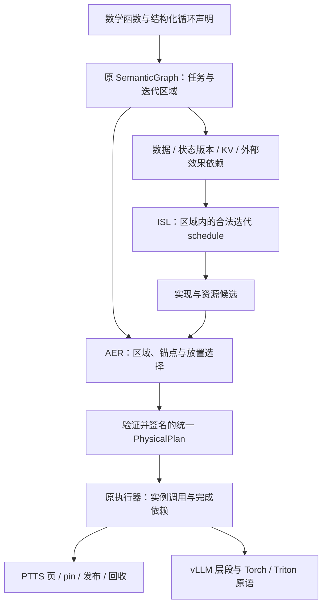

# 将 ISL 接入 pLLM：从任务调度走到迭代调度

本文保留接入设计、早期实验及文末补充。当前能力与未完成项统一见
[功能与进展收口](implementation-status.md)，下文的早期缺口不作为现状清单。

架构前置：先完成 [计算模型设计](computation-model.md) 与原型验证，再推进
本文的完整接入。下文是 ISL 场景、约束和接入思路的依据；涉及给现有 task
追加迭代属性的接口设想，需要按新的区域计算模型调整。文末补充建议保留，
其中保留循环结构、导入 cell 的方向纳入前置设计。教程和示意图仍排在实现、
正确性与性能验证之后。

这是一份接入设计，部分模型路径已迁移，完整全局调度仍未完成。编译内核已从区域 IR 自动推导
依赖、求解 ISL 候选并生成结构化循环，当前证据见 [区域 IR 规格](region-ir.md)。
下面保留接入动机与早期实验记录：2026-09-11 已用仓库现有的
`isl-rs = 0.3.1` 做独立 Rust 实验：ISL 从二维依赖自动求出了 wavefront，
并通过了串行参考对照。这个实验验证求解能力，不代表已有模型后端支持。

建议把“同一份算法声明，自动生成不同的合法执行安排”作为接入的核心目标。
最先打通的真实场景是 **prefill 的 chunk × layer 在线更新**；随后复用相同的
迭代表示做训练步循环、局部流水和批处理。Jacobi 这样的近似单独声明语义。

## 方案形成时的主要缺口

| 位置 | 当前实现 | 接入需要补的内容 |
| --- | --- | --- |
| `SemanticGraph` / `SemanticTask` | 有限任务、结果边、任务级状态版本、锚点窗口 | 参数化迭代域、带迭代坐标的值和状态访问 |
| `version_hazards.rs` | 从任务生产者推导 RAW/WAR/WAW | 从访问关系推导任务实例之间的依赖，区分字段分片与提交原子域 |
| `scheduler.rs` / `aer.rs` | 拓扑依赖、实现候选搜索、region 分组与放置 | affine region 的 ISL schedule 候选与资源摘要 |
| `PhysicalPlan` / `execution.py` | 每个任务一个条目，单游标依次调用 | 循环、实例参数、并行 band、完成依赖和实例级释放 |
| `PageBundleArena` | exact pin、字段 COW、原子发布、receipt 回收 | 接收新计划推导的实例访问与生存期，仍保留唯一所有权 |
| vLLM 附着 | 普通 overlay 在完整 forward 后收集操作数，执行 transition | 可暂停和恢复的层段 / chunk 执行，正确维护 attention 与 KV |

其中两个限制最容易被低估。`freeze.py` 做的是冷代码指纹，不会追踪 Python
循环；`tensor_binding.py` 把各 target 的更新包在一个 transition 函数里。
因此，即使把当前拓扑排序换成 ISL，编译器仍看不到函数里的 chunk 和 layer。
此外，`runtime.py:complete_forward` 才取出捕获的操作数。想让本次 prefill 的
后续层读到刚更新的状态，需要改造后端执行边界，不能只调整事后的训练顺序。

## 先确定一个真正值得自动化的例子

用 `S[c, l]` 表示第 c 个 chunk 在第 l 层的前向与局部更新。这里暂时把
前向、局部训练和该层状态更新合成一个语义单元，便于看清两种依赖：

```text
S[c, l-1] ──当前 chunk 的 hidden──> S[c, l]
S[c-1, l] ──该层的上一状态版本───> S[c, l]
```

前提是每层更新只依赖本层已经可用的输入、目标和状态，且不同层没有未声明的
共享可变状态。后续细化为 forward / learn / publish 时，仍需保留相同的数据
和版本可见性。真实 attention 的历史 KV 依赖也必须加入，不能只保留 LoRA 边。

一个朴素参考是按 chunk 依次走完所有层：

```python
for c in range(chunks):
    for l in range(layers):
        hidden[c, l + 1], state[l] = cell(hidden[c, l], state[l])
```

调度器可把执行时间变成 `theta(c, l) = (c + l, c)`。第一维是波次，第二维
在当前波次中排列实例。3 × 3 的例子如下，同一行中的实例在上述依赖模型下独立：

```text
波次 0    S[0,0]
波次 1    S[0,1]  S[1,0]
波次 2    S[0,2]  S[1,1]  S[2,0]
波次 3    S[1,2]  S[2,1]
波次 4    S[2,2]
```

每个单元读到的 hidden 和旧状态都没变，只改变了独立单元的相对顺序。在单位
成本、无限执行资源的模型下，C×L 个串行位置可组织成 C+L−1 个波次。实际 GPU
收益取决于算子成本、资源竞争和后端能力，不能直接把这个比值当成加速比。

这里确实可以让 ISL 自动求解。独立实验输入如下，依赖两端都与 domain 相交：

```text
domain:
  [C,L] -> { S[c,l] : 0 <= c < C and 0 <= l < L }
validity:
  [C,L] -> { S[c,l] -> S[c+1,l]; S[c,l] -> S[c,l+1] }
```

使用同一份依赖作为 validity、coincidence 和 proximity，并分别设置
`Options::set_schedule_outer_coincidence`，本机现有版本返回：

| 选项 | 实际求得的 schedule map | 树中并行信息 |
| --- | --- | --- |
| `outer_coincidence=0` | `S[c,l] -> [c,l]` | 二维 permutable band |
| `outer_coincidence=1` | `S[c,l] -> [c+l,c]` | 外层波次，内层 band 为 coincident |

第二行的 `[c+l,c]` 是求解器输出，不是预先塞进去的 schedule。实验对两份
schedule 各执行了 30 组尺寸（C=1…6，L=1…5），执行顺序从返回的 ISL map
逐点取值。整数参考单元的全部中间 hidden 和最终各层状态一致；另以 ISL
集合包含检查证明依赖沿字典序向前，故意反转 chunk 的 `[-c,l]` 被判为非法。
这不是浮点模型、CUDA 并行执行或吞吐基准，也不承诺所有依赖图都得到相同形式。

## 接入位置：同一个中段中的两种求解



ISL 和 AER 应当是同一编译过程中的两个求解工具。ISL 的对象是循环实例；
AER 的对象是实现、区域和引擎时机。最终只产生一份计划，worker 不再决定
采用另一种局部顺序，ISL 也不持有状态页或另造一个执行器。

接口上，ISL 给出有限个合法候选及其版本、临时值、并行度和启动边界摘要，
AER 在真实预算与后端能力下选择。选择的表示影响 WAR 和活跃版本数量，因此
不能“先删掉 WAR，最后再看看有没有内存”：每个候选必须绑定它依赖的状态表示。
初期接受这种分层搜索的非全局最优性，保留串行候选作比较。

跨 chunk / layer 的区域必须在区域划分前被看见。若先按现有整步锚点切成
孤立区域，再让 ISL 在每个小任务内部优化，就永远失去了跨层 wavefront 的空间。
涉及模型推进的区域需要后端申报可细化的层段边界；不可拆分的事件仍是边界。

## 第一块基础：让循环进入原语义表示

建议扩展原 `SemanticGraph` 的结构化区域，不增加另一份可独立修改的语义图。
区域里的操作继续使用原任务身份、数学绑定和效果系统。最低限度需要：

| 事实 | 示例 | 为什么必要 |
| --- | --- | --- |
| 参数上下文与迭代域 | C 个 chunk、L 层；尾 chunk 的有效行数 | 处理变长输入，避免逐 token 静态展开 |
| 实例身份 | 原 task ID + `(request, chunk, layer, iteration)` | trace、值引用和完成事件不再混成一个 task |
| 值的索引关系 | 读 `hidden[c,l]`，写 `hidden[c,l+1]` | 自动推导跨层 RAW |
| 逻辑状态访问 | 读 `W[route,l,c]`，产出 `W[route,l,c+1]` | 自动推导跨 chunk 的版本链 |
| 私有更新和发布范围 | 单层状态提交，或显式多字段原子提交 | 确定哪些写可以并行 |
| 数学与效果边界 | 优化器、梯度、RNG、KV、host 调用 | 防止只保留张量边而改变算法 |

算法作者写串行语义、循环携带值和状态归属；编译器推导依赖与顺序。API 不应
要求作者手写 wavefront 波次，也不应要求填写 ISL 字符串。可先支持显式
map/scan 一类结构化循环构件，内部 lower 到这份表示；具体命名在垂直实验后定。

不必一开始把函数内每个 ATen 算子都交给 ISL。一个普通 PyTorch 函数可以是
不透明的数学单元，只要它的输入、输出和可观察读写是完整的。这样先优化
“在哪次迭代调用哪个函数”，与 Torch/Inductor/Triton 的函数内部优化分工。
现有任意 Python `for` 不会因此自动被识别；将来若加 export/tracing 前端，
应独立说明支持的语言子集和捕获行为，不能把代码指纹当成语义分析。

请求与 route 的关系通常不是仿射的。运行时先从原 directory 得到本次稳定的
lineage 映射，再特化到独立分组或保守别名关系。按同一 route 共享状态的请求
不能直接标成并行；打包行号也不能替代逻辑请求身份。页槽寻址留在 lowering
和 PTTS 中，ISL 不需要对动态物理页号做仿射假设。

## 第二块基础：依赖与算法等价

将 `version_hazards.rs` 的规则推广为实例关系，而不是用 ISL 取代状态语义：

- RAW：消费者必须在其声明的生产者之后，包括 hidden、梯度和新状态版本。
- WAR：原地覆盖必须等待旧读。只有选中的表示确实保留旧版本、pin 和容量
  都足够时，才可删除物理覆盖导致的依赖；旧读仍绑定原来的版本。
- WAW：有同一语义旧版本的歧义写不能靠排序修复。作者必须给出版本链、
  独立分片或明确归约语义。
- maybe-write：静态依赖覆盖所有可能写；谓词为假时的版本传递必须有定义。
  普通数据依赖条件不能直接当成 affine 域约束。

目前多个 target 的字段装在同一状态根里。字段 COW 能节约拷贝，却不会自动
让两个基于旧根的并发发布可交换。首轮可把独立层建成同一 arena 管理的独立
逻辑状态分片，并由原目录统一管理请求生命周期；若算法要求多层原子提交，
必须保留这项约束。不能另造一份“每层 latest”缓存来绕开根所有权。

正确性检查应直接使用原始访问关系重建依赖 R，再对候选 theta 检查：

```text
theta 在参数上下文内覆盖完整 domain，且对每个实例单值；
R ⊆ { (x,y) | theta(x) <lex theta(y) }；
并行 band 内不存在尚未由外层携带的依赖；
lowering 对所有实例恰好执行一次，保留边界、guard 与效果。
```

后两项不能被一个 hash 替代。内存生存期、能力、窗口和完成事件另行检查，
再签名。复核方不重新优化，而是检查固定 schedule 的合法性。签名输入应包括
域、依赖、参数 guard、schedule tree、数值策略、lowering 版本与资源事实。
仅在合法性复核中相信候选自己提交的“已删减依赖”是不够的。

严格语义默认保留更新频率、读取版本、随机数归属、detach 和浮点归约顺序。
重排独立实例不等于允许改变 Adam 更新次数、把多次 SGD 合成一次大 batch，
或改变浮点加法树。批处理若改变 kernel 数值行为，需要单独的数值契约与验证。
跨请求有 RNG 时，要么保留原 RNG 顺序，要么显式采用按实例身份定位的随机流。

**Jacobi 应成为显式算法选项，而非合法调度的别名。**
读取 `W[c]` 再产出 `W[c+1]`，与所有 chunk 都读取 `W[0]` 后集中更新，是不同
依赖图。允许 snapshot / bounded-staleness 的算法可把这些可见性范围声明
出来，编译器再在范围内选择；质量、收敛和吞吐需另外比较。ISL 不证明近似
算法与顺序更新等价，也不从数据相关收敛条件自动推出仿射循环。

## 第三块基础：把 schedule 变成真的执行能力

ISL schedule tree 应 lower 成封闭的循环、顺序、并行组、guard 和实例调用
节点，再进入原 `PhysicalPlan`。支持子集先限定在可验证的整数仿射表达式。
不能只是导出一段 C 字符串，然后在 Python 里 `eval`。短期 CPU 验证可有界
展开实例；正式执行不应每个 token 都重新建图、排序、求解。

原 `TaskGraphInvocation` 需要从“task ID 只执行一次”推广到“task 模板按实例
调用”。临时结果目前按 task/output 标识，必须增加实例坐标；释放、trace 和
完成关系都要一起迁移。串行路径也走同一表示，避免留下两个权威运行时。

GPU lowering 再把合法并行组实现为合适的批处理、grouped GEMM 或有限 CUDA
stream，并显式安排事件、scratch 借用和释放。不同层的权重不同，不能只因
shape 相同就说能合并为一次普通 GEMM；同一 GPU 已饱和时，并发也可能更慢。
region 分组、数学融合和 CUDA graph capture 是三件不同的事，各自需要实现证据。

对原始 prefill 目标，后端还需要以下能力：

- 层段输入、residual 和 chunk 边界可被计划驱动；未挂 LoRA 的中间层也不能
  从依赖图中省略。第 1、3、5、7、9 层只是更新位置，不是完整模型执行域。
- 同一层的后续 chunk 必须读到完整因果 KV 前缀，按原逻辑位置写 cache。
  参数更新前生成的历史 KV 是否保留属于算法语义；若要求重算，必须加入 replay。
- 训练目标何时可得要进入依赖。如果更新依赖最后一层 hidden，不能套用
  “本层算完即可更新”的网格；更长的反馈边可能消除大部分 wavefront 空间。
- 取消、部分 chunk、发布和已发 GPU 工作的完成继续由原 owner 结算。
  不能在取消时简单丢弃旧 pin 或重跑已提交的更新。

同一请求的自回归 decode 下一 token 仍依赖本次采样。首轮不跨越这个因果边界
调度未来 token；可以优化已知输入的 prefill、局部迭代和彼此独立的请求。

## ISL 具体怎么用，哪些事还得自己做

Rust 层用 `UnionSet` 表示 domain，用 `UnionMap` 表示访问和依赖，
`ScheduleConstraints::on_domain` 配合 `set_validity`、`set_coincidence`、
`set_proximity` 后调用 `compute_schedule`。有完整读写及原始顺序时可用
`UnionAccessInfo` 做流依赖；状态精确版本关系仍从 pLLM 语义构造。

validity 是必须满足的顺序；coincidence 和 proximity 表达优化偏好。它们
不是 CUDA 成本模型。可以为同一 region 生成保守顺序、偏并行、偏局部性及
少量 tiling 候选，再用后端事实筛选。循环交换、skew、合法融合和 tiling
各自需要候选生成与 lowering；不是调用一次 ISL 就自动完成全部优化。

成本目标应补启动次数、传输、并行资源占用和关键路径估计，再辅以有界实测。
现有 AER 的 materialization / transfer / region / peak / fence 评分没有
完整设备延迟模型，不能把 region 更少解释为一定更快。在线路径使用冷编译的
有界形状 / 别名分组缓存；候选比较必须保持算法语义和有效训练量一致。

工程上先封装一个小的 ISL 所有权与错误边界：context 活到对象全部释放之后，
限制 operations 和编译规模，处理求解失败，复核参数 guard。`isl-rs 0.3.1`
已经覆盖上述求解接口，但本地版本没有 `AstBuild` 包装，AST lowering 需要
补窄 FFI 或遍历支持的 schedule tree 子集。生成的绑定暴露裸指针，字符串
返回的所有权与空指针错误路径也应审计，不直接当成可靠的长期服务边界。

若某个优化候选求解超限，可选事先验证并签名的保守执行候选；必须在 diagnostics
中说明优化未采用。语义非法、域无法表达或后端缺能力应在编译期拒绝，不能
执行到一半转去无计划的 Python 路径。串行候选本身不放宽算法语义。

## 实施顺序与验收

| 阶段 | 实际交付 | 退出条件 |
| --- | --- | --- |
| 1. 原图内的 affine region | 域、访问、版本关系；ISL 候选；合法性复核；原执行器实例调用 | 同一声明生成串行和 wavefront，CPU 参考与真实 PTTS 版本行为一致；非法重排被拒 |
| 2. 真正的设备执行 | 实例级值/释放；并行组 lowering；资源摘要；有界编译缓存 | CUDA 数值、版本、生存期、取消成立；trace 显示真实实例顺序，而非只打印 schedule |
| 3. prefill 模型接入 | 通用层段/chunk primitive、attention/KV 关系、局部更新链 | 同一算法声明在真实模型上自动改变执行安排，对齐朴素串行及专家手写基线 |
| 4. 优化选择与扩展 | tiling / 批处理 / 局部性候选与测量；第二个非 LoRA 场景 | 改 workload 数学和依赖后不用加算法特判；明确哪些工作负载加速、哪些没有 |

阶段 1 的整数网格只是起点。发布“自动 wavefront prefill”能力必须走到阶段 3。
正式对照至少覆盖随机初始状态、不同 chunk 数和尾块、多层、共享与独立 route、
额外反馈边、预算压力、取消，以及不满足并行条件的负例。对齐的模型配置和
训练次数下报告吞吐、尾延迟、峰值内存、编译成本和算法质量；不能拿 Jacobi
减少依赖后的速度代替严格顺序算法的加速证据。

第一条垂直实现应让算法作者只提交串行结构与数学，由编译器打印出“为何
选择 wavefront、哪些边阻止进一步并行、预计与实际用了多少页”。教程图解
随后从这份真实计划生成，而不是先画能力再找实现。

## 实现依据与接口资料

- [当前任务与状态版本表示](../../pllm/contracts/semantic_graph.py)
- [当前版本依赖分析](../../rust/pllm_core/src/planning/version_hazards.rs)
- [当前调度入口](../../rust/pllm_core/src/planning/scheduler.rs)
- [当前区域与放置搜索](../../rust/pllm_core/src/planning/aer.rs)
- [当前任务执行器](../../pllm/execution/execution.py)
- [普通 overlay 的绑定](../../pllm/execution/tensor_binding.py)
- [vLLM 的 forward 边界](../../pllm/backends/vllm/runtime.py)
- [状态页所有权](../../pllm/execution/ptts/page_bundle.py)
- [既有通用编程设计](programmable-inference-next-design.md)
- [ISL 官方手册](https://libisl.sourceforge.io/user.html)：Scheduling、Dependence Analysis、AST Generation。
- [isl-rs 0.3.1](https://docs.rs/isl-rs/0.3.1/isl_rs/)；实验使用本地已构建的该版本，
  语义与接口同时核对了其随附 ISL `doc/user.pod`。

---

补充：

我认为既然有ISL了，那么就有必要可以利用用户workload的等价变换的优化机会。我的建议是：**保留循环骨架，用 `torch.export` 捕获循环体；然后先做依赖分析和调度，最后才交给 `torch.compile`。** 不要先把整个 workload 压成一个计算块，也不要期待从展开后的算子图里重新猜出所有循环。

具体可以沿着下面这条路径做，尽量复用现有 pLLM。

**1. 将“迭代结构”和“一次迭代的数学”分开表示。**

例如一次计算是：

```python
def cell(hidden, weights):
    output = forward(hidden, weights)
    new_weights = update(weights, hidden, output)
    return output, new_weights
```

外面仍然是用户的 chunk×layer 循环。框架需要知道：

- `output` 传给同一 chunk 的下一层；
- `new_weights` 传给同一层的下一 chunk；
- 各层初始参数和各 chunk 初始输入从哪里来。

这些是算法的数据流，**用户不用指定 wavefront、stream 或执行顺序**。第一版可以用很薄的结构化声明表达这层关系；自动识别普通 Python 循环可以以后再做，否则“前端能理解什么”本身就会成为大工程。

**2. 对 `cell` 做 `torch.export`，得到可分析的张量程序。**

这里要得到的不只是一个可执行对象，还包括：

- 张量运算及输入输出关系；
- shape 和符号尺寸约束；
- 参数、buffer 和修改后的输出；
- 必要的别名、修改信息。

再通过适当的 decomposition／functionalization，把支持的原地修改转成显式值。例如：

```text
w₁ = update(w₀, hidden)
```

pLLM 在这一层连接逻辑参数和状态字段，物理页地址仍由现有 arena 管理。不能把 `pool[slot]` 当成算法参数身份。

**3. 把循环骨架和张量数据流合起来，推导实例级依赖。**

对于上面的例子，编译器应自动得到：

```text
cell(c, l) → cell(c, l+1)   # output 的流向
cell(c, l) → cell(c+1, l)   # new_weights 的流向
```

更细的图还可以把前向和更新拆开，但第一版保留整个 `cell` 就已经能表达有价值的 wavefront。

这里应扩展现有语义图，让它能描述一个结构化迭代区域；不另建一套状态系统。现有任务级依赖检查继续负责区域外的发布、采样和其他效果。

**4. 将适合分析的区域交给 ISL，生成并检查调度。**

输入是：

```text
迭代域：0 ≤ c < C，0 ≤ l < L
依赖：上述两类实例关系
```

输出可以是：

```text
执行时间坐标 θ(c, l) = (c + l, c)
```

这才是自动求出的 wavefront。检查器需要确认：所有实例都被覆盖，所有必须保持的依赖都向前，区域边界约束没有被跨越。

随后结合内存、启动开销和后端能力选择方案。**ISL 给出合法安排，不代表这个安排必然最快。**

**5. 按选定调度组织执行，再编译计算块。**

第一版可以直接按照新顺序调用原来的 `cell`，先证明重排正确、确实发生。之后再决定：

- 哪些独立实例能够合批；
- 哪些相邻计算适合融合；
- 哪些计算块交给 `torch.compile`；
- 哪些已经有合适的 paged kernel。

这些执行仍然使用现有 pin、COW、发布和回收机制。涉及真实模型层重排时，后端也必须能按相应粒度执行；只有调度图变化还不够。

整体是：

```text
循环结构 ───────────────┐
                       ├→ 实例级依赖 → ISL 调度 → 组织计算块 → 编译与执行
循环体 → torch.export ─┘
```

**我建议第一版就瞄准一个明确结果：同一个 `cell`、同一份串行算法，框架自动生成串行和 wavefront 两种合法计划，并用原有状态系统执行。** 暂时只支持规则循环和明确的数据流，不做通用 Python 理解，也不自己开发完整的代数优化器。
