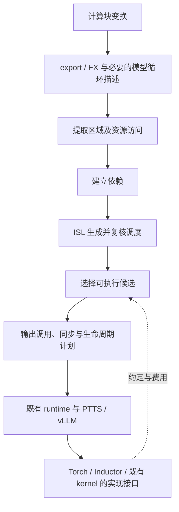

# pLLM 架构精简：聚焦计算块调度中段

日期：2026-09-12。本文约束当前改造顺序；已完成项、验收及剩余工作见
[功能与进展收口](implementation-status.md)。

当前顺序是先精简架构，再恢复后续功能扩展。[计算模型](computation-model.md)、
[ISL 调度计划](isl-scheduling.md) 和 [Region IR](region-ir.md) 中的完整能力是需求
和迁移基线，不是假定它们已经全部实现，也不以“先做完所有功能”推迟精简。

根据随后对 modeling 耦合的审查，职责边界不能等功能全部做完再纠正：当前停止
扩展手写模型内部计算和逐算子重建路径，先确定原图、调度和计算编译器的接口。
其余精简按能力逐条迁移；这项决定不表示现有生产路径已经完成解耦。

改造目标是保留已经实现的能力，让实现更容易理解、修改和维护。自动 wavefront、
export 内部计算拆分、数学变换、合批、真实模型并行执行、容量控制、数值策略以及
现有作者接口都属于迁移基线。不能以“简化”为由，永久退回只会串行执行的早期版本。

本次修订首先确定 pLLM 所处的抽象层，再推导必要数据结构。核心定位是：

> pLLM 是带状态访问语义的计算块调度中段：输入参考程序中的计算块、迭代结构和
> 访问关系，输出保持算法语义、能够由既有 runtime 执行的安排。

设计从这个 pass 的输入、输出和不变量出发，不从一套完整语言应当具有哪些操作
出发。一个新增结构必须回答：它表达的是本层缺少的必要事实，还是再次表达了
上游或下游已经知道的事情？后者优先通过引用、查询或窄的适配接口解决。

## 1. 要解决的问题

pLLM 的主要职责是编译中段：理解算法的数据流和状态依赖，发现合法的变换，
选择计算块及其执行安排。PyTorch 已经提供计算图和部分结构化控制流，ISL 提供
整数集合与调度，Inductor 和既有算子库生成或执行 kernel，vLLM/PTTS 管理模型
调用和资源。后续设计应先复用这些设施，只实现它们之间缺少的部分。

需要审视的复杂度包括：

- 将 export 已有的计算、类型和控制流重新表达成一套通用程序，再维护配套解释器。
- 在 Python 和 Rust 中重复实现相同的通用语义、变换和完整产物重建。
- 为调度核心取得容量信息，深入 Inductor 的分配、模板和代码生成细节。
- 序列化、FX 改写、编译器适配、CUDA IPC 和 profiling 聚集在同一模块。
- 使用大量位置参数、字符串值名和长构造表达式，使算法本身被接线代码遮住。
- 每个局部规则都有类型、摘要、签名和验证入口，但读者难以找到一条完整执行路径。

这些现象不意味着所有现有机制都应该删除。页所有权、版本、物理别名和异步完成
具有真实复杂度。改造应消除重复表达和不必要的耦合，保留解决实际问题的约束。

## 2. 必须保持的能力与保证

改造前应冻结一份已验收的能力清单和可重复基线，后续阶段都与它比较：

| 维度 | 迁移中必须保持 |
| --- | --- |
| 算法语义 | 状态读取版本、更新和发布次数、控制流结果、RNG 归属、可观察效果 |
| 自动优化 | 已支持的内部拆分、wavefront、分块、数学变换、融合及独立合批 |
| 数值行为 | 原数值策略和关闭方式；按原先确定的容差验收，不因迁移失败放宽 |
| 设备执行 | 已有跨 stream 重叠、事件关系、缓冲生存期、取消与失败处理 |
| 资源约束 | 已承诺的容量检查与预算边界；未知费用不能默认为零 |
| 作者体验 | 原公开入口、参数化能力、诊断及已完成的教程示例 |
| 性能 | 真实模型吞吐、尾延迟、峰值内存，以及冷编译和计划缓存开销 |

性能允许的测量波动和回归阈值应在改造前按现有基准确定。对容量有上界保证的
路径，不能用少量输入的峰值采样替代证明。对状态有副作用的候选，比较必须使用
隔离或可恢复的原状态协议，不能额外训练一次后声称是在测量相同算法。

## 3. 先确定 position、上下游与核心契约

### 3.1 本层处理什么

调度位置是一个计算块的实例坐标，例如 `(request, token, layer)`。它描述算法中
哪一次调用，不是 GPU 上的放置位置、页地址，也不必成为通用语言中的运行时变量。
候选调度可以改变执行时间坐标，但原实例身份和结果来源必须保持可追踪。

一个计算块可以是 export 子图、模型层调用或已有 kernel。调度核心关心它的
端口、访问关系和可执行条件。计算体仍由原图或原后端解释。拆分或融合改变块的
边界时，由相应图变换产生新候选，重新提取调度事实。

| 层次 | 输入与输出 | pLLM 项目内需要做的工作 |
| --- | --- | --- |
| 上游：PyTorch 程序及模型接口 | 提供计算图、可支持的控制结构、接口和成立条件 | 导入原图；为模型调用补充逻辑访问、效果和可执行约定 |
| 当前中段：计算块实例调度 | 消费区域和访问关系，产生合法且可执行的安排 | 依赖提取、ISL 候选、选择，以及计划 lowering |
| 下游：计算编译器及 runtime | 编译计算块；执行调用、同步、存储与完成协议 | 接入原接口，提供必要的资源绑定和完成适配 |

“上游负责”不意味着把缺失功能藏到一个新建的通用前端；“下游负责”也不意味着
PyTorch 自动知道 pLLM 的状态所有权。适配仍需实现，但作用域限定在具体边界。

这里需要区分三个问题：

- **模型如何计算。** 以原模型程序及其捕获的图为准。不能通过读取 `gate_up_proj`、
  `self_attn` 等成员，在适配器中手写另一份 forward 来获得通用调度能力。
- **图上能做哪些数学变换。** 独立图变换可以识别 `aten.mm` 等运算，在原 FX 图上
  检查前提并生成候选。基础依赖分析与 ISL 调度不依赖某一条数学规则；改写后重新
  提取受影响的端口、访问和成立条件，不要求 Rust 重建这些张量运算。
- **计算如何成为 kernel。** 将选定子图交给 Torch 编译后端，复用其算子分解、
  融合及代码生成。pLLM 查询实现的接口、别名、临时内存与完成约定，不自行扩建
  一套通用算子 lowering。图切分还需权衡跨块重排与块内融合，不能默认一算子一块。

`torch.compile` 只能利用捕获范围内可见的语义。外部 PTTS 管理的权重版本、
KV 区间、发布、COW 和设备完成，不会因为编译了一个 forward 就自动成为全局
调度约束。pLLM 的必要适配是把这些事实连接到原调用；对无法捕获的调用，先保留
原可执行体和真实效果边界。拆开它必须有原图或后端提供的依据。

当前 vLLM 接入从原 forward 捕获模块调用图，按后端声明的资源边界切分。
attention 前半图继续调用原模块；只读后半图由 Torch 捕获并导入。后半图不再
要求固定的 MLP 或 norm 类，也不读取 norm 的特定权重成员来构造输入样例。
准入依据是原 Tensor ABI、字段来源、只读效果和实际 kernel 契约。

接入直接使用已有的原图导入、原字段匹配与资源借用函数。此前只打包转发的
`BorrowedExport` 已删除，避免为同一计算体再维护一份容器。原图导入保留 Torch
的完整输出／mutation 签名，字段匹配使用实际存储视图；不丢弃待发布的更新结果。
只读借用与 vLLM 计算体现在直接生成数据端口，准入和输出选择仍由对应前端检查。
不同计算体的索引选择已归入通用源组合 `select_function_bodies`，前端提供
选择参数，原调用域保证其范围；不再把层号的位置硬编码进组合算法。

vLLM 的 KV 页表与单 token metadata 适配位于 `region_attention.py`，只接收
原 `Attention` 资源端点，不访问 Qwen 层。FA2 布局、因果范围、slot 一致性及
物理别名检查保持原有约束。Qwen replay 仍负责从模型找到这些资源端点；这次
拆分不代表外层模型接口或 attention 布局已通用于所有模型和后端。

同一次 `fullgraph_capture` 提供计算图与可执行 guard。pLLM 按 Torch 的输入
source 和输出结构接回原字段，再用 fake `make_fx` 转换该图并 export；不解析
日志字符串，也不在验证时执行模型。图外 Python 副作用由 Torch 拒绝，参数视图
使用 Torch 的 functional-call 作用域替换并恢复。vLLM 按原运行器的
`inference_mode` 捕获和检查，保留相应 dispatch 条件。

方法、参数枚举顺序、字段存储视图与 Torch guard 在创建模型端点前检查。
原权重中的数值可以更新；更换存储、改变字段布局或捕获条件失效需要重新准备，
执行器不自行重编译已选计划。这些是 worker 的本地绑定，未新增 wire 协议。

各层可以提供不同的后半图和字段布局。相同定义直接内联，不同定义在原层号
范围内通过现有条件区域选择；各分支继续引用本层捕获的计算体及原字段。
当前异构分支作为条件区域执行，尚未进一步展开分支内部的仿射调度空间。

冷规划只消费源描述，实际函数在 worker 准备阶段绑定。混合 export 导入保留
原 ATen 与功能化自定义 kernel，由后端给出执行/分配契约；功能化 kernel 的
冗余外层复制已移除。Inductor 实现也已移入独立后端，见第 4 节。

验证覆盖原 Qwen2.5-0.5B/BF16 decoder 的 14 次数值比较、KV/RNG 和清理，以及
EngineCore 的 worker 重建、12 个重放行、父进程不初始化 CUDA 和零 fallback。
新捕获路径的 8 项跨进程候选约 600–832 ms，选中候选 1；单次短请求计时不是
稳定吞吐收益。另有两个不同宽度、不同参数注册顺序的后半图，通过 CPU 原资源
绑定与逐位结果检查；该证据不替代完整模型上的异构层验收。

源导入／资源适配拆分后，Qwen 的上述 14 次比较再次通过，零 fallback；候选
0 被选中。另以直接构造的 vLLM Attention（不创建 Qwen 模型包装）检查了页表
绑定、原 metadata 的保留，以及错配 slot、非因果 metadata 和量化 KV 的拒绝。
此项使用 CPU 页存储且未执行 attention forward，只证明资源接口不需要模型类；
完整计算的证据仍来自 Qwen 回归。

剩余接入限制包括 Qwen 外层/attention 与前半图资源提供者、两张量前沿及已审计
custom kernel 范围。后续新增模型应提供原图和资源绑定，不修改 ISL、依赖分析
或生命周期规划。通用模型资源接口、全局 chunk/批处理及训练迁移仍未完成。
导入门禁继续禁止 contracts/execution 依赖 vLLM 或 Transformers。

计算候选的绑定与测量现已分开。`bind_region_candidate` 允许执行器为一次隔离
试验准备带状态程序中的纯图变换，不需要伪造计时或提前制造选择结果；它检查
真实容量和数值策略，再从原图重放 outlining、数学规则与编译实现。
`bind_selected_region` 使用相同的原图重放边界，在真实选择通过验证后安装。
两者都保留原 native 调用与访问器，不能将状态端点吸收进 Torch 子图。
`optimize_region` 的重复测量入口仍只接受纯图／原只读资源，不因此获得重复
执行状态更新的权限。CPU 检查覆盖状态调用包围的两段矩阵计算：合并、重结合、
试验绑定和最终安装均保留每次调用的 begin／publish 次数及结果；越预算和数值
禁用的试验在执行前被拒绝。

生产 `TokenwiseTuning` 在接收 driver 的 schedule proposal 后，由 worker 从本地
原图生成有界的 outlining、数学规则和 Torch 编译候选。现有候选接口不增加 wire
字段：每个计时候选已有独立 imports 和结构变换证据，数学重放记录保留在 worker。
worker 不重复 driver 的调度搜索。计算结构不变时，可沿用原并行时间坐标，但须
以新 imports 重做容量、并发临时空间与 stream proof；outlining 后的程序先使用
自身参考顺序。扩展结构变换后的并行搜索仍是后续工作。

冷目录的最大峰值用于估算 attachment 所需预算；worker 生成实现后，准入上限是
原签署的任务 workspace，而不是旧 imports 的峰值。未测量候选先以合法空行域
完成绑定校验，容量证明仍覆盖完整参数域；一旦引擎提供实际行，最终选择请求
记录其真实 sizes 和 completed generate 时间。越预算候选不执行。
编译／重放发生在私有 trace 与 RNG 作用域内，候选切换在计时前完成；最终安装
重新核验所选源证据并仅对实际选中的数值变换发出提示。

生产命令链的 GPU 检查已覆盖新编译候选：driver 仍只有源描述，worker 生成并
执行候选，安装具有新 stream proof 的 Torch 编译方案，各方案保持相同输出、KV
和原权重，原状态回调留在 owner stream，私有调优恢复 RNG 与公开 trace。
此检查使用小计算图和受控选择分数，不证明完整 Qwen 的数值／吞吐验收。

### 3.2 输入、输出与不变量

核心输入包括原计算体引用、迭代域及参数条件、参考顺序、操作数来源、逻辑资源
访问和控制/效果边界。后端提供可执行条件，选择阶段按需查询实现与费用。

核心输出是绑定到这些输入的执行计划：调用及实例坐标、输入来源、并行和等待关系，
以及由原所有者执行的保留/释放安排。编译产物携带缓存与重建所需的身份和适用条件。

需要保持的不变量是：

1. 在实际成立的控制路径上，实例覆盖、执行次数与原算法一致。
2. 每个数据输入读取原算法要求的值或版本；效果和发布顺序不被破坏。
3. 调度关系可以被后端实现；共享上下文、缓冲和物理别名引入的冲突得到处理。
4. 存储在 GPU 消费完成前保持有效，执行满足已经承诺的容量约束。
5. 数学变换遵循自己的规则前提与原数值策略，不借调度改变算法更新次数。

其他设施是否需要进入核心，由它是否直接承担这些职责决定。

### 3.3 一条短的主路径



这里的分层是职责边界，不要求每个框都新增一种 IR、注册中心或插件框架。
应优先复用已有入口，必要时用普通函数和小型数据结构连接。

基础调度的入口应能直接读出“提取区域 → 建立依赖 → 求调度 → 选择 → 输出计划”。
数学改写关闭时不经过改写搜索；已有计算实现可直接参与选择，不强制重新编译。
候选较多时也不先为所有候选生成全部物理产物，只按对应阶段需要查询信息。

共享调度目录现在按需取得窗口与分块候选，共用同一份源分析。分块的路径和整数
形状只是轻量枚举信息；具体 schedule map/tree 和合法性检查在取用候选时生成。
保留各组预算、交错顺序和完整域去重，目录填满后停止后续构造。诊断只记录实际
尝试过的方案，不为尚未求值的方案补写错误。本轮同尺寸案例的耗时变化不足以
证明明显提速，不能据此宣称冷规划瓶颈已解决。

### 3.4 原计算程序尽量留在 export / FX

张量计算、原图输入输出、已有符号约束及可支持的高阶算子子图以 PyTorch 表示为准。
导入过程可以规范化、做功能化和受支持的分解，但不默认将所有节点翻译为第二套
张量语言。程序变换继续发生在可追踪的原图或派生图上。

控制流复用必须先验证覆盖范围。`torch.cond`、`torch.while_loop` 和 `scan` 的存在，
不等于任意 Python 控制流都能保留，也不等于它们支持所有外部效果、别名、梯度和
动态形状。普通循环可能在 export 中展开；不能为了复用而丢失迭代结构，再从展开图猜回。

对确实无法表示的模型调用、循环或宿主效果，保留最小的结构化描述。它只负责
连接原图、迭代和效果，不重新实现完整 ATen 语义。已经支持但暂时无法迁移的
控制结构继续使用原路径，直到有等价替代；不能作为永久的静默降级。

### 3.5 必要数据结构：少量事实，多种派生视图

以下是概念边界，不是要求新增同名类、持久化格式或注册中心。能复用现有类型时
就复用；只有具有独立不变量或生命周期的概念才需要单独对象。

| 信息 | 保存的必要内容 | 所有权与使用范围 |
| --- | --- | --- |
| 计算体 `Body` | 原 FX 子图或后端调用引用、端口及原条件 | 上游或派生图拥有计算；中段引用 |
| 调度区域 `Region` | 调用表、参数域、参考顺序、输入来源、读写与控制约束 | 从原程序提取的不可变分析输入，不执行一般张量语义 |
| 实现 `Implementation` | executable、接口条件、别名/修改、完成及容量依据 | 原后端生成和管理；中段消费摘要 |
| 计划 `Plan` | 选定调度、实例取值、执行与完成约束、生命周期安排 | 中段产生，由原 runtime 绑定和执行 |

计算体端口类型引用原图元数据；必须跨语言或进程时，才传递接收方实际使用的
shape、dtype 等摘要。资源身份与能力引用原所有者，不在这些对象里新增页状态表。

一个仿射区域的主要事实可以具体写为：

```text
calls[id]       计算体引用与端口
P               参数成立条件
D               调用实例域
T0              原参考顺序
U               (消费者实例, 输入端口) → 原值来源
R / W           调用实例 → 逻辑资源位置集合
boundaries      无法仅由 R/W 表达的控制、发布及外部效果约束
```

`D/T0/R/W` 优先使用 ISL 集合与映射。符号参数保留参数性，不为每个 token 预先
展开节点。`U` 的来源包含入口值和 `(生产者实例, 输出端口)`；聚合输入需有明确的
索引访问描述，不能把多个来源误当成单个张量来源。动态分支下的来源带成立条件，
未知数据相关条件不能伪装成仿射约束。

张量端口来源和资源范围读取必须区分。一个 hidden 通常来自一个确定输出，
attention 对历史 KV 的访问则覆盖多个位置；二者共享关系运算，承担不同职责。
不能只留下一个无类型的“依赖列表”，再让运行时猜怎样取值。

### 3.6 避免重复编码坐标、循环不变量和顺序

坐标及可证明的索引表达式直接进入索引关系。例如 `layer = base + ordinal`
无需先成为 `Constant/Scalar` 指令，再经符号执行恢复仿射形式。原图中的一般
标量计算仍留在原图；若数据标量影响索引，只有证明其范围和形式后才提升到分析层。

该段已落地为 `Coordinate` 操作（2026-09-13）：构造器用一个 op 直接声明
`AffineIndex`（常数加按位置引用输入的系数项），Rust 依赖分析设直达分支，
原来的 Constant int→affine 与 Scalar combine 恢复路径已删除。声明即仿射，
越界或非仿射操作数在验证/分析时硬拒绝，不退化为 opaque。decoder、tokenwise
和区域组合的构造器已全部迁移，`Scalar` 只保留给真正的动态标量（While 计数器）
和布尔谓词。

固定参数与循环不变量不作为每轮返回的状态。真正的 recurrence 才需要携带值
来源；例如新 hidden 或新权重。原 `scan` 的语义可以作为提取依据，不要求为所有
不变量重新建立 bank 和 carry 协议。

Scan 现已明确区分输入前段的 carry 与末尾的固定参数：`invariants` 给出后者
数量，body 只返回下一轮 carry 和要收集的结果。它表达循环本身的数据接口，
不是供优化器猜测安全性的提示。DecoderSource、tokenwise 和 TensorScan 已迁移，
不再让只读坐标、权重和序列 bank 每轮原样返回。结构执行器与容量分析使用同一
分组；固定输入的原版本仍由既有输入引用、依赖和所有者保持。

资源顺序由参考顺序、访问及效果边界推导。只读权重没有更新时，不需要每层
生成一个新的 `weights_order` 再传递。生产构造器迁移后，已删除 Order 类型、旧源
转换和对应的双格式校验／解释分支。发布、未知效果及原控制流的顺序要求继续由
依赖和原 owner 保证。旧工件直接拒绝，需从算法构造器重新生成，不静默擦除 token。

这项改造的删除目标是算法接线中冗余的 carry、token 输出，以及仅为还原它们而
存在的转换。给旧构造器再包一层漂亮的 builder，不算解决问题。

DecoderSource 已先删除能在原构造器中直接确定的冗余：连续层号合并为
`index + (first_layer + 1)`，单层段不再生成零次 Scan，且只为存在 tap 的段捕获
残差相加图。不连续层号继续读取原层号 bank。这里没有增加索引操作或新的
循环属性。此后 tap 分支也完成静态化：命中首层的 tap 在构造期直接展开，
其余 tap 的命中迭代是构造期常量，层 Scan 在 tap 层处分段、命中迭代展开为
单段直写，8 个逐迭代谓词 If 全部消除（recirculation 源 If 从 10 降为 2，
仅保留按请求资格的真动态分支）。新旧源的参考执行调用序列、效果事件与
数值逐字段相等。

### 3.7 一份来源关系贯穿分析、取值和生命周期

对于一个示意的二维递推，前端可以提取出：

```text
hidden_input(t, l) ← hidden_output(t, l-1)，边界来自入口
weight_input(t, l) ← weight_output(t-1, l)，边界来自初始权重
```

这只是说明表示方式，不是假定真实 recirculation 恰好只有这些依赖。`U` 一旦
确定，数据依赖、运行时取值、消费者集合和逻辑最后使用都由它推导。状态读取则
结合参考顺序与资源效果确定版本。派生表可以缓存，但不能各自维护另一份来源事实。

不同算法的实际依赖决定 ISL 能否找到 wavefront。调度的全序时间坐标也不直接
代表 GPU 完成；并行性需由调度带和依赖复核确认，物理释放等待实际消费者完成。
不能把串行 last-use 的时间比较直接套用到跨 stream 回收。

存储归属推导已按同一原则拆开（2026-09-13）：与调度无关的部分——源分析、
来源传递闭包、存储路由、消费者、保留集和出生映射——对每个（源, 导入）只推导
一次并缓存，候选调度共享这份 provenance；只有生存期 envelope 按调度特化。
此前每个候选都从 analyze 重算闭包，24 层真实配置下第四个串行候选的累计 ISL
操作数越过了 20M 配额。envelope 本身也换了表述：值时间的字典序比较在时间
空间的**全集**上进行（比较片不带调度映像的约束），再经 schedule 接回实际发生
的时间；接回后 envelope 关系与原表述相同，全部候选的派生 payload 逐字节一致，
中间关系从约 7000 片降到约 100 片。这是结构复用和表述化简，没有放宽配额。

图改写后，重建受影响区域的来源和访问；相应依赖、容量及计划缓存失效。先采用
简单而明确的失效方式，只有证据表明需要时再建设增量维护系统。

### 3.8 pLLM 补充明确的资源语义

必要的资源描述包括逻辑身份、访问区间、版本或提交关系，以及外部调用的完成
和别名约定。例如 `KV[request, layer, token]` 与物理页地址不是同一个概念。

资源描述应绑定稳定的原操作身份，并由适配器或导入规则建立。图发生拆分、融合
或替换时，应同步重建或迁移这些描述。不能把没有来源、可任意修改的 `node.meta`
字典当成正确性依据，也不能仅凭两个资源名称不同就认定其存储独立。

状态依赖和 GPU 完成继续分别表达：顺序 token 不能代替 CUDA event，逻辑读取结束
也不意味着物理页可以立即回收。PTTS 继续拥有 pin、COW、publication 和 release。

### 3.9 执行计划保持具体

物理计划说明调用什么、参数从哪里来、等待哪些完成事件、结果保存多久、何时释放。
保留真实并行关系，不能只把 wavefront 排成一个串行列表。

优先扩展既有执行器。只为调度执行所需的循环游标和动态分支保留必要指令，避免
另建一套通用虚拟机。所有原模型上下文、输出缓冲和恢复协议仍通过原后端接口管理。
无数据依赖也不自动意味着调用可并发：共享宿主上下文或缓冲的实现必须先提供相应保证。

ISL AST 可复用为循环 lowering 的来源，但不会自动调用 vLLM。保留必要的受限
循环游标是合理的；不为消除少量执行代码而引入另一个通用编译栈。动态谓词只在
原语义要求的位置求值，不能因为计算无写入就擅自提前或复制执行。

## 4. 计算后端：需要信息，不接管实现

### 4.1 编译接口保持分层

pLLM 需要判断一个实现是否可以用于某个计划，但不应默认控制 kernel 的线程划分、
GEMM 模板选择或内部存储优化。Inductor 负责其擅长的代码生成与局部选择。

后端边界应区分三类信息：

| 信息 | 用途 | 要求 |
| --- | --- | --- |
| 可执行约定 | 输入输出、布局条件、修改和别名、完成语义 | 使用实现的必需条件 |
| 容量依据 | 工作区预留或适用范围明确的上界、输出及保留缓冲 | 对应容量承诺的必需条件 |
| 性能估计 | 时间样本、流量估计、launch 数量、并发干扰 | 帮助选择，允许缺失并明确标记 |

这些信息不要求全部使用同一种证明或采集方式。测量可排序性能，不能证明所有
输入的容量；逻辑读写字节数不能直接当成 HBM 流量。

当前深入 Inductor 的适配器已从 `execution/codec.py` 移到
`backends/torch_inductor.py`，模板选择、编译配置、dtype 支持和分配检查均由该
后端负责。`TensorCompiler` 仅提供可行性查询与带执行/分配事实的编译结果；
候选生成和选中方案重建使用同一显式提供者，执行阶段不再查询编译器。
默认 Inductor 仅在 `execution/tensor_compilation.py` 装配，没有新增全局注册中心
或 wire 协议。门禁禁止 contracts/execution 导入 Inductor 私有模块，也没有
放开它们对其他 backend 的依赖。拒绝编译的提供者仍可保留原图调度。

这是计算后端接口的局部迁移，不代表模型资源接入已经通用化。后续逐项寻找稳定
接口、已有后端预算或其他同等保证的替代方式。
若暂时没有替代，保留隔离后的适配器，而不是删除保证或关闭原来已支持的优化。

已删除生产路径中的 `_compiled_kernel_calls`，以及 Python/Rust 编译契约中的
`kernel_count`。调用数没有参与调度或容量推导；要求它大于零还会误拒绝已被
编译器消除的 view。原融合用例在测试中检查生成代码，统计结果不进入计划身份。
代码身份、原图重放和实际分配核验仍保留；调用点数量不证明正确性、容量或加速。

数学变换和实现选择仍然可以联合探索，但基础调度能够直接使用已有计算块；
不选择数学变换时，不应必须构造整套代数变换证据或启动额外的编译器搜索。

### 4.2 不可变值与物理复制分开

值在语义上稳定，不等于每个调用边界都要复制张量。当前复杂度的一条来源是：
边界复制引入额外载荷，载荷需要更细的容量分析，容量分析又推动深度后端适配。
应先检查复制是否由真实写入或所有权约束要求，而不是先接受复制再完善其记账系统。

跨计算块的值引用应尽量复用原存储根与生命周期：只读权重借用已有版本的 pin；
view 保留根存储；输出复用或后续覆盖确实会破坏旧值时，才物化独立副本或安排
COW。计算块内部的 buffer 规划继续交给计算后端，pLLM 不另建完整 bufferization。

| 情况 | 处理方向 |
| --- | --- |
| 输入已由有效 pin 保持，计算契约保证只读 | 借用原版本，计划保持到设备消费完成 |
| 输出是输入 view，原根可以延长生存期 | 保留根及输出别名关系，容量按根计算 |
| 后端下一次调用将覆盖输出 | 证明最后使用早于覆盖，或复制/更换缓冲 |
| 两个逻辑版本同时存活且后续有写入 | 使用原所有者的版本与 COW 协议 |
| 没有可信的别名、修改或存储约定 | 保留原保守实现，直到提供等价依据 |

延长借用也有成本：小 view 可能使大存储根长期存活。选择仍需比较原根保留与
复制的容量和时间，不能规定所有借用都优于复制。原生原地 kernel 和数据相关
输出布局也不因新接口而自动变成安全的只读计算块。

跨 stream 使用时，宿主引用存在不足以证明存储可复用；执行器必须接入对应
事件、allocator stream 约定和原 PTTS 完成机制。替换复制路径前，别名、版本、
设备完成和容量保证须同时通过验收。

## 5. 验证与语言边界：保留不变量，减少重复实现

不以“独立 verifier 数量多”作为正确性的衡量标准。先列出检查对象，再确定唯一
负责的模块和需要独立复核的边界：

| 检查对象 | 推荐职责 |
| --- | --- |
| export 图的合法结构及其约束 | 复用 PyTorch 检查；pLLM 检查自身支持子集与资源接线 |
| 访问与依赖 | pLLM 从原语义推导，检查别名及版本约定 |
| 调度合法性 | 用原依赖关系复核覆盖、执行次数和依赖方向 |
| 数学变换 | 规则前提、图变换和数值策略由对应 pass 维护 |
| 物理执行 | 参数绑定、完成、存储复用和释放由执行层检查 |
| 进程间产物 | 保留 schema、版本、完整性、身份和能力边界检查 |

优先复用现有 Rust/ISL 实现，不为了减少重复就切换语言。Python 保留 PyTorch
图操作；Rust 消费调度需要的紧凑事实。审查每个跨语言字段是否真的被使用，
避免把整个编译器对象图反复编码、解码和重建。

冷路径也按实测定位，不将长时间规划一概归因于 Python 包装。近期采样确认
ISL 的纯 imath 是重要成本，已改用同一上游版本的 `imath-32` 快路径，并保留
任意精度回退。相同纯描述案例的全部 proposal 不变，冷规划从 113.8 秒降到
49.3 秒。固定依赖构建与分发方式见 [vendor 说明](../../rust/vendor/README.md)；
这不替代后续表示和算法精简，也不降低原证明的参数域或候选预算。

摘要可以绑定身份与缓存，不能替代合法性检查。删除重复 verifier 前，必须指出
原检查由哪里覆盖，以及原有错误用例如何继续被拒绝。

当前已收掉一处重复：串行候选统一由 `region_payload::derive` 组合容量与保留关系；
并行候选的 `region_streams::validate` 已重建完整计划，AER 在其通过后复用嵌套
payload，并检查候选采用相同的 phase schedule。Python 安装同样只选择串行 payload
校验或完整 stream 校验，不再对并行计划另做一次相同 payload 的跨语言往返。
实际函数绑定与每次调用的原 owner 权限仍分别检查，尚未完成全部验证职责收敛。

函数体的外层声明现在作为同一次源校验的签名约束，而不再先追加进 imports、
检查整个 body，然后再用原 imports 重查 body。进一步已删除 Python 的 SSA、
操作签名、作用域和资源规则实现：Python 源入口与 native 规划共用 Rust verifier。
外层声明不进入可调用表，因此隐式自调用和自导入仍被拒绝。内联内部只做已检查
block 的变量重命名；公开源入口和最终组合结果仍完整校验。

通用 wire codec 已移到 contracts，execution 兼容入口直接重导出同一组函数。
Python 只承担必要的表示检查，如实际枚举类型、tuple、索引类型和常量的 i64
可表示范围，避免编码先把非法 Python 值转成另一种含义。Rust 保持唯一的源
语义规则；运行时绑定、原所有者权限和真实传输工件仍在对应边界检查。

同一 verifier 现也覆盖 `Coordinate`：输出必须是单个 index 值、terms 按位置
引用本 op 输入、系数非零且无重复引用。声明与仿射矛盾时验证或分析直接报错，
不存在"先接受再退化"的第二路径，因此也不需要为退化形式准备错误用例。

相邻调用的结构提取也已统一到现有 Rust outlining 入口，删除 Python 的递归
区域替换和提取规则，以及把完整提取结果再送回 native 重做的往返。实际 Torch
图仍从原调用重建；外来提取证据仍须验证。串行策略检查直接消费源分析出口已
规范化的参考顺序，不再为比较一个顺序字段而生成整份取值访问器。

同进程内的不可变分析结果优先直接传递，或持有现有 native 对象句柄。仅在真实
进程、持久化或不可信输入边界编码必要产物。内部每个 pass 不各自获得一套公开
wire 协议和完整 verifier。改变传输方式前核对原权限与 worker 重建要求，不能
仅凭“内部对象”绕过外部产物校验。

概念上集中为三个检查点：导入时检查来源与契约；计划安装时检查调度、容量和
执行成立条件；调用时检查本次动态绑定及原发布/释放权限。规则 pass 保留局部
前提检查。这样减少重复工作，同时让读者知道一种错误应在哪里被发现。

## 6. 可读性是改造交付，不是最后的代码格式整理

### 6.1 让模块名和职责一致

`codec.py` 应只承担明确的数据编码与解码。现有内容按职责归入已有合适模块，
确有需要才新增模块：

- FX 导入、子图组合和数学改写放到图处理模块。
- Inductor 内部调用与兼容处理放到编译后端适配器。
- CUDA IPC、存储共享留在对应运行时边界。
- profiler 解析放到性能诊断工具。

拆文件本身不算完成。拆分后若仍需理解同样数量的跳转和隐式约定，说明只是把
复杂度分散了。应同时减少重复数据结构、转发层和只有一个实现却需要注册的入口。

### 6.2 让代码直接显示算法步骤

目前部分接线依赖长 tuple 和结果末尾的位置。例如示意中的：

```python
outputs = (replay.results[-3].name, replay.results[-2].name,
           "trace1", replay.results[-1].name)
```

读者必须跳到构造端才能知道每一项的意义。应在适配边界一次解包并赋予明确名称：

```python
model_order, kv_order, weights_order = replay_effect_results
outputs = (model_order, kv_order, next_trace_order, weights_order)
```

示例只表达命名原则，不要求为每个 tuple 新增一套类型。稳定且跨多处使用的接口
可以采用小型命名结果；局部结果使用普通变量即可。不要用更多 builder 和 DSL
隐藏同一份位置协议。

这只是存量代码的过渡改进。按照第 3.6 节，如果这些顺序结果能由访问关系直接
表达，最终应删除对应参数与输出，而不是永久把它们改成更好看的变量名。

构造控制区域时，应能直接读出“准备输入 → 原层计算 → 条件 replay → 完成”。
避免数十行嵌套构造器、单行多重条件和字符串拼接同时出现。重复接线可以提取为
有业务含义的函数；只调用一次、只转发参数的包装层通常不值得保留。

### 6.3 数据在边界规范化，核心使用明确类型

外部输入和 wire 数据在入口校验并规范化。核心函数不反复猜测同一对象究竟是
Tensor、Bank、字符串还是任意字典。运行时会变化的资源权限和完成状态仍须在
正确位置检查，不能以“已做过类型检查”为理由删除。

PyTorch 私有 API 所需的 cast、Protocol 和版本判断集中到适配器，避免传播到
算法和调度代码。错误处理只捕获可以解释或恢复的情况，并给出具体操作和约束。

### 6.4 注释说明理由，文档提供一条可走通的路径

注释优先解释为何需要复制、哪条依赖禁止移动、某个完成边界由谁拥有。避免
重复函数名，或在每个文件中反复写相同的架构宣言。

保留一份短的开发者导览，带读者从 recirculation 的朴素算法走到原图、访问关系、
ISL 调度和设备执行。示例应来自可运行测试或真实计划，避免维护另一套手写伪计划。
公开 API 文档保持用户视角，不暴露内部签名和 verifier 接线。

### 6.5 可读性验收

每个阶段由未参与该处实现的维护者完成以下阅读任务，并记录阻碍：

1. 找到一个输出的生产者、读取的状态版本以及对应依赖。
2. 解释一个合法重排为何被允许、一个非法重排为何被拒绝。
3. 找到 CUDA 等待和释放由谁安排。
4. 增加一个已支持类型的计算调用，不修改通用执行上下文。
5. 关闭数学优化后，追踪最基础的调度执行路径。

统计自有语义类型、跨语言字段、生产代码量和上述任务涉及的模块数量，作为改造
前后对照。它们不是单独的通过标准，不设鼓励压缩写法的硬性行数目标。

代码量应分别统计调度核心、图变换、后端适配、运行时、旧有基础设施和测试。
不把整个项目约两万行都归因于调度，也不以转移文件或删除测试美化数字。
对每个拟删除机制，记录其原职责、替代来源和实际减少的生产路径。

重点观察的是结构性减少：索引往返转换是否消失、来源事实是否只维护一份、
调用边界复制是否有明确理由、一个算法是否还需手工拼接资源 token。短代码若仍
隐藏这些协议，不能通过可读性验收。

## 7. 先验证最小表示，再迁移完整能力

### 7.1 架构验证必须产生具体结果

在重构生产代码前，选用完整实现中的同一份真实 recirculation，给出以下四份
可审阅产物。它们是开发验证材料，不要求新增四种产品文件格式：

1. **一页输入契约。** 列出调用体、坐标、端口来源、资源效果和原所有者；逐项标明
   哪些直接来自 export，哪些由模型适配器提供，哪些尚需原控制结构。
2. **最小调度表示。** 提取第 3.5 节的事实，生成并验证调度。不手写对角线顺序，
   不借 kernel 内部分析证明调用间无依赖。
3. **执行对照。** 将计划接到已经完成的 runtime，比较值、状态版本、真实并行与
   容量。新计划不必与旧计划逐字相同，但应保持语义、支持范围和性能要求。
4. **替换账目。** 列出哪些旧数据结构、转换、复制和验证路径因此可以删除。
   若只在原系统外增加一层接口，没有实际删除项，就不能宣称架构得到精简。

再用基线中的第二种依赖结构检查这些字段是否通用。如果必须增加算法名称分支，
回到输入契约寻找缺少的事实；不直接往通用上下文添加新的算法专属模式。

如果 export 对某类已支持控制流存在缺口，明确记录它，不以“未来 PyTorch 可能
支持”作为删除旧路径的前提。整个原型只验证边界与替代收益，不同时重写后端、
替换语言绑定和扩充优化目录。

### 7.2 按职责逐条替换

采用逐条生产路径替换。迁移开关可以暂时用于对照，但每一步都要有旧分支删除条件，
避免新增一套长期并存的核心。比对不能让有状态算法在同一状态上执行两次。

| 阶段 | 工作 | 退出条件 |
| --- | --- | --- |
| A. 冻结基线 | 整理完整能力矩阵、正确性与性能结果、资源承诺和阅读任务 | 能区分功能回归、性能波动和可读性变化 |
| B. 最小表示验证 | 完成第 7.1 节四份产物，核验 export 控制流与模型效果边界 | 真实案例与第二算法成立，具体删除项清楚；未覆盖能力有保留方案 |
| C. 隔离后端 | 分离 codec 职责，建立实现约定、容量和性能信息的边界 | 核心调度无需导入 Inductor 内部类；原支持范围和保证保持 |
| D. 缩减表示 | 复用原图与控制结构，直接提取索引和效果，统一来源关系 | 冗余 carry/token、对应转换与解释分支实际删除；来源及约束仍可追踪 |
| E. 收敛验证 | 明确 Python/Rust 分工，删除没有独立价值的重复规则与序列化 | 原拒绝用例保持；修改一个规则不再必须同步维护两套算法 |
| F. 统一执行与借用 | 接入已完成的并行 runtime，以原所有者和完成协议替换可避免的复制 | wavefront、参数绑定、KV、别名、取消、容量及生存期验收保持 |
| G. 恢复全部优化组合 | 将原数学、合批、编译与成本功能接回薄接口 | 所有原能力及代表性组合通过；真实性能达到事先约定标准 |
| H. 清理与教学同步 | 删除迁移开关、失效文件和旧文档，更新导览与 notebook | 仓库只保留正式路径，教程运行并反映实际计划 |

这里“恢复”指迁移到新路径，不是在整个改造期间禁用旧能力。阶段 D 若发现某种
控制流复用代价更高，应保留窄的原实现并记录原因，不继续扩建第二套通用前端。

每一步先改变一个边界，再运行适合该边界的原验收。迁移完成前保留可比较基线，
但不长期保留两套互相竞争的状态或调度权威。新入口和旧入口的暂时共存应共享
原资源所有者，并有明确的生产切换和旧代码删除条件。

## 8. 首要验收场景

**真实 recirculation。** 使用原算法全部数据、KV、replay 和恢复依赖。由编译器
推导合法波次或局部并行；不能把算法人为替换成只有两条邻接依赖的理想网格。
对照改造前结果与 trace，验证自动发现的并行能力和实际性能没有退化。

**提前准备计算。** 对 export 中不依赖 backbone 输出、但读取确定权重版本的
子图，保持自动拆分和提前执行能力。检查实际重叠、版本正确性及中间值生存期。

**不同依赖结构的第二算法。** 沿用基线中的非 recirculation 场景，检查不需要
新增算法专属核心字段；同时覆盖动态分支、尾块和无并行机会的负例。

**原优化组合。** 保留数学变换与调度联合使用、数值关闭、紧预算拒绝、分页别名、
多状态、取消以及 worker 重建测试。精简后端时尤其核对临时分配与返回别名。

## 9. 需要明确作出的取舍

- 不预先承诺彻底删除自有控制流：先证明已有设施覆盖了实际语义。
- 不要求整个 workload 必须成为一个 export 图，也不重新猜测已经展开的循环。
- 不新增完整 MLIR/TVM 栈来替换当前框架；引入依赖必须有具体替代收益。
- 不把 kernel 内部分析作为基础调度的必需依赖；暂时不可替代的适配器隔离保留。
- 不通过删除容量、版本或异步完成保证来减少代码。
- 不将行数减少等同于可读性提升。算法步骤、数据来源和模块边界必须更清楚。
- 不以新增一个 pass 为由新增完整协议、类型体系和注册机制；先复用普通函数及现有对象。
- 不把“上游/下游负责”当作功能已经存在的证据；缺失接口必须有窄而可验证的适配。

最终应能沿一条短主路径回答：这个实例在哪里，输入来自谁，访问哪些状态，
为什么可以提前，如何落实执行与完成。完整功能由分工清楚的层协作提供，基础
调度只依赖本抽象层需要的事实。新增数学规则不修改页所有权，调度既有调用不
分析 kernel 内部，使用已有控制流不重新建设一套同等能力的语言。
