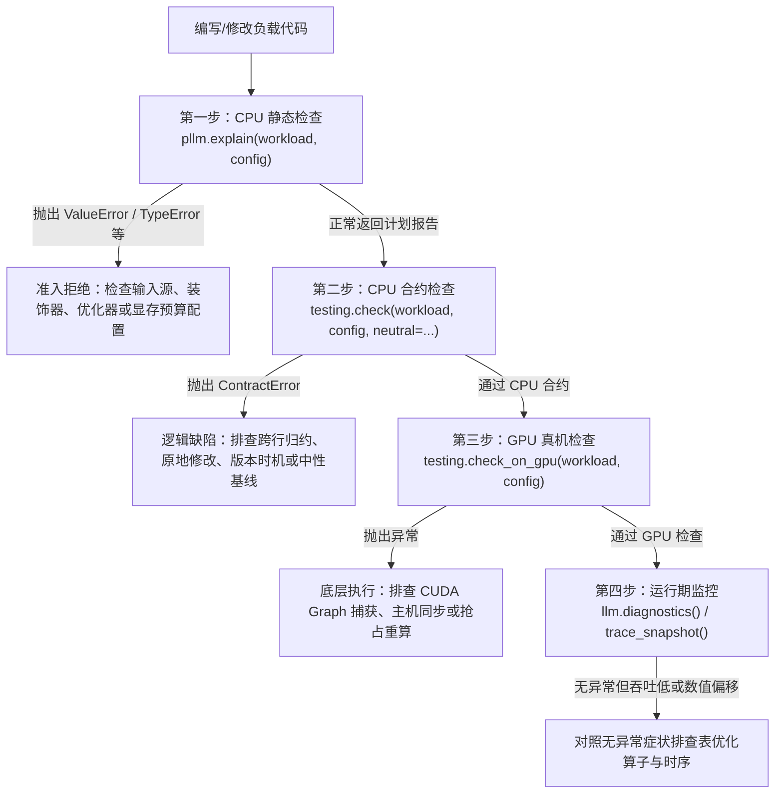

# 排查报错

编写或运行 pLLM 算法负载（`pllm.Workload`）时，如果遇到程序抛出异常，或者吞吐下降、显存不足、数值产生未预期偏移，本页提供快速定位和修复的具体步骤。

---

## 1. 快速分诊流程：先 CPU 后 GPU

当负载运行出现问题时，不要直接在多卡集群或大模型上盲目调试。完整的排查路线是：**先在 CPU 上用 `pllm.explain` 和 `testing.check` 几秒钟复现并定位，再到 GPU 上用 `check_on_gpu` 与 `diagnostics` 排查运行时状态**。



### 第一步：在 CPU 上运行 `pllm.explain`（检查准入与计划）

`pllm.explain` 与 `pllm.make_llm` 共享完全一致的准入校验（admission check）和显存规划逻辑。它只需模型配置文件（`config.json`），在 CPU 上使用 `meta` 张量完成形状追踪，不加载任何模型权重，不初始化 CUDA，几秒内即可完成。

如果代码存在以下问题，`pllm.explain` 会立即抛出与真实启动完全相同的异常：
- 方法参数缺少输入源默认值（如缺少 `= pllm.hidden(0)`）；
- 方法未挂载任何效果装饰器（未指明结果去哪）；
- 声明了多个 `@pllm.guide_sampling`；
- 在线训练方法 `@pllm.train` 对应的状态缺少优化器声明；
- 导出张量尺寸超出单行 32 KiB 限制；
- 显存预算不足（见返回报告中的 `budget_errors`）。

即便没有抛出异常，也可检查返回的计划报告：`report.eager_reason` 是否为空（非空表示模型前向会退回 eager 模式）、各方法的 `anchor` 与 `lane`（`side` 旁路流还是 `main` 主流）是否符合预期。详见 [看成本：pllm.explain](../guides/explain.md)。

### 第二步：在 CPU 上运行 `pllm.testing.check`（检查算法契约）

当 `pllm.explain` 正常通过后，下一步在 CPU 上运行 `pllm.testing.check`。它使用固定的三个合成请求，经由真实规划器与执行器测试请求调度，检验你的张量数学是否满足框架契约：
- **请求行混淆（Row Mixing）**：是否在第 0 维误用了 `mean(0)`、`sum(0)` 或跨行排序，破坏了并发请求间的隔离性；
- **原地修改借用视图（In-place Mutation）**：是否直接对输入张量或参数执行了 `add_()`、`mul_()` 等原地写入；
- **版本可见性时机（publish_lag）**：训练更新与前向读取的版本是否符合时序预期；
- **中性基线（Neutral）**：当把干预强度设为 0 时（传入 `neutral=Workload(beta=0.0)`），干预输出是否严格为 0。

若违反契约，会抛出 `pllm.testing.ContractError`。详见 [检查正确性](../guides/checking.md)。

### 第三步：在 GPU 上运行 `pllm.testing.check_on_gpu`（验证图捕获与真机执行）

CPU 检查不执行模型内部的真实前向。对于挂载在模型内部的效果（如 `pllm.model.ActivationPatch`、`@pllm.custom_residual`、`@pllm.custom_attention`、`pllm.model.Adapter`），需要在 GPU 上使用 `pllm.testing.check_on_gpu` 进一步验证：
- 稳态解码是否被完整捕获进 CUDA Graph；
- 解码步骤中是否存在未预期的主机同步（Host sync，要求解码期间 0 次 CPU 同步）；
- 发生显存不足或抢占重算时，状态能否正确重算。

### 第四步：运行时状态诊断 `llm.diagnostics()` 与 `llm.trace_snapshot()`

在真实服务运行期间，若发现吞吐低于预期或怀疑数值异常，可查询运行时诊断信息：
- `llm.diagnostics().eager_reason`：为空字符串表示运行在整图 CUDA Graph 模式；若非空，会明确点名退回 eager 的原因；
- `llm.diagnostics().numeric_health`：检查状态张量中是否存在 NaN 或 Inf；
- `llm.diagnostics().state_usage`：监控逻辑存活字节与物理分配字节；
- `llm.trace_snapshot()`：查看主干流与旁路流各任务的耗时分布，以及是否有导出丢弃（`export_dropped`）。

---

## 最小诊断示例

下面是利用 `Qwen/Qwen2.5-0.5B-Instruct` 在 CPU 上运行 `pllm.explain` 与 `testing.check` 的完整可运行示例：

```python
from dataclasses import dataclass

import torch
from torch import nn

import pllm
from pllm import testing
from pllm.workloads.esamp import ESampConfig, ESampWorkload

# 1. 声明模型配置（隐藏层 896，24 层，词表 151936）
config = pllm.ModelConfig("Qwen/Qwen2.5-0.5B-Instruct", max_num_seqs=8)

# 2. 准备待检查的工作负载及其强度为 0 的中性基线
workload = ESampWorkload(ESampConfig(rank=4, intervention_beta=0.5))
neutral_workload = ESampWorkload(ESampConfig(rank=4, intervention_beta=0.0))

# 3. 第一步：在 CPU 上查看执行计划与显存预算（快速捕获准入错误与 eager 风险）
report = pllm.explain(workload, config)
assert report.eager_reason == "", f"未进入 CUDA Graph: {report.eager_reason}"

# 4. 第二步：在 CPU 上验证请求隔离、版本时滞与中性基线
check_result = testing.check(workload, config, neutral=neutral_workload)
print("CPU 检查通过项:", check_result.passed)
```

若要在 GPU 上进一步检验 CUDA Graph 捕获与运行时状态，可补充以下步骤：

```python
# check-docs: skip: requires a CUDA engine and GPU
# 第三步：在 GPU 上验证模型内部算子与 0 主机同步
print(testing.check_on_gpu(workload, config, neutral=neutral_workload))

# 第四步：运行时查看引擎诊断信息
with pllm.make_llm(config, workload=workload) as llm:
    diag = llm.diagnostics()
    assert diag.eager_reason == "", f"模型退回 eager: {diag.eager_reason}"
    assert all(field.nonfinite_count == 0 for field in diag.numeric_health), "状态里出现了 NaN/Inf"
```

---

## 常见报错速查（报错 → 原因 → 改法）

本节汇总编写与构建负载时最常见的报错信息。每条规则均源自底层的连续批处理、CUDA Graph 捕获或自动求导机制。完整的报错目录请参阅 [报错目录](../reference/errors.md)。

| 报错（原文） | 为什么 | 改法 |
| :--- | :--- | :--- |
| `...: give every input a source as its default, e.g. ...` | pLLM 只从参数默认值知道每个输入读什么，不按参数名猜：猜错不会报错，只会悄悄读错数据 | 给 `self` 之后的每个参数写来源，如 `h: torch.Tensor = pllm.hidden(0)` |
| `the workload has no effect on the model: add @pllm.train, ...` | pLLM 只安排有去处的计算；没有效果装饰器的方法不会运行 | 给方法加效果装饰器；只当选择器用的方法要被某个效果的 `rows=` 引用 |
| `a method takes one pLLM decorator of each kind; split stacked effects into one method per effect` | 后一个装饰器会覆盖前一个，其中一个效果悄悄失效；不同效果的默认时机也不同 | 每个效果一个方法，用 `pllm.result(name)` 共享计算 |
| `... both declare @pllm.guide_sampling; keep at most one guidance method` | 采样器每步只按一个预测重新加权；两个预测怎样合成是算法的选择 | 在一个方法里合成一个预测；其余修正用 `@pllm.add_logits` |
| `tensor export needs positive every, max_rows and max_cols, with max_cols * 8 <= ... bytes (32 KiB), so one row fits an export event` | 导出值按每个 8 字节传回，一行必须装进一个 32 KiB 的导出事件 | `max_cols` 不超过 4096；更宽的向量先在方法里压缩（如 top-k 编号） |
| `property ... needs a return annotation; ...` | pLLM 不执行 getter 也要认出哪些属性是状态 | 写返回类型，如 `-> pllm.RequestState` |
| `pllm.parameter(..., ...) names no declared field; declared: ...` | 字段名不存在 | `shape=` 声明的状态只有字段 `"value"`；`FromModule` 状态用 `pllm.module(state)` 读 |
| `@pllm.train reads ..., which trains with ...; declare ... with optimizer=...` | 训练方式由方法读的输入决定，优化器写在状态上 | 给状态加报错里说的优化器 |
| `rows= and update_rows= on request training require a model effect without sampler guidance, or @pllm.add_logits; standalone training and @pllm.guide_sampling update every selected state, so remove rows= and update_rows=` | 这条训练路径每步给每个状态做一次更新并发布新版本，不支持按行跳过 | 在 `@pllm.guide_sampling(rows=...)` 上选行，或用 `reduction="sum"` 并把要排除的行的 loss 乘 0 |
| `... pLLM funds one training mode per workload, so move one of them to a separate workload` | 请求行训练和宿主批训练的更新时机、显存预留不同，一个负载只有一种 | 分到两个引擎；只给宿主读的状态可以用 `pllm.host.make_host` 单独训练 |
| `a task reads a value (sampled tokens, hidden states or another task's result) that exists only after its phase ends; declare it in a later phase` | 值在产生它的阶段之前不存在，例如采样结果在采样之后才有 | 采样前读 logits 用 `pllm.layer_logits((-1,))`；读采样结果的方法放进 `@pllm.train` 或 `@pllm.on(pllm.Phase.AFTER_SAMPLE)` |
| PyTorch 的 "Tensor.item() cannot be called on meta tensors"，附注 `while shape tracing method ...; methods run inside CUDA graphs: use tensor operations such as torch.where, not .item() or Python branches on tensor values` | 构建时方法只按形状追踪（没有数值），运行时在 CUDA graph 里重放 | 去掉 `.item()`、`print(tensor)`、按张量值的 `if`；用掩码和 `torch.where`，看数值用 `@pllm.export` |
| `... reads block or model outputs, which a @pllm.custom_forward does not produce; use pllm.residual or pllm.layer_logits to read each layer's last visited stream` | custom forward 里一层可能跑多遍或不跑，"这一层的输出"不唯一 | 读 `pllm.residual(layer)` 或 `pllm.layer_logits(...)` |
| `Use @pllm.custom_forward(tokens="decode") for active=: skipped prompt tokens would leave approximate K/V that every later token reads. ...` | prompt 是之后每个 token 都要读的上下文，跳层留下的近似 K/V 会影响整个生成 | `@pllm.custom_forward(tokens="decode")` |
| `worker processes cannot send ... defined in __main__ or a notebook; move it into an importable .py module, ...` | 子进程按导入路径重建负载，找不到 `__main__` 或 notebook 里的类 | 把类放进 `.py` 模块，或 `multiprocessing=False` |
| `... mixes rows: equal inputs for this request produced different outputs. ...` | 方法跨行计算（`mean(0)`、行排序），或在 `self` 上保存了可变状态 | 只沿 `dim=-1` 计算 |
| `... mutates borrowed input ... in place; inputs and parameters are read-only views. ...` | 输入和参数与别的方法、别的版本共享 | 返回新张量；改状态用 `@pllm.write` 或 `@pllm.train` |
| `training methods return one loss per row; pLLM reduces the selected rows per state` | 只有 pLLM 知道一步里哪些行属于哪份状态 | 返回 `[rows]` 的 loss，不要自己 `.mean()` |
| `guide_sampling still declares a sampler stage; set its beta to zero.` | `neutral=` 的负载仍在引导采样，常见原因是装饰器写了 `beta=beta` | 用设置方法：`beta=strength`，`def strength(self) -> float: return self.beta` |
| `add_logits must return exactly zero` | 强度为零时加法必须精确为零 | 让强度乘在整个结果上 |
| `host-batch training returns one scalar and owns its reduction; remove reduction=` | 宿主批次的长度、权重和归一化方式只有你知道 | 在方法里自己归约，去掉 `reduction=` |
| `...: add init=pllm.Computed(...) (e.g. random A, zero B); with both low_rank factors at zero every gradient is zero and the adapter never learns` | 两个因子都为零时梯度恒为零 | A 随机、B 为零 |
| `pLLM misrouted rows ...` | 先排除自己的代码：原地写参数，或混用不同状态的行；排除后这是框架的 bug | 把报错信息报告给我们 |

--- | :--- | :--- |
| `...: give every input a source as its default, e.g. ...` | 静态编译期需要通过参数默认值确定每个输入的来源与依赖拓扑，普通无默认值的参数无法知晓输入来自哪个张量。 | 为 `self` 之后的每个参数提供输入源默认值，例如 `h: torch.Tensor = pllm.hidden(0)` 或 `w: torch.Tensor = pllm.parameter(...)`。 |
| `the workload has no effect on the model: add @pllm.train, ...` | 方法未挂载指示结果去向的效果装饰器，孤立的张量计算不会对模型推理或状态产生任何影响。 | 为方法添加效果装饰器（如 `@pllm.train`、`@pllm.add_logits`、`@pllm.guide_sampling`、`@pllm.export` 等）；若该方法仅用作行选择器，需在效果方法中用 `rows=` 引用它。 |
| `a method takes one pLLM decorator of each kind; split stacked effects into one method per effect` | 不同的效果装饰器在引擎中具有不同的执行时机（anchor）、执行流（lane）和张量形状约定，框架不支持在一个函数上叠加多个异构效果。 | 拆分为多个独立方法，每个方法只带一个装饰器；若需复用前序计算的中间结果，通过 `pllm.result(name)` 传递。 |
| `... both declare @pllm.guide_sampling; keep at most one guidance method` | 采样引导会在采样器内部修改候选 token 的概率分布，为了保证采样算法语义唯一且收敛确定，一个负载内至多允许一个引导方法。 | 一个负载（含组合的子组件）中只保留一个 `@pllm.guide_sampling` 方法；如果需要多次干预未归一化的 logits，声明多个可共存的 `@pllm.add_logits`。 |
| `tensor export needs positive every, max_rows and max_cols, with max_cols * 8 <= ... bytes (32 KiB), so one row fits an export event` | 异步导出采用单事件不超过 32 KiB 的定长无锁环形页缓冲区，避免数据拷回 CPU 阻塞 GPU 主计算流。 | 将 `max_cols` 调小至最多 4096 列（BF16/FP16 下 $4096 \times 2 \le 32768$ 字节）；超出 `max_rows` 的行会被截断丢弃，应适当调大 `max_rows` 或在 `generate` 时控制并发。 |
| `property ... needs a return annotation; ...` | 编译期规划器依赖属性的返回类型注解来区分状态的作用域（`RequestState` 还是 `InstanceState`）以分配合适的显存池。 | 为状态属性声明明确的返回类型注解，例如 `@property def my_state(self) -> pllm.RequestState:`。 |
| `pllm.parameter(..., ...) names no declared field; declared: ...` | 借用状态张量时必须精确匹配状态声明中的具名字段，以确保张量指针正确绑定到预留显存。 | 检查状态名与字段名是否一致；若状态用 `shape=` 声明，则它只包含唯一字段 `"value"`；若使用 `init=pllm.FromModule(...)`，应使用 `pllm.module(state)` 访问。 |
| `@pllm.train reads ..., which trains with ...; declare ... with optimizer=...` | 在线训练需要为状态维护动量等优化器变量，框架要求状态显式绑定对应的优化器配置以分配优化器显存。 | 在报错提示的状态声明中添加指定的优化器参数，例如 `optimizer=pllm.AdamW(lr=1e-3)`。 |
| `rows= and update_rows= on request training require a model effect without sampler guidance, or @pllm.add_logits; standalone training and @pllm.guide_sampling update every selected state, so remove rows= and update_rows=` | 独立请求训练以及伴随 `@pllm.guide_sampling` 的训练采用无条件更新路径（每步无条件为所有选定状态执行优化器更新并发布版本，以与下一步前向重叠），该路径未实现行掩码条件更新。 | 移除训练方法上的 `rows=` 和 `update_rows=`；如需按请求过滤，可在采样引导方法上设置 `rows=`，或在训练中将无需更新行的损失乘以 0 并采用 `reduction="sum"`（注意 `reduction="mean"` 下权重为 0 的行仍会计入分母）。 |
| `... pLLM funds one training mode per workload, so move one of them to a separate workload` | 请求行训练（每步按请求更新私有参数）与宿主批训练（跨请求聚合为单批次更新）采用完全不同的显存排布与调度流，单负载只支持其中一种模式。 | 将请求行在线训练与宿主批训练拆分到不同的负载中，不要在同一个负载中混用。 |
| `a task reads a value (sampled tokens, hidden states or another task's result) that exists only after its phase ends; declare it in a later phase` | 计算图存在因果时序约束，例如采样产生的 token（`pllm.sampled_tokens()`）和基座 logits（`pllm.base_logits()`）在采样阶段之前尚未产生，无法在前序阶段读取。 | 将依赖后序产物的方法移到对应阶段（如 `@pllm.on(pllm.Phase.AFTER_SAMPLE)` 或 `@pllm.train`），或者在采样前改读最后一层的投影 logits `pllm.layer_logits((-1,))`。 |
| PyTorch 的 "Tensor.item() cannot be called on meta tensors"，附带 note：`while shape tracing method ...; methods run inside CUDA graphs: use tensor operations such as torch.where, not .item() or Python branches on tensor values` | 方法在静态编译期通过 `meta` 张量追踪形状，并在 GPU 解码时捕获为 CUDA Graph；向主机同步提取标量（如 `.item()`、`.tolist()`、`print` 或基于张量值的 `if` 分支）会触发同步并中断图捕获，`meta` 张量也无实际数值。 | 移除方法内部的 `.item()`、`.tolist()`、`print(tensor)` 和 `if tensor ...:` 分支，改用张量掩码与 `torch.where`；如需观测张量数值，使用 `@pllm.export` 异步回传。 |
| `... reads block or model outputs, which a @pllm.custom_forward does not produce; use pllm.residual or pllm.layer_logits to read each layer's last visited stream` | 自定义前向（`@pllm.custom_forward`）接管了层循环与早退，原生单遍前向被切断或重排，模型不再产生全局唯一的块输出或最终隐藏状态（`pllm.hidden` / `pllm.final_hidden`）。 | 改用 `pllm.residual(layer)` 或 `pllm.layer_logits(...)` 读取各层最后访问的残差流，或者直接在自定义前向内部计算所需特征。 |
| `Use @pllm.custom_forward(tokens="decode") for active=: skipped prompt tokens would leave approximate K/V that every later token reads. ...` | Prefill 阶段生成的 KV cache 会被后续所有解码步读取；如果在 prompt 上按 token 跳层，留下的残缺或近似 KV 会永久污染后续所有 token 的注意力计算。 | 对早退或跳层逻辑（`active=`）设置 `@pllm.custom_forward(tokens="decode")`；Prefill 阶段默认执行完整模型前向以保证 KV 精度。 |
| `worker processes cannot send ... defined in __main__ or a notebook; move it into an importable .py module, ...` | 启用张量并行或多进程 Worker 时，Python 的 `pickle` 无法跨进程序列化定义在主入口 `__main__` 或 Notebook 单元格中的临时类。 | 将负载类定义放入独立的 Python 模块文件（`.py`）中并进行 `import`，或者在单卡测试阶段设置 `multiprocessing=False`。 |
| ContractError `method ... mixes rows: equal inputs for this request produced different outputs. Dimension 0 holds request rows; reduce features (dim=-1), not requests (dim=0).` | 连续批处理中张量的第 0 维拼接了不同并发请求，沿第 0 维做归约（如 `mean(0)`、`sum(0)`、BatchNorm 或跨行排序）会导致当前请求的结果受其他请求干扰，破坏了请求隔离性。 | 沿特征维度归约（如 `mean(-1)`、`dim=-1`），确保每行的计算仅依赖当前请求；避免在负载实例中保存跨请求或跨步的可变 Python 状态（如 `self.count += 1`）。 |
| ContractError `pLLM misrouted rows ... Report this message as a framework bug.` | 框架发现状态、采样或导出目的地的行与输入行产生了非预期的路由错位。 | 先排查代码中的未定义行为：是否对输入或参数执行了原地写入（如 `w.add_(1)`），或在张量运算中混淆了不同状态的行索引；排除上述问题后再向框架提交 issue。 |
| ContractError `[neutral] ...: add_logits must return exactly zero` / `[neutral] guide_sampling still declares a sampler stage; set its beta to zero.` | 中性基线契约要求当干预强度设为 0 时，负载必须完全无害，数学上不能对模型的原始 logits 或采样分布产生任何微小扰动。 | 确保强度参数直接乘在整个干预输出上（如 `return self.beta * delta`），并在引导采样方法中将 beta 设为返回 0.0 的动态方法（如 `def strength(self) -> float: return self.beta`），传入 `neutral=Workload(beta=0.0)`。 |
| `method ... mutates borrowed input ... in place; inputs and parameters are read-only views. Use out-of-place tensor math or clone() before writing; publish state changes through @pllm.write or @pllm.train.` | 传入方法的张量是只读借用视图，在底层可能与其他方法或前序状态版本共享显存地址；原地修改（如 `add_`、`mul_`、`copy_` 或 `out=`）会静默破坏其他请求的数据和 CUDA Graph 重放。 | 改用非原地算子（如 `y = x + 1`），或在修改前显式调用 `.clone()`；状态更新必须统一通过 `@pllm.write` 或 `@pllm.train` 发布。 |
| `training methods return one loss per row; pLLM reduces the selected rows per state` | 请求训练方法需要为批次中每一行独立求导；在方法内部提前调用 `.mean()` 返回标量会导致框架无法区分各行的损失归属，无法实现逐请求的掩码更新。 | 请求训练方法返回形状为 `[rows]` 的一维损失向量（每行一个标量损失）；跨行的归约（`reduction="mean"` 或 `"sum"`）由 `@pllm.train` 框架自动处理。 |
| `host-batch training returns one scalar and owns its reduction; remove reduction=` | 宿主批训练处理的是跨请求汇聚的整个宿主批次，天然由用户在方法内归约为单一标量损失，不接受框架层二次设置 `reduction=` 参数。 | 在宿主批训练方法中自行完成损失归约并返回单个标量张量，同时在 `@pllm.train` 中移除 `reduction=` 参数。 |
| `...: add init=pllm.Computed(...) (e.g. random A, zero B); with both low_rank factors at zero every gradient is zero and the adapter never learns` | 低秩适配器（$W = BA$）中若两个矩阵均全零初始化，由链式法则可知两侧导数恒为 0，模型参数将永远无法更新。 | 使用 `init=pllm.Computed(...)` 将其中一个低秩矩阵初始化为随机分布（如高斯初始化），另一个初始化为零。 |

---

## 运行无异常但行为不合预期（症状排查）

很多时候代码并未抛出异常，但吞吐大幅下降、显存超标或数值产生微小偏移。下表汇总此类常见症状的物理根因与针对性调优策略。关于进一步的性能调优技巧，详见 [让负载更快](faster.md)。

| 症状表现 | 物理机制与原因 | 排查与解决办法 |
| :--- | :--- | :--- |
| **`eager_reason` 非空<br>（模型退回 eager）** | 某些声明暂不支持整图捕获（如将 `pllm.model.Adapter` 挂在跨请求共享的 `InstanceState` 上）；或方法包含不可追踪操作；或使用 `@pllm.custom_forward` 时整模型图被切片图替代。退回 eager 的代价取决于步长：RTX 4090、128 并发下，0.5B 降至图模式的约 49%，7B 只慢约 2%。 | 查看 `pllm.explain` 或 `llm.diagnostics().eager_reason` 指明的原因；若需整图吞吐，将 Adapter 改为每请求独立的 `RequestState`；在配置中设置 `ModelConfig(cuda_graphs=True)`，使任何导致 eager 的写法在启动时直接报错，避免静默降级。 |
| **吞吐远低于原生 vLLM<br>（例如只有一两成）** | 常见于以下原因：<br>1. 动态注意力（如 `kv.attend(q, topk=...)`）虽减少了 KV 读取，但未经融合的打分与 gather 算子开销远超节省的带宽（如示例 10 中 `QuestRead` 在 7B 上吞吐仅为原生的 14%）；<br>2. 方法内含隐式 CPU 同步；<br>3. `placement="host"` 主机大表查表方法混读了 `pllm.hidden`，导致查表无法提前到步首 `request.prepare / side` 与前向重叠（跨 PCIe 搬运 38.9 MB 约需 1.6 ms，暴露在外直接拖慢步时）；<br>4. 声明了多层 `pllm.layer_logits`，触发多次全词表 LM Head 矩阵乘（GEMM）。 | 1. 要省 KV 显存用静态布局（`keep="window"` / `source=k`），要提速就把打分写成融合 kernel（见示例 09、10）；<br>2. 移除所有主机同步代码；<br>3. 将主机大表查表拆成仅依赖 `pllm.input_tokens` 和不可变状态的独立方法，经 `pllm.result` 传递，确保调度在 `side` 旁路流上重叠；<br>4. 用 `@pllm.guide_sampling` 替代多层 `layer_logits`，共用 LM Head。详见 [让负载更快](faster.md)。 |
| **强度为 0 时输出与原生 vLLM 存在微小差异** | 带 `@pllm.custom_residual` 或 `ActivationPatch` 时，vLLM 在 CUDA graph 里捕获模型原本的算子，不做 inductor 融合；默认的原生 vLLM 用融合后的算子，bf16 舍入略有不同。 | 这是正常的舍入差异。和 eager 模式的原生 vLLM 对比（应逐位相同），或运行 `pllm.testing.check_on_gpu`，它会建一个设置相同的原生引擎做逐位对照。 |
| **导出数据丢失行或不完整<br>（`dropped_rows > 0`）** | `@pllm.export` 具有**零阻塞保证**：为不阻塞 GPU 计算流，采用有界锁页环形缓冲区（队列上限 256 个事件，每个 $\le 32\text{ KiB}$）。当消费拉取不及时队列满时，默认直接丢弃（`overflow="drop"`，记入 `export_dropped`）；当单步有效行数超过 `max_rows`，或单次 `generate` 传入的 prompt 数超过 `max_rows` 时，超出部分会被截断（记入 `event.dropped_rows`）。 | 调大 `@pllm.export(max_rows=...)`，确保覆盖最大并发序列数或分块大小；调大导出间隔 `every=...`（如每 4 步导出一次）；确保消费进程及时读取；单次 `generate` 传入的 prompt 数量不要超过 `max_rows`。 |
| **`make_llm` 报 OOM 或图捕获预算报错点名字节数** | pLLM 为确保在线训练与状态发布完全进 CUDA Graph，会在初始化时预留固定显存池。若默认预算叠加 vLLM 权重与 KV cache 超出了物理显存容量，就会导致分配失败。`pllm.explain` 会在 `budget_errors` 中列出超标字节数。 | 对照 `pllm.explain` 的 `memory` 与 `state` 行调整 `ExecutionOptions` 参数：<br>- `state_page_budget_bytes`：状态页显存预算（调小以限制状态显存，或将大只读表设为 `placement="host"`）；<br>- `execution_peak_budget_bytes`：执行峰值预算（包含任务工作区与重叠缓冲区）；<br>- `cuda_graph_pool_budget_bytes`：CUDA Graph 显存池预算（若使用复杂切片或多个自定义方法捕获显存不足，需适当调大）；<br>- `max_host_training_rows`：主机批训练最大并行行数（调小以降低显存峰值）；<br>适当调低 `gpu_memory_utilization` 或 `max_num_seqs`。 |
| **抢占时抛出异常<br>（Preemption Rejection）** | 当显存紧张触发抢占、vLLM 试图逐出并重算序列历史时，仅当请求状态以 `request_id` 为键（私有独立副本）、且无跨请求可变实例状态、无外部导入（`Imported`）或主机外部输入时，框架才能够无害重算历史；任何其他带有覆盖（overlay）或可变共享状态的算法，由于历史无法复原，框架会拒绝重算并抛出异常。 | 提高 `gpu_memory_utilization`（如从 0.85 提至 0.90）为 KV cache 预留更多显存，从根源上避免触发抢占；调低并发序列数 `max_num_seqs`；避免在算法中依赖跨请求的可变 `InstanceState`。详见 [性能与显存](../explain/performance.md)。 |
| **采样器里抛出没有说明的 `AssertionError`** | `@pllm.guide_sampling` 返回的宽度不等于 hidden 宽度（Qwen2.5-0.5B 为 896）。`@pllm.add_logits` 的词表宽度在构建时就检查，guide_sampling 的宽度目前不在 CPU 上检查。 | 核对 `@pllm.guide_sampling` 返回值的最后一维等于模型的 `hidden_size`。 |
| **宿主批训练某几轮特别慢** | 训练批次的形状（序列数、长度）第一次出现时，pLLM 要为它编译训练步。 | 形状稳定后不再重编；测吞吐时用固定形状的批次并排除预热轮（见[公平地测吞吐](measure-throughput.md)）。 |
| **单进程内创建多个引擎导致崩溃或显存冲突** | 每个 pLLM 引擎会在 GPU 端独占分配图显存池、状态页和 vLLM KV cache。前一个引擎若未完全释放，显存将被锁死，导致后续引擎无法分配连续显存块。 | 使用上下文管理器 `with pllm.make_llm(...) as llm:`，退出时自动释放资源；或显式调用 `llm.close()` 释放 GPU 显存与后台 Worker 进程后再创建新引擎。 |

---

## 自测小问题

1. **问题**：在实现每请求在线学习时，你的方法被 `@pllm.train(state="adapter")` 装饰，并在函数体最后写了 `return loss.mean()`。在 CPU 上运行 `testing.check` 时抛出了 `training methods return one loss per row; pLLM reduces the selected rows per state`。为什么框架禁止用户自己在方法里调用 `.mean()`？
   <details><summary>答案</summary>
   因为连续批处理中每个 step 拼入了多个并发请求，框架需要获得每行独立的标量损失 <code>[rows]</code>，才能知道每个请求的私有状态对应的梯度，进而执行逐请求的掩码过滤与优化器更新。如果用户自己在函数内调用 <code>.mean()</code> 归约成单个标量，不同请求的损失就混合在了一起，框架无法还原各请求独立的损失值。跨行归约应当交由 <code>@pllm.train(reduction="mean"|"sum")</code> 框架自动处理。
   </details>

2. **问题**：你给模型添加了一个 `placement="host"` 的超大查表状态，并在同一个方法里既通过 `pllm.input_tokens` 查表，又通过 `pllm.final_hidden()` 读取模型最后一层激活做门控。为什么在 GPU 上运行后吞吐明显下降？
   <details><summary>答案</summary>
   因为该方法同时读取了 <code>final_hidden</code>，它必须等到整个模型前向全部计算完毕后才能启动执行。这导致跨 PCIe 搬运主机大表数据的耗时（[性能与显存](../explain/performance.md)一页中 128 行、7B 词表宽的查表约 1.6 ms/步）完全暴露在模型前向之外，无法在后台与前向重叠。正确的改法是将主机查表拆写为一个只读 <code>input_tokens</code> 的无效果方法（规划器会将其调度在步首的 <code>request.prepare / side</code> 旁路流上，利用 1/4 SM 在后台等 PCIe 搬运），再由门控方法通过 <code>pllm.result(...)</code> 读取查表结果，从而让大表搬运与主干前向深度异步重叠。
   </details>

---

## 接下来

- 查看全部错误消息清单与异常类型：[报错目录](../reference/errors.md)
- 了解如何在 CPU 与 GPU 上系统性验证契约：[检查正确性](../guides/checking.md)
- 在不启动 GPU 的前提下分析执行图与显存预算：[看成本：pllm.explain](../guides/explain.md)
- 了解避免 eager 退化与最大化重叠的优化技巧：[让负载更快](faster.md)
