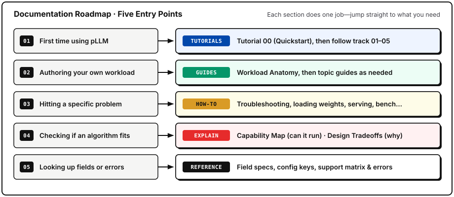

# Documentation

pLLM's documentation is organized into five categories by purpose, with each page focused on a single job: **Tutorials** teach you how to write workloads from scratch; **User Guides** explain each declaration by feature along with its costs; **How-To Guides** give step-by-step recipes for specific problems; **Reference** pages provide item-by-item specifications; and **Explanation** pages cover the reasoning behind the rules. There is also an **Examples** gallery, where each entry implements an algorithm family with measured numbers.

To have a coding agent write a workload or migrate an existing project to pLLM, install the skill first (`pllm skill --install claude` / `codex` / `cursor`), or point it directly to the [agent skill](agent/SKILL.md), [migration guide](agent/migration.md), and [agent reference](agent/reference.md).

## Tutorials

Executable notebooks (requiring a GPU) with outputs saved inline. Most run on `Qwen2.5-0.5B-Instruct`; Tutorial 03 benchmarks throughput on `Qwen2.5-7B-Instruct` (~15 GiB BF16 weights, requiring a 24 GiB GPU). Each tutorial starts from a concrete algorithm and ends with common errors and self-check questions.

| Tutorial | Algorithm | What You Will Learn |
| --- | --- | --- |
| [00 Quickstart](tutorials/00_quickstart.ipynb) | Activation steering (CAA) | The three questions a workload answers—what to read, what to store, where results go—and pre-flight checks with `pllm.explain` and `pllm.testing.check` |
| [01 Observe & Probe](tutorials/01_observe_probe.ipynb) | Linear probe / SAE monitoring | Reading per-token hidden states and exporting to the host without altering outputs or disabling CUDA graphs |
| [02 Per-Request LoRA](tutorials/02_request_adapters.ipynb) | Text-to-LoRA hypernetwork | `RequestState`, `Adapter`, `@pllm.write`: giving each request its own prompt-generated LoRA |
| [03 Decode-Time Training](tutorials/03_decode_training.ipynb) | ESamp | `@pllm.train`, `@pllm.guide_sampling`, `publish_lag`; measuring throughput |
| [04 Custom Forward](tutorials/04_custom_forward.ipynb) | Looped depth (Ouro / Huginn style) | `@pllm.custom_forward`; how KV caches are handled inside loops |
| [05 Host Feedback Loops](tutorials/05_host_feedback.ipynb) | TTRL / GRPO | Host-batch training: closing the generate–vote–train loop inside a single engine |

## User Guides

Organized by capability: each page explains what a feature is and when to use it, gives a short runnable example, and explains its cost and constraints.

- [Capability Map](guides/capability-map.md): which inference-time algorithms pLLM supports today, which primitives to use, and built-in workloads
- [Workload Anatomy](guides/workload-anatomy.md): the three kinds of declarations, method body rules, when methods run, selectors, and the development loop
- [Reading Model Internals](guides/reading.md): hidden states, residual streams, per-layer logits, token history, and sampling outcomes
- [State](guides/state.md): request state vs. instance state, fields, initializers, precision, and carry fields
- [Where Results Go](guides/results.md): exports, additive logits, sampling guidance, and state writes
- [Online Training](guides/training.md): `@pllm.train`, reductions, selectors, `publish_lag`, and gradient edges
- [Model Edits](guides/model-edits.md): activation patches, adapters, and in-forward training
- [Customizing Forward Structure](guides/forward-structure.md): custom residuals, custom attention & KV layouts, and custom forward
- [Host Loops & Batch Training](guides/host-loops.md): host batches, causal models, `make_host`, and `generate_feedback`
- [Custom Operators](guides/custom-ops.md): integrating Triton / CUDA kernels via `torch.library.custom_op`
- [Composing Workloads](guides/composition.md): running multiple workloads in one engine
- [Inspecting Costs: `pllm.explain`](guides/explain.md): reading the execution plan on CPU before launch
- [Checking Correctness](guides/checking.md): `testing.check`, `check_on_gpu`, and `check_distribution`

## How-To Guides

- [Troubleshooting Errors](howto/troubleshooting.md)
- [Online Serving: `AsyncVllmLlm` & `pllm serve`](howto/online-serving.md)
- [Loading Trained Weights](howto/load-trained-weights.md)
- [Sharing Training Across Requests](howto/share-training-across-requests.md)
- [Production Deployment: Multiprocessing, Tensor Parallelism & Quantized Bases](howto/production.md)
- [Measuring Throughput Fairly](howto/measure-throughput.md)
- [Making Workloads Faster](howto/faster.md)
- [Using New Model Families](howto/new-model-families.md)

## Reference

- [Support Matrix](reference/support-matrix.md): model × feature × vLLM version × parallelism
- [Composition Rules](reference/composition-rules.md): which combinations are valid, which are rejected, and why
- [Configuration Options](reference/config.md): full fields for `ModelConfig`, `ExecutionOptions`, and related configs
- [`explain` Reports & Runtime Diagnostics](reference/diagnostics.md)
- [Error Catalog](reference/errors.md): exact error messages, causes, and fixes
- [Glossary](reference/glossary.md)
- [Measurement Log](reference/measurements.toml): exact configurations and runs behind every throughput and latency number in the docs
- [API Reference](reference/api.md): signatures and docstrings for every public symbol, grouped by purpose (generated from source)

## Explanation

- [Core Concepts](explain/core-concepts.md): why declarations replace hooks, rows, the single-step timeline, state versions & `publish_lag`, and why boundaries exist
- [Design Tradeoffs](explain/design-tradeoffs.md): why certain algorithms cannot be expressed today, and available alternatives
- [Performance & Memory](explain/performance.md): decode bottlenecks, what pLLM saves for you, and measured costs across patterns

## Further Reading

- [Standalone Technical Essays (EN / ZH)](../blog/README.md): eleven standalone articles covering inference-time algorithm trends, unified tensor state management, scheduler retrospectives, bandwidth quotas, mantissa/bit tricks, compiled fast-weight training, static-graph pointer addressing, GPU memory MVCC/RCU, attention layouts, `attn_metadata` unpacking, and multi-tenant verification

## Examples

Each example implements an algorithm family following the structure "problem → workload → explain → check → generate → measure → cost & boundaries", with environment details for every benchmark.
Throughput and memory numbers are measured on `Qwen2.5-7B-Instruct` (RTX 4090, vLLM 0.32.0): Examples 07 and 12 use 7B throughout; 06, 09, 10, and 11 inspect behavior on 0.5B before benchmarking throughput on 7B; 08 uses a community 4B In-Place TTT checkpoint; 13 runs its search on 0.5B and requires `bubblewrap` and an authenticated agent CLI.

| Example | Algorithm | Key Focus |
| --- | --- | --- |
| [06 Reading Inside](examples/06_reading_inside.ipynb) | Logit Lens / DoLa | Keeping residual streams and per-layer logits inside CUDA graphs; compute cost of DoLa |
| [07 Custom Residual](examples/07_custom_residual.ipynb) | Value residual / hyper-connections / memory sublayers | `@pllm.custom_residual`; bitwise equivalence to native eager when identity; throughput cost |
| [08 In-Place TTT](examples/08_inplace_ttt.ipynb) | In-Place TTT (community 4B checkpoint) | Chunked fast-weight updates; cross-chunk updates during decode; throughput vs. the official implementation |
| [09 Custom Kernels](examples/09_custom_kernels.ipynb) | Relative steering (Triton kernel) | `torch.library.custom_op`; operator rows in `explain`; device-equivalence checks in `check_on_gpu` |
| [10 Custom Attention](examples/10_custom_attention.ipynb) | Attention monitoring / Quest / KV layouts | Swapping read logic only; top-K reads; KV savings from sliding window, prompt+window, and cross-layer sharing |
| [11 Lookup Memory](examples/11_lookup_memory.ipynb) | N-gram priors / Engram-style residuals | `pllm.input_tokens`; reading tables via `pllm.Pretrained`; placing tables in GPU VRAM vs. host DRAM |
| [12 Adaptive Depth](examples/12_adaptive_depth.ipynb) | Per-token layer skipping (early exit) | `active=`; KV backfill for skipped layers; when skipping actually saves time |
| [13 Algorithm Search](examples/13_algorithm_search.ipynb) | Agent-driven search loop | `explain` + `check` + scoring + replay; distinguishing real gains from noise |
