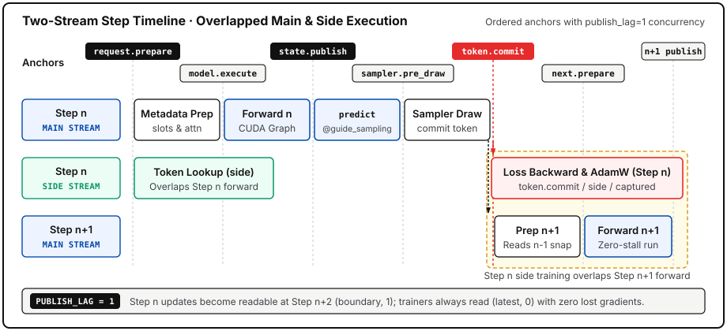

# Core Concepts

After running through one or two tutorials (such as [00 Quickstart](../tutorials/00_quickstart.ipynb) or [03 Decode-Time Training](../tutorials/03_decode_training.ipynb)), you may notice that writing algorithms in pLLM feels very different from attaching PyTorch forward hooks to Hugging Face `generate`. Inputs are declared as default parameter values (input markers), methods cannot call `.item()` or branch in Python on tensor values, reductions are restricted to the last dimension (`dim=-1`), and parameters trained on step $n$ become readable by default one step later, on step $n+2$.

These rules are not arbitrary syntax restrictions. They follow directly from two physical mechanisms at the heart of modern inference engines: **continuous batching** and **asynchronous CUDA Graph execution**. Understanding the five core concepts below—why declarations replace hooks, what a "row" is, the single-step timeline and stream overlap, versioned state publishing, and why invalid combinations are rejected at build time—lets you see the reason behind every rule and predict a workload's behavior and cost before running it.

---

## 1. Why Not Hooks: Continuous Batching & CUDA Graphs

### The Real Problem in a Serving Engine

In a single-request prototype, reading or modifying layer 12 activations takes five lines with `register_forward_hook`. Drop that same logic into a vLLM serving engine, however, and you immediately hit two walls:

1. **No Python code runs during CUDA Graph replay**: During autoregressive decoding, each step generates only 1 token per concurrent request, so individual kernels are very short. To eliminate the CPU overhead of launching kernels one by one from Python, vLLM captures the entire model forward pass into a CUDA Graph and launches the whole graph with a single replay call per step. (Falling back to eager mode by disabling CUDA graphs imposes a penalty proportional to step duration: at concurrency 128 on an RTX 4090, a ~3 ms 0.5B step drops to 49% of graph-mode throughput, whereas a ~21.7 ms 7B step still reaches 98%; see [Performance & Memory](performance.md).) During graph replay, the Python interpreter is completely out of the loop—Python hooks registered on modules never fire.
2. **Packed tensors have no request identity, and Python branches force host syncs**: Even in eager mode, continuous batching packs tokens from dozens of concurrent requests into a single 2D tensor. A plain module hook receives that packed tensor with no idea which row belongs to which request or which row is the final token of a newly finished prompt. Worse, writing `if h.norm() > 1:` or `print(h.item())` inside a hook forces the CPU to stall until the GPU finishes all queued kernels and copies the value back to host memory (host sync), draining the GPU pipeline and breaking CUDA Graph capture.

### The pLLM Approach: Declare Once, Trace Statically, Capture the Whole Graph

pLLM replaces runtime callbacks with **declarations + pure tensor math**. Your `pllm.Workload` subclass declares only three things (see [Workload Anatomy](../guides/workload-anatomy.md)):

- **What to read**: written as parameter defaults (such as `pllm.hidden(0)`, `pllm.residual(12)`, `pllm.parameter("distiller", "w")`);
- **What state to own**: written as class attributes or type-annotated `@property` definitions (such as `pllm.RequestState`, `pllm.InstanceState`);
- **Where results go**: written as method decorators or model-site declarations (such as `@pllm.train`, `@pllm.guide_sampling`, `@pllm.export`, `pllm.model.ActivationPatch`).

When creating the engine (`pllm.make_llm`) or inspecting the execution plan ([`pllm.explain`](../guides/explain.md)), pLLM reads these declarations once at startup, traces each method on CPU using PyTorch `meta` tensors to compute every intermediate shape, memory lifetime, and dependency, and then compiles and captures your tensor math—including autograd backward passes and `AdamW` / `SGD` updates—directly into CUDA Graphs.

```python
from dataclasses import dataclass

import torch
from torch import nn

import pllm
from pllm import testing


@dataclass(frozen=True)
class Distill(pllm.Workload):
    beta: float = 0.5

    distiller = pllm.RequestState(
        init=pllm.FromModule(
            lambda m: nn.Sequential(nn.Linear(m.hidden_size, 4), nn.Linear(4, m.hidden_size))
        ),
        optimizer=pllm.AdamW(1e-3),
    )

    @pllm.train(state="distiller")
    def loss(
        self,
        shallow: torch.Tensor = pllm.hidden(0),
        deep: torch.Tensor = pllm.hidden(-1),
        f: nn.Module = pllm.module("distiller"),
    ) -> torch.Tensor:
        return (f(shallow.float()) - deep.float()).square().mean(-1)

    def strength(self) -> float:
        return self.beta

    @pllm.guide_sampling(beta=strength)
    def predict(
        self,
        shallow: torch.Tensor = pllm.hidden(0),
        f: nn.Module = pllm.module("distiller"),
    ) -> torch.Tensor:
        return f(shallow.float())


CONFIG = pllm.ModelConfig("Qwen/Qwen2.5-0.5B-Instruct", max_num_seqs=8)
print(pllm.explain(Distill(), CONFIG))
```

`pllm.explain` completes tracing and planning on CPU and produces an excerpt like:

```text
forward  CUDA graphs: no effect needs eager
member  effect  anchor / lane / graph  state reads (origin, distance)
loss  train  token.commit / side / captured  distiller (latest, 0)
predict  guide_sampling  state.publish / main / captured  distiller (boundary, 1)
state  scope  bytes/root  reserved bytes [exact; state_page_budget_bytes]
distiller  request  96832  1807536  field 0: float32 x 24 pages, field 1: float32 x 16 pages, ...
host     0 syncs in traced workload math; exports: none
timing   publish_lag=1 (default): updates at step n become readable at n + 2; training may overlap later forwards
```

### What This Means for Your Code

All four method-body rules (no cross-row math, read-only inputs, no host syncs or value-dependent Python branches, no mutable state stored on `self`) follow directly from this: methods are traced once with `meta` tensors at build time and replayed as CUDA graphs at runtime. See [Workload Anatomy: What to Write in Method Bodies](../guides/workload-anatomy.md#what-to-write-in-method-bodies) for the exact rules, examples, and fixes.

---

## 2. Rows: Dynamically Packed Requests & the Isolation Contract

### The Real Problem in a Serving Engine

In offline batching, row `i` of a batch tensor is always example `i`. In a continuous-batching engine, a single engine step mixes requests at different lifecycle stages:

- **decode** requests generating one token at a time;
- newly arrived **prefill** requests (with chunked prefill enabled, a long prompt is split into chunks across multiple steps);
- requests temporarily **preempted** due to KV cache pressure whose history is later recomputed.

At every step, the scheduler packs the currently active tokens contiguously along dimension 0. **Row ordering is chosen by the scheduler, changes on every step, and is outside your control.**

### What a "Row" Means in pLLM

In every row-aligned tensor passed to a workload method, dimension 0 is always the **row axis (`[rows, ...]`)**. pLLM handles row selection and state alignment underneath: whenever you read a `pllm.RequestState` (via `pllm.parameter` or `pllm.module`), row `r` of the parameter tensor is guaranteed to belong to the exact same request as row `r` of the activation tensor.

Which token each row corresponds to depends on the input marker you declare (see [Reading Model Internals](../guides/reading.md)):

| Input Marker or Method Type | Meaning of Each Row Along Dimension 0 (`rows`) |
| :--- | :--- |
| `pllm.hidden`, `pllm.residual`, `pllm.final_hidden` (default `tokens="decode"`) | **1 row** per request currently in decode (that request's latest generated decode token) |
| Same markers with `tokens="prefill"` | **1 row** per request finishing its full prompt prefill on this step (the final token of that prompt; even for chunked prompts, it appears only once, on the completion step) |
| `pllm.layer_logits`, `@pllm.add_logits`, `@pllm.guide_sampling` | **1 row** per token being sampled on this step (each prompt's final token upon prefill completion, plus every decode token) |
| Activation markers above with `tokens="all"` (`@pllm.export` only) | **1 row** for **every token** newly computed on this step (including intermediate chunks of a prompt), ordered by in-request position; tokens recomputed after preemption are exported only once |

### What This Means for Your Code

A request's result must never depend on which other requests happen to be packed alongside it on a given step. Methods therefore operate along the feature dimension (`dim=-1`), and per-row training returns a `[rows]` loss vector that pLLM reduces per state. See [What to Write in Method Bodies](../guides/workload-anatomy.md#what-to-write-in-method-bodies) for the rules. On CPU, [`pllm.testing.check`](../guides/checking.md) permutes row order, alters co-batched requests, chunks prompts, and simulates preemption to verify that every request produces identical results.

---

## 3. Timeline: Anchors, Phase Windows & Main/Side Lanes

### The Real Problem in a Serving Engine

Within a single decode step, different pieces of data become available at different moments: input token IDs are known before the model forward pass; layer hidden states exist only after the forward pass finishes; and newly sampled tokens exist only after the sampler runs. Meanwhile, serializing external table lookups, backward passes, and optimizer steps onto the same CUDA stream as the model forward pass forces every step's forward to wait on them, dragging down throughput.

### The Step Timeline: Anchors and Phase Windows (`pllm.Phase`)

pLLM divides each engine step into an ordered sequence of timeline **anchors**. When `pllm.explain` prints `token.commit / side / captured` in the `member` column, the first item is the anchor to which the task is attached:

1. `request.prepare`: step begins; active request slots and historical input tokens (`pllm.input_tokens`) are ready.
2. `model.execute`: the base model runs its forward pass (`ActivationPatch`, `Adapter`, `@pllm.custom_residual`, `@pllm.custom_attention`, `@pllm.train_in_forward`, and `@pllm.custom_forward` execute here).
3. `state.publish`: model forward completes; layer activations (`pllm.hidden`, `pllm.residual`, `pllm.final_hidden`) and state versions published at the forward boundary are ready.
4. `sampler.pre_draw`: pre-sampling logit biases (`@pllm.add_logits`) and guidance predictions (`@pllm.guide_sampling`) are ready and fed into the sampler.
5. `sampler.complete`: the sampler finishes drawing tokens.
6. `token.commit`: tokens drawn on this step (`pllm.sampled_tokens`) and unmodified base distributions (`pllm.base_logits`) are committed.
7. `request.finish` → `next.prepare`: finished requests retire and their slots are reclaimed; the engine prepares the next step.

Each interval between two anchors defines a **phase window (`pllm.Phase`)**. Every effect decorator has its own default phase window, and the planner automatically places each method where its inputs are ready and its outputs arrive before consumers need them. You only need `@pllm.on(phase)` when writing helper methods without an effect decorator or when overriding default timing:

| `pllm.Phase` Enum | Anchor Interval | Effects & Computations Running Here by Default |
| :--- | :--- | :--- |
| `Phase.BEFORE_FORWARD` | `request.prepare` → `model.execute` | Lookup computations depending only on `pllm.input_tokens` and read-only state |
| `Phase.IN_FORWARD` | `model.execute` → `state.publish` | `@pllm.train_in_forward` (plus in-model patches, adapters, residual edits, and attention rewrites) |
| `Phase.AFTER_FORWARD` | `state.publish` → `sampler.pre_draw` | `@pllm.export` (exports after forward completes by default) |
| `Phase.BEFORE_SAMPLE` | `model.execute` → `sampler.pre_draw` | `@pllm.add_logits`, `@pllm.guide_sampling` |
| `Phase.AFTER_SAMPLE` | `token.commit` → `next.prepare` | Per-request-row `@pllm.train`, host-batch `@pllm.train` |
| `Phase.AUTOMATIC` | `request.prepare` → `next.prepare` | Default declared window for `@pllm.write` and `@pllm.train` (placed automatically by the planner from dependencies) |

### Overlapping the Main Stream (`main`) and Side Stream (`side`)

Besides choosing the anchor, the planner assigns each task an execution `lane`:

- **`main` (main stream)**: the primary CUDA stream running the model forward (`model.execute`) and sampler, plus any task whose results must finish before this step's sampling (such as `predict` in `Distill` from Section 1).
- **`side` (side stream)**: an auxiliary CUDA stream running concurrently with `main`. Whenever a task does not block the current step's sampling, the planner puts it on `side` to overlap with main-stream execution:
  - Lookup methods that read only `pllm.input_tokens` and read-only tables launch at `request.prepare / side`, overlapping with the **current step's** model forward;
  - Per-request online training (such as `loss` in `Distill`) launches at `token.commit / side`, overlapping with the **next step's** model forward.

Using the `Distill` workload from Section 1 (augmented with a read-only token-lookup helper), two consecutive decode steps execute across the two streams as follows:



### What This Means for Your Code

A value can only be read in the phase that produces it or later: sampling outcomes are available only to `@pllm.train` or `AFTER_SAMPLE` methods; to read logits before sampling, use `pllm.layer_logits((-1,))` (see [When Methods Run](../guides/workload-anatomy.md#when-methods-run)). Factoring computations that depend only on tokens and read-only tables into a separate helper method lets the planner schedule them at the start of the step to overlap with the forward pass (see [Performance & Memory](performance.md)).

---

## 4. State & Versions: Immutable Snapshots & `publish_lag`

### The Real Problem in a Serving Engine

When hundreds of requests generate concurrently while online training or external imports continuously mutate parameters, two concurrency issues arise:

1. **Who shares which copy of a parameter?** Some parameters are engine-wide (static steering vectors, global lookup tables), some belong to each request individually (per-request online distillers or LoRAs), and others must be shared across $n$ sampled completions of the same prompt or persisted by session route across multiple `generate` calls.
2. **Read/write hazards and mid-stream tearing**: If an optimizer on the side stream mutates a weight tensor in place while the next forward pass on the main stream reads it, the model observes half-written weights. Likewise, if a new request imports a new steering vector via `generate` and overwrites a global buffer in place, older in-flight requests have their parameters swapped out mid-sentence.

### Scopes, Immutable Versions, and In-Flight Isolation

In pLLM, **State is the only mutable construct** (see [State](../guides/state.md)).

First, you declare the ownership scope of each state copy via the state type and `key_fields`:

- **`pllm.InstanceState`**: one logical state shared across the entire engine.
- **`pllm.RequestState`**: independent state copies partitioned by `key_fields`:
  - Default `key_fields=("request_id",)`: one private copy per request, initialized on request admission and reclaimed when generation finishes;
  - `key_fields=("prompt_index",)`: shared across all $n$ sampled sequences from the same prompt;
  - `key_fields=("route",)`: shared by requests passing the same routing key to `generate(..., routes=(...))`, persisting across multiple `generate` calls until the engine shuts down.

Second, **state updates never overwrite a buffer under a reader's feet—they publish a new Version**. Whether via `@pllm.train` optimizer updates, `@pllm.write` tensor writes, `pllm.io.StateImport`, or cross-process `llm.feed`, every update writes to a fresh copy and atomically publishes it as a new version at a window boundary.

A method reading state locks onto a published version at the start of its window, so:

- **Readers never observe torn, half-written tensors**;
- **In-flight requests keep the version they started with**: recall the `Steering` workload in [00 Quickstart](../tutorials/00_quickstart.ipynb), which declares `steer = pllm.InstanceState(..., init=pllm.Imported())` and `pllm.model.ActivationPatch("steer", layers=(12,), operator="add", decode=True)`. Each `llm.generate(prompts, greedy, batch=pllm.io.StateImport((strength * vector,)))` call publishes a new version of `steer`; requests admitted by that call bind to the new version, while already-running requests continue reading the version captured at their own admission (`ActivationPatch` defaults to `refresh="admission"`; it only switches to the latest version every decode step if you explicitly set `refresh="step"`).

### `publish_lag`: Why Updates Become Visible One Step Later by Default

Understanding versions and the side stream explains these two lines in the `pllm.explain` output from Section 1:

```text
loss     train           token.commit / side / captured   distiller (latest, 0)
predict  guide_sampling  state.publish / main / captured  distiller (boundary, 1)
timing   publish_lag=1 (default): updates at step n become readable at n + 2; training may overlap later forwards
```

In online distillation (ESamp, [03 Decode-Time Training](../tutorials/03_decode_training.ipynb)), the training method `loss` on step $n$ starts after `token.commit` and must complete its forward, backward, and `AdamW` update on the `side` stream.

- Requiring `predict` on step $n+1$ to immediately read the weights trained on step $n$ (`publish_lag=0`) forces the main stream on step $n+1$ to stall until step $n$'s training finishes, serializing training and inference.
- pLLM defaults to **`publish_lag=1`**: updates computed on step $n$ become visible to other readers on step **$n+2$**. While step $n$'s training runs on `side`, step $n+1$'s main stream immediately reads the version already published at step $n-1$ (`boundary, 1`, distance 1 from latest) without waiting. Meanwhile, the training task itself always iterates on the latest version (`latest, 0`, distance 0), never dropping a single gradient step (see [Online Training](../guides/training.md)).
- Because both the new version being written on `side` and the older version being read on `main` must reside in VRAM simultaneously, pLLM reserves more pages per state than `max_num_seqs` (shown as `x N pages` on the `state` line of `explain`: at `max_num_seqs=8`, `Distill` reserves 24 pages for the parameter field, while `AdamW` step and moment fields are read only by training itself—no older versions retained—so they reserve 16 pages each). Larger `publish_lag` keeps more concurrent versions alive and increases parameter-field page reservations.

### What This Means for Your Code

`pllm.version(state)` tells a method how many times a state has been updated, so untrained requests can fall back to unmodified sampling. When an algorithm strictly requires seeing updates on the very next step, set `ExecutionOptions(publish_lag=0)`, trading away overlap between training and the next forward pass. See [Online Training](../guides/training.md) for usage.

---

## 5. Why Boundaries Exist: Build-Time Rejection & Explicit Costs

### The Real Problem in a Serving Engine

In research scripts, when two modules combine ambiguously or a tensor exceeds available VRAM, tools often "silently fall back to a slow path" (disabling graph capture, silently spilling tensors to CPU RAM, or overwriting in some implicit order). In a serving engine, silent fallbacks are disastrous: the code appears to run, yet either throughput collapses unnoticed or gradients become zero and the algorithm quietly stops working.

### pLLM's Principle: Validate at Build Time, Make Expensive Choices Explicit

pLLM treats workload compilation as static verification (see [Composition Rules](../reference/composition-rules.md) and [Error Catalog](../reference/errors.md)):

1. **Reject illegal or ambiguous combinations before touching a GPU**: `pllm.explain` and `pllm.make_llm` enforce the exact same admission rules. Whenever declarations conflict or have undefined semantics, build time raises an error immediately with the reason and fix rather than silently taking another path. The sole automatic fallback is CUDA graph capture: under the default `cuda_graphs="auto"`, a few constructs that cannot enter the whole-model graph drop the model to eager mode, with the reason recorded on `explain`'s `forward` line and in `llm.diagnostics().eager_reason`; setting `ModelConfig(cuda_graphs=True)` turns that into a hard error.
2. **Defaults only make cheap, local decisions**: For example, the default `dtype="auto"` selects precision by field role—parameters updated by an optimizer or read-modify-write accumulators use `torch.float32` (preventing small-gradient underflow and long-sequence drift), while read-only fields match the model's `bfloat16`/`float16` precision (cutting memory capacity and bandwidth in half).
3. **Expensive tradeoffs must be declared explicitly, and `explain` itemizes the bill**:
   - Placing large read-only lookup tables in host RAM (`pllm.Pretrained(path, placement="host")`) vs. VRAM (default `"device"`, never silently spilled to host);
   - Changing `@pllm.custom_attention` physical KV retention (`keep="window"`, `sink=True`, or cross-layer sharing `keep="none", source=k`);
   - Disabling cross-step overlap (`publish_lag=0`) or requiring exact intra-forward cross-chunk visibility (`@pllm.train_in_forward(visibility="exact")`);
   - Memory budget knobs (`state_page_budget_bytes`, `execution_peak_budget_bytes`, `cuda_graph_pool_budget_bytes` on `ExecutionOptions`): when `execution_peak_budget_bytes` falls between the side-overlap peak and the inline floor, `explain`'s `memory` line states the threshold and gracefully degrades side tasks to inline main-stream execution; dropping below the inline floor or graph-pool budget raises an error with exact required bytes, never silently disabling CUDA graphs.

### Four Canonical Boundaries and Why They Exist

These four examples illustrate why pLLM rejects certain patterns at build time and the math or mechanics behind each boundary (for broader discussion of unsupported algorithm families, see [Design Tradeoffs](design-tradeoffs.md); for authoring patterns, see [Model Edits](../guides/model-edits.md) and [Customizing Forward Structure](../guides/forward-structure.md)):

| Rejected Pattern | Build-Time Error (Excerpt) | Why the Boundary Exists / How to Fix |
| :--- | :--- | :--- |
| Declaring two `@pllm.guide_sampling` methods in one workload (including subcomponents) | `... and ... both declare @pllm.guide_sampling; keep at most one guidance method` | Multiple `@pllm.add_logits` contributions simply add biases to the vocabulary before filtering; addition is commutative, so any number can coexist. `@pllm.guide_sampling` projects a hidden-state prediction to the vocabulary and reweights the top-k/top-p filtered distribution via `(1 + beta) * logits - beta * pred_logits`, which the sampler performs once per step. Whether two predictions should be averaged, summed, or applied sequentially is an algorithmic choice pLLM refuses to guess: combine them into one returned prediction in a single method, or use `@pllm.add_logits` for additive vocabulary biases. |
| Reading `pllm.hidden` or `pllm.final_hidden` alongside `@pllm.custom_forward` | `... reads block or model outputs, which a @pllm.custom_forward does not produce; use pllm.residual or pllm.layer_logits to read each layer's last visited stream` | In a standard forward pass, every layer runs exactly once, so `pllm.hidden(L)` uniquely identifies layer `L`'s MLP output. Under `@pllm.custom_forward`, a layer may execute multiple times (looped depth) or be skipped (early exit), leaving "the unique output of layer `L`" undefined. Use `pllm.residual(layer)` or `pllm.layer_logits(...)` to read each layer's last-visited residual stream. |
| Passing an early-exit mask `active=` to `layers(...)` inside `@pllm.custom_forward(tokens="all")` | `Use @pllm.custom_forward(tokens="decode") for active=: skipped prompt tokens would leave approximate K/V that every later token reads. ...` | When a row exits early at layer $L$ and skips subsequent layers, pLLM backfills approximate K/V entries for the skipped layers. Skipping prompt tokens during prefill would leave approximate K/V across upper layers of the prompt that every subsequent decode token attends to. `active=` is therefore restricted to `tokens="decode"`, while prompts run the full model by default. |
| Leaving a trainable low-rank `pllm.model.Adapter(operator="low_rank")` with the default all-zero initializer | `...: add init=pllm.Computed(...) (e.g. random A, zero B); with both low_rank factors at zero every gradient is zero and the adapter never learns` | A low-rank adapter computes $\text{scale} \cdot B A x$. If both $A$ and $B$ start at zero, then during backprop $\nabla_A \propto B^\top = 0$ and $\nabla_B \propto A^\top = 0$; every gradient is identically zero and the adapter never updates. Supply `init=pllm.Computed(...)` initializing one factor (e.g., $A$) to small random values and the other ($B$) to zero. |

---

## Self-Check

1. **Why does writing `return h - h.mean(dim=0, keepdim=True)` in an `@pllm.export` method pass `pllm.explain` yet fail `pllm.testing.check`?**
   <details><summary>Answer</summary>
   <code>h.mean(dim=0, keepdim=True)</code> is still pure tensor math with valid shapes and no GPU-to-CPU synchronization, so it passes static shape and memory planning in <code>pllm.explain</code>. However, dimension 0 holds dynamically packed rows from concurrent requests; averaging along <code>dim=0</code> couples one request's output to whoever else happens to be in the same batch. <code>pllm.testing.check</code> catches this when altering co-batched requests and permuting row order, raising <code>ContractError: method ... mixes rows</code>. Reduce along the feature dimension instead: <code>h - h.mean(dim=-1, keepdim=True)</code>.
   </details>

2. **In the `Distill` workload, both `@pllm.train` and `@pllm.guide_sampling` read `"distiller"`, yet `pllm.explain` reports `(latest, 0)` for `loss` and `(boundary, 1)` for `predict`. Why?**
   <details><summary>Answer</summary>
   Under the default <code>publish_lag=1</code>, the side-stream training task launched at <code>token.commit</code> on step $n$ executes concurrently with step $n+1$'s main-stream forward pass. The guidance method <code>predict</code> on the main stream reads the version already published at the forward boundary (<code>boundary, 1</code>, computed on step $n-1$) so it does not stall waiting for step $n$'s backward pass and optimizer step. Meanwhile, the training task <code>loss</code> always iterates on the latest parameters (<code>latest, 0</code>) so every gradient update accumulates onto the newest state.
   </details>

3. **If you want to filter or rescale the model's original vocabulary distribution inside an `@pllm.add_logits` method, why can't you declare `logits: torch.Tensor = pllm.base_logits()`? What should you use instead?**
   <details><summary>Answer</summary>
   On the step timeline, <code>@pllm.add_logits</code> runs in <code>Phase.BEFORE_SAMPLE</code> (between <code>model.execute</code> and <code>sampler.pre_draw</code>) before sampling happens, whereas <code>pllm.base_logits()</code> is only committed at <code>token.commit</code> after sampling finishes for post-sample consumers such as <code>@pllm.train</code>. To read the final layer's logits before sampling, declare the parameter default as <code>logits: torch.Tensor = pllm.layer_logits((-1,))</code> (and take <code>logits[:, 0]</code>).
   </details>

---

## Where to Go Next

- Look up patterns by task: [State](../guides/state.md), [Reading Model Internals](../guides/reading.md), [Where Results Go](../guides/results.md), [Online Training](../guides/training.md), [Model Edits](../guides/model-edits.md), [Customizing Forward Structure](../guides/forward-structure.md)
- Read execution plans and memory bills on CPU: [Inspecting Costs: `pllm.explain`](../guides/explain.md)
- Verify correctness contracts on CPU and GPU: [Checking Correctness](../guides/checking.md)
- Review measured throughput and memory figures across mechanisms: [Performance & Memory](performance.md)
- Understand why certain algorithm families are outside scope: [Design Tradeoffs](design-tradeoffs.md)
- Further reading: [Standalone Technical Essays](../../blog/README.md) collects ten standalone deep dives on underlying mechanics, scheduling tradeoffs, and verification
- Look up exact definitions of all terms: [Glossary](../reference/glossary.md)
