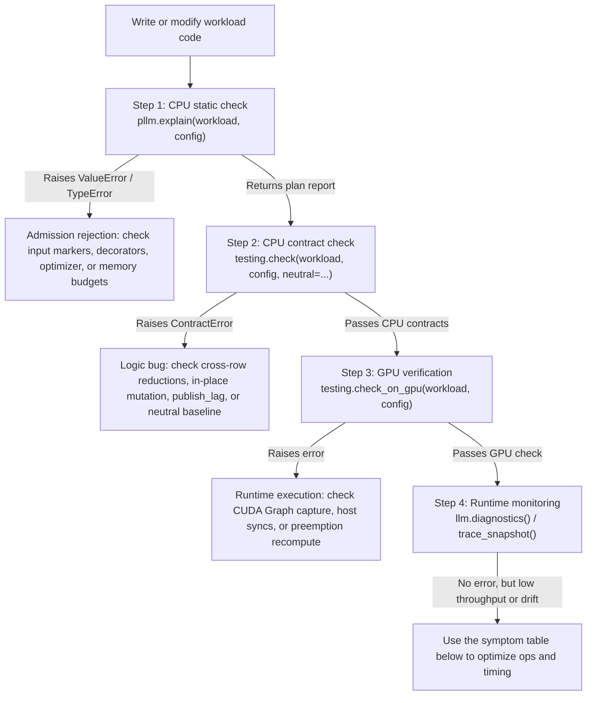

# Troubleshooting

When authoring or running a `pllm.Workload`, if you hit an exception, unexpected throughput drop, out-of-memory failure, or numerical drift, use this page to pinpoint the root cause and fix it systematically.

---

## 1. Quick Triage Workflow: CPU First, Then GPU

Do not debug directly on a multi-GPU cluster or a huge checkpoint. Follow this four-step triage path: **reproduce and isolate in seconds on CPU with `pllm.explain` and `testing.check`, then verify GPU runtime behavior with `check_on_gpu` and `diagnostics`**.



### Step 1: Run `pllm.explain` on CPU (Admission and Planning)

`pllm.explain` shares the exact same admission checks and memory planner as `pllm.make_llm`. Using only the model's `config.json` and `meta` tensors on CPU, it traces shapes in seconds without loading weights or initializing CUDA.

If your code violates static rules, `pllm.explain` immediately raises the exact same error as engine startup:
- Missing input marker defaults on method parameters (e.g., missing `= pllm.hidden(0)`);
- An undecorated method with no effect decorator (result goes nowhere);
- Multiple `@pllm.guide_sampling` methods declared;
- A `@pllm.train` method targeting a state that lacks an optimizer;
- An exported tensor exceeding the 32 KiB per-row limit;
- Insufficient memory budget (listed in `report.budget_errors`).

Even when no exception is raised, inspect the returned report: check whether `report.eager_reason` is empty (non-empty means the forward pass falls back to eager mode) and whether each method's `anchor` and `lane` (`side` stream vs. `main` stream) match expectations. See [Reading Costs: pllm.explain](../guides/explain.md).

### Step 2: Run `pllm.testing.check` on CPU (Algorithmic Contracts)

Once `pllm.explain` succeeds, run `pllm.testing.check` on CPU. It drives three fixed synthetic requests through the real planner and executor to verify that your tensor math satisfies pLLM's contracts:
- **Row mixing**: Whether you accidentally reduced or sorted across dimension 0 (e.g., `mean(0)`, `sum(0)`), breaking isolation between concurrent requests;
- **In-place mutation of borrowed views**: Whether you modified an input tensor or state parameter in place via `add_()`, `mul_()`, etc.;
- **Version visibility timing (`publish_lag`)**: Whether training updates and forward reads see the expected state versions;
- **Neutral baseline**: Whether setting intervention strength to 0 (passing `neutral=Workload(beta=0.0)`) yields strictly zero intervention output.

Any violation raises `pllm.testing.ContractError`. See [Checking Correctness](../guides/checking.md).

### Step 3: Run `pllm.testing.check_on_gpu` on GPU (Graph Capture and Device Execution)

CPU checks do not run the real model forward pass. For effects hooked inside model layers (`pllm.model.ActivationPatch`, `@pllm.custom_residual`, `@pllm.custom_attention`, `pllm.model.Adapter`), run `pllm.testing.check_on_gpu` on GPU to verify:
- Steady-state decode is captured into a CUDA Graph;
- Zero unexpected host syncs occur during decode steps (enforcing 0 CPU syncs);
- State recomputes cleanly on memory pressure / preemption.

### Step 4: Runtime Diagnostics with `llm.diagnostics()` and `llm.trace_snapshot()`

During live runs, if throughput lags or numerical behavior looks suspicious, inspect runtime diagnostics:
- `llm.diagnostics().eager_reason`: Empty string means whole-model CUDA Graph mode; otherwise names the exact fallback cause;
- `llm.diagnostics().numeric_health`: Reports NaN or Inf counts across state tensors;
- `llm.diagnostics().state_usage`: Tracks logical live bytes vs. physical allocated bytes;
- `llm.trace_snapshot()`: Shows timing breakdowns across main-stream and side-stream tasks as well as dropped exports (`export_dropped`).

---

## Minimal Diagnostic Example

Here is a self-contained runnable example using `Qwen/Qwen2.5-0.5B-Instruct` to run `pllm.explain` and `testing.check` on CPU:

```python
from dataclasses import dataclass

import torch
from torch import nn

import pllm
from pllm import testing
from pllm.workloads.esamp import ESampConfig, ESampWorkload

# 1. Declare model config (hidden size 896, 24 layers, vocab 151936)
config = pllm.ModelConfig("Qwen/Qwen2.5-0.5B-Instruct", max_num_seqs=8)

# 2. Construct the workload under test and its zero-strength neutral baseline
workload = ESampWorkload(ESampConfig(rank=4, intervention_beta=0.5))
neutral_workload = ESampWorkload(ESampConfig(rank=4, intervention_beta=0.0))

# 3. Step 1: Inspect execution plan & memory budgets on CPU (catches admission errors and eager fallback)
report = pllm.explain(workload, config)
assert report.eager_reason == "", f"Not in CUDA Graph: {report.eager_reason}"

# 4. Step 2: Verify request isolation, version lag, and neutral baseline on CPU
check_result = testing.check(workload, config, neutral=neutral_workload)
print("CPU checks passed:", check_result.passed)
```

To continue verification on GPU for CUDA Graph capture and runtime state:

```python
# check-docs: skip: requires a CUDA engine and GPU
# Step 3: Verify in-model ops and zero host syncs on GPU
print(testing.check_on_gpu(workload, config, neutral=neutral_workload))

# Step 4: Inspect runtime engine diagnostics
with pllm.make_llm(config, workload=workload) as llm:
    diag = llm.diagnostics()
    assert diag.eager_reason == "", f"Fell back to eager: {diag.eager_reason}"
    assert all(field.nonfinite_count == 0 for field in diag.numeric_health), "NaN/Inf detected in state"
```

---

## Common Error Lookup (Error → Why → Fix)

Every error message, its cause, and its fix are organized by topic in the [Error Catalog](../reference/errors.md); `...` denotes parts that vary with your code.

---

## No Exception Raised, Wrong Behavior (Symptom Guide)

Often your code runs without throwing, yet throughput collapses, VRAM overflows, or outputs drift slightly. The table below maps common symptoms to their physical causes and fixes. For further tuning techniques, see [Making Workloads Faster](faster.md).

| Symptom | Physical Mechanism & Cause | Diagnosis & Fix |
| :--- | :--- | :--- |
| **`eager_reason` non-empty<br>(no whole-model CUDA Graph)** | Certain declarations do not support whole-model graph capture (e.g., `@pllm.custom_forward` replaces the whole-model graph with per-slice captured graphs, or a method contains a non-traceable op). The cost depends on step duration: on RTX 4090 at 128 concurrency, 0.5B drops to ~49% of graph mode, while 7B is only ~2% slower. | Check the reason reported by `pllm.explain` or `llm.diagnostics().eager_reason`; set `ModelConfig(cuda_graphs=True)` so anything that breaks whole-model capture fails loudly at startup instead of silently degrading. |
| **Throughput far below native vLLM<br>(e.g., 10–20% of native)** | Common causes:<br>1. Dynamic attention (`kv.attend(q, topk=...)`) reduces KV reads, but unfused PyTorch scoring and gather overhead dwarfs the saved bandwidth (e.g., `QuestRead` in Example 10 runs at 13% of native on 7B);<br>2. Implicit CPU host sync inside a workload method;<br>3. A `placement="host"` lookup method also reads `pllm.hidden`, preventing scheduling at `request.prepare / side` and exposing a ~1.6 ms PCIe transfer (38.9 MB) outside the forward;<br>4. Multi-layer `pllm.layer_logits` triggers multiple full-vocabulary LM Head GEMMs. | 1. Use static layouts (`keep="window"` / `source=k`) to save KV VRAM, or implement scoring as a fused kernel (Examples 09, 10) for speed;<br>2. Remove all host syncs;<br>3. Split host lookups into a dedicated undecorated method reading only `pllm.input_tokens` and immutable state, passed via `pllm.result` to overlap on the `side` stream;<br>4. Replace multi-layer `layer_logits` with `@pllm.guide_sampling` to share the LM Head. See [Making Workloads Faster](faster.md). |
| **Tiny output difference vs. native vLLM at strength 0** | With `@pllm.custom_residual` or `ActivationPatch`, vLLM captures the model's un-fused original ops inside the CUDA Graph instead of Inductor-fused ops; default native vLLM runs fused ops, causing slight bf16 rounding differences. | Expected rounding variance. Compare against native vLLM in eager mode (should match bitwise), or run `pllm.testing.check_on_gpu`, which builds a matching native engine for bitwise comparison. |
| **Export drops rows or events<br>(`dropped_rows > 0`)** | `@pllm.export` guarantees **zero blocking**: to avoid stalling GPU compute, it uses a bounded pinned ring buffer (256-event queue, $\le 32\text{ KiB}$ per event). When consumers lag and the queue fills, it drops events by default (`overflow="drop"`, counted in `export_dropped`); when active rows per step or prompts in a `generate` call exceed `max_rows`, excess rows are truncated (counted in `event.dropped_rows`). | Increase `@pllm.export(max_rows=...)` to cover max concurrency or batch chunks; increase `every=...` (e.g., export every 4 steps); drain the consumer promptly; keep prompts per `generate` call within `max_rows`. |
| **`make_llm` hits OOM or capture-pool budget error** | To keep online training and state publishing inside CUDA Graphs, pLLM pre-allocates fixed pools at init. If default budgets plus vLLM weights and KV Cache exceed physical VRAM, allocation fails. `pllm.explain` lists exceeded bytes in `budget_errors`. | Tune `ExecutionOptions` against `pllm.explain`'s `memory` and `state` lines:<br>- `state_page_budget_bytes`: cap state-page memory (lower it, or move large read-only tables to `placement="host"`);<br>- `execution_peak_budget_bytes`: execution peak budget (workspaces + overlap buffers);<br>- `cuda_graph_pool_budget_bytes`: CUDA Graph pool budget (raise if complex slices or custom methods exhaust capture memory);<br>- `max_host_training_rows`: lower max host batch rows to cut peak memory;<br>Also consider lowering `gpu_memory_utilization` or `max_num_seqs`. |
| **Exception on preemption<br>(Preemption Rejection)** | When VRAM pressure triggers preemption and vLLM tries to evict and recompute a sequence's history, pLLM permits lossless recomputation only when request state is keyed solely by `request_id` (private copies) with no mutable cross-request instance state, `Imported` state, or external host inputs; any other overlay or mutable shared state cannot be reconstructed and raises an exception. | Raise `gpu_memory_utilization` (e.g., from 0.85 to 0.90) to give KV Cache more headroom and avoid preemption; reduce `max_num_seqs`; avoid mutable cross-request `InstanceState`. See [Performance and Memory](../explain/performance.md). |
| **Side-stream training (`side`) not overlapping with forward** | When `execution_peak_budget_bytes` falls between the two thresholds on `explain`'s `memory` line, pLLM downgrades side-stream tasks to inline execution on the main stream (`lane` flips from `side` to `main`); `publish_lag=0` also serializes training with the forward. | Check the `member` and `timing` lines in `explain`; keep the default `publish_lag=1`, or raise `execution_peak_budget_bytes` above the overlap threshold. See [Making Workloads Faster](faster.md), Section 3. |
| **NaN / divergence in long-sequence recurrences or online training** | When accumulators, carry fields, or `pllm.scan` coefficients run in low precision (BF16), rounding errors accumulate across steps. | Check field `dtype` values on `explain`'s `state` lines; declare `pllm.Field(..., dtype=torch.float32)` explicitly and use FP32 coefficients for `pllm.scan`; inspect `llm.diagnostics().numeric_health` at runtime. |
| **Wrong shape returned by `@pllm.guide_sampling`** | `@pllm.guide_sampling` must return `[rows, hidden_size]` (e.g., 896 on Qwen2.5-0.5B). pLLM checks the trailing dimension both at build/CPU check time and at runtime; returning a tensor of another width raises a shape error. | Verify that `@pllm.guide_sampling` returns `[rows, hidden_size]` matching the model's `hidden_size`. |
| **Certain host batch training rounds are much slower** | The first time a training batch shape (sequence count, length) appears, pLLM compiles the training step for that shape. | Once shapes stabilize, no recompilation occurs; use fixed batch shapes and exclude warmup rounds when benchmarking (see [Measuring Throughput Fairly](measure-throughput.md)). |
| **Crash or VRAM conflict when creating multiple engines in one process** | Each pLLM engine reserves its own GPU graph pools, state pages, and vLLM KV Cache. If a prior engine has not fully released its resources, VRAM stays pinned and subsequent engines fail to allocate. | Always use `with pllm.make_llm(...) as llm:` to release resources automatically on exit, or call `llm.close()` explicitly before creating a new engine. Engines using `@pllm.train_in_forward(visibility="exact")` currently cannot return all VRAM on close—launch subsequent engines in a new subprocess. |

---

## Self-Check Questions

1. **Question**: While implementing per-request online learning, you decorated your method with `@pllm.train(state="adapter")` and wrote `return loss.mean()` at the end. Running `testing.check` on CPU raised `training methods return one loss per row; pLLM reduces the selected rows per state`. Why does the framework forbid calling `.mean()` inside the method?
   <details><summary>Answer</summary>
   Because continuous batching packs multiple concurrent requests into each step, the framework needs one scalar loss per row (<code>[rows]</code>) to attribute gradients to each request's private state, mask padding rows, and run per-state optimizer updates. Reducing to a single scalar with <code>.mean()</code> mixes losses across different requests so individual request losses cannot be recovered. Cross-row reduction must be left to <code>@pllm.train(reduction="mean"|"sum")</code>.
   </details>

2. **Question**: You added a large `placement="host"` lookup table and wrote a single method that gathers from the table via `pllm.input_tokens` and gates the result using `pllm.final_hidden()`. Why did GPU throughput drop noticeably?
   <details><summary>Answer</summary>
   Because that method also reads <code>final_hidden</code>, it cannot start until the entire model forward finishes. As a result, the PCIe host-table transfer (~1.6 ms/step for 128 vocab-wide rows on 7B in [Performance and Memory](../explain/performance.md)) is completely exposed outside the forward pass instead of overlapping with it. The fix is to move the host gather into a dedicated undecorated helper reading only <code>input_tokens</code> and the table (which the planner schedules at <code>request.prepare / side</code> using 1/4 of SMs in the background), and read its output in the gating method via <code>pllm.result(...)</code>.
   </details>

---

## Next Steps

- Browse all error messages and exception types: [Error Catalog](../reference/errors.md)
- Learn how to systematically verify contracts on CPU and GPU: [Checking Correctness](../guides/checking.md)
- Analyze execution plans and memory budgets without a GPU: [Reading Costs: pllm.explain](../guides/explain.md)
- Learn how to avoid eager fallback and maximize overlap: [Making Workloads Faster](faster.md)
